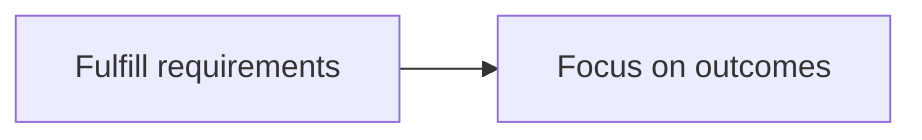

# Editorial rules

Cross-cutting rules for authoring and reviewing content in `src/content/`. These bind AI collaborators the same way `AGENTS.md`'s engineering rules do — they're not suggestions to weigh against convenience.

## Diagrams, flowcharts, and formulas: English labels, even in Chinese articles

Mermaid diagrams and math formulas use English node labels and variable names, in both `zh.md` and `en.md` — this is already how every existing diagram and formula on the site is written (verified: zero Chinese characters inside any `mermaid` block or KaTeX expression across the content tree). Keep it that way:



```
\text{Profit} = \text{Revenue} - \text{Cost}
```

Use Chinese inside a diagram or formula only when the concept has no natural English label and forcing one would be misleading (a proper noun, a term the piece is specifically about). Default to English; treat a Chinese label as the exception that needs a reason, not the baseline.

## A diagram earns its place by carrying an argument

A diagram belongs in a piece when the reader needs to see a structure that prose cannot hold: a capability space with layers, an ownership boundary, a decision procedure, or a lifecycle. Removing it should cost the reader something. A diagram added because a technical article is expected to have one is an AI signal (`agent/writing-style.md`), not a structural aid.

Match the diagram to the question it answers:

| Diagram | Question it answers |
| --- | --- |
| Structure map (house diagram) | What is the whole trying to achieve, and how does the capability space decompose? |
| Dependency diagram | What calls what, where does data flow, and where are the ownership boundaries? |
| Flowchart | How does a reader classify a case or make a decision? |
| State machine | How does something move through its lifecycle? |

`zh.md` and `en.md` keep the same nodes, layers, and relationships; only visible labels may differ, under the English-label rule above. The `.claude/skills/house-diagram` skill operationalizes the structure-map case.

## Analytical evidence sequence

When a piece in any collection makes a claim about a market, product, approach, or industry, do the research and judgment passes in this order before fixing the final argument. This is the canonical statement of the sequence; the category guides and the `write-*` skills cite it rather than restating it.

1. **Industry facts and scope** — collect dated, sourced facts and define the time window, population, and terms being used; distinguish observation from interpretation.
2. **Development and change** — trace what changed over time and test whether the apparent change is substantive or only a change in naming, packaging, or attention.
3. **Competitors, prior art, and alternatives** — identify the real competing options and the obvious alternative explanation or approach a knowledgeable reader would raise.
4. **Like-for-like comparison** — compare the options against shared dimensions and the actual constraints of the decision, not against marketing claims or incomparable feature lists.
5. **Pros and cons** — record benefits, costs, failure modes, and which party or user bears each trade-off; don't reduce this to a decorative scorecard.
6. **Conclusion and dialectical challenge** — write a provisional conclusion, then try to disprove it with counterexamples, omitted alternatives, selection effects, changing assumptions, and cases where the opposite choice is better.
7. **Bounded judgment** — keep only the conclusion that survives the challenge, state its conditions and limits, and make the practical implication clear.

Two constraints on how this shows up: the sequence belongs to the working process, so don't force seven visible sections, a competitor table, or literal `Pros` / `Cons` headings into prose that reads better as an essay; and the challenge in step 6 must happen after the comparison and before the conclusion is treated as final. Personal or reflective pieces are exempt unless they genuinely make an analytical comparative claim.

## AI-detection threshold

When an AI-text detector is run on a piece, **5% or below** is the bar it must clear before the piece enters the finalize/publish flow (see `CONTRIBUTING.md` for the human-facing publish process this sits inside, and the relevant `agent/category-guides/*.md` for the drafting order that leads up to it). This is not a proofreading nicety — a measured score over the threshold sends the content back for revision, full stop.

No detector is wired into this repository: nothing in `npm run publish:check` measures it, and no skill may report a percentage it did not actually measure (`.claude/skills/content-review`, `.claude/skills/humanize-writing`). So the pre-publish report must state which of two cases applies, and never leave it ambiguous:

- **A detector was run** — name the tool and the date, give the score, and revise anything above 5% before finalizing.
- **No detector was run** — say so plainly, and the qualitative AI-signal pass in `.claude/skills/content-review` carries this gate on its own judgment. An unrun check is reported as unrun, never as a pass.

Qualitative review assesses clarity, argument, fidelity, and the author's voice. A phrase, punctuation mark, sentence-length distribution, or detector score alone cannot establish authorship. Treat repeated framing and generic connective tissue as prompts to inspect the passage in context. Sentence-length uniformity alone is not a reason to revise; preserve deliberate cadence and structures carrying real information. `agent/writing-style.md` remains the voice reference, and `.claude/skills/humanize-writing` operationalizes this pass.

The project-local `.claude/skills/shuorenhua` package is the Chinese implementation layer for this pass. Use its scene, protected-span, severity, scope, and two-way fidelity rules after calibrating against the author's voice. The project-local `.claude/skills/humanizer` package is the English implementation layer; use it after 信达雅 translation review to audit English-specific AI patterns. Neither package authorizes invented personal detail, factual drift, detector evasion, or a change to publication state.

## Revision contract

Apply this contract to Chinese calibration, Chinese cleanup, English prose editing, and final review. The author's voice and the collection's register take precedence over generic cleanup heuristics.

1. **Set task and scope.** Identify source material, requested mode (draft / review / revision), locale, and permitted structural change. Existing writing defaults to local edits; restructuring requires an explicit request. Review returns findings and proposed repairs.
2. **Lock meaning before style.** Preserve entities, numbers and their subjects, conditions, negation, uncertainty, causal and temporal relationships, citations, code, and quotations. Existing specifics may replace a vague restatement; absent specifics become a question for the author. Abstract material stays abstract until evidence is supplied. Hypothetical examples must remain recognizable as examples and never become purported lived experience.
3. **Require a local reason to edit.** Identify the passage, concrete problem, voice/genre exemption, and smallest repair for each proposed change. Unmatched text stays unchanged during cleanup. Report factual or clarity issues on their own merits; editorial preference alone is not evidence of AI authorship.
4. **Protect ordinary language.** Questions, question headings, metaphors, inline parallelism, repeated technical nouns, passive constructions, long sentences, and ordinary list punctuation are valid forms. Their presence or frequency alone does not warrant rewriting. Preserve genuine changes of mind and informative contrasts; remove a contrast only when its setup invents a misconception or adds no meaning. Retain genre-appropriate numbering, including research sections and referenced steps.
5. **Read back both ways.** Every source claim and qualification must survive, and every output claim must have a source. Preserve headings, section order, lists, tables, and paragraph boundaries during cleanup unless the user authorized structural change. English sentence-level freedom remains governed by `translation-spec.md`.

A revision handoff records target files, source version, mode/scope, material gaps, representative edits with reasons, protected voice features, and unresolved issues. Keep it in the conversation or a requested working artifact, outside reader-facing prose. When nothing needs changing, report that outcome and finish.

## Maintaining cleanup rules

[Lieflat Less AI Tone](https://github.com/larashero3-dotcom/lieflat-less-ai-tone/blob/main/SKILL.md) and its [research notes](https://github.com/larashero3-dotcom/lieflat-less-ai-tone/blob/main/RESEARCH.md) inform the narrow-edit safeguards above. Its reported corpus results are external hypotheses for this author and these genres: the underlying corpus is unavailable for independent verification. Do not copy frequency ratios into project thresholds, infer authorship from a hit, or apply Chinese findings to English.

Before adding or broadening a cleanup rule, record its trigger, source/evidence limits, smallest allowed edit, and exemptions. Include an example that should change and an example that should remain intact. For automated matching, inspect up to 20 actual hits (all hits if fewer), including legitimate author/genre uses, before accepting aggregate counts; document how many were inspected and which were false positives. Count comparable units and exclude frontmatter, code, quotations, tables, and other protected spans as appropriate. These diagnostics advise review; making them publication blockers requires a separate approved policy change.

Use `agent/writing-check-cases.md` to review workflow and preservation boundaries when changing writing rules or skills. This manual review is not evidence of detector accuracy or a measured model benchmark.

## Review and revision are separate stages

A review identifies the passages, evidence, and conditions that block readiness; it does not silently revise the content. Use a review-only pass when the request is to assess a draft or decide publication readiness. A requested revision is a separate pass, followed by a new review. Record a final GO against the target files as reviewed; a later Chinese change to a claim, structure, or frontmatter invalidates the related translation review and final GO. A GO remains a recommendation and never replaces owner approval or changes a publication state.

## English translation standard: 信达雅, not literal translation

Chinese is the source locale; every published English page is a translation of a Chinese original (see `agent/translation-spec.md` for mechanics — quoting, what to translate vs. copy verbatim, `translationKey` wiring). The *quality* bar for that translation is Yan Fu's three-part standard, in this order of priority when they trade off:

1. **信 (faithful)** — the English carries the same meaning, argument structure, and claims as the Chinese. Nothing added, nothing dropped, no softening or hardening of a claim's certainty.
2. **达 (expressive/fluent)** — reads as English written by someone thinking in English, not as Chinese re-cased into English words. A literal, clause-for-clause translation that preserves Chinese sentence structure is a failure at this level even if every word is individually correct.
3. **雅 (elegant)** — the English carries the register and rhetorical moves documented in `agent/writing-style.md` (the negation-reframe move, claims cashed out into concrete criteria, non-absolute hedging built into the sentence), not flattened into generic translated-technical-writing English.

A translation that is faithful but not fluent is unpublishable; a translation that is fluent but not faithful is worse. When forced to trade 达 against 雅, prefer 达 — Yan Fu himself treated fluency as the more load-bearing of the two, since a translation nobody can follow is useless regardless of how faithful or elegant it is underneath.

English-side review (published `en.md` files carry `translationStatus: reviewed`) checks against this same 信达雅 standard, not against a literal back-translation match to the Chinese. The `.claude/skills/xinda-ya-translation` skill operationalizes this check.
