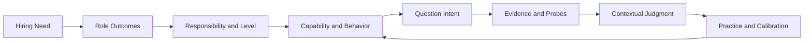

**Interviews shouldn't be guesswork: know the role, show the evidence**

Over the past five years I've interviewed about 1,000 candidates, and one gap keeps showing up. Job descriptions ask for judgment, influence, and a focus on results, yet the interview often comes down to one or two questions and a lot of guessing. Candidates guess what the interviewer wants to hear. Interviewers judge ability by how smoothly a story is told. And the team may never agree on what this hire is supposed to solve.

**Interview Compass** is the bilingual, open reference site where I've written down ten years of my hiring method. The idea fits in one line: **know the role, show the evidence.** Candidates learn what a question is really testing and how to back their stories with evidence. Interviewers learn what to probe. Hiring managers start by saying why they're hiring. → [Open the site](https://liyuk.github.io/interview-compass/) · [GitHub](https://github.com/Liyuk/interview-compass)

> Built from ten years of my own work, and informed by screening criteria from some leading internet companies.
>
> - ~**1,000** candidates interviewed and ~**300** people coached in the past five years
> - **200+** managers have attended my manager training
> - Used in promotions from junior roles up to **second-line managers**
> - The earlier version reached roughly **20,000–30,000** reads

I have organized these experiences into role responsibilities, question intent, signals to look for, and evidence standards, explaining why a criterion exists and what kind of answer can support a judgment. The site reflects my interpretation of this material. Any specific role still needs to be understood in its own context.

> **The 30-second version**
>
> - The problem: both sides of the interview are guessing, and role requirements never turn into evidence anyone can observe.
> - The method: hiring need → outcomes and responsibility → capability and behavior → question intent → evidence and probes → contextual judgment.
> - Candidates: organize an experience in six steps, and separate the team's results from your own contribution.
> - Interviewers and hiring managers: start by stating why you're hiring, then probe for evidence, treating the signal list as prompts for follow-up rather than a checklist.
> - Boundaries: no model answers, no automatic scoring; people make the final judgment.

## Start by clarifying why the role is needed

Hiring starts with the reason for the role; interview questions come later. A hiring manager first needs to explain why the team needs someone, what outcomes the role should deliver, what the person will own, and where the work depends on others. Otherwise, words such as “senior” and “influential” can remain little more than impressions. An individual contributor and a manager may work in the same situation, but their areas of responsibility, decision-making authority, and accountability can differ.

Once the role and its scope are clear, it becomes easier to translate expectations into observable capabilities and behaviors. Questions should then gather the information needed for a judgment; covering a question type is secondary. Answers also need to return to the original goal and constraints: what the candidate owned, what choices they made and why, what those choices cost, and what the result and evidence show.

> An outcome does not by itself tell us who caused it.

Without context and attribution, an interviewer may hear an impressive ending without understanding how it came about.

This is the chain I use to think about interviews and organize Interview Compass:

The chain describes an order of understanding, and anyone can enter it at whichever link fits. In an interview, a story might start with the outcome, a failure, or a technical trade-off. What matters is whether the listener can follow the links between the goal, the candidate’s responsibility, their judgment, their actions, and the evidence. Causality matters here: what else affected the outcome, what did the candidate actually change, and how far can the evidence support a conclusion?

## Candidates: tell one experience clearly in six steps

I want the practice material to answer two questions. First, why is this question being asked? Second, how can someone tell an experience clearly enough to support a judgment? The first calls for an analysis of the question’s goal, the situations where it applies, and other plausible interpretations. The second is about helping the listener follow the causal thread: What needed to be solved? Why did the candidate need to get involved? What did they own? What judgment did they make? What happened as a result, and what evidence suggests their actions contributed to it?

A candidate can organize an answer in this order:

1. **Lead with the point:** In a sentence or two, state the judgment or outcome the story will support so the listener knows where it is going.
2. **Give the necessary context:** Explain the goal, constraints, and main difficulty needed to understand the question. Save the rest of the project for follow-up questions.
3. **Clarify your responsibility:** Separate what the team accomplished from what you owned, including your decision-making authority and collaboration boundaries.
4. **Explain your judgment:** Describe the problem you saw, the options you considered, and why you chose one under those conditions. Include the cost of the alternatives you set aside.
5. **Connect actions to results:** Choose the actions that show your reasoning, then give the outcome or evidence that can be checked. If other people or external conditions also shaped the outcome, say so.
6. **Close with what the story supports:** State what this experience can and cannot demonstrate. When relevant, explain what you changed afterward.

This order is a scaffold for organizing a story; there is no need to recite it as headings. A story can begin wherever it best makes the point. Starting with the point and then adding only the context the listener needs is often easier to follow than recounting everything chronologically. Expand the part the interviewer asks about. A good answer responds to the question’s assessment goal, and it can use as many of the six steps as that goal needs.

The same structure helps candidates show their strengths. If you want to show that you can move cross-team work forward, saying “I’m good at communication” is only a starting point. Explain where the teams’ goals differed, what coordination or decision-making you owned, what you did, and what changed as a result. Point to evidence that supports your contribution. If the team produced the outcome together, distinguish its shared result from your own role.

> A strength is not a label you give yourself. It is a conclusion the listener can draw from your decisions and evidence.

### Why STAR isn't enough

Frameworks such as STAR can help organize a story, but situation, task, action, and result do not answer everything. STAR does not tell a candidate what the interviewer is assessing, and it does not establish that the candidate caused the result. Interview Compass brings question intent and evidence standards into the preparation process. Candidates first work out what the question is meant to assess, then choose the parts of an experience that speak to it. That way, each story is aimed at what its own question is assessing.

### Four evidence levels for one question

Consider a question in the library: an AI assistant times out while issuing a refund, so the system does not know whether the refund went through. Retrying automatically could issue it twice. The point of the exercise is to distinguish checking a status from issuing another side-effecting operation, determine whether the current state is known, consider whether the user’s authorization still applies, and explain how to pause, verify, and recover when the outcome cannot be confirmed. Saying the word “idempotency” is only where it begins. The question analysis lays out evidence anchors at different levels and suggests follow-up questions.

The evidence levels for this question are specific:

| Level | What the answer does | What it shows |
| --- | --- | --- |
| 1 | Retries every time after a timeout | Duplicate side effects are left unaddressed |
| 2 | Names idempotency or checks the status first | Basic risk control |
| 3 | Also weighs the operation’s side effects and the user’s authorization | A more complete judgment |
| 4 | If the external state still cannot be confirmed, explains how to pause, reconcile, and take responsibility for recovery | The failure path has been thought through |

> Practice means understanding where these distinctions come from, so the reasoning can be derived again in a different situation.

Candidates can answer a question before reading its analysis, then ask what they left out: the goal, their responsibility, the trade-offs, or the evidence? An answer that explains the conditions behind an action shows the underlying rule is clear; the right terminology alone is only part of it. Applying the same reasoning to a different experience helps show whether it transfers. The question analysis and evidence references on a four-level scale are there to calibrate thinking.

## How candidates, interviewers, and hiring managers use it

| Perspective | What it's for | Where to start | What to watch for |
| --- | --- | --- | --- |
| Candidate | Understand how the role is defined, judge fit, prepare stories | Role profiles and stage guides, then question intent and evidence references | Test the expectations against your own experience, and consider whether the organization fits |
| Interviewer | Gather enough information from a question to support a judgment | Angles, follow-up prompts, and comparison dimensions in the question analysis | Adapt to the candidate's answers; use the signal list as prompts for follow-up |
| Hiring manager | Answer “Why are we hiring?” and clarify role requirements and assessment criteria | Roles and responsibility stages, the capability model | Connect team goals to role responsibilities, expected outcomes, and risks first |

For candidates, the first task is to understand how the role is defined: what problem it exists to solve, what outcomes it owns, where its decision-making and collaboration boundaries lie, and what level of responsibility it carries. Guessing which questions might come up can wait. Only then can you judge whether your experience and capabilities fit, what gaps you may need to address, and whether you want the work the role entails. The role profiles and stage guides provide a reference point. From there, candidates can use question intent and evidence references to choose relevant experiences and explain the goals, responsibility, judgment, and results. They still need to test the expectations against their own experience and consider whether the organization fits. The material is a reference to compare against; the answer itself has to come from your own experience.

Interviewers need to gather enough information from a question to support a judgment. The question analysis offers relevant angles, follow-up prompts, and comparison dimensions. It can help interviewers develop a question and check the context, individual contribution, trade-offs, and attribution behind a result. In the interview itself, they still need to adapt their questions to the candidate’s answers, using the list of signals as prompts for follow-up rather than as a checklist. A reliable assessment starts with clear role goals; even a thorough question framework depends on them.

Hiring managers need to answer “Why are we hiring?” They have to connect team goals to role responsibilities, expected outcomes, and risks, then agree with interviewers on what to assess. When the group discusses a candidate’s experience, the focus belongs on how that experience relates to the actual work; how polished the story sounds matters less. The site gives managers a reference for structuring that thinking. Defining levels, designing the full hiring process, and making the hiring decision stay with each company.

The three perspectives have different entry points, but share the same underlying material. Roles and responsibility stages describe expectations. The capability model defines areas to examine. Question analyses explain assessment intent and evidence. Candidates use this material to prepare and judge fit, interviewers to shape questions, and hiring managers to clarify role requirements and assessment criteria.

## What's on the site

Every audience shares one question bank and simply starts from a different entry point:

- **Chinese and English content.**
- **Role models** across six engineering specializations and multiple responsibility stages, which help narrow the scope.
- **Eight capability domains.**
- **Goal paths and curated sets** that let readers start with a purpose.
- **A searchable, filterable full library**, filterable by capability, scenario, topic, and format.
- **Question analyses**: a question page shows its intent, signals, possible interpretations, context probes, trade-offs, and evidence anchors. Questions with an individual analysis have a full question-level breakdown; shared reading prompts are labeled as rule-based references.
- **AI analysis prompts**: a question page can generate an analysis prompt for the external AI tool a reader chooses. The site does not collect answers or send them anywhere.

```mermaid
flowchart LR
    subgraph Inputs[Role and Hiring Context]
        direction TB
        I1[Hiring Goals]
        I2[Role and Responsibility Stage]
        I3[Eight Capability Domains]
    end
    subgraph Library[Question Reference]
        direction TB
        Q1[Bilingual Question Bank]
        Q2[Question Intent and Signals]
        Q3[Probes and Evidence Anchors]
    end
    subgraph Entry[Reader Entry Points]
        direction TB
        E1[Candidate Preparation]
        E2[Interviewer Design]
        E3[Hiring Manager Alignment]
    end
    Inputs --> Library
    Library --> Entry
    Entry --> O[People Apply Context and Make Decisions]
```

The diagram shows how the content relates, independent of the order in which the site runs. Readers can enter in different places, but the links between role expectations, question intent, and evidence should remain consistent. Roles and organizations vary, so people still make the final judgment.

## How this differs from mock interviews and AI scoring

Public question banks and answer frameworks make it easier to look things up and study independently. Human or AI mock interviews are better suited to practicing how to communicate under pressure. Automated scoring can return feedback quickly. The [Interviewing.io homepage](https://interviewing.io/) puts mock interviews with senior engineers and AI-led interviews up front, alongside expert feedback; [ClearRound](https://clearround.io/) brings role-specific tracks, voice-based practice, structured frameworks, and AI grading into one practice flow (both also provide questions and frameworks; this comparison describes the emphasis of their public product pages). Interview Compass starts with a reference layer for judgment: it connects hiring goals, responsibility stages, question intent, and evidence, so the reasoning can be revisited and recombined, it becomes easier to explain why a question is relevant or what an answer is missing, and the hiring team’s role and evidence criteria sit in the same chain. The trade-off: live interview practice and delivery practice belong to mock interviews, and whether someone fits a particular team is judged in the real situation. These approaches complement each other. Scoring depends on whether its dimensions match the role and whether the feedback explains its reasoning; a reference framework asks readers to apply it to the situation in front of them. My choice was to make the basis for a judgment easier to see first.

## Boundaries and risks

There is also a practical risk: evidence anchors can easily be used as a checklist or misread as a universal score. The site therefore treats the anchors as references for explaining differences, and keeps the context probes and alternative interpretations alongside them. Reaching a conclusion about a person takes that context; matching answers against the entries is not enough.

The question analyses and the four-level evidence references are not model answers, and the site does not automatically score candidates. The site as a whole remains a heuristic reference, not a validated universal leveling standard. Readers need to account for the role’s scope, evaluation practices, and team constraints. Candidates also need to practice with their own experience beyond the evidence anchors.

The questions I hope readers carry with them are: What is this question trying to find out? What assumptions does the judgment depend on? What evidence can distinguish a visible outcome from someone’s actual contribution? If those questions help candidates explain their strengths, interviewers gather more useful information, and hiring managers state their reasons for hiring more clearly, then Interview Compass has helped.

> 👉 [Try Interview Compass](https://liyuk.github.io/interview-compass/en/). Pick the candidate or interviewer path and try one question.
>
> ⭐ If it helps, [star the repo on GitHub](https://github.com/Liyuk/interview-compass) or open an issue with a question you'd like covered.
