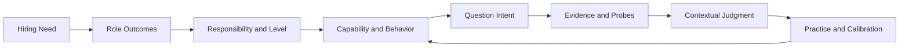

```mermaid
flowchart LR
    subgraph Inputs[Role and Hiring Context]
        direction TB
        I1[Hiring Goals]
        I2[Role and Responsibility Stage]
        I3[Eight Capability Domains]
    end
    subgraph Library[Question Reference]
        direction TB
        Q1[Bilingual Question Bank]
        Q2[Question Intent and Signals]
        Q3[Probes and Evidence Anchors]
    end
    subgraph Entry[Reader Entry Points]
        direction TB
        E1[Candidate Preparation]
        E2[Interviewer Design]
        E3[Hiring Manager Alignment]
    end
    Inputs --> Library
    Library --> Entry
    Entry --> O[People Apply Context and Make Decisions]
```

There's a disconnect I keep noticing in interviews. Job descriptions ask for judgment, influence, and a focus on results, yet an interview may rely on one or two questions to guess how those qualities show up in practice. Candidates try to guess what the interviewer wants to hear. Interviewers infer ability from how smoothly someone tells a story. The hiring manager may reach the end of the process only to find that the group never agreed on the problem this person was supposed to solve.

I built Interview Compass as a bilingual reference site to work through these questions. I see it as a way to assess people in interviews and promotion reviews, as well as a framework for understanding roles and explaining experience. Hiring teams first clarify the problem a role needs to solve, then use structured questions to look for evidence of capability. Candidates can use the same framework to understand evaluation criteria, shape their stories, and decide whether a role fits. You can [visit the Interview Compass site](https://liyuk.github.io/interview-compass/).

This approach draws on what I learned and synthesized over the past ten years at work, as well as some of the criteria leading technology companies use to evaluate candidates. Over the past five years, I have interviewed about 1,000 candidates and coached about 300 people. More than 200 people have also attended my manager training sessions. I have used the approach in promotion cases across levels, from junior roles through second-line management. An earlier version of the site drew roughly 20,000 to 30,000 views. I have organized these experiences into role responsibilities, question intent, signals to look for, and evidence standards, explaining why a criterion exists and what kind of answer can support a judgment. The site reflects my interpretation of this material. Any specific role still needs to be understood in its own context.

## Start by clarifying why the role is needed

Hiring should not start with interview questions. A hiring manager first needs to explain why the team needs someone, what outcomes the role should deliver, what the person will own, and where the work depends on others. Otherwise, words such as “senior” and “influential” can remain little more than impressions. An individual contributor and a manager may work in the same situation, but their areas of responsibility, decision-making authority, and accountability can differ.

Once the role and its scope are clear, it becomes easier to translate expectations into observable capabilities and behaviors. Questions should then gather information needed for a judgment, rather than simply cover a certain question type. Answers also need to return to the original goal and constraints: what the candidate owned, what choices they made and why, what those choices cost, and what the result and evidence show. An outcome does not by itself tell us who caused it. Without context and attribution, an interviewer may hear an impressive ending without understanding how it came about.

This is the chain I use to think about interviews and organize Interview Compass:

This is not a form everyone has to fill out in order. In an interview, a story might start with the outcome, a failure, or a technical trade-off. What matters is whether the listener can follow the links between the goal, the candidate’s responsibility, their judgment, their actions, and the evidence. Causality matters here: what else affected the outcome, what did the candidate actually change, and how far can the evidence support a conclusion?

## Training means understanding the rules behind the question

I want the practice material to answer two questions. First, why is this question being asked? Second, how can someone tell an experience clearly enough to support a judgment? The first calls for an analysis of the question’s goal, the situations where it applies, and other plausible interpretations. The second is about helping the listener follow the causal thread: What needed to be solved? Why did the candidate need to get involved? What did they own? What judgment did they make? What happened as a result, and what evidence suggests their actions contributed to it?

A candidate can organize an answer in this order:

1. **Lead with the point:** In a sentence or two, state the judgment or outcome the story will support so the listener knows where it is going.
2. **Give the necessary context:** Explain the goal, constraints, and main difficulty needed to understand the question. Do not retell the entire project from the beginning.
3. **Clarify your responsibility:** Separate what the team accomplished from what you owned, including your decision-making authority and collaboration boundaries.
4. **Explain your judgment:** Describe the problem you saw, the options you considered, and why you chose one under those conditions. Include the cost of the alternatives you set aside.
5. **Connect actions to results:** Choose the actions that show your reasoning, then give the outcome or evidence that can be checked. If other people or external conditions also shaped the outcome, say so.
6. **Close with what the story supports:** State what this experience can and cannot demonstrate. When relevant, explain what you changed afterward.

This order is a scaffold for organizing a story, not a set of headings to recite. A story does not have to begin with the earliest event. Starting with the point and then adding only the context the listener needs is often easier to follow than recounting everything chronologically. Expand the part the interviewer asks about. A good answer responds to the question’s assessment goal; it does not have to cover all six steps every time.

The same structure helps candidates show their strengths. If you want to show that you can move cross-team work forward, saying “I’m good at communication” is not enough. Explain where the teams’ goals differed, what coordination or decision-making you owned, what you did, and what changed as a result. Point to evidence that supports your contribution. If the team produced the outcome together, distinguish its shared result from your own role. A strength is not a label you give yourself. It is a conclusion the listener can draw from your decisions and evidence.

Frameworks such as STAR can help organize a story, but situation, task, action, and result do not answer everything. STAR does not tell a candidate what the interviewer is assessing, and it does not establish that the candidate caused the result. Interview Compass brings question intent and evidence standards into the preparation process. Candidates first work out what the question is meant to assess, then choose the parts of an experience that speak to it. That keeps every story from turning into the same answer.

Consider a question in the library: an AI assistant times out while issuing a refund, so the system does not know whether the refund went through. Retrying automatically could issue it twice. The point of the exercise is not to repeat the word “idempotency.” It is to distinguish checking a status from issuing another side-effecting operation, determine whether the current state is known, consider whether the user’s authorization still applies, and explain how to pause, verify, and recover when the outcome cannot be confirmed. The question analysis lays out evidence anchors at different levels and suggests follow-up questions.

The evidence levels for this question are specific. Retrying every time after a timeout fails to account for duplicate side effects. Naming idempotency or checking the status first shows basic risk control. A stronger answer also considers the operation’s side effects and the user’s authorization. If the external state still cannot be confirmed, explaining how to pause, reconcile, and take responsibility for recovery shows that the candidate has considered the failure path. Practice means understanding where these distinctions come from, so the reasoning can be derived again in a different situation.

Candidates can answer a question before reading its analysis, then ask what they left out: the goal, their responsibility, the trade-offs, or the evidence? If an answer uses the right terminology but does not explain the conditions behind an action, the underlying rule may not be clear yet. Applying the same reasoning to a different experience helps show whether it transfers. The question analysis and evidence references on a four-level scale are there to calibrate thinking. They are not model answers, and the site does not automatically score candidates.

## Three perspectives, one shared set of reference material

For candidates, the first task is to understand how the role is defined, not to guess which questions might come up: what problem it exists to solve, what outcomes it owns, where its decision-making and collaboration boundaries lie, and what level of responsibility it carries. Only then can you judge whether your experience and capabilities fit, what gaps you may need to address, and whether you want the work the role entails. The role profiles and stage guides provide a reference point. From there, candidates can use question intent and evidence references to choose relevant experiences and explain the goals, responsibility, judgment, and results. They still need to test the expectations against their own experience and consider whether the organization fits. The material is not a script to copy.

Interviewers need to gather enough information from a question to support a judgment. The question analysis offers relevant angles, follow-up prompts, and comparison dimensions. It can help interviewers develop a question and check the context, individual contribution, trade-offs, and attribution behind a result. In the interview itself, they still need to adapt their questions to the candidate’s answers. A list of signals should not become a checklist. If the role’s goals are unclear, even a thorough question framework will not make the assessment reliable on its own.

Hiring managers need to answer “Why are we hiring?” They have to connect team goals to role responsibilities, expected outcomes, and risks, then agree with interviewers on what to assess. When the group discusses a candidate’s experience, it needs to consider how that experience relates to the actual work, rather than simply comparing who tells the more polished story. The site gives managers a reference for structuring that thinking. It does not define a company’s levels, design its full hiring process, or make the hiring decision.

The three perspectives have different entry points, but share the same underlying material. Roles and responsibility stages describe expectations. The capability model defines areas to examine. Question analyses explain assessment intent and evidence. Candidates use this material to prepare and judge fit, interviewers to shape questions, and hiring managers to clarify role requirements and assessment criteria.

## Why build a reference site

I looked at a few adjacent approaches. Public question banks and answer frameworks make it easier to look things up and study independently. Human or AI mock interviews are better suited to practicing how to communicate under pressure. Automated scoring can return feedback quickly. The [Interviewing.io homepage](https://interviewing.io/) puts mock interviews with senior engineers and AI-led interviews up front, alongside expert feedback. [ClearRound](https://clearround.io/) brings role-specific tracks, voice-based practice, structured frameworks, and AI grading into one practice flow. Both also provide questions and frameworks. This comparison describes the emphasis of their public product pages, not a full inventory of every feature.

Interview Compass starts with a reference layer for judgment: it connects hiring goals, responsibility stages, question intent, and evidence so people in different roles can use the same material to prepare, design interviews, and calibrate discussions. The benefit is that the reasoning can be revisited and recombined. It becomes easier to explain why a question is relevant or what information an answer is missing. Compared with products that focus on practice performance and feedback, this approach also puts the hiring team’s role and evidence criteria into the same chain. The cost is clear too: the site cannot put someone through a live interview, help them practice delivery, or establish whether they fit a particular team.

These approaches do different jobs. Someone who needs to practice under pressure may benefit more from a human or AI mock interview. Someone looking for quick feedback on delivery may find automated evaluation a useful starting point. Someone who first needs to understand the links between role requirements, question intent, and evidence may get more from a reference framework. Scoring depends on whether its dimensions match the role and whether the feedback explains its reasoning. A reference framework has a different limit: readers still have to apply it to the situation in front of them. My choice is not a claim that one approach is more advanced. I wanted to make the basis for a judgment easier to see.

## Site structure: different entry points, shared evidence

The site does not maintain a separate question bank for each audience. Goal paths and curated sets let readers start with a purpose. Role and responsibility-stage profiles help narrow the scope. The full library can be filtered by capability, scenario, topic, and format. A question page then shows its intent, signals, possible interpretations, context probes, trade-offs, and evidence anchors. Only questions with an individual analysis have a full question-level breakdown. Shared reading prompts are labeled as rule-based references.

The diagram shows how the content relates, not the order in which the site runs. Readers can enter in different places, but the links between role expectations, question intent, and evidence should remain consistent. Roles and organizations vary, so people still make the final judgment. A question page can also generate an analysis prompt for the external AI tool a reader chooses. The site does not collect answers or send them anywhere.

The current site includes Chinese and English content, role models across six engineering specializations and multiple responsibility stages, eight capability domains, goal paths, curated sets, a searchable and filterable question bank, and question analyses. It remains a heuristic reference, not a validated universal leveling standard. Readers need to account for the role’s scope, evaluation practices, and team constraints. Candidates also need to practice with their own experience rather than rely on evidence anchors alone.

The questions I hope readers carry with them are: What is this question trying to find out? What assumptions does the judgment depend on? What evidence can distinguish a visible outcome from someone’s actual contribution? If those questions help candidates explain their strengths, interviewers gather more useful information, and hiring managers state their reasons for hiring more clearly, then Interview Compass has helped.
