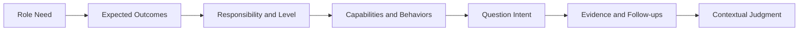
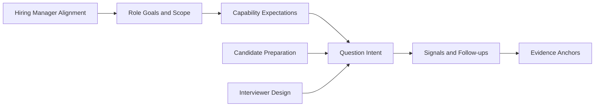

Over the past five years, I have interviewed about 1,000 candidates. The same gap kept showing up: job descriptions ask for judgment, influence, and ownership of results, but the interview can turn into guesswork. Candidates try to infer what the interviewer wants to hear. Interviewers may infer ability from how smoothly a story is told. By the end, the group may still not have agreed on what the role needs this person to solve.

I shaped Interview Compass from a decade of work, informed in part by screening criteria used at some leading internet companies. It is a bilingual interview and promotion reference. The central idea is simple: **Know the role. Show the evidence.** Candidates can learn what a question is trying to assess and support their account with experience. Interviewers and hiring managers can use the same material to define the role, probe for evidence, and align their judgments.

> In the past five years, I have interviewed about 1,000 candidates and coached about 300 people.
> More than 200 managers have attended my management training. The method has also been used in promotions from junior roles through second-line management.
> An earlier version received roughly 20,000–30,000 reads.

### The idea in 30 seconds

- **The problem:** Role goals and responsibilities often remain vague, so both sides guess at what a question or answer means.
- **The method:** Role needs → outcomes and responsibility → capabilities and behaviors → question intent → evidence and follow-ups → judgment in context.
- **For candidates:** Understand the role and assess fit, then tell a story that connects goals, responsibility, decisions, actions, and results.
- **For interviewers and managers:** State why the team is hiring and what the role owns, then ask for evidence and calibrate the judgment.
- **The boundary:** Analysis and evidence anchors help people understand the criteria. They do not prescribe one answer or make hiring and promotion decisions.

## Know the role. Show the evidence.

Hiring should start with why the team needs someone. A manager needs to explain the problem to solve, the outcomes the role should own, and its responsibility, decision, and collaboration boundaries. Words such as “senior” or “influential” become assessable only when tied to a role and its scope.

Once the goal is clear, the team can identify the capabilities and behaviors it needs, then design questions that gather useful information. A candidate’s account should follow the same logic: What was the goal? What were you responsible for? Which decisions and trade-offs did you make? What did you do, and what outcome or checkable evidence followed? An outcome alone does not show who caused it; context and personal contribution still need to be established.

This sequence helps both sides find the basis for a judgment. It is not a script to recite in order. An interview answer may begin with a result, a failure, or a technical trade-off. What matters is whether the listener can follow the links between the goal, the candidate’s responsibility, their decisions, their actions, and the evidence.

## Candidates: make a story clear enough to assess

Start with a target role. Understand the problem it needs to solve, its scope, and its level; then choose an experience that is relevant. Use these six checks to organize the story:

1. **Lead with the point:** In a sentence or two, say what this experience can show.
2. **Add the necessary context:** Explain the goal, constraints, and key difficulty. Keep only what the listener needs to follow the decision.
3. **Clarify responsibility:** Separate the team’s result from your part, and explain your authority and collaboration boundaries.
4. **Show the judgment:** Name the problem you saw, the options you compared, why you chose one under those conditions, and what the alternatives would have cost.
5. **Connect action to outcome:** Focus on the actions that reveal your reasoning, then share the result and evidence that can be checked. Include external factors when they affected the outcome.
6. **Set the limits:** Say what this experience supports and what would need more evidence.

These steps are a way to organize material, not a template to memorize. The listener should be able to reconstruct the situation: what needed to change, what you owned, why you acted as you did, and what happened next. If an interviewer probes one part, expand that part.

> A strength is not a label you give yourself. It is a conclusion the listener can draw from your decisions and evidence.

STAR can help structure a story around situation, task, action, and result. Those four elements alone do not show what the question is testing or establish that the result came from your contribution. Connecting role expectations, question intent, personal responsibility, and the basis for the outcome gives both sides something specific to discuss.

### One question, four levels of evidence

Consider this question: an AI assistant times out after initiating a refund, and the system cannot tell whether the refund completed. A direct retry could refund twice. The difference between answers is not whether someone can name idempotency; it is whether they address the unknown state, user authorization, and responsibility for recovery.

| Reference level | What the answer does | What it can support |
| --- | --- | --- |
| 1 · Needs verification | Treats the timeout as a failure and retries without distinguishing completed, incomplete, and unknown states. | Does not yet explain how duplicate side effects are controlled. |
| 2 · Basic safe path | Uses an idempotency key or checks operation status to avoid executing the same refund twice. | Shows a basic understanding of retry protection. |
| 3 · Handles key trade-offs | Compares retrying, checking status, pausing, and manual verification; considers authorization timing, partial completion, and dependency failures. | Shows an ability to design for risk and context. |
| 4 · Owns recovery | Explains reconciliation, recovery, authorization changes, and ownership when the partner’s status cannot be checked. | Accounts for abnormal states and what happens next. |

[Read the full question analysis and follow-ups](https://liyuk.github.io/interview-compass/en/questions/a-ai-engineering-agent-duplicate-side-effect/).

These levels are evidence references for this question, not a universal score for every role. Change the scope, dependency, or risk and the basis for judgment may change too.

## How candidates, interviewers, and managers use it

| Role | First question to answer | How to use the site | What to keep in view |
| --- | --- | --- | --- |
| Candidate | What does this role need, and does my experience fit? | Read the role and responsibility-stage profile, find relevant questions, and organize a story around its goal, ownership, decisions, actions, and evidence. | Use your own experience. Do not turn an evidence anchor into a model answer. |
| Interviewer | What information would support a judgment about this candidate? | Start with question intent, compare approaches, and probe context, personal contribution, trade-offs, and attribution. | Follow the answer instead of treating a signal list as a checklist. |
| Hiring manager | Why are we hiring, and what will this role own? | Define the goal, scope, and expected outcomes, then align the interview team on what to examine. | The hiring team has to define its own criteria for the role and organization. |

The three audiences enter through different paths, but the material underneath is shared: roles and responsibility stages describe expectations, question analysis explains intent, and evidence references help identify what is missing from an answer.

## Why start with a reference site

Live or AI mock interviews help people practice delivery, pace, and pressure. Immediate feedback can also show candidates what to practice next. For example, [interviewing.io](https://interviewing.io/) offers human and AI mock interviews, while [ClearRound](https://clearround.io/) describes voice mocks, AI feedback, and structured frameworks as part of its product. Those approaches focus on practice and feedback.

I started Interview Compass as a reference because candidates often need to understand the role and the question before practice begins. Interviewers and managers also need material they can discuss together. The site first lays out why a question is asked, what to observe, and what evidence can support a judgment, so the same basis can serve both sides of the interview table. It cannot replace live practice or make a hiring decision. When the problem is delivery or performance under pressure, a mock interview is more direct.

## What is inside

Interview Compass currently includes:

- Goal-based paths for candidate preparation, interviewer evidence gathering, hiring, and promotion.
- Role references across six engineering specializations and different responsibility stages.
- Eight capability domains, curated question sets, and a filterable bilingual question bank.
- Individually reviewed analysis for selected core questions: intent, signals, context probes, trade-offs, and evidence anchors.
- Prompts readers can copy into an external AI tool of their choice.

The content fits together like this:

Goal paths and curated sets offer a place to start. Role and responsibility-stage profiles narrow the scope. Question analysis connects intent, follow-ups, and evidence. A reader can examine one question or use the material to plan a fuller preparation path.

## Limits and use

Evidence anchors explain differences between answers. They are not a validated universal leveling standard and should not be used to score people outside the role, responsibility, and context in question. The analyses offer reasoning to inspect; people who understand the actual job still make hiring, promotion, and fit decisions.

## Start with one question

[Open Interview Compass and try a question](https://liyuk.github.io/interview-compass/) · [Visit the open-source repository and star it](https://github.com/Liyuk/interview-compass) · [Suggest a question to add](https://github.com/Liyuk/interview-compass/issues/new)
