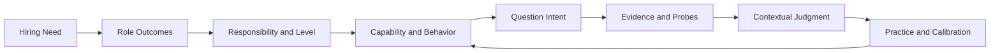

我一直对面试里的一个落差比较在意：岗位描述写着要有判断力、影响力、结果意识，面试时却常常只能拿一两个问题去猜这些词是什么意思。候选人猜面试官想听什么，面试官从一段讲得顺不顺的经历里判断能力，招聘负责人则可能到最后才发现，大家对“这个人进来要解决什么问题”并没有说到一起。

Interview Compass 是我把这类思考做成的双语参考站点。我把它看作一套面试和晋升中的识人方法，也是一套帮助人识岗、讲清经历的框架：招聘方先明确岗位要解决的问题，再用结构化提问寻找能力证据；候选人则据此理解评判标准，组织自己的故事，也判断岗位是否适合自己。可以直接[访问 Interview Compass 站点](https://liyuk.github.io/interview-compass/)。

这套方法来自我过去十年工作的积累和总结，也吸收了部分头部互联网公司的筛选准则。过去五年里，我面试过约 1,000 位候选人、辅导过约 300 人，管理者培训也有 200 多人听过课；这套方法还用于从初级到二线管理者的不同级别晋升。旧版曾有两三万阅读量。现在我把这些经验拆成岗位责任、问题意图、判断线索和证据标准，尽量讲清规则为何如此、什么样的回答能够支撑判断。页面呈现的是我对这些材料的整理和解释，具体岗位仍要结合实际要求理解。

## 先把招聘理由说清楚

招聘不是从题目开始的。管理者先要能说明团队为什么需要这个人，岗位要交付什么结果，哪些事情由这个角色负责，哪些事情要依赖其他人。否则“资深”“有影响力”这样的词很容易只剩下印象。相同的工作场景，个人贡献者和管理者可能都参与其中，但责任边界、决策范围和需要承担的后果并不相同。

角色和责任范围明确后，才比较容易把要求拆成可以观察的能力与行为。接下来设计的问题，不是为了覆盖某个题型，而是为了拿到判断所需的信息。回答也需要回到当时的目标、约束、个人责任、选择及其代价、结果和证据。结果本身不能自动说明是谁造成的；没有背景和归因，面试官听到的可能只是一个好看的结局。

我用这条链路理解面试，也用它组织 Interview Compass 的内容：

它不是一条要求每个人按顺序填空的流程。实际面试里，回答可能先从结果讲起，也可能从一次失败或一个技术取舍讲起。关键是最后能不能把目标、责任、判断、行动和证据之间的关系问出来。这里面“因果”尤其重要：结果受哪些因素影响，候选人真正改变了什么，哪些结论只能谨慎地说。

## 训练不是背题，而是看懂题目背后的规则

我希望站点里的训练材料能回答两类问题。一类是“这道题为什么问”，另一类是“怎样把经历讲到足以支撑判断”。前者要拆问题的目标、适用情境和其他可能解释；后者要让听的人跟得上这段经历的因果关系：当时要解决什么，为什么需要你介入，你具体负责什么，你做了什么判断，行动带来什么结果，哪些证据能说明是这些行动起了作用。

一个回答可以按这个顺序整理：

1. **先说重点**：用一两句话交代你要说明的判断或结果，让听众知道故事的落点。
2. **补足背景**：只讲理解问题所必需的目标、约束和关键难点，不从头复述整个项目。
3. **划清责任**：说明团队共同完成了什么、你本人负责哪一段，决定权和协作边界在哪里。
4. **讲清判断**：解释你看到的问题、考虑过的方案，以及为什么在当时的条件下选择这一种；被放弃的方案有什么代价。
5. **交代行动与结果**：挑能说明判断的行动来讲，再给出结果或可核实的信号；如果结果由多人或外部条件共同影响，也要说清楚。
6. **收住结论**：指出这段经历能证明什么、不能证明什么，必要时补充后来如何调整。

这个顺序是整理思路的支架，不是回答时必须逐项报标题。故事也不一定从最早发生的事开始。先给结论，再回到必要背景，通常比按时间把所有经过讲完更容易听懂；面试官追问哪一段，就把那一段展开。回答是否完整，最终要看它有没有回应题目的判断目标，而不是六项是否都说了一遍。

“怎么说明自己的优势”也落在这里。比如要说明自己擅长推动协作，光说“我沟通能力强”还不够；要讲清当时各方目标哪里不一致、自己承担了什么协调或决策责任、做了哪些动作，最后出现了什么结果，哪些事实能支持这是自己的贡献。如果结果主要由团队共同完成，也要把团队成果和个人作用分开说。优势不是自我贴上的标签，而是听众从具体判断和证据里得出的结论。

像 STAR 这样的表达框架可以帮助整理叙述，但只说清情境、任务、行动、结果还不够：它不会自动告诉候选人面试官到底在判断什么，也不能保证“结果”就是个人贡献。Interview Compass 想把问题意图和证据标准也放进准备过程里。候选人先理解题目要判断什么，再从上述结构中挑出有关的经历和信息；这样表达才不是把所有故事都套成同一种答案。

举个站点里的问题：AI 助手发起退款后遇到超时，系统不知道退款是否已经完成；自动重试可能造成重复退款。这里值得练习的不是把“幂等”这个词说出来，而是先区分查询状态与再次执行退款的风险，判断当前状态是否已知，考虑授权是否仍然有效，并解释无法确认时怎么暂停、核实和恢复。题目分析为这类判断列出不同强度的证据锚点，也给出可继续追问的方向。

这道题的证据层次也很具体：超时后一律重试，说明没有处理重复副作用；能说出幂等或先查状态，是基本的风险控制；再把操作副作用和用户授权一起考虑，判断才更完整；如果外部状态始终无法确认，还能说明怎样暂停、对账和负责恢复，才算把异常路径想到了。训练时要弄懂这些差别从哪里来，换成别的场景也能重新推导。

练习时可以先独立回答，再看题目分析：自己漏掉的是目标、责任、取舍还是证据？如果答案只把名词说对了，却没交代在什么条件下采取什么行动，说明还没有真正理解规则。再找一个不同经历来回答，才看得出这套推理能不能迁移。题库里的分析和 1–4 档证据参考用于帮助读者校准思考，不是标准答案，也不是平台对候选人的自动评分。

## 三个立场，共用一套判断材料

对候选人来说，最先要弄清的不是可能会遇到哪道题，而是岗位本身怎么设：它要解决什么问题、承担什么结果、实际的决策和协作边界是什么、处于什么责任级别。只有岗位设定看清楚了，才能判断自己的经验和能力是否匹配、有哪些差距需要补，也能考虑自己是否愿意承担这样的工作。站点里的角色画像和阶段资料提供对照，之后再从问题意图和证据参考出发，挑出相关经历，把目标、责任、判断和结果讲清楚。候选人需要用自己的事实检验岗位要求，也要看组织环境是否适合自己，而不是把参考材料改写成一套“正确话术”。

面试官面对的是另一件事：怎样从一个问题拿到足以支持判断的信息。问题分析可以提供切题的切入点、追问和比较维度，帮助面试官把题目拓展开，也提醒他核实背景、个人贡献、取舍和结果归因。现场仍要根据候选人的回答调整问题，不能把信号列表变成勾选表；如果岗位目标没有说清，再完整的题目框架也不会自动让判断变准。

招聘管理者要先回答“为什么招”。他需要把团队目标落到岗位责任、预期结果和风险，再与面试官对齐要观察什么。候选人的经历放到最后讨论时，也要看它和岗位实际工作的关系，而不是只比较谁讲得更漂亮。站点给管理者的是组织思路的参照，不会替某家公司定义职级、设计完整招聘流程或作出录用决定。

三种立场在站点里有不同入口，但底下连接的是同一套材料：岗位和责任阶段说明期待，能力框架说明观察领域，问题分析说明判断意图与证据。候选人用它准备和判断匹配度，面试官用它组织提问，管理者用它澄清岗位与考核重点。

## 为什么做成参考站点

我考虑过几种相邻的产品路径。公开题库和答案框架方便查找与自学；真人或 AI 模拟面试更适合练习现场表达、节奏和压力；自动评分能快速给出反馈。从[Interviewing.io 的公开页面](https://interviewing.io/)看，它的主线是资深工程师真人模拟、AI 面试和专家反馈；[ClearRound](https://clearround.io/)则把岗位方向、语音模拟、结构化框架和 AI 评分放在一条练习路径里。它们当然也有题目与框架材料；这里比较的是公开页面呈现的产品重心，不是对所有功能的完整盘点。

Interview Compass 选择先做“判断参考层”：把招聘目标、责任阶段、问题意图和证据线索放在一起，让同一套材料能被不同立场拿来准备、设计问题和校准讨论。这样做的优势是思考依据可以被反复查看和组合，也更容易解释一道题为什么相关、某段回答缺了什么信息；相对于只围绕练习表现给反馈，它也把招聘方的岗位和证据标准放进了同一条链路。它的代价也很清楚：站点不会陪人完成一次真实面试，不会替人练表达，更不能证明一个候选人适不适合某个具体团队。

因此它和模拟面试不是非此即彼。有人需要在压力下练习，真人或 AI 模拟更直接；有人需要快速得到表达反馈，自动评估能提供一个起点；有人要先弄懂岗位要求、问题意图和证据之间的关系，参考框架更合适。评分的可信度取决于维度是否贴近岗位、反馈能否解释依据；参考框架的限制则是读者仍要自己应用到具体情境。我的取舍不是说某一种更先进，而是先把“判断从哪里来”这件事做清楚。

## 站点结构：让入口不同，内容依据保持一致

站点不是把每类用户各做一份题库。目标路径和精选题单帮助用户从目的进入；角色与责任阶段帮助缩小适用范围；完整题库可以按能力、场景、主题和题型筛选。进入题目后，再查看目标、信号、可能的解释、上下文追问、取舍和证据锚点。只有经过专项分析的题目才会提供完整的题目级拆解，公共阅读提示会明确标成规则参考。

```mermaid
flowchart LR
    subgraph Inputs[Role and Hiring Context]
        direction TB
        I1[Hiring Goals]
        I2[Role and Responsibility Stage]
        I3[Eight Capability Domains]
    end
    subgraph Library[Question Reference]
        direction TB
        Q1[Bilingual Question Bank]
        Q2[Question Intent and Signals]
        Q3[Probes and Evidence Anchors]
    end
    subgraph Entry[Reader Entry Points]
        direction TB
        E1[Candidate Preparation]
        E2[Interviewer Design]
        E3[Hiring Manager Alignment]
    end
    Inputs --> Library
    Library --> Entry
    Entry --> O[People Apply Context and Make Decisions]
```

这张图表达的是内容关系，不是网站调用顺序。入口可以不同，岗位预期、问题意图和证据之间的关联要尽量保持一致；具体岗位和组织仍有差异，最终判断也留给人。这里也有一个实际风险：证据锚点容易被拿来当勾选清单，或者被误读成通用分数。站点因此把锚点当作解释差异的参考，并保留上下文追问和其他可能解释；读者不能只对照词条就给人下结论。题目页面还可以生成一段供用户复制到外部 AI 工具的分析提示，但回答不会由站点收集或发送。

当前站点包括中英文内容、六个工程方向与多个责任阶段的角色模型、八个能力域、目标路径、精选题单、可筛选题库和题目分析。它仍是一套启发式参考材料，不是验证过的通用职级标准。不同公司的岗位范围、评价方式和团队约束需要自己补进来；候选人也需要用真实经历练习，而不能只读评分锚点。

我希望最后留下来的不是“某题应该怎么答”，而是看问题时多问一步：它想确认什么？这个判断依赖哪些条件？什么证据能区分表面结果和实际贡献？如果这些问题能让候选人更清楚地介绍自己的优势，让面试官问到更有用的信息，也让管理者把招聘理由说具体，Interview Compass 才算帮上了忙。
