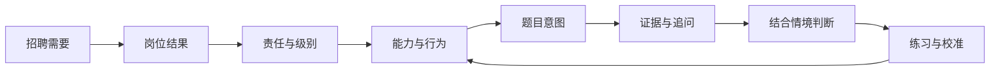
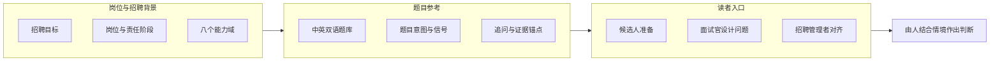

**面试不靠猜：先看清岗位，再讲清证据**

过去五年，我面试过约 1,000 位候选人。我一直在意一个落差：岗位描述写着“判断力”“影响力”“结果意识”，面试时却常常只剩一两道题去猜这些词的意思。候选人猜面试官想听什么，面试官从一段经历讲得顺不顺来推断能力；到最后，大家可能都没对齐“这个人进来要解决什么问题”。

**Interview Compass** 是我把十年识人方法整理成的中英双语开源参考站。它的思路只有一句话：**先看清岗位，再讲清证据。** 候选人用它看懂题目在考什么、讲出能被核实的经历；面试官用它追问到关键信息；管理者用它先说清“为什么招”。→ [打开站点](https://liyuk.github.io/interview-compass/) · [GitHub](https://github.com/Liyuk/interview-compass)

> 这套方法来自我十年工作的积累，也参考了部分头部互联网公司的筛选准则。
>
> - 近五年面试约 **1,000** 位候选人，辅导约 **300** 人
> - **200+** 位管理者参加过我的管理者培训
> - 用于从初级到**二线管理者**的晋升
> - 旧版曾有约 **2–3 万**阅读

现在我把这些经验拆成岗位责任、问题意图、判断线索和证据标准，尽量讲清规则为何如此、什么样的回答能够支撑判断。页面呈现的是我对这些材料的整理和解释，具体岗位仍要结合实际要求理解。

> **30 秒看懂**
>
> - 问题：面试双方都在“猜”，岗位要求没有落到可以观察的证据上。
> - 方法：岗位需要 → 结果与责任 → 能力与行为 → 题目意图 → 证据与追问 → 结合情境判断。
> - 候选人：用“六步”整理经历，分开团队成果和个人贡献。
> - 面试官和管理者：先说清“为什么招”，再按证据追问，把信号表当作追问线索而非勾选表。
> - 边界：不给标准答案、不自动打分，最终判断留给人。

## 先把招聘理由说清楚

招聘的起点是招聘理由，题目排在后面。管理者先要能说明团队为什么需要这个人，岗位要交付什么结果，哪些事情由这个角色负责，哪些事情要依赖其他人。否则“资深”“有影响力”这样的词很容易只剩下印象。相同的工作场景，个人贡献者和管理者可能都参与其中，但责任边界、决策范围和需要承担的后果各有不同。

角色和责任范围明确后，才比较容易把要求拆成可以观察的能力与行为。接下来设计的问题，是为了拿到判断所需的信息，覆盖题型只是附带的结果。回答也需要回到当时的目标、约束、个人责任、选择及其代价、结果和证据。

> 结果本身不能自动说明是谁造成的。

没有背景和归因，面试官听到的可能只是一个好看的结局。

我用这条链路理解面试，也用它组织 Interview Compass 的内容：

这条链路是理解的顺序，每个人都可以按实际情况从任意一环切入。实际面试里，回答可能先从结果讲起，也可能从一次失败或一个技术取舍讲起。关键是最后能把目标、责任、判断、行动和证据之间的关系问出来。这里面“因果”尤其重要：结果受哪些因素影响，候选人真正改变了什么，哪些结论只能谨慎地说。

## 候选人：用六步讲清一段经历

我希望站点里的训练材料能回答两类问题。一类是“这道题为什么问”，另一类是“怎样把经历讲到足以支撑判断”。前者要拆问题的目标、适用情境和其他可能解释；后者要让听的人跟得上这段经历的因果关系：当时要解决什么，为什么需要你介入，你具体负责什么，你做了什么判断，行动带来什么结果，哪些证据能说明是这些行动起了作用。

一个回答可以按这个顺序整理：

1. **先说重点**：用一两句话交代你要说明的判断或结果，让听众知道故事的落点。
2. **补足背景**：只讲理解问题所必需的目标、约束和关键难点，项目的其余经过留到被追问时再展开。
3. **划清责任**：说明团队共同完成了什么、你本人负责哪一段，决定权和协作边界在哪里。
4. **讲清判断**：解释你看到的问题、考虑过的方案，以及为什么在当时的条件下选择这一种；被放弃的方案有什么代价。
5. **交代行动与结果**：挑能说明判断的行动来讲，再给出结果或可核实的信号；如果结果由多人或外部条件共同影响，也要说清楚。
6. **收住结论**：指出这段经历能证明什么、不能证明什么，必要时补充后来如何调整。

这个顺序是整理思路的支架，回答时无需逐项报标题，故事也可以从最能说明问题的那一刻讲起。先给结论，再回到必要背景，通常比按时间把所有经过讲完更容易听懂；面试官追问哪一段，就把那一段展开。回答是否完整，最终要看它有没有回应题目的判断目标，六项可以按需取舍。

“怎么说明自己的优势”也落在这里。比如要说明自己擅长推动协作，光说“我沟通能力强”还不够；要讲清当时各方目标哪里不一致、自己承担了什么协调或决策责任、做了哪些动作，最后出现了什么结果，哪些事实能支持这是自己的贡献。如果结果主要由团队共同完成，也要把团队成果和个人作用分开说。

> 优势不是自我贴上的标签，而是听众从具体判断和证据里得出的结论。

### 为什么 STAR 不够

像 STAR 这样的表达框架可以帮助整理叙述，但只说清情境、任务、行动、结果还不够：它不会自动告诉候选人面试官到底在判断什么，也不能保证“结果”就是个人贡献。Interview Compass 想把问题意图和证据标准也放进准备过程里。候选人先理解题目要判断什么，再从上述结构中挑出有关的经历和信息；这样每段故事都能对准各自题目的判断目标。

### 一道题的四档证据

举个站点里的问题：AI 助手发起退款后遇到超时，系统不知道退款是否已经完成；自动重试可能造成重复退款。这里值得练习的是先区分查询状态与再次执行退款的风险，判断当前状态是否已知，考虑授权是否仍然有效，并解释无法确认时怎么暂停、核实和恢复；把“幂等”这个词说出来只是起点。题目分析为这类判断列出不同强度的证据锚点，也给出可继续追问的方向。

这道题的证据层次也很具体：

| 档位 | 回答表现 | 说明了什么 |
| --- | --- | --- |
| 1 | 超时后一律重试 | 没有处理重复副作用 |
| 2 | 能说出幂等或先查状态 | 有基本的风险控制 |
| 3 | 把操作副作用和用户授权一起考虑 | 判断更完整 |
| 4 | 外部状态始终无法确认时，还能说明怎样暂停、对账和负责恢复 | 把异常路径想到了 |

> 训练时要弄懂这些差别从哪里来，换成别的场景也能重新推导。

练习时可以先独立回答，再看题目分析：自己漏掉的是目标、责任、取舍还是证据？能交代清楚在什么条件下采取什么行动，才说明真正理解了规则，光把名词说对还差一步。再找一个不同经历来回答，才看得出这套推理能不能迁移。题库里的分析和 1–4 档证据参考用于帮助读者校准思考。

## 候选人、面试官、管理者分别怎么用

| 立场 | 用来做什么 | 从哪里进入 | 注意什么 |
| --- | --- | --- | --- |
| 候选人 | 看清岗位设定，判断匹配度，准备经历 | 角色画像和阶段资料，再到问题意图和证据参考 | 用自己的事实检验岗位要求，也看组织环境是否适合自己 |
| 面试官 | 从一个问题拿到足以支持判断的信息 | 问题分析里的切入点、追问和比较维度 | 根据回答调整问题，把信号列表当作追问线索 |
| 招聘管理者 | 先回答“为什么招”，澄清岗位与考核重点 | 岗位和责任阶段、能力框架 | 先把团队目标落到岗位责任、预期结果和风险 |

对候选人来说，最先要弄清的是岗位本身怎么设：它要解决什么问题、承担什么结果、实际的决策和协作边界是什么、处于什么责任级别；可能会遇到哪道题反倒排在后面。只有岗位设定看清楚了，才能判断自己的经验和能力是否匹配、有哪些差距需要补，也能考虑自己是否愿意承担这样的工作。站点里的角色画像和阶段资料提供对照，之后再从问题意图和证据参考出发，挑出相关经历，把目标、责任、判断和结果讲清楚。候选人需要用自己的事实检验岗位要求，也要看组织环境是否适合自己；参考材料是用来对照的，真正的回答要来自自己的经历，而不是一套“正确话术”。

面试官面对的是另一件事：怎样从一个问题拿到足以支持判断的信息。问题分析可以提供切题的切入点、追问和比较维度，帮助面试官把题目拓展开，也提醒他核实背景、个人贡献、取舍和结果归因。现场仍要根据候选人的回答调整问题，把信号列表当作追问的线索，而不是勾选表；判断能否变准，前提是岗位目标先说清，题目框架再完整也替代不了这一步。

招聘管理者要先回答“为什么招”。他需要把团队目标落到岗位责任、预期结果和风险，再与面试官对齐要观察什么。候选人的经历放到最后讨论时，重点看它和岗位实际工作的关系，讲得漂亮与否是次要的。站点给管理者的是组织思路的参照；职级定义、完整的招聘流程和录用决定，仍由各家公司自己负责。

三种立场在站点里有不同入口，但底下连接的是同一套材料：岗位和责任阶段说明期待，能力框架说明观察领域，问题分析说明判断意图与证据。候选人用它准备和判断匹配度，面试官用它组织提问，管理者用它澄清岗位与考核重点。

## 站里有什么

所有读者共用同一套题库，只是从不同入口进入：

- **中英双语内容**。
- **角色模型**：六个工程方向与多个责任阶段，帮助缩小适用范围。
- **八个能力域**。
- **目标路径和精选题单**：帮助用户从目的进入。
- **可筛选的完整题库**：按能力、场景、主题和题型筛选。
- **题目分析**：进入题目后，可以查看目标、信号、可能的解释、上下文追问、取舍和证据锚点。经过专项分析的题目提供完整的题目级拆解，公共阅读提示会明确标成规则参考。
- **AI 分析提示**：题目页面可以生成一段供用户复制到外部 AI 工具的分析提示，回答不会由站点收集或发送。

这张图画的是内容之间的关系，与网站的调用顺序无关。入口可以不同，岗位预期、问题意图和证据之间的关联要尽量保持一致；具体岗位和组织仍有差异，最终判断也留给人。

## 和模拟面试、AI 评分有什么不同

公开题库和答案框架方便查找与自学；真人或 AI 模拟面试更适合练习现场表达、节奏和压力；自动评分能快速给出反馈。从[Interviewing.io 的公开页面](https://interviewing.io/)看，它的主线是资深工程师真人模拟、AI 面试和专家反馈；[ClearRound](https://clearround.io/)则把岗位方向、语音模拟、结构化框架和 AI 评分放在一条练习路径里（它们也有题目与框架材料，这里只比较公开页面呈现的产品重心）。Interview Compass 选择先做“判断参考层”：把招聘目标、责任阶段、问题意图和证据线索放在一起，思考依据可以被反复查看和组合，也更容易解释一道题为什么相关、某段回答缺了什么信息，并把招聘方的岗位和证据标准放进同一条链路。代价是：真实面试的演练和表达训练要交给模拟面试，一个候选人是否适合某个具体团队，也要在实际情境里判断。几种路径可以互补，评分的可信度取决于维度是否贴近岗位、反馈能否解释依据，参考框架则要读者自己应用到具体情境；我的取舍是先把“判断从哪里来”这件事做清楚。

## 边界与风险

这里有一个实际风险：证据锚点容易被拿来当勾选清单，或者被误读成通用分数。站点因此把锚点当作解释差异的参考，并保留上下文追问和其他可能解释；给人下结论要结合这些上下文，单对照词条还不够。

题库里的分析和 1–4 档证据参考用来校准思考，不是标准答案，也不是平台对候选人的自动评分。整个站点是一套启发式参考材料，不是验证过的通用职级标准。不同公司的岗位范围、评价方式和团队约束需要自己补进来；评分锚点之外，候选人也需要用真实经历练习。

我希望最后留下来的，是看问题时多问一步：它想确认什么？这个判断依赖哪些条件？什么证据能区分表面结果和实际贡献？如果这些问题能让候选人更清楚地介绍自己的优势，让面试官问到更有用的信息，也让管理者把招聘理由说具体，Interview Compass 才算帮上了忙。

> 👉 [打开 Interview Compass](https://liyuk.github.io/interview-compass/)，从“候选人准备”或“面试官取证”题单开始，先试一道题。
>
> ⭐ 觉得有用，欢迎到 [GitHub](https://github.com/Liyuk/interview-compass) 点个 Star，也欢迎提 issue 告诉我哪道题该补。
