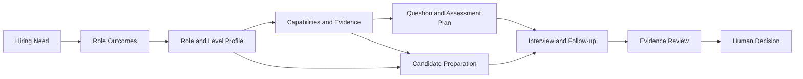
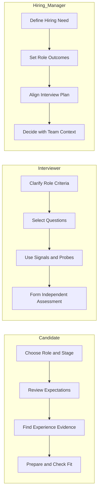
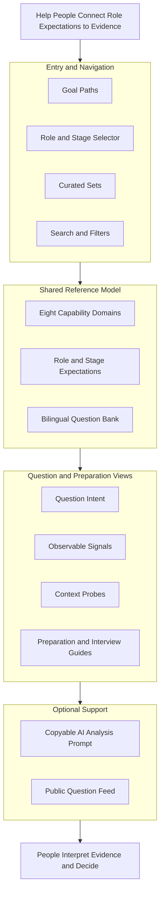

项目上线了，不一定代表目标达成；团队拿到结果，也不等于每个人的贡献相同。面试里常见的难处，是我们听到一段经历，却不确定它说明了什么：这个人当时承担什么责任，做过哪些判断，结果受哪些条件影响，又有什么证据能支持结论。

我做 Interview Compass，是想把“岗位需要什么”到“面试里该看什么”之间的路铺清楚。它是一份以候选人准备为主要入口的双语问题库与参考框架，也服务面试官和管理者，覆盖外部面试、招聘、晋升、项目/技术答辩和工作复盘。核心不是替人写答案，而是让问题的意图、需要观察的信号和可以继续追问的方向都能被看见。

## 从招聘目标走到可观察的证据

我理解的面试准备，不应该从“最近流行问什么题”开始。先要知道为什么要招这个角色、这个角色要承担什么结果，再描述角色画像与责任级别。接下来才是把要求拆成能力和行为证据，决定用哪些问题、工作样本或讨论来观察。面试结束后，参与者还要回到背景和约束，判断证据支持什么、不能支持什么。

候选人可以沿这条路反向准备：先找目标岗位和责任级别，再对照能力要求整理自己的经历，最后用问题练习讲清背景、取舍、行动和结果。岗位画像不是保证录用的标准答案；它让候选人知道自己在对照什么，也能判断这个角色是否适合自己。

这条链路把面试设计和候选人准备放在同一张图里：岗位要求与证据标准是共同参照，双方在面试里交换信息，最后由人结合岗位上下文作判断。图里的箭头表示设计和讨论的先后关系，不表示某个问题或某条证据可以直接因果地预测工作表现。

## 三种角色，三种用法

**候选人是站点优先服务的读者，要先找到目标角色和评判依据。** 可以先选工程方向和责任阶段，查看该阶段的角色预期、常见行为和证据，再从目标路径、精选题单或题库中挑问题。准备时要做的不是背一段“高分答案”，而是检查自己的经历能否讲清业务目标、挑战、本人责任、关键取舍、替代方案的成本、结果和个人贡献，也能说明哪些事没有做以及为什么。再用追问检查证据缺口，并通过反向提问判断岗位、组织支持和个人诉求是否匹配。页面中的级别与证据描述提供对照参照，不代表平台会替候选人打分或预测面试结果。

**面试官要找到切题的提问框架，并把回答问具体。** 可以从面试官设计路径或精选题单进入，也可以按角色、阶段、能力和场景筛选。每道题的意图、观察信号和追问方向，帮助面试官把问题和岗位要求连起来，并根据回答追问背景、个人贡献、取舍和结果。平台提供的是准备与记录思路；面试官仍要负责倾听、追问，并依据组织自己的标准形成判断。

**招聘管理者要先说清楚为什么招人、招来解决什么问题。** 接着定义角色的责任范围和级别，选择需要考察的能力，和面试官对齐问题及证据要求。面试结束后，再把证据放回团队需要、岗位实际工作和风险里讨论。Interview Compass 提供可参考的思考路径和问题材料，不替管理者创建岗位编制、制定公司职级制度或做最终录用决定。

三种用法的入口不同，底层参照相通：岗位期待、责任级别、能力要求和工作证据。候选人借它准备自己的材料，面试官借它拓展提问并追问证据，管理者借它校准岗位要求和招聘判断。

## 站点如何把这些材料组织起来

站点不只有一份平铺的问题清单。用户可以从目标路径开始，也可以先选工程方向和责任阶段；想快速练习时可以用精选题单，想自己探索时可以进入完整题库，按角色、场景、能力、主题和形式筛选或搜索。到了题目页，再看这道题要了解什么、哪些回答信号值得注意、可以怎样追问。需要复盘时，页面还能生成一段供用户复制到自己选择的外部 AI 工具中的分析提示；答案不会由站点收集或发送。

这些入口背后共用同一套内容关系：能力模型描述观察工作的领域，角色与阶段资料描述责任和预期证据，问题库把问题关联到能力、适用场景和观察信号，精选题单与目标路径则把问题排成适合某种目的的阅读顺序。站点另有可供 companion skill 查询的公开题目数据。架构的重点是让不同入口指向同一批经过整理的问题，而不是让每种用途各自维护一套互不相干的题目。

目前题库按八个能力域组织，角色与责任阶段资料用于解释同一道题在不同级别下应关注什么。部分参照用 1–4 档行为证据锚点描述证据差异；这些锚点是共享的参考尺度，不是逐题生成的分数，也不等于对候选人的自动评级。级别改变的是责任范围和证据期待，不是题目难度。

## 为什么从问题和证据出发

我也看过几种相邻的做法。答案与框架型题库适合自学；真人或 AI 模拟面试提供现场练习和反馈；有些 AI 练习产品会按预设维度给回答打分。比如，[Interviewing.io](https://interviewing.io/)提供真人及 AI 模拟面试，[ClearRound](https://clearround.io/)的公开介绍则强调按岗位方向对回答给出 AI 评分。它们解决的是练习和反馈的问题。Interview Compass 选择把重心放在“岗位要求如何转成问题和证据”：候选人可以自己准备，面试官可以设计追问，管理者可以对齐岗位标准。

这几种方式并不互相替代。模拟面试更接近实际对话，代价是需要参与一次练习；评分反馈给人一个快速参照，但它能说明多少，取决于评分维度是否对应目标岗位；问题与证据框架便于反复查阅和组合，却不会替用户练习表达，也不会替组织完成评估。Interview Compass 接受了最后一种方式的边界：它不提供真人模拟面试，不自动评价回答，也不替组织维护正式评分流程。用户仍要自己选择材料、结合上下文练习，组织也要自己定义岗位标准。

## 目前做到哪里，哪些判断仍属于人

目前站点提供中英文首页、目标路径、精选题单、完整题库、能力与角色阶段资料、搜索和筛选、使用指南，以及可复制的外部 AI 分析提示。内容仍在扩展；不同公司的岗位定义、面试流程和级别标准，也需要读者自行对照。工程方向和责任阶段能帮助找到更相关的材料，但不能覆盖每个团队的具体工作。

我希望它能让候选人更清楚自己要对照什么，让面试官更容易围绕岗位要求追问，让管理者把“为什么招、要看什么证据”说得具体一些。它提供共同的语言和可参考的路径；是否胜任、岗位是否合适，最后仍要回到真实工作、具体上下文和人的判断。
