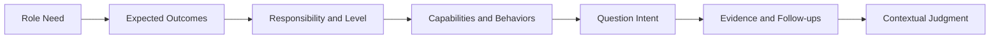
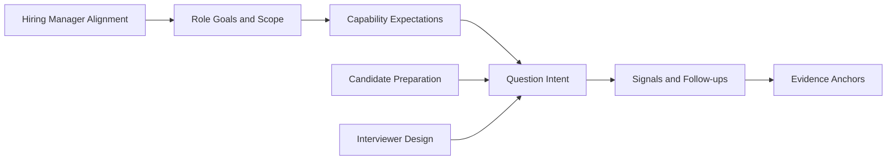

过去五年，我面试过约 1,000 位候选人。面试里反复出现一个落差：岗位描述写着“判断力”“影响力”“结果意识”，真正坐下来交流时，候选人猜面试官想听什么，面试官也可能从一段经历讲得顺不顺来推断能力。谈到最后，大家未必说清楚这个岗位要解决什么问题。

我把过去十年的工作积累整理成 Interview Compass，也参考了部分头部互联网公司的筛选准则。它是一套中英双语的面试与晋升参考站，核心思路是：**先看清岗位，再讲清证据。** 候选人可以看懂题目在判断什么，再用自己的经历说明能力；面试官和管理者可以围绕岗位要求设计问题、追问依据、对齐判断。

> 近五年面试约 1,000 位候选人，辅导约 300 人。
> 200 多位管理者参加过我的管理者培训；这套方法也用于从初级到二线管理者的晋升。
> 旧版曾有两三万阅读。

### 30 秒看懂

- **问题从哪里来：**岗位目标和责任没有落到可观察的行为与证据，双方只能猜。
- **方法怎么走：**岗位需要 → 结果与责任 → 能力与行为 → 题目意图 → 证据与追问 → 结合上下文判断。
- **候选人怎么用：**先弄清岗位和匹配度，再把一段经历讲到目标、责任、判断、行动和结果都能对得上。
- **面试官和管理者怎么用：**先说清为什么招、岗位要承担什么，再围绕证据提问和校准。
- **材料的边界：**问题分析和证据锚点帮助人理解规则，不提供统一答案，也不替人做录用或晋升决定。

## 先看清岗位，再讲清证据

招聘要从“为什么需要这个人”开始。管理者先说清团队要解决的问题、岗位预期交付的结果，以及角色的责任、决策和协作边界。像“资深”“有影响力”这样的词，只有放回具体岗位和责任范围，才有可判断的含义。

岗位目标明确后，才能继续拆出需要的能力和行为，再设计能拿到判断信息的问题。候选人回答时也要回到同一条线上：当时要达成什么目标，自己负责哪一部分，做过什么判断和取舍，采取了什么行动，最后有什么结果和可核实的证据。结果本身不能自动说明是谁造成的；背景和个人贡献需要讲清楚。

这条线是帮助双方找到判断依据，不要求每个人把回答按固定顺序念出来。实际交流可以从结果、一次失败或一个技术取舍开始；只要最后能把目标、责任、判断、行动和证据之间的关系讲清楚，听众就有材料继续追问。

## 候选人：把一段经历讲到可以判断

准备时先选一个目标岗位，弄清它要解决的问题、责任范围和级别，再挑与之相关的经历。讲故事时可以用六步检查信息是否齐全：

1. **先说结论：**用一两句话说明这段经历能证明什么，让听众知道重点。
2. **补足背景：**交代目标、约束和关键难点，只保留理解判断所需的信息。
3. **划清责任：**区分团队共同完成的结果和你本人负责的部分，也说明权限与协作边界。
4. **讲出判断：**说明你看到了什么问题、比较过哪些方案，为什么当时选择这一种，以及放弃其他方案的代价。
5. **连接行动与结果：**讲最能体现判断的行动，给出结果和可核实的信号；如果外部因素也影响结果，要一并说明。
6. **收住适用范围：**指出这段经历能说明什么，哪些结论还需要更多信息。

这六步是整理材料的支架，不是需要背诵的模板。听众应该能顺着你的话还原：你面对什么问题、承担什么责任、为什么这样做、事情后来怎样。面试官追问某个环节时，再把那部分展开。

> 优势不是自己贴上的标签，而是听众从具体判断和证据里得出的结论。

STAR 能让故事有情境、任务、行动和结果，但光有四个要素还不能说明题目在判断什么，也不能自动证明结果来自你的贡献。把岗位要求、题目意图、个人责任和结果依据连起来，面试双方才有机会讨论同一件事。

### 同一道题，证据为什么分四档

比如这道题：AI 助手发起退款后遇到超时，系统无法确认退款是否已经完成。直接重试可能造成重复退款。回答的差异不在于是否说出“幂等”，而在于有没有处理未知状态、用户授权和恢复责任。

| 参考层次 | 回答表现 | 能支持什么判断 |
| --- | --- | --- |
| 1 · 仍需核验 | 把超时当作失败并直接重试，没有区分已完成、未完成和未知状态。 | 尚未说明如何控制重复副作用。 |
| 2 · 基本安全路径 | 使用幂等标识或查询操作状态，避免同一退款被执行两次。 | 理解了最基本的重试保护。 |
| 3 · 处理关键取舍 | 比较重试、查询、暂停和人工核实，并考虑授权时点、部分成功和依赖故障。 | 能根据风险和上下文设计处理方式。 |
| 4 · 负责恢复闭环 | 合作方状态不可查询时，仍能说明怎样对账、恢复、处理授权变化，以及由谁负责。 | 考虑到了异常状态和后续责任。 |

[打开这道题的完整分析与追问](https://liyuk.github.io/interview-compass/questions/a-ai-engineering-agent-duplicate-side-effect/)。

这些层次是针对这道题的证据参考，不是给所有岗位套用的通用分数。换一个责任范围、依赖条件或风险等级，判断依据也会变。

## 候选人、面试官和管理者分别怎么用

| 角色 | 先解决什么问题 | 在站点里怎么用 | 需要留意什么 |
| --- | --- | --- | --- |
| 候选人 | 这个岗位要什么，我的经历是否匹配？ | 看岗位画像与责任级别，筛出相关问题，再按目标、责任、判断、行动和证据整理故事。 | 用自己的真实经历回答，不要把证据锚点改成“标准话术”。 |
| 面试官 | 需要通过什么信息判断候选人？ | 从题目意图开始，比较思路，追问上下文、个人贡献、取舍和结果归因。 | 根据回答继续挖掘，不要把信号清单当作勾选表。 |
| 招聘管理者 | 为什么招这个人，入职后要承担什么？ | 先定义目标、责任范围和预期结果，再与面试官对齐评判标准。 | 具体岗位和组织环境不同，最终标准要由招聘团队自己说清楚。 |

三种角色进入站点的路径不同，但底下使用的是同一套材料：岗位与责任说明预期，问题分析说明判断意图，证据参考帮助辨别回答里还缺什么。

## 为什么先做参考站

真人或 AI 模拟面试适合练习现场表达、节奏和压力；即时反馈也能让候选人知道接下来该练什么。比如 [interviewing.io](https://interviewing.io/) 提供真人和 AI 模拟面试，[ClearRound](https://clearround.io/) 的公开产品介绍强调语音模拟、AI 反馈和结构化框架。这些路径解决的是练习和反馈的问题。

我先把 Interview Compass 做成参考站，是因为候选人开始练习之前，往往还需要看清岗位和题目在考什么；面试官与管理者也需要一份能共同讨论的判断材料。这里优先整理“为什么问、要观察什么、什么证据支持判断”，让同一套依据能服务面试桌两边。它不能代替现场练习，也不会自动得出录用结论；当问题在于表达节奏或临场状态时，模拟练习会更直接。

## 站里有什么

Interview Compass 目前包括：

- 按目标进入的候选人准备、面试官取证、招聘和晋升路径；
- 六个工程方向及不同责任阶段的岗位参考；
- 八个能力域、精选题单和可筛选的中英双语题库；
- 对部分核心问题逐题复核的意图、信号、上下文追问、方案取舍和证据锚点；
- 供读者复制到自选外部 AI 工具的分析提示词。

内容关系可以概括为：

目标路径和题单让人从自己的任务进入，岗位和责任阶段帮助缩小范围，题目分析则把意图、追问和证据连起来。读者可以只看一题，也可以按岗位逐步整理准备材料。

## 使用边界

证据锚点帮助解释回答的差异，不是未经验证的通用职级标准，也不应该脱离岗位、责任范围和上下文来给人打分。问题分析提供可供检查的思路；录用、晋升和是否匹配，仍由了解岗位实际情况的人来判断。

## 从一道题开始

[打开 Interview Compass，先试一道题](https://liyuk.github.io/interview-compass/) · [查看开源仓库并点 Star](https://github.com/Liyuk/interview-compass) · [提出希望补充的问题](https://github.com/Liyuk/interview-compass/issues/new)
