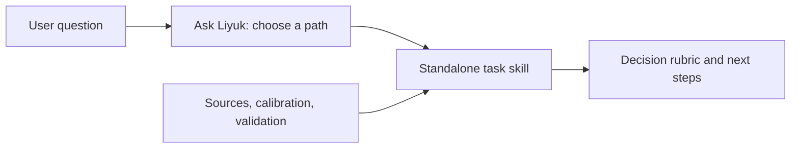

The project started when Yaozi mentioned building an internal Ask Liyuk skill. I began thinking about the articles, engineering methods, and judgments about management and communication I'd accumulated over the years. I could distill some of them into skills people could call on their own, then add a few insights from spoken conversations. The practical use gradually became clearer: bring an existing proposal, a change in metrics, or an account of work to an AI assistant and ask it to examine the material with a defined method. If you're not sure which method fits, Ask Liyuk can help you choose where to start.

Liyuk Skills is an open-source repository that packages methods for engineering decisions, team management, communication, and everyday choices as AI skills. It currently contains 21 skills. Each can be installed on its own, or you can start with Ask Liyuk to identify the task and find a suitable method. The repository uses the Chinese-first Agent Skills file format and includes installation and usage examples for Claude Code and Codex.

## What you can use it for

If you're not sure what kind of problem you have, start with Ask Liyuk:

```text
$ask-liyuk Our online conversion rate has fallen for two weeks. I'm not sure whether to check instrumentation, review recent releases, or discuss a redesign. Where should I start?
```

The router recommends a method and next step based on the decision you need to make. It helps choose a path; it doesn't pretend to run a task skill you haven't installed.

When you know what you need, call the relevant skill and include the material. The 21 skills cover these tasks:

**Engineering decisions**

- `tech-planning`: compare engineering investments and roadmap options.
- `tech-review`: review an existing architecture, migration, or pilot, focusing on issues that could change the decision.
- `metric-decision`: define metrics and interpret changes after checking definitions and comparability.
- `management-retro`: review a completed project, cycle, or incident; separate facts, explanations, and next improvements.
- `problem-location`: find testable underlying constraints when a seemingly sound solution has not solved the problem.
- `project-diligence`: assess whether a startup or new business is viable and merits further investment; invoke it explicitly.

**Growth and experience**

- `eng-reporting`: turn notes, existing conclusions, or results into material a reader can use to make a decision.
- `experience-review`: check personal contribution and evidence in a project self-review, interview, or promotion case.
- `distill-experience`: turn lived experience into a candidate method whose scope the author can confirm; invoke it explicitly.
- `new-context-onboarding`: map the value chain, information gaps, and next steps when entering an unfamiliar team, business, or system.

**Management and collaboration**

- `situational-leadership`: choose direction, coaching, support, or delegation for a specific task.
- `one-on-one`: align goals, expectations, support, and authority between a manager and a team member.
- `manager-of-managers`: handle resource trade-offs, escalated authority, and handoffs among team leads.
- `hiring-assessment`: define role gaps, prepare interview questions, and organize hiring evidence; it does not make the hiring decision.
- `conflict-alignment`: clarify goals, facts, trade-offs, and decision rights in a collaboration conflict.
- `conversation-preparation`: prepare for feedback, requests, refusals, or clarification conversations.

**Relationships and everyday choices**

- `person-deep-analysis`: form a bounded interpretation from a person's account, chat, or character material.
- `interaction-risk-analysis`: examine specific suspicious requests, deception, coercion, or bullying risks.
- `relationship-boundaries`: decide what you can take on when someone asks for help, a referral, an introduction, or a commitment.
- `gift-planning`: plan gift options around the relationship, occasion, needs, and budget.

Together with Ask Liyuk, that makes 21. Each name is an independently callable skill; the “Install and call a skill” section below shows the commands.

These skills provide a judgment framework, questions to ask, and suggested next steps. Conclusions depend on the material and model used. Decisions requiring professional responsibility, such as hiring, legal, or tax matters, remain with the people accountable for them.

## Install and call a skill

Skills are files an AI client reads, not a hosted service that requires an account. You can install Ask Liyuk for navigation and copy the task skills you want to use alongside it. For Codex, run:

```sh
git clone https://github.com/Liyuk/skills.git liyuk-skills
mkdir -p ~/.codex/skills
cp -R liyuk-skills/skills/ask-liyuk ~/.codex/skills/
cp -R liyuk-skills/skills/tech-review ~/.codex/skills/
```

Then enter `$ask-liyuk` or `$tech-review` in Codex and include your question or proposal. Claude Code works similarly: copy the skill directories to `~/.claude/skills/`, then use `/ask-liyuk` or `/tech-review`. See the [repository README](https://github.com/Liyuk/skills#%E5%AE%89%E8%A3%85%E4%B8%8E%E8%B0%83%E7%94%A8) for other installation options and client details. The plugin configuration has passed static checks, but installation in each client has not yet been verified.

## Why keep a router and standalone skills

Ask Liyuk handles navigation. It identifies the decision a user needs to make or the output they need. When the task is clear, it recommends a path without sending everyone through a fixed sequence. For example, checking the evidence and delivery readiness of an existing proposal calls for a technical review; deciding what to invest in calls for technical planning. When a task spans multiple methods, the router explains what to carry forward and when to stop.

Each task skill keeps its own invocation and scope. The catalog records its core judgment, usage example, boundaries with related methods, source type, author-calibration status, and behavioral-validation status.



This structure was informed by [Matt Pocock's skills repository](https://github.com/mattpocock/skills): an entry point guides users to a task, while standalone skills handle specific jobs. I borrowed that organizational idea, not his coding workflow. These methods focus on engineering judgment, management, communication, and personal experience. Standalone installation has a cost: users need to install the skills they want, and the catalog and routing guidance need to stay in sync.

## Sources and validation are tracked separately

The methods come from different places: some were migrated from existing engineering skills; others were distilled from public writing or personal experience; some draw on external books or frameworks. The catalog records source and author-calibration status separately. A migration or citation does not mean the author has confirmed every newly organized branch. External books are traceable references, not evidence of the author's endorsement or of a method's effectiveness.

Each method includes cases for checking its behavior. An expected output describes the standard to check against; it is not a result the model has already passed. Version `0.5.0 / preview` also ran limited with-and-without-skill instruction probes on eight skills: after fixes and a rerun, all 24 prompt pairs met their case criteria. Each skill had only three prompts, assessed once by the implementer against criteria they had written. This does not establish effectiveness in real use, cover every skill, or verify installation in every client.

That is the project's current state: the skills can be installed, read, modified, and tried, while newly organized methods still need more real use and author calibration. For decisions requiring professional expertise, such as hiring, legal, or tax decisions, each skill keeps its scope limits and does not make the final decision for a user or organization.

The repository is released under the MIT license. Visit the [Liyuk Skills repository](https://github.com/Liyuk/skills) for the full catalog, installation instructions, source records, and validation limits.
