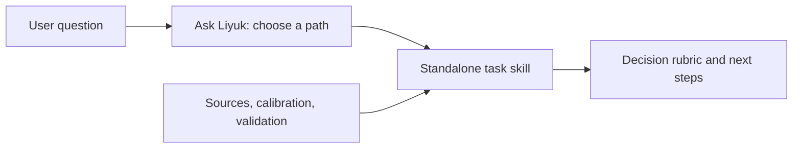

这个项目最初是瑶子提到，他做了一个内部用的 Ask Liyuk skill。我听完想到，自己这些年也积累了一些文章、工程方法和管理沟通里的判断，或许可以蒸馏成能单独调用的技能；再补进一部分口述里的内容。做出来的东西要能解决什么问题，也慢慢清楚了：当你手上有一个方案、一次指标变化或一段工作经历，可以把材料交给 AI，让它按一套明确的方法检查。还没想清该用什么方法时，再让 Ask Liyuk 帮忙选入口。

Liyuk Skills 是一个把工程判断、团队管理、沟通和个人经验整理成 AI 技能的开源仓库。它现在有 21 项技能：可以单独安装，也可以先用 Ask Liyuk 判断当前要解决的问题，再找到对应的方法。仓库采用中文优先的 Agent Skills 文件格式，提供 Claude Code 和 Codex 的安装与调用示例。

## 你可以拿它做什么

如果你还不确定问题属于哪一类，可以先问 Ask Liyuk：

```text
$ask-liyuk 线上转化率连续两周下降，我不确定该先查埋点、复盘发布，还是讨论改版。应该从哪一步开始？
```

入口会根据你要作的决定推荐方法和下一步；它负责选路，不会假装已经执行了没安装的专项技能。

知道目标后，可以直接调用对应技能，并把问题材料一起给它。21 项技能覆盖这些任务：

**工程判断**

- `tech-planning`：比较工程投入和路线图选项。
- `tech-review`：评审已有架构、迁移或试点方案，只找会影响决定的问题。
- `metric-decision`：定义指标、解释变化，检查口径与数据是否可比。
- `management-retro`：复盘已完成的项目、周期或事故，区分事实、解释和下一步改进。
- `problem-location`：方案看似正确却没解决问题时，从症状找可检验的底层约束。
- `project-diligence`：判断创业项目或新业务是否成立、是否值得继续投入；需主动调用。

**成长与经验表达**

- `eng-reporting`：把纪要、已有判断或成果整理成读者能据此决策的材料。
- `experience-review`：检查项目自评、面试或晋升材料里的个人贡献与证据。
- `distill-experience`：把亲历经验整理成候选方法，再由作者确认适用范围；需主动调用。
- `new-context-onboarding`：刚进入陌生团队、业务或系统时，梳理价值链、信息缺口和下一步。

**管理与协作**

- `situational-leadership`：按具体任务选择指导、教练、支持或授权。
- `one-on-one`：对齐上下级之间的目标、预期、支持和授权。
- `manager-of-managers`：处理多位一线负责人之间的资源取舍、授权升级和交接。
- `hiring-assessment`：定义岗位缺口、准备面试追问、整理招聘证据，不替组织作录用决定。
- `conflict-alignment`：厘清协作分歧里的目标、事实、取舍和决定权。
- `conversation-preparation`：准备反馈、请求、拒绝或澄清谈话。

**人际与日常选择**

- `person-deep-analysis`：根据自述、聊天或人物材料形成有边界的理解。
- `interaction-risk-analysis`：检查具体可疑要求、欺骗、胁迫或霸凌风险。
- `relationship-boundaries`：决定面对求助、推荐、介绍或承诺时能承担到什么范围。
- `gift-planning`：结合关系、场合、需求与预算规划礼物方向。

加上 Ask Liyuk 入口，共 21 项。每个名字就是独立技能的调用名；在后面的“安装后怎么调用”里有完整命令示例。

这些技能给的是判断框架、追问和下一步建议。结论会受输入材料和所用模型影响；招聘、法律、税务等需要专业责任的决定，仍由相应的人来作。

## 安装后怎么调用

技能是放进 AI 客户端读取的文件，不是一个需要登录的在线服务。可以只装 Ask Liyuk 做导航，也可以把要执行的专项技能一并复制进去。以 Codex 为例，在终端运行：

```sh
git clone https://github.com/Liyuk/skills.git liyuk-skills
mkdir -p ~/.codex/skills
cp -R liyuk-skills/skills/ask-liyuk ~/.codex/skills/
cp -R liyuk-skills/skills/tech-review ~/.codex/skills/
```

之后在 Codex 里输入 `$ask-liyuk` 或 `$tech-review`，再附上问题或方案。Claude Code 的文件安装方式类似，把技能目录复制到 `~/.claude/skills/`，然后用 `/ask-liyuk` 或 `/tech-review`。其他安装方式和客户端细节见 [仓库 README](https://github.com/Liyuk/skills#安装与调用)。插件配置通过静态检查，但客户端插件安装还没有逐一验证。

## 为什么既有入口，也有独立技能

Ask Liyuk 负责导航。它先识别用户要作的决定或想得到的产物；目标清楚时直接推荐路径，不要求每个人都走一遍固定流程。比如，已有方案要检查证据和交付准备，可以进入技术方案评审；还在决定投什么，则是技术规划。涉及多个方法时，入口说明交接材料和停止条件。

每项专项技能都保留自己的调用入口和适用范围。目录还记录核心判断、使用例子、相邻方法的边界、来源类型、作者校准状态和行为验证状态。



这个分法参考了 [Matt Pocock 的 skills 仓库](https://github.com/mattpocock/skills)：入口负责告诉用户该从哪里开始，专项技能各自处理一种任务。我借了这个组织思路，没有照搬他的编码工作流；这里的专项方法来自工程判断、管理沟通和个人经验整理。保留独立安装也有代价：需要用哪个方法，就得把相应目录装进客户端，入口目录和专项技能也要一起维护。

## 来源与验证状态分开记录

仓库里的方法来自不同地方：有些从已有工程技能迁入，有些从公开文章或个人经验中整理，也有些参考了外部书籍或框架。目录会分别标出来源和作者校准状态。迁入或引用不代表所有新整理的分支都得到作者确认；外部书籍也只是可追溯的参考，不等于作者背书或效果证据。

每项方法附有检查案例，预期输出描述的是判断标准，不是模型已经通过的结果。`0.5.0 / preview` 版本还对八项技能做了有限的有无技能指令探针：24 组提示在修复问题并重测后达到各自的案例标准。每项只有三条提示，单轮结果由实现者对照自己写的标准判断；它不能证明方法在真实使用中有效，也没有验证所有技能或各客户端的安装体验。

这也是它目前的状态：可以安装、阅读、修改和试用，但新整理的方法仍需要更多真实使用与本人校准。对需要招聘、法律或税务等专业决定的场景，技能会保留自己的边界，不替用户或组织作最终决定。

仓库使用 MIT 许可。查看 [Liyuk Skills 仓库](https://github.com/Liyuk/skills) 获取完整目录、安装说明、来源记录和验证限制。
