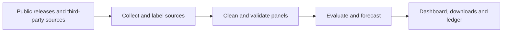

[View the repository ↗](https://github.com/Liyuk/cn-housing-price-training) · [Open the 70-city dashboard ↗](https://liyuk.github.io/cn-housing-price-training/)

## What the project asks

Understanding China's housing market starts with a measurement problem. The National Bureau of Statistics publishes price indexes; third-party platforms often report average listing prices; local housing authorities may release transaction counts and area without prices. Each describes a different aspect of the market. They cannot simply be joined into one transaction-price series.

This project began by collecting and organizing 70-city housing indexes. It has grown into a public data pipeline, forecasting experiment, and interactive dashboard for readers who want to examine city trends, compare markets, or inspect the methods and sources behind a forecast. Its aim is to make each figure's provenance, definition, and limits available for inspection.

## Where the data come from

In the **November 5, 2026** snapshot, the second-hand housing index panel covers 249 months, from January 2006 through September 2026. From February 2011 onward, it primarily uses directly collected NBS releases. Earlier months and some missing official pages use a third-party mirror, with provenance labels retained. All 13,580 cells that could be compared matched the official pages. This check covers overlapping cells; early months without official pages have no contemporaneous comparison.

The project checks internal consistency by comparing the product of 12 monthly changes with the year-over-year index. Data for 2006–2007 failed that check; they remain in the download with a warning, while dashboard history starts in 2008. A change in statistical methodology around 2011 is marked on the charts, and models use data after the break. Gaps in the new-home index are listed on the data page.

The project also collects national real-estate development and sales data from the NBS, loan prime rates (LPR) from the People's Bank of China, third-party district listing and rental data, and Beijing housing authority transaction data. Their coverage and frequency differ: macro indicators are generally cumulative from the beginning of the year, district rankings contain only selected areas each month, and official Beijing district transactions are currently a single-month snapshot. They provide context and cannot substitute for one another.

## From releases to an inspectable dashboard

Python scripts collect, clean, and validate the panels, then generate forecasts, downloads, and data for the static site. Updates record source replacements. The site reads each data block's coverage from a manifest, so the dates beside charts change with the data. The pipeline and downloads are available in the repository, allowing readers to trace a dashboard figure back to its source and processing.

## Using the online pages

*Local dashboard screenshots show the Chinese-language interface; data through September 2026.*

On the [dashboard](https://liyuk.github.io/cn-housing-price-training/), start with **Overview** for the national second-hand index and forecast range. The **City ranking** compares all 70 cities by trend strength, monthly and yearly changes, and forecast summaries. Select a city for details or switch cities from its page. Some cities also offer district search, listing prices, rents, and rental yields. District data come from third-party rankings; the pages state which areas and months are covered.

**Statistics** shows the broader distribution: the number of cities with monthly increases, a year-over-year heatmap, new versus second-hand indexes, macro indicators, and LPR rates. City rental-yield rankings may include different numbers of districts. The Beijing transaction chart shows counts.

Overview and city pages offer line and candlestick views. The candlesticks are synthesized from monthly indexes: monthly candles have no intraday high or low, and quarterly and annual wicks represent extremes among their constituent months. They offer another view of the same series, without adding daily transaction data. An index measures relative change and cannot be read directly as a transaction price per square meter.

**Forecast logic** presents errors, interval coverage, and the forecast ledger. **Data and methods** lists sources, coverage, gaps, definitions, and downloads. The site also links to papers revised separately in the project repository; paper and dashboard model versions may differ.

## Forecasting method

The target is the cumulative change in each city’s second-hand housing index over future horizons. Inputs are primarily historical price changes. Candidate paths include last-month persistence, the trailing 12-month average, AR(1) reversion, a damped trend, and a cross-city gradient boosting model; Chronos-2 is optional. The national path aggregates city results from the bottom up.

For the first 12 months, the two models with the lowest realized historical errors available at the forecast origin are averaged. Later horizons use a fixed shrunk damped trend. Intervals combine recent volatility, horizon, and trend instability with weighted quantiles of historical forecast errors. Rolling backtests reassess the models and intervals as new data become available.

## Backtest results

The project compares methods including no change, recent averages, AR(1), damped trends, and a cross-city model, with an optional time-series foundation model. Forecast combinations and intervals use rolling historical errors: at each backtest origin, the forecast uses only prior data and is compared with subsequent observations. Rolling backtests show performance across origins; the role of these same results in model selection is described below.

In the November 2026 acceptance record, the average 12-month forecast error across the 70-city backtest was 38% lower than the no-change baseline. The nominal 80% interval had observed coverage of 77%–82% at horizons from 1 to 24 months. Errors at 48 and 60 months were respectively 12% and 33% higher than the no-change baseline, so the dashboard labels those longer horizons as scenarios. The damped-trend rule for months 13–24 was selected using the same backtests. These figures summarize a historical sample, with results varying across cities and periods.

The project freezes forecasts monthly and scores them when new data arrive. **As of this snapshot, the ledger contains only one entry, for September 2026**, so it does not yet provide a long-term prospective evaluation. Retrospectively selected rules are described above.

## Project value

**Data preparation.** Dispersed monthly releases become a downloadable city-by-month panel with provenance, methodology, and quality labels. Researchers can inspect gaps and source replacements without collecting the same material again.

**Analysis and evaluation.** Readers can compare city trends, inspect forecast intervals, and follow them back to errors and coverage on the same site. That makes it possible to see where the model has performed better and which horizons need a different reading.

**Use and maintenance.** The ranking, statistical views, and downloads serve different levels of inquiry. A static site and monthly update scripts connect the data, charts, and records for ongoing maintenance.

## Remaining problems

**Data representation.** The 70-city scope and early mirror comparison are described under “Where the data come from”; district listing rankings cover only selected areas. Further work includes locating original sources and analyzing district sample selection.

**Forecast evidence.** Some rules were selected from historical backtests, and the ledger has one entry. Reporting frozen-forecast errors and coverage by city and horizon over time will show whether aggregate scores conceal local weaknesses.

**Explanation and decisions.** The model mainly uses price history and cannot explain turning points caused by policy or shifts in supply and demand. The forecast is also an index rather than an actual transaction price. Longer fundamental data and comparisons across market regimes are worthwhile next steps.

The project covers public data preparation, index checks, backtest methods, and city-level index results. Forecast intervals are constructed from historical errors.

The project remains under maintenance. Dashboard data, models, and evaluations will change with updates; the coverage and results described here refer to the November 2026 snapshot.
