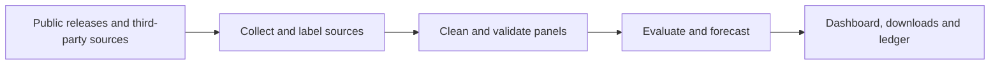

[查看项目仓库 ↗](https://github.com/Liyuk/cn-housing-price-training) · [打开 70 城趋势看板 ↗](https://liyuk.github.io/cn-housing-price-training/)

## 这个项目想回答什么

想了解中国住宅市场的变化，首先会遇到一个数据问题：国家统计局发布的是价格指数，第三方平台常见的是挂牌均价，地方住建部门公开的网签数据又可能只有套数和面积。它们可以从不同角度描述市场，却不能直接拼成一条“成交价格”曲线。

这个项目从采集和整理 70 城住宅价格指数开始，逐步发展为一套公开数据管线、预测实验和交互看板。它面向想查看城市走势、比较不同市场，或检查预测方法和数据来源的读者。项目的重点是让每个数字有可追溯的来源、明确的口径和可检验的使用边界。

## 数据从哪里来

截至 **2026 年 11 月 5 日**的项目快照，70 城二手住宅指数面板覆盖 2006 年 1 月至 2026 年 9 月，共 249 个月。2011 年 2 月起主要直接采集国家统计局页面；更早的月份以及部分官方页面缺失月份使用第三方镜像，并保留来源标记。镜像与官方页面在可对照的 13,580 个单元中一致；这一核对结果适用于重叠单元，早期无官方页面的月份仍缺少同期对照。

项目用“连续 12 个月环比的乘积应接近同比”检查序列内部一致性。2006—2007 年的数据未通过这一检查，仍保留在下载文件中并标记；看板历史从 2008 年开始。2011 年前后存在统计口径变化，图表标出断点，模型使用断点之后的数据。新房指数存在覆盖缺口，数据页标注了相应范围。

除城市指数外，项目还整理国家统计局的全国房地产开发与销售数据、中国人民银行 LPR、第三方区县挂牌与租金数据，以及北京市住建委网签数据。这些数据的频率和范围不同：宏观指标多为年初累计口径，第三方区县榜单每期只列部分区域，北京区级网签目前是单月快照。它们提供背景，不能互相替代。

## 从月报到可检查的看板

Python 脚本负责采集、清洗与面板校验，再生成预测、下载文件和静态网站所需的数据。数据更新时记录来源替换，站点从数据清单读取各模块的时间范围，让图表旁的截止日期随数据一起更新。整条链路和下载文件都放在项目仓库中，读者可以从看板回到来源及处理过程。

## 如何使用在线页面

*本地看板截图，数据截至 2026 年 9 月。*

进入[趋势看板](https://liyuk.github.io/cn-housing-price-training/)后，可以先从**总览**查看全国二手住宅指数的历史走势及预测区间，再进入**城市榜**，按趋势强度比较 70 城的环比、同比和预测摘要。点击城市可打开详情，也可在详情页切换城市；部分城市提供区县搜索、挂牌价格、租金与收益率。区县数据来自第三方榜单，覆盖的区域和月份以页面标注为准。

**数据统计**适合看整体分布：例如每月环比上涨的城市数量、城市同比热力图、新房与二手指数的对比，以及宏观指标和 LPR。各城市租金收益率榜单纳入的区县数量可能不同；北京网签图显示成交套数。

总览和城市页可在折线与 K 线之间切换。K 线由月度指数合成，月线没有日内高低点；季线和年线的影线反映其所含月份的指数极值。它提供另一种观察时间序列的方式，并没有增加日度交易数据。价格指数表示相对变化，也不能直接读成每平方米成交价。

**预测逻辑**页展示不同期限的误差、区间覆盖率和预测账本；**数据与方法**页列出来源、时间范围、缺口、口径解释及下载入口。站内也有论文入口；研究稿件在项目仓库中单独修订，与看板模型可能采用不同版本。

## 预测算法

模型的目标是预测每座城市未来各期限的二手住宅指数累计变化。输入以历史价格变化为主，先分别计算上月延续、近 12 个月均值、AR(1) 回归、阻尼趋势和跨城市梯度提升模型等候选路径；也可选用 Chronos-2。全国路径由城市结果自下而上汇总。

前 12 个月按截至预测时已实现的历史误差，选出误差较小的两个模型取平均；之后采用固定的收缩阻尼趋势。区间结合近期波动、期限和趋势不稳定度，用历史预测误差的加权分位数估计。随着新一期数据公布，滚动回测重新评估模型和区间。

## 回测结果

项目比较价格不变、近期均值、AR(1)、阻尼趋势和跨城市模型等方法，也提供可选的时间序列基础模型。预测组合与区间使用滚动历史误差：在每个回测起点，只用当时之前的数据形成对应预测，再与后来观察到的结果比较。滚动回测呈现模型跨时间的表现；模型选择使用的回测结果及其影响见下文“预测证据”。

2026 年 11 月的验收记录中，70 城回测的 12 个月预测平均误差比“价格不变”低 38%；名义 80% 区间在 1 至 24 个月的实际覆盖率为 77%—82%。48 和 60 个月预测的误差分别比不变基线高 12% 和 33%，看板因此把远期结果标为情景。13 至 24 个月的阻尼趋势规则由同一批回测结果确定；这些数字汇总历史样本，城市和时期之间的表现有所不同。

项目每月冻结预测，并在新数据发布后评分。**截至这份快照，账本只有 2026 年 9 月一期**，现有记录尚未形成长期事前评估；历史回放中事后确定的模型规则见上文。

## 项目的价值

**数据整理。** 把分散的月报整理成可下载的城市—月份面板，保留来源、口径和质量标记。研究者可以直接检查缺口和来源替换，少做一遍数据搜集。

**分析与检验。** 同一页面可以比较城市走势、查看模型区间，再回到误差和覆盖率。与只给一条预测曲线相比，读者能看到模型在哪些期限表现较好，哪些期限需要换一种读法。

**使用与维护。** 城市榜、统计图和下载文件服务不同的阅读深度；静态站和月度更新脚本把数据、图表与记录连起来，便于持续维护。

## 还需要解决的问题

**数据代表性。** 70 城覆盖 30 个省级行政区，早期镜像核验范围见“数据从哪里来”；区县挂牌榜单只覆盖部分区域。后续工作包括补充原始来源，并分析区县样本的选择偏差。

**预测证据。** 部分规则由历史回测选择，账本目前只有一期记录。继续按城市和期限报告冻结预测的误差及覆盖率，可检验汇总成绩是否掩盖个别城市的偏差。

**解释与决策。** 目前模型主要依靠价格历史，无法解释政策或供需变化造成的转折；预测结果与真实成交价格之间还有距离。加入更长的基本面数据、比较不同市场阶段，是后续值得做的工作。

项目覆盖公开数据整理、指标检查、回测方法和城市级指数结果；预测区间依据历史误差构造。

项目仍在维护。看板数据、模型与回测会随更新变化；本文中的覆盖范围和成绩均对应上述 2026 年 11 月快照。
