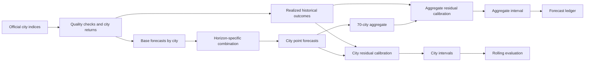
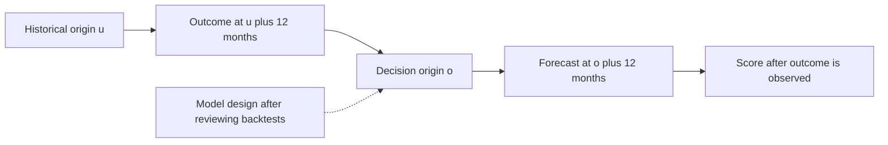

**Version:** 0.3 (preprint)

**Data through:** 2026-09. The backtests and scenarios use data available through this date and do not update automatically with the page.

## Abstract

For how long can a model forecast urban home prices in China, and how often do its prediction intervals contain the realized outcomes? Using the National Bureau of Statistics' existing-home price indices for 70 cities, this paper constructs forecasts for horizons of 1 to 60 months and evaluates them in rolling backtests against an unchanged-price baseline. The modeling data cover February 2011 through September 2026; origins from 2019 onward are scored, and earlier origins are used for learning.

In the city-level backtest, the 12-month forecast has 38% lower mean absolute error than the unchanged-price baseline, and its nominal 80% interval covers 80% of realized outcomes. At 24 months, the corresponding figures are 28% lower error and 82% coverage. At 48 and 60 months, errors are 12% and 33% higher, while coverage of the 80% interval falls to 64% and 59%. The number of scoreable origins differs by horizon, and cities and origins are correlated, so these coverage rates describe the backtest sample. The global model has misaligned multi-horizon training labels, so some backtests may use future information. The model and some parameters were also selected using the same backtests, making results potentially optimistic. The June 2026 origin is also a retrospective replay. The first saved forecast ledger awaits scoring against subsequent observations and does not yet establish prospective validation.

This paper also finds an implementation error in the mean-reversion component of the author's earlier v0.2 method, whose weight-selection objective differs from the five-year cumulative outcome reported. At matched origins, errors for Beijing fall by approximately 19% and 28% at 12 and 24 months, respectively. This comparison is also affected by retrospective model selection.

**Keywords:** house price indices; probabilistic forecasting; rolling backtests; interval coverage; forecast combinations; China

## 1. Introduction

Households and researchers care about future house prices, but a single long-range number does not show how large forecast errors may be. This paper asks whether forecasts constructed from historical price indices improve on the simple unchanged-price baseline at different horizons, and how their prediction intervals have covered historical outcomes. The outcome is the cumulative change in city existing-home price indices, not transaction prices per square meter. The paper does not estimate the effects of changes in policy, interest rates, or population.

The paper combines several base models and builds intervals from realized historical errors. The global model also uses recent changes in the new-home price index as a feature. Error, direction, and coverage are reported separately by horizon. Model selection and interval learning restrict when historical outcomes are available, but the global model has misaligned multi-horizon training labels. The overall method was also designed after examining the backtests, so backtest performance cannot be equated with independent prospective forecasting ability. The author's previous five-year forecast paper provides an additional comparison. This paper presents the data, method, and results first, then examines the earlier implementation error and differences between the methods.

## 2. Related Work

**Damped trends and forecast combinations.** Damped trends (Gardner & McKenzie, 1985) attenuate extrapolated trends; forecast combinations have been studied by Bates and Granger (1969), among others. The top-k average and the fixed use of a damped trend at long horizons follow these approaches.

**Information across series.** Global modeling and modeling each series separately are alternative ways to forecast a group of time series (Montero-Manso & Hyndman, 2021). This paper uses cross-series information in two ways: a gradient-boosting model pooled across 70 cities and shrinkage of each city's momentum toward its tier's mean (first-, second-, or third-tier cities).

**Foundation models.** Zero-shot time-series foundation models can forecast without training on the target data (Ansari et al., 2025, Chronos-2). Chronos-2 is included as an optional base model.

**House price momentum and reversion.** For US repeat-sales indices, Case and Shiller (1989) found that annual changes in citywide indices were followed by changes in the same direction, amounting to one-quarter to one-half of the previous year's change, with weak evidence of seasonality. Glaeser and Nathanson's (2017) extrapolative-expectations model produces one-year momentum, five-year mean reversion, and excess volatility relative to fundamentals. Capozza et al. (2002) estimated serial-correlation and reversion coefficients for 62 US metropolitan areas; both varied with city size, income growth, population growth, and construction costs. These studies suggest that short-term momentum and long-term reversion can coexist. US findings do not by themselves establish the same pattern for China's 70 cities. This paper uses an unchanged-price baseline to examine historical performance at different horizons.

**China.** Fang, Gu, Xiong, and Zhou (2016) constructed a 120-city price index from developers' successive sales of new homes for 2003 to 2013; Wu, Deng, and Liu (2014) examined the construction of Chinese house price indices. This paper uses an equal-weighted average of the National Bureau of Statistics' 70-city indices and does not examine measurement error in those indices, a limitation discussed in §6.3.

## 3. Data and Methods

### 3.1 Data

The data are the National Bureau of Statistics' month-on-month and year-on-year existing-home sales price indices for 70 large and medium-sized cities. Official pages were collected directly from February 2011 onward. Earlier data come from a third-party mirror; all 13,580 comparable cells match the official pages, but official pages are unavailable to check 2006 through 2010 themselves. **Data quality check:** chaining monthly indices should reproduce the year-on-year index. The identity has no violations from 2013 onward and passes from 2008, but **fails in 2006 and 2007** (median difference about 4 index points). Modeling therefore uses only the current methodology from February 2011 onward. From 2021, the mirror swapped Xuzhou with Yangzhou and Huizhou with Shaoguan; the same identity established that the official pages were correct, so the mirror is not used from 2021 onward.

The modeling sample covers 188 months from 2011-02 to 2026-09 across 70 cities, with no missing or imputed cells. “National” means the **equal-weighted mean** of the 70 city month-on-month indices, chained over time and aggregated bottom-up from city forecasts.

Figure 1 shows the research flow. City point forecasts are combined at the city level and then aggregated monthly into the equal-weighted 70-city index; city and national intervals use their respective historical errors.


**Figure 1:** Main paths from data through models to evaluation. The rolling backtest replays history; the forecast ledger records predictions awaiting assessment.

### 3.2 Forecast Target

For each city and each horizon h = 1…60, the target is the cumulative log change over h months after the origin. Outputs are a point forecast and four endpoints for the 80% and 95% intervals.

Let $I_{c,t}$ be the month-on-month index for city c in month t. Monthly log change is $r_{c,t}=\log(I_{c,t}/100)$, and the target at origin o and horizon h is $y_{c,o,h}=\sum_{j=1}^{h}r_{c,o+j}$. City results are converted back to a cumulative index using $100\exp(y)$.

### 3.3 Base Models

| Model | Meaning |
|---|---|
| naive | Continues the previous month's change |
| drift12 | Continues the mean monthly change over the previous 12 months (the “trend” component in v0.2) |
| ar1 | AR(1) on monthly changes, reverting toward the mean of the most recent 60 months |
| damped | Damped trend: EWMA level over 24 months with a two-month half-life, multiplied by 0.96 each month |
| damped_shrunk | As damped, with each city level equal to 0.6 × its own level + 0.4 × its tier mean |
| global | Gradient boosting pooled across 70 cities (direct multi-horizon, trained through 36 months) |
| chronos2 | Zero-shot foundation model (forecasts through 12 months only) |

The global model uses the city's own lagged values, rolling means and volatility, 70-city aggregate features, city tier, and the three-month mean for new homes. It fits targets separately at 1, 2, 3, 6, 9, 12, 18, 24, and 36 months and interpolates other horizons. Training selection is cut off by target maturity; fewer than 1,500 observations means that model does not provide a forecast. Review found that the code misaligns an h-month label as the cumulative change from t+h through t+2h−1, while the selection condition still requires only t+h to be no later than the forecast origin. For h≥2, training may therefore use outcomes up to h−1 months after that origin. The h=1 label does not have this misalignment.

### 3.4 Combination

- **+1 to +12 months:** For each horizon, select the two available models with the lowest mean squared error (MSE) in cumulative log changes over cities and origins realized before the decision origin, and average them equally (top-2). This selection criterion differs from the mean absolute error (MAE) used in the result tables.
- **From +13 months:** Use damped_shrunk with fixed weight and no further learning. Learning long-horizon weights can use only origins at least h months old, which belong to another market regime. In the backtest, weighting historical errors through 36 months produced 36% higher error than “unchanged price” at +36 months. The long-horizon rule was selected in the same backtest, so its results may be optimistic (§6.1). The shrinkage strength of 0.6 was selected from three candidates and is likewise optimistic.

The damped trend is implemented as follows. The last 24 monthly log changes for a city are averaged with exponential weights with a two-month half-life; call the result $L_c$. Let $\bar L_{tier(c)}$ be the mean across cities in the same tier. The model computes $\widetilde L_c=0.6L_c+0.4\bar L_{tier(c)}$, then the cumulative forecast $\widehat y_{c,o,h}=\sum_{j=1}^{h}0.96^j\widetilde L_c$. City tiers follow the project's classification table.

Each backtest proceeds in this order:

```text
for each origin o and horizon h:
    generate base forecasts for o; the global model has the label defect described above
    select historical origins u whose h-month outcomes are available by o
    if h <= 12 and at least 3 such origins are available:
        rank available models by pooled city-and-origin MSE; average the best 2
    else if h > 12:
        use the shrunk damped model
    else:
        use naive and mark the horizon as not yet scoreable
    recombine historical base forecasts with the selected current weights
    standardize the realized errors and calculate recency-weighted quantiles
    score the forecast only when its outcome is available
```
Model weights are chosen by horizon, not by city. If fewer than 100 standardized city errors are available, the interval uses preset normal quantiles; the same fallback applies when fewer than three national residual origins are available. When too few models are available, the combination is renormalized over the paths present.

### 3.5 Intervals

For city c and horizon h, the interval scale is

> s(c, h) = σ_c · √h + τ_c · h

Here σ_c is the standard deviation of monthly log changes over the last 24 months, and τ_c is the standard deviation over the last 36 months of the 12-month mean change, measuring the instability of the trend itself. The first term accumulates monthly noise as a random walk; the second grows linearly with uncertainty about the trend. The base-model forecasts at historical origins are recombined using the weights chosen at the current decision origin, producing realized errors that are divided by s. These are not errors from the combined forecasts actually issued at each historical origin, which may increase optimistic bias. For each horizon, the **empirical quantiles** of standardized errors are calculated with greater weight on recent origins (a half-life of four origins, or 12 months). The interval is point forecast + quantile × s. Standardized residual quantiles are adjusted for monotonicity across horizons; this does not guarantee monotonic final interval endpoints. The center is the model point forecast, not a forecast median corrected by the empirical residual median.

The national series first takes an equal-weighted average of the monthly forecast indices across cities and then chains those averages. Its interval does not average city intervals directly. At each historical origin, actual and forecast paths are aggregated separately; their difference in national cumulative log change is divided by the median scale across the 70 cities at that origin. National quantiles use the same recency weights. For output, the national point forecast is increased by “national quantile × current median city scale” and converted back to an index. The coverage in Table 2 pools city observations only. This paper does not report national interval coverage under the same protocol, and city coverage cannot stand in for it.

This construction replaces the v0.2 band based on the magnitude of historical five-year cumulative change. The v0.2 width is unrelated to forecast error; here the width comes from realized forecast errors.

### 3.6 Evaluation Protocol

- **Origins:** Every three months from 2016-01, 43 in total. Scoring starts in 2019-01 (31 origins); earlier origins are used only for learning.
- **Information boundary for model selection and intervals:** Origin o enters horizon h weight and quantile learning only when o + h ≤ the decision origin. Unit tests protect this rule, but they did not cover the misalignment of the global model’s training labels.
- **Metrics:** MAE improvement relative to “unchanged price” (skill), direction hit rate, and realized coverage of 80% and 95% intervals. The unchanged-price baseline predicts zero cumulative change.
- **Repeat runs:** The original project reports point-by-point identical pipeline results for the same input; its complete environment and data snapshot still need independent verification.

The following illustrates the information boundary for a forecast origin o and a 12-month horizon. The 12-month outcome from a historical origin u must be realized by o to enter model selection and interval calculation. Under the selection and interval rules, outcomes after o do not enter those two steps; the global model’s training labels have the exception described above.


**Figure 2:** Information boundary used in model selection and interval learning; the global model’s multi-horizon training labels violate this boundary. The dotted line indicates that the overall method was determined after examining backtests; that design step was not part of the decision made at each historical origin.

### 3.7 Forecast Ledger

Each update saves all current forecasts to a file for automatic scoring after the next data release. The repository contains the first ledger, with origin 2026-09. As of the data cutoff in this paper, no subsequent scoring was available, and the file's creation time and immutability have not been verified here; it cannot yet be treated as a completed prospective test.

## 4. Results

### 4.1 Backtest Performance


**Figure 3:** Errors and city interval coverage of the original combination including global at the eight reported horizons; the global model’s multi-horizon training labels are misaligned. Dotted lines indicate nominal coverage. Horizons are positioned at their actual month values on the horizontal axis; each point is one evaluated horizon, and intervening months were not tested individually.

**Table 1. Original rolling backtest (70 cities, realized scoring origins from 2019-01; mean absolute error of cumulative log change × 100)**

The global model’s results at h≥2 are affected by misaligned training labels; the combination may also be affected. See the comparison excluding the global model below.

| Model | +1 | +3 | +6 | +12 | +24 | +36 | +48 | +60 |
|---|---|---|---|---|---|---|---|---|
| Unchanged price | 0.49 | 1.38 | 2.62 | 4.97 | 9.31 | 12.66 | 15.11 | 16.92 |
| naive | 0.29 | 0.87 | 1.92 | 4.18 | 9.11 | 15.15 | 22.95 | 34.27 |
| drift12 | 0.36 | 0.97 | 1.91 | 3.85 | 8.51 | 15.57 | 24.91 | 36.44 |
| ar1 | 0.29 | 0.89 | 1.99 | 4.62 | 11.53 | 20.23 | 29.09 | 38.05 |
| damped | 0.30 | 0.80 | 1.63 | 3.20 | 6.95 | 12.16 | 17.10 | 22.60 |
| damped_shrunk | 0.30 | 0.79 | 1.58 | 3.03 | 6.73 | 11.94 | 16.85 | 22.46 |
| global (through 36) | 0.27 | 1.07 | 2.78 | 8.00 | 15.44 | 19.95 | — | — |
| Chronos-2 (through 12) | 0.27 | 0.76 | 1.62 | 3.36 | — | — | — | — |
| **Combination** | **0.27** | **0.76** | **1.52** | **3.07** | **6.73** | **11.94** | **16.85** | **22.46** |
From +13 months, the combination equals damped_shrunk, so their values are identical. Global and Chronos-2 are not reported beyond the horizons for which they were trained.

Each horizon includes only outcomes realized by 2026-09; 31 is the total number of scoring origins, not the number in each column. In the order shown, the scoreable origins number 31, 30, 29, 27, 23, 19, 15, and 11. Cities and adjacent origins are not independent, and statistical uncertainty is not estimated in the table. The log errors in Table 1 cannot be compared directly with the errors in ordinary cumulative percentage change in Table 3.

**Table 2. Improvement over “unchanged price,” direction hit rate, and interval coverage**

| Horizon | +1 | +3 | +6 | +12 | +24 | +36 | +48 | +60 |
|---|---|---|---|---|---|---|---|---|
| Improvement over unchanged price | 46% | 45% | 42% | 38% | 28% | 6% | −12% | −33% |
| Direction hit rate | 83% | 84% | 84% | 81% | 76% | 65% | 50% | 26% |
| Realized 80% interval coverage | 80% | 78% | 77% | 80% | 82% | 71% | 64% | 59% |
| Realized 95% interval coverage | 95% | 94% | 95% | 96% | 96% | 91% | 86% | 85% |

**Reading the results.** (1) At the reported +1, +3, +6, and +12 months, improvement is 38% to 46%, 80% interval coverage is 77% to 80%, and 95% interval coverage is 94% to 96%, close to nominal values. (2) At +24 months, improvement is 28% and coverage is 82%, but the rule was selected in the backtest and is optimistic. (3) By +36 months the improvement has nearly disappeared; it becomes negative at +48 and +60 months, with coverage also below nominal. Direction accuracy is only 26% at +60 months: momentum at the scoring origins was upward, while 90% of cities fell cumulatively over the following 60 months.


**Figure 4:** Differences in error across cities. Each point represents a city. The mean of each forecast's error is calculated for the same realized origins in that city; improvement is “unchanged-price MAE − combination MAE.” A positive value means the combination has lower error, and the short orange line is the median across 70 cities. The vertical axis is absolute error in cumulative log change multiplied by 100. The 12-, 24-, and 60-month horizons use 27, 23, and 11 origins respectively, with results for all 70 cities at each horizon. All 70 cities have positive values at 12 and 24 months, and two are positive at 60 months. This describes the backtest sample; cities and adjacent origins are not independent.


**Figure 5:** Error broken down by backtest origin. For each point, the combination and unchanged-price MAE are first calculated across 70 cities at the same origin and horizon; improvement is “unchanged-price MAE − combination MAE,” with positive values indicating lower combination error. The horizontal axis is forecast origin o, and the realized target window runs from the month after o through month o + h. The panels show horizons of 12, 24, and 60 months. Adjacent origins are three months apart and their target windows overlap heavily, so the points are not independent observations. The number and range of scoreable origins differ by horizon, so the panels cannot be directly compared as though they used the same time sample.

Both figures recalculate combination weights and errors for each origin from the saved backtest cache. The same cache is first used to recalculate Tables 1 and 2 and verify agreement with the original report, then the results are aggregated by city or origin. Cache and algorithm versions are listed in the evidence index below.

**Sensitivity excluding the global model and Chronos-2.** Base-model caches are used to reselect models and calculate intervals, first removing the global model alone and then removing both the global model and Chronos-2. In the latter case, combination errors at 1, 3, 6, and 12 months are 0.281, 0.819, 1.597, and 3.086, respectively; removing only the global model produces 0.278, 0.754, 1.519, and 3.073. For the reported origins in the original combination, global was selected at all 31 origins at +1 month, where the label does not have the misalignment described above; it was selected at one of 30 origins at +3 months, and at none at +6 or +12 months. At horizons not shown in Table 1, global was also selected at all 31 origins at +2 months and at two of 28 origins at +11 months. Because interval quantiles are adjusted across horizons, removing a model may also affect intervals at other horizons. This test reused the cache without retraining base models.

**Excluding Chronos-2 alone.** The Chronos-2 paper appeared in 2025, whereas backtest origins start in 2019. The full time boundary of its pretraining data and any overlap with the target series have not been verified, so early results cannot be treated as prospective forecasts using a model that was actually available then. Using saved base-model backtest records, the original report is first recalculated; Chronos-2 is then removed and both the combination and interval calibration are reselected:

| Horizon | Original combination MAE × 100 | Without Chronos-2 | Improvement over unchanged price without Chronos-2 | 80% coverage without Chronos-2 |
|---|---:|---:|---:|---:|
| +1 | 0.267 | 0.275 | 43.9% | 79.5% |
| +3 | 0.763 | 0.824 | 40.1% | 79.4% |
| +6 | 1.519 | 1.597 | 39.1% | 78.3% |
| +12 | 3.073 | 3.086 | 38.0% | 80.2% |

From +13 months, the shrunk damped trend is fixed; removing Chronos-2 does not change its point forecasts. This comparison reused saved base-model records and did not recollect data or retrain every base model. Recalculation from the cache matched the original report's backtest metrics.

### 4.2 Credibility Bands

Using the eight evaluated horizons of 1, 3, 6, 12, 24, 36, 48, and 60 months, this paper makes a rough retrospective division into three ranges for reading the scenario results. Unreported months have not been verified month by month, and the thresholds do not guarantee future performance. The reference criteria are: within the learning horizon, 80% interval coverage within 0.80 ± 0.05 and improvement ≥ 20% are labeled “better backtest performance”; thereafter, improvement ≥ 15% and coverage ≥ 70% are labeled “cautious reference”:

| Band | Horizon | Meaning |
|---|---|---|
| Better backtest performance | +1 to +12 months | Weights learned from realized errors; sample coverage close to nominal |
| Cautious reference | +13 to +24 months | Fixed rule selected after seeing results; performance is optimistic |
| Scenario only | From +25 months | No demonstrated skill; treat as a scenario, not a forecast |

### 4.3 Replay from the June 2026 Origin

Using 2026-06 as origin and learning weights and quantiles only from that month and earlier, the model is compared with the next three months of published data. The national cumulative index (origin month = 100) was 99.71, 99.40, and 99.14; model point forecasts were 99.67, 99.33, and 98.97; and the 80% intervals were [99.54, 99.82], [99.04, 99.92], and [98.53, 99.77]. All three actual values fell within the intervals. Across 70 cities, MAE in the +3-month cumulative log change × 100 was 0.35 (unchanged price: 0.94). For v0.2 over the same period, Beijing was above its interval's upper bound in all three months, while the national value was close to the upper bound. The model was finalized after those three months were published, so this is a replay.

### 4.4 Side-by-Side Comparison with v0.2 at Matched Origins

**Table 3. Cumulative-change error at matched origins from 2019-01, percentage points**

| Region | Horizon | Origins | v0.2 algorithm | This model | Unchanged price |
|---|---|---|---|---|---|
| National | +12 | 27 | 4.13 | **2.09** | 4.24 |
| | +24 | 23 | 9.43 | **4.93** | 7.75 |
| | +36 | 19 | 15.75 | 10.05 | 9.93 |
| | +60 | 11 | 28.69 | 20.72 | 14.22 |
| Beijing | +12 | 27 | 5.32 | **4.30** | 5.05 |
| | +24 | 23 | 10.96 | **7.89** | 9.82 |
| | +36 | 19 | 18.09 | 13.80 | 12.36 |
| | +60 | 11 | 35.94 | 15.35 | 8.92 |

At +12 and +24 months, this model's national error is about half that of v0.2; Beijing's is 19% to 28% lower. **From +36 months, neither model beats “unchanged price.”** Origins start only after 2019 because this model needs realized history for learning.

### 4.5 Current Forecast


**Figure 6:** Historical equal-weighted 70-city index and model output from origin 2026-09, with the origin set to 100. The shading is the model's 80% interval; long-horizon city intervals undercovered in backtests, and national interval backtest coverage has not been reported separately.

National (origin 2026-09, point forecasts and 80% intervals for cumulative index change):

| Horizon | Point forecast | 80% interval | Band |
|---|---|---|---|
| +12 months (2027-09) | −2.8% | −6.3% ~ −0.4% | Better backtest performance |
| +24 months (2028-09) | −4.5% | −11.4% ~ −0.1% | Cautious reference |
| +36 months (2029-09) | −5.5% | −17.1% ~ +0.7% | Scenario only |
| +60 months (2031-09) | −6.5% | −24.3% ~ +3.5% | Scenario only |

The v0.2 five-year baseline of −22.1% lies near the lower end of this paper's five-year interval (−24.3% to +3.5%). **The interval is wide and five-year skill has not been demonstrated.** This paper therefore treats −6.5% as a scenario center under damped momentum extrapolation with mean reversion omitted, not as a five-year forecast.

## 5. Comparison with and Corrections to the Earlier Method

The comparison is the author's earlier [v0.2 five-year forecast paper](https://github.com/Liyuk/cn-housing-price-training/blob/main/docs/paper-five-year-housing-price-forecast.md). Methods and results for the following calculations are in the repository's [audit script](https://github.com/Liyuk/cn-housing-price-training/blob/main/scripts/paper_algorithm_audit.py) and [audit record](https://github.com/Liyuk/cn-housing-price-training/blob/main/docs/review-forecast-paper-algorithm-2026-11.md).

### 5.1 Replication

On the v0.2 data (2019-01 to 2026-06, 90 months), all v0.2 figures are fully reproduced: national weights 1/0/0 and Beijing weights 0.25/0.50/0.25; ρ = 0.958 and 0.695; five-year baselines of −22.1% (−33.5% to −10.6%) and −4.6% (−9.0% to −0.1%); and all 12 rows of the weight-sensitivity table in §3.2 of that paper.

### 5.2 An Implementation Error

The v0.2 mean-reversion component retained 1 − ρ of the gap each month (`five_year_forecast.py:74`), whereas an AR(1) should retain ρ. As a result, the component closed ρ of the gap in the first step (96% nationally and 69% for Beijing), effectively jumping straight to the sample mean. The half-lives reported in v0.2, 16.1 and 1.9 months, were not those actually used. After correction, the national result is unchanged because the reversion weight is zero. Beijing's weights change from 0.25/0.50/0.25 to 0/0.75/0.25, **the five-year baseline changes from −4.6% to −7.0%**, and its interval changes from −9.0% to −0.1% to −11.5% to −2.6%.

### 5.3 Methodological Weaknesses

- **Small weight-selection sample.** In 90 months of data, weights came from only seven overlapping windows, each 12 months long and three months apart, from 2022-01 to 2024-06. They represent roughly 2.5 independent years, all in the same downturn. The first and second national models differ in error by only 0.6%, and the Beijing models by only 0.1%.
- **Selection objective differs from the reported quantity.** Weights were selected on MAE for 12 months of monthly indices and then used to report a 60-month cumulative change.
- **Headline sensitivity to one hyperparameter.** Changing only the training cutoff fraction from 0.55 to 0.9 moves the Beijing five-year baseline between −0.6% and −9.6%, a span wider than the v0.2 low/high interval of −9.0% to −0.1%.
- **The low/high band is not an error interval.** Its width is 0.5 × the absolute value of the past five-year cumulative change, unrelated to forecast error and constant across horizons.
- **The reversion anchor changes with the window.** The “long-run mean” implies an annualized −2.45% in the window starting in 2019, +0.09% from 2011-02, and +0.68% from 2008-01.

### 5.4 Testing the v0.2 Algorithm over a Longer History

For the national and Beijing series from 2011-02, the v0.2 algorithm is rerun at each of 22 origins from 2016-06 to 2021-09 using data available at that time, including reselection of weights. Forecasts are compared with subsequent realized cumulative change.

**Table 4. Rolling test of the v0.2 algorithm (MAE of cumulative change, percentage points)**

| Region | Horizon | v0.2 algorithm | Unchanged price | v0.2 improvement over unchanged | Realized v0.2 interval coverage |
|---|---|---|---|---|---|
| National | +12 | 2.90 | 4.13 | +30% | 41% |
| | +24 | 6.14 | 7.30 | +16% | 36% |
| | +36 | 10.60 | 9.91 | −7% | 14% |
| | +60 | 19.59 | 14.45 | −36% | 23% |
| Beijing | +12 | 6.65 | 4.76 | −40% | 41% |
| | +24 | 12.08 | 8.17 | −48% | 41% |
| | +36 | 19.16 | 10.64 | −80% | 50% |
| | +60 | 40.72 | 12.61 | −223% | 36% |

**Limitations.** All origins fall in the 2016 to 2021 rising market. The test examines extrapolation from an upswing into the subsequent downturn, not the downturn extrapolation v0.2 actually faced. The 22 origins overlap heavily; at +60 months there is only about one effectively independent origin. Beijing also experienced a policy shock in 2016 and 2017, unfavorable to any momentum-based algorithm. Table 4 therefore shows that **the algorithm has no protection at turning points**; it cannot be translated directly into a claim that v0.2's −22% must be wrong.

### 5.5 Citation Check

The v0.2 references were checked against their original abstracts. Its descriptions of Capozza et al. (2002) and Fang et al. (2016) were accurate. Piazzesi and Schneider (2009) described a “small cluster” of households, not “many”; v0.2 **overstated** this. Glaeser and Nathanson (2017) found **one-year momentum and five-year mean reversion**, contrary to v0.2's five-year approach. Case and Shiller (1989) found weak evidence of seasonality, yet v0.2 assigned seasonality a 25% weight. For Rapach and Strauss (2009) and a few other references, only existence was confirmed; contents were not checked.

## 6. Discussion and Limitations

The global model’s misaligned multi-horizon training labels are an implementation defect in this version of the backtest. The global row in Table 1 should not be used as a model comparison free of look-ahead; sensitivity results for the combination are in §4.1. The complete pipeline can be verified only after correcting the labels, retraining, generating forecasts, and repeating the backtest.

### 6.1 Retrospective Design

Retrospective design enters in four main places: (1) the model was finalized after the most recent three months were published, so §4.3 is a replay; (2) the long-horizon damped rule was chosen after it appeared as the best long-horizon single model in the same backtest; (3) k in top-2 and the shrinkage strength of 0.6 were selected in that backtest (k=1 was better at +12 months, but winner-take-all was less stable, so 2 was selected; restricting origins to 2023 onward also improves results, but uses the same data); and (4) backtest origins overlap heavily, with only 15 and 11 origins at +48 and +60 months, respectively, and fewer effectively independent observations. Results at all horizons may be optimistic; the long-range results are particularly affected by rule selection and limited effective sample size. The 2026-09 forecast ledger has been saved, but its creation time and immutability remain to be verified.

### 6.2 Regime Bias in the Backtest

Scoring origins from 2019 onward cover one complete downturn, while nearly all earlier origins fell in an upswing. The +48-month scoring origins are limited to 2019-01 through 2022-07, and the +60-month origins to 2019-01 through 2021-07. The 36 to 60 months after these origins coincide with the downturn starting in 2021. The negative +60-month result therefore shows that “momentum extrapolation fails at turning points”; it does not mean every five-year forecast will perform worse than “unchanged price.”

### 6.3 Index Measurement

This paper treats the equal-weighted average of the National Bureau of Statistics' 70-city indices as price, without examining whether the indices reflect actual transaction prices or whether equal weighting is appropriate. There is dedicated research on Chinese house price index construction (Wu, Deng & Liu, 2014); Fang et al. (2016) constructed their own 120-city new-home price index. This paper leaves that question to future work.

### 6.4 Other Limitations

- **No exogenous variables.** Policy, interest rates, population, and income are excluded. Monthly data from 2022 onward for variables such as rental yields have been collected for 12 cities, but remain insufficient to estimate long-run relationships.
- **The 70 cities are not the whole country.** They cover 30 provincial-level jurisdictions (excluding Tibet), but represent only a small share of China's roughly 300 prefecture-level cities and exclude large cities such as Suzhou, Dongguan, Foshan, Zhongshan, and Zhuhai.
- **Data sources.** The 2006 to 2010 data come from a third-party mirror without official pages for verification, and the 2006 to 2007 data failed the consistency test between monthly and year-on-year indices.
- **Long-range intervals cease to be calibrated.** From +36 months, 80% interval coverage falls below nominal; this paper labels those outputs scenarios accordingly.
- **Not done:** hierarchical reconciliation (city → tier → national), online conformal calibration, and turning-point probabilities.

### 6.5 Implications for v0.2

The v0.2 qualitative conclusion that “Beijing is a mean-reverting market” rested on a 0.1% selection difference and an implementation error; it no longer holds here. The v0.2 characterization of the national market as a “downward-trending market” remains consistent with this paper at +12 months (a −2.8% national point forecast). This paper neither disproves nor confirms v0.2's discussion of a market bottom: it does not produce an endogenous turning-point probability.

## 7. Conclusion

In this 70-city backtest, 12-month results beat the unchanged-price baseline, and interval coverage is close to nominal. The 24-month result is also favorable but affected by retrospective selection. Five-year results have not shown an advantage over the baseline, so the output can serve only as a model scenario. The v0.2 five-year baseline of −22.1% relies on momentum extrapolation and does not outperform “unchanged price” in the backtest; its Beijing figure is also affected by an implementation error. The methodological implications are: (1) report performance relative to “unchanged price” first and separately by horizon; (2) interval width should include trend instability and be calibrated using realized errors; (3) learning long-horizon weights requires enough realized historical outcomes, and this paper's fixed rule also needs independent validation; and (4) use a forecast ledger to separate retrospective design from prospective testing.

## Reproduction

```bash
python scripts/paper_algorithm_audit.py            # §5：复现 v0.2、选择诊断、滚动检验、与本文模型并排
python -m src.probabilistic_forecast               # §3、§4：不含 Chronos-2 的回测与预测
python scripts/acceptance.py --full                # 验收：数据、模型、站点；--full 另查逐值可复现
```
Table 1 includes Chronos-2. Reproducing it also requires running `src.tsfm_baseline` to generate a forecast JSON and passing it with `--tsfm <JSON 路径>`. The default command excludes that model. Model dependencies, caches, and the exact commit have not been independently verified here, so these commands are entry points to reproduction rather than a guarantee of completed replication. Backtest results are in `reports/probabilistic_forecast_backtest.json`, and the forecast ledger is in `reports/forecast_ledger/`. The “Forecast Logic” page at <https://liyuk.github.io/cn-housing-price-training/> shows the items in Tables 1 to 3.

### Evidence Index and Version

The table pins the repository commit checked here, [`dab16046e5f7ed3955167cbef17d826d45bffef4`](https://github.com/Liyuk/cn-housing-price-training/tree/dab16046e5f7ed3955167cbef17d826d45bffef4). The processed panel and model cache are not included in that commit; hashes identify the local files used here and do not imply that public readers can already obtain the same snapshots.

| Stage | File or result | Relationship to this paper |
|---|---|---|
| Collection and definitions | `data/source_registry.csv`, `src/panel.py` | Source records, data validation, and definition of monthly log change |
| Cleaned panel | `data/processed/housing_indices_clean_v4.csv` | Modeling input from 2011-02 through 2026-09; SHA-256: `47f85bb3c57978dcbbfd5676cf8c486da0fbe14204965a7434c6d7bc3a1465a8`; untracked file |
| Backtest algorithm | `src/probabilistic_forecast.py`, `src/tsfm_baseline.py` | Base models, model selection, intervals, and scoring; base-model weights and caches must be obtained separately |
| Results | `reports/probabilistic_forecast_backtest.json` | Figure 3 and Tables 1–2; SHA-256: `d6bdcf6fe324534043044448376e49cfe56692712471057e003fbd74e929e039` |
| Forecast ledger | `reports/forecast_ledger/2026-09.csv` | Figure 6 point forecasts and intervals; SHA-256: `7a691f3c8159cc6d2cf03ab5990cb904e2b3af1b273a51689e702a33acaec1c5` |
| Earlier-model comparison | `scripts/paper_algorithm_audit.py`, `reports/paper_algorithm_audit.json` | Tables 3–4 and review of the v0.2 algorithm |

Figure 3 uses the eight reported horizons directly from the results file. Figures 4 and 5 call the same model-selection and combination functions at each origin using the backtest cache described below, and then average by origin or city respectively. The historical line in Figure 6 is constructed by equal-weighting the cleaned panel's 70 monthly city indices, chaining them, and setting 2026-09 to 100; the forecast line and intervals come from corresponding ledger columns. The table excluding Chronos-2 uses the local backtest cache: the original report is checked first, then that model's paths are removed and the same scoring function is called. The cache is not pinned as a public snapshot; its SHA-256 is `58498c59b44c5687f04291175c5925a2a01511d4bdd958b9e5e3a32f5e55dc5a`. This cache calculation used Python 3.9.6, NumPy 2.0.2, pandas 2.3.3, and scikit-learn 1.6.1. Full replication will require publication or reconstruction of matching-hash data and caches, plus fixed execution environment and Chronos-2 model version.

## References

[1] Ansari, A. F., Shchur, O., Küken, J., et al. (2025). Chronos-2: From Univariate to Universal Forecasting. arXiv:2510.15821. https://arxiv.org/abs/2510.15821

[2] Bates, J. M., & Granger, C. W. J. (1969). The Combination of Forecasts. *Operational Research Quarterly*, 20(4), 451–468. https://doi.org/10.2307/3008764

[3] Capozza, D., Hendershott, P., Mack, C., & Mayer, C. (2002). Determinants of Real House Price Dynamics. NBER Working Paper 9262. https://doi.org/10.3386/w9262

[4] Case, K., & Shiller, R. (1989). The Efficiency of the Market for Single-Family Homes. *American Economic Review*, 79(1). NBER Working Paper 2506. https://doi.org/10.3386/w2506

[5] Fang, H., Gu, Q., Xiong, W., & Zhou, L.-A. (2016). Demystifying the Chinese Housing Boom. *NBER Macroeconomics Annual*, 30. NBER Working Paper 21112. https://doi.org/10.3386/w21112

[6] Gardner, E. S., & McKenzie, E. (1985). Forecasting Trends in Time Series. *Management Science*, 31(10), 1237–1246. https://doi.org/10.1287/mnsc.31.10.1237

[7] Glaeser, E., & Nathanson, C. (2017). An Extrapolative Model of House Price Dynamics. *Journal of Financial Economics*, 126(1). NBER Working Paper 21037. https://doi.org/10.3386/w21037

[8] Makridakis, S., Spiliotis, E., & Assimakopoulos, V. (2020). The M4 Competition: 100,000 time series and 61 forecasting methods. *International Journal of Forecasting*, 36(1), 54–74. https://doi.org/10.1016/j.ijforecast.2019.04.014

[9] Montero-Manso, P., & Hyndman, R. J. (2021). Principles and algorithms for forecasting groups of time series: Locality and globality. *International Journal of Forecasting*, 37(4), 1632–1653. https://doi.org/10.1016/j.ijforecast.2021.03.004

[10] Piazzesi, M., & Schneider, M. (2009). Momentum Traders in the Housing Market: Survey Evidence and a Search Model. NBER Working Paper 14669; *American Economic Review*, 99(2), 406–411. https://doi.org/10.3386/w14669

[11] Rapach, D., & Strauss, J. (2009). Differences in Housing Price Forecastability Across US States. *International Journal of Forecasting*, 25(2), 351–372. https://doi.org/10.1016/j.ijforecast.2009.01.009

[12] Timmermann, A. (2006). Forecast Combinations. In *Handbook of Economic Forecasting*, Vol. 1, 135–196. https://doi.org/10.1016/S1574-0706(05)01004-9

[13] Wu, J., Deng, Y., & Liu, H. (2014). House Price Index Construction in the Nascent Housing Market: The Case of China. *Journal of Real Estate Finance and Economics*, 48(3), 522–545. https://doi.org/10.1007/s11146-013-9416-1

[14] Author. (2026a). Measurable and Unmeasurable: A Source- and Definition-Aware Approach to Constructing Chinese House Price Data (with Beijing as a District-Level Case). Preprint, v0.4.

[15] Author. (2026b). China's Existing-Home Prices over the Next Five Years: An Interpretable Combination Forecast and Analysis of a Potential Bottom (2026–2030). Preprint, v0.2.

**Citation verification.** The descriptions of [3], [4], [5], [7], and [10] were checked against abstracts on NBER pages. [6], [8], [9], [12], [13], and [1] were verified for existence and bibliographic details via Crossref or arXiv; **their contents were not checked individually**. This paper cites them only for their titles and commonly recognized findings (damped trends, M4, global models, forecast combinations, Chinese index construction, and foundation models). Only the existence of [11] was verified; the paper does not rely on its specific conclusions.

## Author and Disclosures

**Author:** Liyuk

**Conflicts of interest:** The author declares no conflicts of interest. This project received no commercial funding, and it does not constitute investment advice; forecast outputs are not promises or guarantees of future house prices.

**Data and code availability:** Collection, cleaning, modeling, backtesting, and acceptance code is in the GitHub repository; reproduction still requires verification of the exact commit, dependencies, and model resources ([cn-housing-price-training](https://github.com/Liyuk/cn-housing-price-training)). Processed data and forecast quantiles can be downloaded from the site's “Data and Methods” page.

**About the writing:** Backtest figures come from the repository's result files (`reports/probabilistic_forecast_backtest.json`, `reports/paper_algorithm_audit.json`). The paper and code were produced by the author with AI assistance; the author is responsible for their contents.
