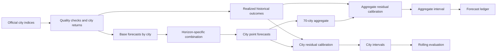
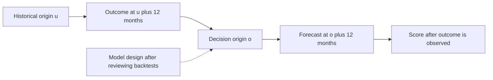

**版本：** 0.3（预印本）

**研究数据截至：** 2026-09；本文的结果是截至该时点数据的回测与情景，不随页面自动更新。

## 摘要

预测中国城市住宅价格时，模型的表现能维持多长时间，预测区间又覆盖了多少实际结果？本文使用国家统计局 70 城二手住宅价格指数，构造 1—60 个月的预测，并以价格不变为基准开展滚动回测。建模数据覆盖 2011 年 2 月至 2026 年 9 月；自 2019 年起的起点用于评分，较早起点用于学习。

在城市样本的回测中，12 个月预测的平均绝对误差比价格不变低 38%，标称 80% 区间覆盖了 80% 的已实现结果；24 个月分别为低 28% 和覆盖 82%。48、60 个月的误差分别高 12%、33%，80% 区间覆盖率降至 64%、59%。不同期限的可评分起点数量不同，城市和起点之间存在相关性，这些覆盖率只是样本内描述。全局模型的多期训练标签存在错位，部分回测可能使用未来信息；模型和部分参数依据同一批回测选择，成绩也可能偏乐观。2026 年 6 月起点的检验也是事后回放。已保存的首期预测账本有待后续实际数据评分，尚不能据此声称通过事前验证。

与作者此前的 v0.2 方法相比，本文还发现其均值回归实现有误，且权重选择目标与五年累计结果不一致。相同起点的比较中，北京在 12、24 个月的误差分别下降约 19%、28%；这一比较同样受事后选模限制。

**关键词：** 房价指数；概率预测；滚动回测；区间覆盖；预测组合；中国

## 1. 引言

家庭和研究者关心未来房价，但单个长期数值无法说明预测误差有多大。本文研究的问题是：仅用历史价格指数构造的预测，在不同期限上能否改善价格不变的朴素基准，以及预测区间的历史覆盖情况如何。研究对象是城市二手住宅价格指数的累计变化，不是每平方米成交价，也不估计政策、利率或人口变化的影响。

本文将多个基础模型组合，并根据已实现的历史误差构造区间；其中全局模型也使用新建住宅指数的近期变化作为特征。对每个预测期限分别报告误差、方向和覆盖率。选模和区间学习限制历史结果的可用时间，但全局模型的多期训练标签存在错位；整个方法也是在观察回测后设计的，因而不能把回测成绩等同于独立的事前预测能力。作者先前的五年预测论文是一个额外的比较对象；本文先报告本研究的数据、方法与结果，再讨论它的实现错误及两种方法的差异。

## 2. 相关工作

**阻尼趋势与预测组合。** 阻尼趋势（Gardner & McKenzie, 1985）对趋势外推加入衰减；预测组合由 Bates 与 Granger（1969）等研究。本文的 top-k 平均与"远期固定用阻尼趋势"都沿用这一思路。

**跨序列信息。** 跨序列建模与逐条建模是预测多条时间序列的不同选择（Montero-Manso & Hyndman, 2021）。本文用两种方式利用它：一个在 70 城上池化训练的梯度提升模型，以及把每个城市的动量向所属层级（一/二/三线）的均值收缩。

**基础模型。** 零样本时间序列基础模型无需在目标数据上训练即可预测（Ansari 等, 2025，Chronos-2）。本文将其作为一个可选的基础模型。

**房价的动量与回归。** 对美国重复销售指数，Case & Shiller（1989）发现全市价格指数的年变化会被同方向的变化接续，幅度为前一年的四分之一到二分之一，且季节性证据弱；Glaeser & Nathanson（2017）的外推预期模型给出一年期动量、五年期均值回归、以及相对基本面的超额波动；Capozza 等（2002）在 62 个美国都市区估计序列相关与回归系数，二者随城市规模、收入增长、人口增长与建筑成本而异。这些研究提示短期动量与长期回归可能并存；美国市场的结果不能直接证明中国 70 城具有同样的规律。本文以价格不变为基准，检验不同期限的历史表现。

**中国。** Fang、Gu、Xiong 与 Zhou（2016）用开发商新房连续销售构建 120 城价格指数（2003—2013）；Wu、Deng 与 Liu（2014）讨论了中国房价指数的构建。本文使用国家统计局 70 城指数的等权平均，没有讨论指数本身的度量误差，这是一项局限（§6.3）。

## 3. 数据与方法

### 3.1 数据

国家统计局 70 个大中城市二手住宅销售价格指数（环比、同比）。官方页面自 2011-02 起直接抓取；2011-02 之前来自第三方整理的镜像，镜像与官方页面在可对照的 13,580 个单元中逐格一致，但 2006—2010 年本身没有官方页面可核对。**数据质量检验**：环比连乘应当等于同比；该恒等式在 2013 年起零违例、2008 年起通过，但 **2006—2007 年不成立**（中位差约 4 个指数点），因此本文只用 2011-02 之后的现行口径建模。（2021 年起镜像互换了徐州↔扬州、惠州↔韶关两对城市，同样用该恒等式证明官方页面是对的，故 2021 年起不使用镜像。）

建模样本：2011-02 至 2026-09，共 188 个月，70 城，无缺口、无推算单元。"全国"定义为 70 城环比指数的**等权平均**再连乘，自下而上由城市预测汇总。

研究链路如图 1：城市点预测先在城市层面组合，再逐月汇总为 70 城等权指数；城市与全国区间各自使用对应的历史误差。



**图 1：** 数据、模型与评估的主要路径。滚动回测与预测账本解决的问题不同：前者回放历史，后者记录待评分的预测。

### 3.2 预测对象

对每个城市和每个期限 h = 1…60，预测从起点月起累计 h 个月的对数变化。输出为点预测，以及 80% 和 95% 区间的四个端点。

记城市 c 在月份 t 的环比指数为 $I_{c,t}$，则月对数变化 $r_{c,t}=\log(I_{c,t}/100)$，起点 o、期限 h 的目标为 $y_{c,o,h}=\sum_{j=1}^{h}r_{c,o+j}$。城市结果转换回累计指数时使用 $100\exp(y)$。

### 3.3 基础模型

| 模型 | 含义 |
|---|---|
| naive | 上月环比延续 |
| drift12 | 最近 12 个月环比均值延续（v0.2 的"趋势"成分） |
| ar1 | 环比的 AR(1)，向最近 60 个月均值回归 |
| damped | 阻尼趋势：24 个月、半衰期 2 个月的 EWMA 水平，每月乘 0.96 |
| damped_shrunk | damped，但每个城市的水平 = 0.6 × 自身 + 0.4 × 所属层级均值 |
| global | 70 城池化的梯度提升（直接多期，训练到 36 个月） |
| chronos2 | 零样本基础模型（只预测到 12 个月） |

全局模型使用城市自身滞后值、滚动均值与波动、70 城汇总特征、城市层级及新建住宅三个月均值。它分别拟合 1、2、3、6、9、12、18、24、36 个月的目标，其他期限通过插值得到；训练筛选按目标到期时间截断，少于 1,500 条时不提供该模型预测。复核发现，代码将 h 月标签错位为从 t+h 至 t+2h−1 的累计变化，而筛选条件仍为 t+h 不晚于预测起点；h≥2 时训练可能使用该起点之后最多 h−1 个月的结果。h=1 的标签没有这一错位。

### 3.4 组合

- **+1 至 +12 个月**：每个期限，按决策时点以前已实现的跨城市、跨起点累计对数变化预测误差的均方误差（MSE），选择最小的两个可用模型，等权平均（top-2）；这与结果表使用的平均绝对误差（MAE）是不同的指标。
- **+13 个月起**：固定使用 damped_shrunk，不再学习。理由：学习长期限的权重只能用 h 个月之前的起点，这些起点属于另一种市场状态；在回测中，按历史误差加权到 36 个月时，+36 个月的误差比"价格不变"高 36%。长期规则是在同一回测中选定的，成绩可能偏乐观（§6.1）。收缩强度 0.6 是从三个候选值中选的，同样偏乐观。

阻尼趋势的实现可以写得更具体。城市最近 24 个月的对数环比用半衰期为 2 个月的指数权重求均值，记为 $L_c$；同层级城市的均值为 $\bar L_{tier(c)}$。模型先计算 $\widetilde L_c=0.6L_c+0.4\bar L_{tier(c)}$，再给出累计预测 $\widehat y_{c,o,h}=\sum_{j=1}^{h}0.96^j\widetilde L_c$。城市层级由项目中的分类表确定。

一次回测按以下顺序执行：

```text
for each origin o and horizon h:
    generate base forecasts for o; the global model has the label defect described above
    select historical origins u whose h-month outcomes are available by o
    if h <= 12 and at least 3 such origins are available:
        rank available models by pooled city-and-origin MSE; average the best 2
    else if h > 12:
        use the shrunk damped model
    else:
        use naive and mark the horizon as not yet scoreable
    recombine historical base forecasts with the selected current weights
    standardize the realized errors and calculate recency-weighted quantiles
    score the forecast only when its outcome is available
```

模型权重按期限而非按城市选择。若城市标准化误差少于 100 个，区间使用预设正态分位数；全国残差起点少于 3 个时也使用该回退值。可用模型不足时，组合按实际存在的路径重新归一化。

### 3.5 区间

对城市 c、期限 h，区间尺度

> s(c, h) = σ_c · √h + τ_c · h

其中 σ_c 是近 24 个月环比对数变化的标准差，τ_c 是近 36 个月"12 个月环比均值"的标准差（趋势本身的不稳定度）。前一项是月度噪声按随机游走累积，后一项是对趋势不确定性的线性增长。用当前决策时点选出的权重重新组合历史基础模型预测，得到已实现误差，再除以 s 得到标准化误差；这不是历史各起点当时实际发出的组合预测误差，可能增加乐观偏差。对每个期限取这些标准化误差的**经验分位数**，且近期起点权重更大（半衰期 4 个起点，即 12 个月）。区间为 点预测 + 分位数 × s。标准化残差分位数经过跨期限的单调性调整；这并不保证最终区间端点随期限单调。中心值直接取模型点预测，并非用经验残差中位数校正后的预测中位数。

全国序列先对各城市每月的预测环比指数取等权平均，再连乘。区间不直接平均城市区间：对每个历史起点，分别汇总实际和预测路径，用两者的全国累计对数差除以该起点 70 城尺度的中位数，再以同样的近期权重计算全国分位数。输出时，将全国点预测加上“全国分位数 × 当前城市尺度中位数”，最后转换回指数。表 2 的覆盖率只汇总城市样本；本文没有给出同等协议下全国区间的覆盖率，不能用城市覆盖率代替它。

这一构造是 v0.2 的"以历史 5 年累计波动为幅度"的替代。v0.2 的幅度与预测误差无关；这里的幅度来自已实现的预测误差。

### 3.6 评估协议

- **起点**：2016-01 起每 3 个月一个，共 43 个；记分从 2019-01 起（31 个），之前的起点只用来学习。
- **选模与区间的信息边界**：起点 o 只在 o + h ≤ 决策时点时才用于期限 h 的权重与分位数学习。该规则由单元测试保护，但测试未覆盖全局模型训练标签的错位。
- **指标**：相对"价格不变"的平均绝对误差改善（技能）、方向命中率、80%/95% 区间的实际覆盖率。基准"价格不变"即预测累计变化为 0。
- **重复运行**：原项目报告相同输入下流水线逐值一致；完整环境和数据快照尚需独立核验。

下面以预测起点 o、期限 12 个月说明信息边界。历史起点 u 的 12 个月结果必须在 o 以前实现，才能参加选模和区间计算；按选模与区间规则，o 之后的结果不进入这两个步骤；全局模型训练标签存在前述例外。



**图 2：** 选模与区间学习采用的信息边界；全局模型多期训练标签违反这一边界。虚线表示整套方法依据回测结果确定，这一步不属于每个历史起点当时的决策。

### 3.7 预测账本

每次更新把当期全部预测保存为文件，下期数据公布后自动对照评分。仓库保存了起点 2026-09 的首期账本；截至本文的数据截点尚无后续评分，也未在本文验证文件生成时间及不可变记录，不能将它视为已完成的事前检验。

## 4. 结果

### 4.1 回测成绩


**图 3：** 含 global 的原始组合在八个报告期限的误差与城市区间覆盖；global 的多期训练标签存在错位。虚线是标称覆盖率，横轴按实际月份定位；每个点对应一个评估期限，中间月份未逐月检验。

**表 1　原始滚动回测（70 城，2019-01 起的已实现记分起点；累计对数变化的平均绝对误差 × 100）**

全局模型在 h≥2 的结果受训练标签错位影响；组合结果也可能受其影响，见下方剔除全局模型的对照。

| 模型 | +1 | +3 | +6 | +12 | +24 | +36 | +48 | +60 |
|---|---|---|---|---|---|---|---|---|
| 价格不变 | 0.49 | 1.38 | 2.62 | 4.97 | 9.31 | 12.66 | 15.11 | 16.92 |
| naive | 0.29 | 0.87 | 1.92 | 4.18 | 9.11 | 15.15 | 22.95 | 34.27 |
| drift12 | 0.36 | 0.97 | 1.91 | 3.85 | 8.51 | 15.57 | 24.91 | 36.44 |
| ar1 | 0.29 | 0.89 | 1.99 | 4.62 | 11.53 | 20.23 | 29.09 | 38.05 |
| damped | 0.30 | 0.80 | 1.63 | 3.20 | 6.95 | 12.16 | 17.10 | 22.60 |
| damped_shrunk | 0.30 | 0.79 | 1.58 | 3.03 | 6.73 | 11.94 | 16.85 | 22.46 |
| global（至 36） | 0.27 | 1.07 | 2.78 | 8.00 | 15.44 | 19.95 | — | — |
| Chronos-2（至 12） | 0.27 | 0.76 | 1.62 | 3.36 | — | — | — | — |
| **本文组合** | **0.27** | **0.76** | **1.52** | **3.07** | **6.73** | **11.94** | **16.85** | **22.46** |

+13 个月起组合等于 damped_shrunk，数值相同。表中 global 与 Chronos-2 在其未训练的期限不报告。

不同期限只计入截至 2026-09 已实现的结果，因此 31 是全部记分起点数，并非每一列的起点数。按表中期限顺序，可评分起点依次为 31、30、29、27、23、19、15、11 个。城市与相邻起点并不独立，表中未估计统计不确定性。表 1 的对数误差不能与表 3 的普通累计百分比变化误差直接比较。

**表 2　相对"价格不变"的改善、方向命中率与区间覆盖**

| 期限 | +1 | +3 | +6 | +12 | +24 | +36 | +48 | +60 |
|---|---|---|---|---|---|---|---|---|
| 相对不变的改善 | 46% | 45% | 42% | 38% | 28% | 6% | −12% | −33% |
| 方向命中率 | 83% | 84% | 84% | 81% | 76% | 65% | 50% | 26% |
| 80% 区间实际覆盖 | 80% | 78% | 77% | 80% | 82% | 71% | 64% | 59% |
| 95% 区间实际覆盖 | 95% | 94% | 95% | 96% | 96% | 91% | 86% | 85% |

**读法。** (1) 报告的 +1、+3、+6、+12 个月：改善 38%—46%，80% 区间覆盖 77%—80%，95% 区间覆盖 94%—96%，接近标称值。(2) +24 个月：改善 28%、覆盖 82%，但这一段的规则是回测中选出的，偏乐观。(3) +36 个月起改善几乎消失，+48、+60 个月转负，覆盖率也低于标称。方向命中率在 +60 个月只有 26%：记分起点上的动量是上涨的，而随后 60 个月里 90% 的城市累计下跌。


**图 4：** 城市间的误差差异。每个点代表一个城市，先分别对该城市在相同已实现起点上的两种预测误差取平均，再以“不变基准 MAE − 组合 MAE”表示改善；正值表示组合误差较低，橙色短线为 70 城中位数。纵轴是累计对数变化的绝对误差乘以 100。12、24、60 个月分别使用 27、23、11 个起点；每期 70 城均有结果。12 和 24 个月的 70 城均为正，60 个月有 2 城为正。这是该回测样本的描述，城市与相邻起点的结果并不独立。


**图 5：** 按回测起点分解的误差。每个点先对同一预测起点、同一期限的 70 城分别计算组合与不变基准 MAE，再取“不变基准 MAE − 组合 MAE”；正值表示组合误差较低。横轴是预测起点 o，对应的实际目标窗口从 o 后一个月至 o 后 h 个月，三个面板分别为 12、24 和 60 个月。相邻起点相隔 3 个月，目标窗口高度重叠，不能把这些点视为独立样本。不同期限可评分起点数和时间范围不同，因此面板间不可当作相同时间样本直接比较。

两图均从保存的回测缓存逐起点重算组合权重与误差；先用同一缓存复算表 1、表 2 并确认与原报告一致，再对城市或起点汇总。缓存和算法版本见文末证据索引。

**排除全局模型与 Chronos-2 的敏感性检验。** 用已保存的基础模型缓存重新选模和计算区间，分别移除全局模型，以及同时移除全局模型和 Chronos-2。后者的 1、3、6、12 个月组合误差分别为 0.281、0.819、1.597、3.086；仅移除全局模型时分别为 0.278、0.754、1.519、3.073。原组合在所报告的起点中，global 在 +1 月的 31 个起点均被选中（这一期限的标签无上述错位），在 +3 月的 30 个起点中有 1 个被选中，+6、+12 月未被选中。在未列入表 1 的期限中，+2 月的 31 个起点及 +11 月的 28 个起点中的 2 个也选中了 global。由于区间分位数在期限间调整，剔除模型还可能影响其他期限的区间。该检验重用缓存，没有重新训练基础模型。

**单独排除 Chronos-2。** Chronos-2 的论文发表于 2025 年，而回测起点从 2019 年开始。其预训练数据的完整时间边界及与目标序列的重合情况尚未核实，因此早期结果不能视作当时能够实际使用该模型的事前预测。使用保存的基础模型回测记录，先复算原报告，再移除 Chronos-2 并重新选择组合和校准区间，得到：

| 期限 | 原组合 MAE × 100 | 去除 Chronos-2 | 去除后相对不变改善 | 去除后 80% 覆盖 |
|---|---:|---:|---:|---:|
| +1 | 0.267 | 0.275 | 43.9% | 79.5% |
| +3 | 0.763 | 0.824 | 40.1% | 79.4% |
| +6 | 1.519 | 1.597 | 39.1% | 78.3% |
| +12 | 3.073 | 3.086 | 38.0% | 80.2% |

+13 个月起固定使用收缩阻尼趋势，移除 Chronos-2 不改变其点预测。该对照重用了保存的基础模型记录，没有重新采集数据或训练所有基础模型；缓存重算的原回测指标与报告一致。

### 4.2 可信度分区

依据表中 1、3、6、12、24、36、48、60 个月这八个评估期限，本文事后粗略划分三个区间，供阅读情景结果时参考。未报告的月份没有逐月验证，分档阈值也不保证未来表现。参考标准是：学习期限内 80% 区间覆盖在 0.80 ± 0.05 以内且改善 ≥ 20% 记为“回测表现较好”；其后改善 ≥ 15% 且覆盖 ≥ 70% 记为“谨慎参考”：

| 档 | 期限 | 含义 |
|---|---|---|
| 回测表现较好 | +1 至 +12 个月 | 权重由已实现误差学习，样本内覆盖接近标称 |
| 谨慎参考 | +13 至 +24 个月 | 固定规则，是看到结果后定的，成绩偏乐观 |
| 仅作情景 | +25 个月起 | 无被证明的技能；当作情景，不当作预测 |

### 4.3 2026 年 6 月起点回放

用 2026-06 为起点（仅用其及以前的数据学习权重与分位数），对比随后公布的三个月：全国累计指数（起点月 = 100）的实际值为 99.71、99.40、99.14，模型点预测 99.67、99.33、98.97，80% 区间 [99.54, 99.82]、[99.04, 99.92]、[98.53, 99.77]，三个实际值全部落在区间内；70 城 +3 个月累计对数变化的平均绝对误差乘以 100 为 0.35（价格不变：0.94）。v0.2 的算法在同一时期：北京连续三个月高于其区间上沿，全国贴近上沿。模型在这三个月的数据公布后定型，因此这是一项回放。

### 4.4 与 v0.2 的并排比较（相同起点）

**表 3　相同起点（2019-01 起）上的累计变化误差，百分点**

| 地区 | 期限 | 起点数 | v0.2 算法 | 本文模型 | 价格不变 |
|---|---|---|---|---|---|
| 全国 | +12 | 27 | 4.13 | **2.09** | 4.24 |
| | +24 | 23 | 9.43 | **4.93** | 7.75 |
| | +36 | 19 | 15.75 | 10.05 | 9.93 |
| | +60 | 11 | 28.69 | 20.72 | 14.22 |
| 北京 | +12 | 27 | 5.32 | **4.30** | 5.05 |
| | +24 | 23 | 10.96 | **7.89** | 9.82 |
| | +36 | 19 | 18.09 | 13.80 | 12.36 |
| | +60 | 11 | 35.94 | 15.35 | 8.92 |

本文模型在 +12、+24 个月的误差约为 v0.2 的一半（全国），北京低 19%–28%；**+36 个月起两者都不优于"价格不变"**。起点只在 2019 年之后，因为本文模型需要已实现的过去来学习。

### 4.5 本文的当前预测


**图 6：** 历史 70 城等权指数和以 2026-09 为起点的模型输出，起点设为 100。阴影为模型给出的 80% 区间；远期城市区间在回测中覆盖不足，全国区间尚未单独报告回测覆盖率。

全国（起点 2026-09，指数累计变化的点预测与 80% 区间）：

| 期限 | 点预测 | 80% 区间 | 档 |
|---|---|---|---|
| +12 个月（2027-09） | −2.8% | −6.3% ~ −0.4% | 回测表现较好 |
| +24 个月（2028-09） | −4.5% | −11.4% ~ −0.1% | 谨慎参考 |
| +36 个月（2029-09） | −5.5% | −17.1% ~ +0.7% | 仅作情景 |
| +60 个月（2031-09） | −6.5% | −24.3% ~ +3.5% | 仅作情景 |

v0.2 的五年基准 −22.1% 位于本文五年区间（−24.3% ~ +3.5%）的低端。**五年区间很宽、且五年期没有被证明的技能**，本文不把 −6.5% 当作五年预测，只当作"在动量外推被阻尼、均值回归被忽略的情形下的情景中心"。

## 5. 与既有方法的比较和更正

对照对象是作者此前的 [v0.2 五年预测论文](https://github.com/Liyuk/cn-housing-price-training/blob/main/docs/paper-five-year-housing-price-forecast.md)。下列计算方法和结果见仓库中的 [审计脚本](https://github.com/Liyuk/cn-housing-price-training/blob/main/scripts/paper_algorithm_audit.py) 与 [审计记录](https://github.com/Liyuk/cn-housing-price-training/blob/main/docs/review-forecast-paper-algorithm-2026-11.md)。

### 5.1 复现

在 v0.2 的数据（2019-01 至 2026-06，90 个月）上，v0.2 的所有数字完整复现：全国权重 1/0/0，北京 0.25/0.50/0.25；ρ = 0.958 与 0.695；五年基准 −22.1%（−33.5%~−10.6%）与 −4.6%（−9.0%~−0.1%）；论文 §3.2 的权重敏感性表 12 行全部一致。

### 5.2 一处实现错误

v0.2 的均值回归成分每月保留缺口的 1 − ρ（`five_year_forecast.py:74`），而 AR(1) 应保留 ρ。结果是该成分在第一步就闭合了 ρ 的缺口（全国 96%，北京 69%），实际是"直接跳到样本均值"，v0.2 报告的半衰期（16.1 与 1.9 个月）不是模型实际使用的。修正后全国不变（回归权重为 0），北京权重由 0.25/0.50/0.25 变为 0/0.75/0.25，**五年基准由 −4.6% 变为 −7.0%**，区间由 −9.0%~−0.1% 变为 −11.5%~−2.6%。

### 5.3 方法弱点

- **权重选择样本过小。** 在 90 个月的数据上，权重只来自 7 个重叠窗口（2022-01 至 2024-06），每个窗口 12 个月、每 3 个月一个，只相当于约 2.5 个独立年份，且全处于同一轮下行。全国第一名与第二名的误差只差 0.6%，北京只差 0.1%。
- **选择目标与被报告量不一致。** 选择目标是 12 个月环比指数的 MAE，被拿去报告 60 个月累计变化。
- **头条对一个超参数敏感。** 仅训练切点比例从 0.55 到 0.9，北京五年基准在 −0.6% 到 −9.6% 之间摆动，比 v0.2 给出的低/高区间（−9.0%~−0.1%）还宽。
- **低/高带不是误差区间。** 幅度 = 0.5 ×｜过去 5 年累计变化｜，与预测误差无关，也不随期限变化。
- **回归锚随窗口变化。** "长期均值"在 2019 年起的窗口里意味着年化 −2.45%，在 2011-02 起为 +0.09%，在 2008-01 起为 +0.68%。

### 5.4 在更长历史上检验 v0.2 的算法

对 2011-02 起的全国与北京序列，在每个起点（2016-06 至 2021-09，22 个）用当时的数据重新跑 v0.2 的算法（重新选权重），比较随后实际发生的累计变化。

**表 4　v0.2 算法的滚动检验（累计变化的平均绝对误差，百分点）**

| 地区 | 期限 | v0.2 算法 | 价格不变 | v0.2 相对不变 | v0.2 区间实际覆盖 |
|---|---|---|---|---|---|
| 全国 | +12 | 2.90 | 4.13 | +30% | 41% |
| | +24 | 6.14 | 7.30 | +16% | 36% |
| | +36 | 10.60 | 9.91 | −7% | 14% |
| | +60 | 19.59 | 14.45 | −36% | 23% |
| 北京 | +12 | 6.65 | 4.76 | −40% | 41% |
| | +24 | 12.08 | 8.17 | −48% | 41% |
| | +36 | 19.16 | 10.64 | −80% | 50% |
| | +60 | 40.72 | 12.61 | −223% | 36% |

**局限。** 起点全是 2016—2021 年的上涨期，被检验的是"从上涨期外推到随后的下行"，而不是 v0.2 实际面对的"下行期外推"；22 个起点高度重叠，+60 个月时有效独立起点只有约 1 个；北京在此期间有 2016—2017 年的政策冲击，对任何动量类算法都不友好。所以表 4 说明的是**算法在转折点上没有保护**，不能直接换算成"v0.2 的 −22% 一定错"。

### 5.5 引用核对

对 v0.2 的引用，用原文摘要核对：Capozza 等（2002）与 Fang 等（2016）的转述准确；Piazzesi 与 Schneider（2009）原文是"一小群"家庭而非"大量"，**夸大**；Glaeser 与 Nathanson（2017）的结论是**一年期动量、五年期均值回归**，与 v0.2 对五年期的做法相反；Case 与 Shiller（1989）发现季节性证据弱，v0.2 却给了季节性 25% 的权重。Rapach 与 Strauss（2009）等少数文献只确认了存在，内容未核对。

## 6. 讨论与局限

全局模型的多期训练标签错位是本版回测的实现缺陷。表 1 的 global 行不应作为无前视的模型比较；组合的敏感性结果见 §4.1。修正标签并重新训练、生成预测和回测之后，才能验证完整流水线。

### 6.1 事后设计

事后设计主要发生在四处：(1) 模型是在最近三个月的数据公布之后定型的，§4.3 是回放；(2) 长期规则（阻尼趋势）是在同一回测里看到它是长期限最佳单模型后定的；(3) top-2 中的 k 与收缩强度 0.6 是在同一回测上选的（k=1 在 +12 个月更好，但赢者通吃更不稳，选了 2；只看 2023 年以后的起点同样改善，但仍是同一数据）；(4) 回测的起点高度重叠，+48、+60 个月分别只有 15、11 个起点，有效独立样本更少。所有期限的成绩都可能偏乐观，长期结果尤其受规则选择和有效样本不足影响。起点 2026-09 的预测账本已保存，其生成时间和不可变性仍待核验。

### 6.2 回测的时代偏差

记分起点（2019 年起）覆盖了一次完整下行，但此前的起点几乎全在上涨期；+48 个月的记分起点限于 2019-01 至 2022-07，+60 个月限于 2019-01 至 2021-07，这些起点之后的 36—60 个月恰好是 2021 年起的下行。因此 +60 个月为负的结论说明"动量外推在转折点上失效"，并不意味着任何五年预测都会比"不变"差。

### 6.3 指数的度量问题

本文把国家统计局 70 城指数的等权平均当作价格，没有讨论指数是否反映真实成交价、等权是否合适。文献里有专门研究中国房价指数构建的工作（Wu, Deng & Liu, 2014）；Fang 等（2016）自建了 120 城新房价格指数。本文不处理这一点，但这应当是后续工作。

### 6.4 其他局限

- **没有外生变量。** 不含政策、利率、人口、收入。租金收益率等变量已采集到 12 个城市 2022 年起的月度数据，仍不足以估计长期关系。
- **70 城不是全国。** 覆盖 30 个省级行政区（缺西藏），但只占全国约 300 个地级市的一小部分，且不含苏州、东莞、佛山、中山、珠海等大城市。
- **数据来源。** 2006—2010 年来自第三方镜像，无官方页面可核对，且 2006—2007 年未通过环比与同比的自洽检验。
- **区间在远期不再校准。** +36 个月起 80% 区间覆盖率低于标称；本文按此标注为情景。
- **未做：** 层级协调（城市→层级→全国）、在线共形校准、转折点概率。

### 6.5 对 v0.2 结论的影响

v0.2 的定性结论"北京是均值回归市"建立在 0.1% 的选择差距上，且依赖一处实现错误，本文不再成立；"全国是下行趋势市"在 +12 个月内仍与本文一致（本文全国 +12 个月点预测 −2.8%）；v0.2 对"驻底"的情景讨论没有被本文推翻或证实——本文没有模型内生地给出转折点的概率。

## 7. 结论

在这组 70 城回测中，12 个月结果优于价格不变基准，区间覆盖接近标称；24 个月结果也较好，但受事后选择影响。五年期未显示优于基准的能力，输出只能作为模型情景。v0.2 的五年基准（−22.1%）依赖动量外推，在回测中不优于"价格不变"，其北京数字还受一处实现错误影响。方法上的启示是：(1) 总是先报告相对"价格不变"的成绩，且按期限分开；(2) 区间宽度要包含趋势不稳定度，并由已实现误差校准；(3) 长期限权重学习需要足够多已实现的历史结果，本文固定规则也需要独立验证；(4) 用预测账本把"事后设计"和"事前检验"分开。

## 复现

```bash
python scripts/paper_algorithm_audit.py            # §5：复现 v0.2、选择诊断、滚动检验、与本文模型并排
python -m src.probabilistic_forecast               # §3、§4：不含 Chronos-2 的回测与预测
python scripts/acceptance.py --full                # 验收：数据、模型、站点；--full 另查逐值可复现
```

表 1 包含 Chronos-2；重现该表还需先运行 `src.tsfm_baseline` 生成预测 JSON，并以 `--tsfm <JSON 路径>` 传入。默认命令不包含该模型；模型依赖、缓存及确切提交尚未在本文独立核验，因此这些命令是复现入口，不是已完成的复现保证。回测结果在 `reports/probabilistic_forecast_backtest.json`；预测账本在 `reports/forecast_ledger/`；站点 <https://liyuk.github.io/cn-housing-price-training/> 的“预测逻辑”页逐项展示表 1—3。

### 证据索引与版本

下表固定本次核对的仓库提交 [`dab16046e5f7ed3955167cbef17d826d45bffef4`](https://github.com/Liyuk/cn-housing-price-training/tree/dab16046e5f7ed3955167cbef17d826d45bffef4)。处理面板和模型缓存未纳入该提交；散列用于识别本次使用的本地文件，不表示公开读者已经能取得相同快照。

| 环节 | 文件或结果 | 与本文的关系 |
|---|---|---|
| 采集和口径 | `data/source_registry.csv`、`src/panel.py` | 来源记录、数据校验和对数环比定义 |
| 清洗面板 | `data/processed/housing_indices_clean_v4.csv` | 2011-02 至 2026-09 的建模输入；SHA-256：`47f85bb3c57978dcbbfd5676cf8c486da0fbe14204965a7434c6d7bc3a1465a8`；该文件未跟踪 |
| 回测算法 | `src/probabilistic_forecast.py`、`src/tsfm_baseline.py` | 基础模型、选模、区间及评分；基础模型权重和缓存需另备 |
| 结果 | `reports/probabilistic_forecast_backtest.json` | 图 3、表 1–2；SHA-256：`d6bdcf6fe324534043044448376e49cfe56692712471057e003fbd74e929e039` |
| 预测账本 | `reports/forecast_ledger/2026-09.csv` | 图 6 的点预测和区间；SHA-256：`7a691f3c8159cc6d2cf03ab5990cb904e2b3af1b273a51689e702a33acaec1c5` |
| 旧模型对照 | `scripts/paper_algorithm_audit.py`、`reports/paper_algorithm_audit.json` | 表 3–4 及 v0.2 算法审查 |

图 3 直接使用结果文件中的八个报告期限；图 4、图 5 从下述回测缓存中按每个起点调用同一选模与组合函数，再分别对起点或城市取平均；图 6 的历史线由清洗面板的 70 城月环比等权平均后连乘、以 2026-09 为 100，预测线和区间取账本对应列。去除 Chronos-2 的表格使用本地回测缓存，先比对原报告，再移除该模型路径并调用相同评分函数；缓存未作为公开快照固定，其 SHA-256 为 `58498c59b44c5687f04291175c5925a2a01511d4bdd958b9e5e3a32f5e55dc5a`。本次缓存计算使用 Python 3.9.6、NumPy 2.0.2、pandas 2.3.3、scikit-learn 1.6.1。未来要完整复现这些结果，还需要公开或重新构建匹配散列的数据及缓存，并固定运行环境和 Chronos-2 模型版本。

## 参考文献

[1] Ansari, A. F., Shchur, O., Küken, J., et al. (2025). Chronos-2: From Univariate to Universal Forecasting. arXiv:2510.15821. https://arxiv.org/abs/2510.15821

[2] Bates, J. M., & Granger, C. W. J. (1969). The Combination of Forecasts. *Operational Research Quarterly*, 20(4), 451–468. https://doi.org/10.2307/3008764

[3] Capozza, D., Hendershott, P., Mack, C., & Mayer, C. (2002). Determinants of Real House Price Dynamics. NBER Working Paper 9262. https://doi.org/10.3386/w9262

[4] Case, K., & Shiller, R. (1989). The Efficiency of the Market for Single-Family Homes. *American Economic Review*, 79(1). NBER Working Paper 2506. https://doi.org/10.3386/w2506

[5] Fang, H., Gu, Q., Xiong, W., & Zhou, L.-A. (2016). Demystifying the Chinese Housing Boom. *NBER Macroeconomics Annual*, 30. NBER Working Paper 21112. https://doi.org/10.3386/w21112

[6] Gardner, E. S., & McKenzie, E. (1985). Forecasting Trends in Time Series. *Management Science*, 31(10), 1237–1246. https://doi.org/10.1287/mnsc.31.10.1237

[7] Glaeser, E., & Nathanson, C. (2017). An Extrapolative Model of House Price Dynamics. *Journal of Financial Economics*, 126(1). NBER Working Paper 21037. https://doi.org/10.3386/w21037

[8] Makridakis, S., Spiliotis, E., & Assimakopoulos, V. (2020). The M4 Competition: 100,000 time series and 61 forecasting methods. *International Journal of Forecasting*, 36(1), 54–74. https://doi.org/10.1016/j.ijforecast.2019.04.014

[9] Montero-Manso, P., & Hyndman, R. J. (2021). Principles and algorithms for forecasting groups of time series: Locality and globality. *International Journal of Forecasting*, 37(4), 1632–1653. https://doi.org/10.1016/j.ijforecast.2021.03.004

[10] Piazzesi, M., & Schneider, M. (2009). Momentum Traders in the Housing Market: Survey Evidence and a Search Model. NBER Working Paper 14669; *American Economic Review*, 99(2), 406–411. https://doi.org/10.3386/w14669

[11] Rapach, D., & Strauss, J. (2009). Differences in Housing Price Forecastability Across US States. *International Journal of Forecasting*, 25(2), 351–372. https://doi.org/10.1016/j.ijforecast.2009.01.009

[12] Timmermann, A. (2006). Forecast Combinations. In *Handbook of Economic Forecasting*, Vol. 1, 135–196. https://doi.org/10.1016/S1574-0706(05)01004-9

[13] Wu, J., Deng, Y., & Liu, H. (2014). House Price Index Construction in the Nascent Housing Market: The Case of China. *Journal of Real Estate Finance and Economics*, 48(3), 522–545. https://doi.org/10.1007/s11146-013-9416-1

[14] 作者. (2026a). 可测量与不可测量：中国房价数据的一种来源—口径感知构建方法（以北京为区级案例）. preprint, v0.4.

[15] 作者. (2026b). 未来五年中国二手住宅价格：一种可解释组合预测方法及其驻底分析（2026—2030）. preprint, v0.2.

**引用核对说明。** [3][4][5][7][10] 的转述已对照 NBER 页面上的摘要；[6][8][9][12][13] 与 [1] 经 Crossref / arXiv 核实存在与书目信息，**其内容未逐篇核对**，本文只依其标题与公认的结论引用（阻尼趋势、M4、全局模型、预测组合、中国指数构建、基础模型）；[11] 只核实存在，本文不依赖其具体结论。

## 作者与声明

**作者：** Liyuk

**利益冲突：** 作者声明无利益冲突。本项目未受任何商业机构资助，不构成任何投资建议；预测输出不构成对未来房价的承诺或保证。

**数据与代码可用性：** 采集、清洗、建模、回测与验收代码见 GitHub 仓库；复现仍需核对具体提交、依赖与模型资源（[cn-housing-price-training](https://github.com/Liyuk/cn-housing-price-training)）。处理后的数据与预测分位数可在站点“数据与方法”页下载。

**关于本文的撰写：** 回测数字来自仓库结果文件（`reports/probabilistic_forecast_backtest.json`、`reports/paper_algorithm_audit.json`）；论文与代码由作者在 AI 辅助下完成，作者对其内容负责。
