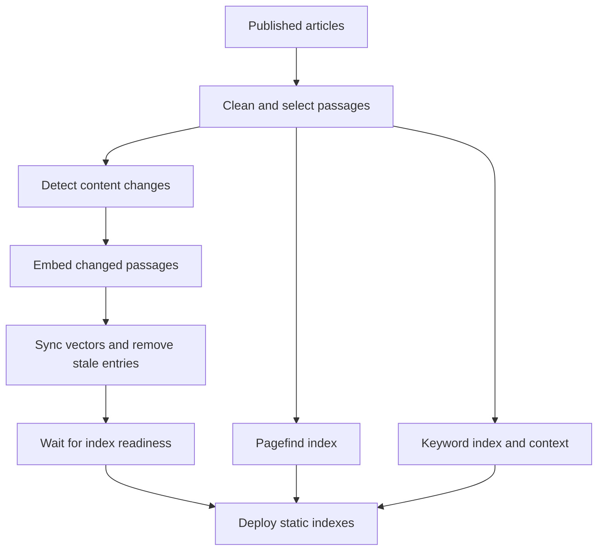
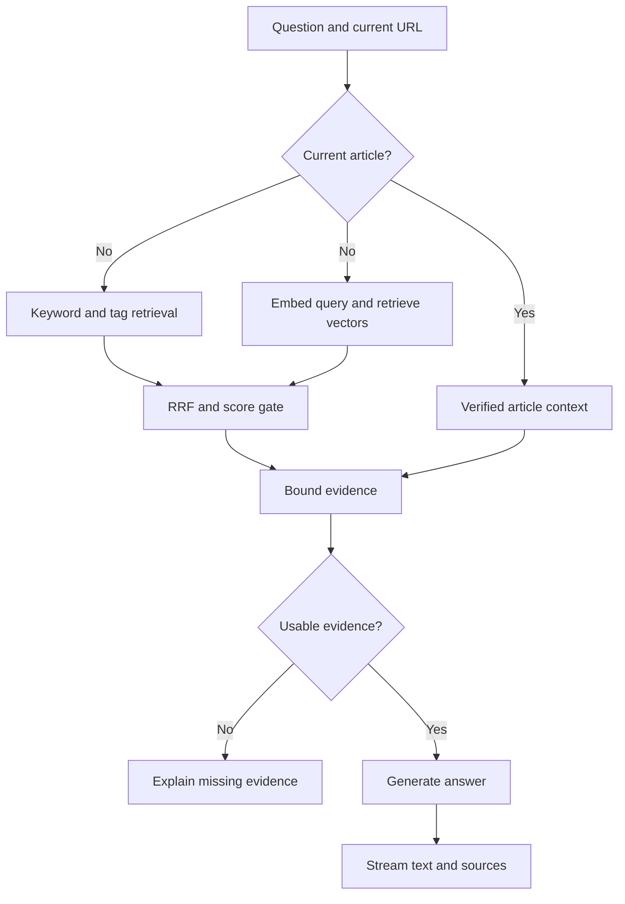

This blog has accumulated quite a few articles. Having them on the site does not necessarily make them easy to use. A friend once collected the content, organized it for a model, and asked it questions. That made information scattered across many articles easier to find. But someone had to download and organize the site first, then connect it to a model. An ordinary visitor may never do that. Could the site offer its own way to ask "What has been written here?" without first having to work out how to search?

The site therefore added an AI assistant that answers only questions supported by its articles and includes source links. Site search helps readers find specific content. The assistant also needs to handle readers who do not know article titles but can describe the problem they face, bringing several articles together into an answer. Search and the assistant offer different ways to use the content. The assistant should stay within the site's material rather than behave as a general chatbot or present outside knowledge as the author's views.

My constraints were specific: no spending, keep using Cloudflare, and do not maintain indexes manually after updating articles. The first assistant used a static keyword index integrated into the existing build process. Getting that initial version working was straightforward. The difficulty came in the decision that followed: the discussion of vectors quickly settled on "leave them out for now," even though there was no vector retrieval comparison using this site's content.

I kept asking: if we have not tested it, why rule it out? If the free allowance is enough and a Function can query vectors directly, or a separate Worker can do it, it should be possible to try. A zero budget is a constraint on whether a design can run; it cannot replace a comparison of results. Local vector experiments followed, putting keyword, vector, and hybrid retrieval against the same questions. The comparison had two layers. Locally, BGE-M3 ranked all candidates exactly to show the differences between retrieval strategies. In the cloud, Workers AI and Vectorize were used to check actual candidates, latency, and resource use. Both quality and cost had to be assessed.

During the first tests, the assistant answered both "Any recommendations?" and "What can you talk about?" with "There is not enough information on this site." When asked whether an engineering team was held back by slow CI feedback, the correct article sometimes missed the top three. When asked for last month's traffic, it returned articles that merely touched on the topic. AI then helped add questions drawn from the blog and community discussions, including "Should engineers take part in product decisions?" and "How can a team pass on what it has learned?" These failures showed that the problem went beyond Gemini's ability to write an answer. The model sees only the passages retrieval gives it. With the wrong material, fluent writing can make an incorrect answer more convincing.

Two things need checking separately: whether the system finds the right articles, and whether the model can answer from them. What has the system already done before the model starts writing?

## Search and an AI assistant offer different ways to use content

The aim is to help readers use what has already been written. Adding a chat box is only one part of that. Readers can narrow their choices through navigation, columns, tags, and archives; use full-text search when they remember a word; or follow related articles after finishing a piece. This site's recommendations rank articles using rules such as shared columns and tags, and display the reason for each recommendation. They do not require reader behavior tracking. Outside the site, search engines such as Google crawl and index pages, then show them to people who have not visited before. These routes all help people find content, but they use different signals and serve different tasks.

Pagefind, for example, generates a static index during the site build. A reader enters keywords, gets matching pages and excerpts, and decides what to open. Columns, tags, and related articles are closer to reading paths organized by the author. SEO and sitemaps support discovery outside the site. A sitemap lists URLs to help search engines discover pages, but it does not guarantee crawling or indexing. Google still needs to crawl, analyze, and index a page before serving it in response to a query. [How Pagefind works](https://pagefind.app/docs/) [How Google Search works](https://developers.google.com/search/docs/fundamentals/how-search-works/) [Google's sitemap guidance](https://developers.google.com/search/docs/crawling-indexing/sitemaps/overview)

The assistant is intended for readers who cannot remember a title or do not know what to search for, but can describe a situation or a topic they want to understand. "How can a team pass on its experience?" and "Which articles should I start with?" describe a problem or a reading goal. Ideally, the assistant finds supporting articles, connects their ideas, and provides links back to the originals. When the site does not contain supporting material, it should say so.

Documentation products already place question answering near their content discovery tools. GitBook's Site AI Ask limits answers to published documentation. ReadMe's Ask AI answers from published documentation, includes sources, and can be opened from search. [GitBook Site AI Ask](https://gitbook.com/docs/developers/gitbook-api/api-reference/docs-sites/site-ai-ask) [ReadMe Ask AI](https://docs.readme.com/main/docs/ask-ai) [ReadMe's search and Ask AI update](https://docs.readme.com/main/changelog/ask-ai-v2) These products show how search and an assistant can coexist. Search offers a direct route when the reader knows the keywords. An assistant can connect relevant material when the reader knows what they need but not what the site contains.

Tags can also provide a starting point for questions. Someone looking at "Technology" or "Management" may have no complete question yet. They want to know what is available under that topic. Given a tag name, the assistant should find articles carrying that tag, describe what the site covers, and suggest a starting point with sources. A tag page leaves readers to choose from a list; the assistant first explains the themes across several articles. The site's existing taxonomy supplies a defined topic, so the model does not have to infer an intention from a broad word alone.

"Understanding the reader's goal" describes the intended product behavior, rather than a capability the system has already demonstrated. Google also explains that AI Overviews and AI Mode retrieve pages through the Search index before organizing an answer and its sources. Generative presentation still depends on discovery, indexing, and retrieval. [Google's guidance on AI search features](https://developers.google.com/search/docs/fundamentals/ai-optimization-guide) The first version of this site's assistant had no semantic retrieval. It found passages by keyword and asked Gemini to explain them. If a different phrasing caused retrieval to miss an article, the model could not use that article. That gap led back to retrieval itself.

## What RAG adds after search finds an article

The assistant adds a step after search: a model turns several retrieved passages into an answer. This is RAG, or Retrieval-Augmented Generation. When a question arrives, articles are retrieved and sent to the model alongside the question and their sources. The articles are not used to train the model. [Lewis et al.'s RAG paper](https://arxiv.org/abs/2005.11401)

Think of it as an open-book exam. The article collection is the reference material; the question set is the exam. Questions check whether retrieval and the model can do the task and should stay out of the reference material. After repeatedly using the same questions to tune weights, add synonyms, and change chunking, they become practice questions. They can no longer serve as an independent final exam.

```text
Reader question
    ↓
Retrieve candidate passages from the article index
    ↓
Send the question, passages, and sources to the model
    ↓
Generate an answer and display article links
```

It is tempting to describe this as connecting a dataset to a language model. More precisely, articles remain external material retrieved when an answer is needed. Test questions evaluate retrieval and answering; they do not change the model's parameters. If an article has no answer, or retrieval fails to find the evidence, the model has no basis for answering from the site.

RAG supplies retrieved passages for the model to use. Retrieval can use keywords, vectors, or both. An embedding is a representation used in retrieval, rather than RAG itself. Adding a generative model does not repair the earlier retrieval result. Incorrectly retrieved articles can still provide the basis for a wrong answer.

Enterprise systems also distinguish retrieval from answer generation. Slack has described how AI Answers retrieves material a user has permission to access. Anthropic compared contextual enrichment, BM25, vector retrieval, and reranking; in its own tests, the top-20 retrieval failure rate fell from 5.7% to 1.9%. Those results used larger collections and different models, so they cannot predict this site's performance. [Slack's enterprise search implementation](https://slack.engineering/how-we-built-enterprise-search-to-be-secure-and-private/) [Anthropic's Contextual Retrieval](https://www.anthropic.com/engineering/contextual-retrieval)

## Checking whether retrieval is the problem

Page search and the assistant use separate indexes. Pagefind finds pages, while the assistant has Chinese and English passage indexes that a Pages Function uses to find evidence. The passage index is built from published articles. It removes Markdown formatting, retains titles, descriptions, and section headings, and splits text at paragraphs and sentences. The default limit is 1,200 characters per passage, with no overlap. Passage length controls how much context a passage retains; overlap affects duplicated content and storage. These parameters need separate comparisons.

Queries and article fields are converted into terms. English text and numbers are treated as continuous strings. Runs of Chinese characters are split into adjacent character pairs: "反馈回路" becomes "反馈," "馈回," and "回路." A title match has weight 5, a description match 2, a topic keyword match 2.5, and a passage match 1. Rare terms receive more weight through IDF. Common question phrasing such as "怎么样" and "有没有" is filtered out. This is not a full BM25 implementation: it does not count repeated occurrences within a passage or normalize for document length.

The retriever also requires enough distinct terms to overlap between the article and the question, up to a maximum requirement of 3. If filtering leaves only one or two terms, the requirement falls accordingly. A candidate that fails this check is treated as insufficient site evidence, without calling Gemini. The check filters weak lexical matches; it does not establish that an answer is correct. Because Chinese uses character pairs here, "3 terms" does not mean three complete Chinese words.

These rules explain why an article ranks ahead of another: matches in the title count more, as do rarer terms. But term overlap cannot establish that an article answers a question. A paraphrase may be missed, while an incidental match on a word such as "efficiency" can rank an irrelevant article highly.

Embeddings may recover some of these paraphrases. They can also place passages about similar topics together even when the answers differ. Similarity is not answer accuracy. The comparisons below use local BGE-M3, then Workers AI's model of the same name with an actual Vectorize index. Gemini Embedding 2 was not tested, so these scores cannot be attributed to it.

The scoring separates matches in the title, description, and keywords from the highest-scoring passage. $q'$ is the set of query terms left after common question phrasing is removed, $N$ is the number of articles in the same language, and $df(t)$ is the number containing term $t$. IDF gives rare terms more weight:

$$
\operatorname{IDF}(t)=\ln\left(1+\frac{N-df(t)+0.5}{df(t)+0.5}\right)
$$

For article $d$, $P_d$ is its set of passages and $p^*$ its highest-scoring passage. $I_f(t,d)$ indicates whether term $t$ occurs in a title, description, or topic keyword field; $I_p(t,p)$ indicates whether it occurs in a passage. The keyword retrieval score is:

$$
\begin{aligned}
\operatorname{Score}(d,q)=&\sum_{t\in q'}\operatorname{IDF}(t)\left(5I_{title}(t,d)+2I_{description}(t,d)+2.5I_{keywords}(t,d)\right)\\
&+\max_{p\in P_d}\sum_{t\in q'}\operatorname{IDF}(t)I_p(t,p)
\end{aligned}
$$

The implementation accumulates term scores for each passage and takes the highest one. A term appearing in several passages does not cause all their scores to be added. A candidate must also meet the term overlap requirement:

$$
\left|q'\cap\left(T_{title}\cup T_{description}\cup T_{keywords}\cup T_{p^*}\right)\right|\geq\min(3,|q'|)
$$

The index is prepared so a Pages Function does not have to reread every article for each question. During the Astro build, terms are mapped to articles, fields such as titles, descriptions, tags, and columns, and the passage numbers in which they occur. Combining article vocabularies produces an inverted index. Its vocabulary is sorted alphabetically for binary lookup. Postings are compressed with variable-length integers and delta encoding, then serialized as static JSON for each language. Chinese and English each have an index; drafts are excluded from production indexes.

At request time, the Function extracts query terms and looks up candidate articles and matching passages in the inverted index, without scanning every article body. It applies field weights and IDF, takes each article's highest-scoring passage, and sends at most four sources to the model. Parsing, chunking, and index construction happen during the deployment build. Online work consists of index lookup, evidence selection, and calling the generative model. Retrieval still depends on lexical overlap, and index updates require rebuilding and deploying the site.

Vector retrieval compares the query vector $q$ and passage vector $p$ using cosine similarity:

$$
\operatorname{cosine}(q,p)=\frac{q\cdot p}{\|q\|\,\|p\|}
$$

This example uses BGE-M3's 1,024-dimensional vectors. Article passages and questions are encoded separately and compared; test questions are not stored as articles in the content collection. Two corpus configurations were used: a full chunking version with 3,187 Chinese and English passages, and a representative-passage version with 795 passages. The latter keeps at most three passages per article, drawn from the beginning, middle, and end. Fewer passages reduce ingestion costs but leave out parts of the text. Retrieval cannot find evidence absent from its index, however good the retriever is. Keyword and vector comparisons therefore need the same fixed corpus.

## Decide what to measure before reading the scores

Questions invented only by the developers tend to use familiar phrasing. The question sets came from two sources. One contained 31 questions adapted from Reddit discussions about personal blog readers, team knowledge transfer, and product prioritization. The other combined basic and challenge questions into a set of 85. In the Reddit-inspired group, 25 questions were expected to be answerable from the site; 6 required outside material or had no answer on the site. The posts provided ideas for phrasing. They were not a survey of Reddit users and do not represent real readers' question frequencies. Both groups were organized manually or with model assistance.

The basic and challenge set has 85 questions: 5 require current-page context, 70 are expected to be answerable, and 10 have no answer. They have been used repeatedly to debug retrieval, so they help compare changes during development. Model-generated questions can fill gaps in question types quickly, but synthetic sets inherit biases from the generating model and the task. Their origins need recording, and some questions should be held out from tuning. [Synthetic Test Collections for Retrieval Evaluation](https://www.microsoft.com/en-us/research/publication/synthetic-test-collections-for-retrieval-evaluation/) [Can we Evaluate RAGs with Synthetic Data?](https://arxiv.org/abs/2508.11758)

A more basic limitation is that the questions identify relevant **articles**, without labeling the **passages** that support each answer. The metrics can show whether an article reached the top three, but cannot establish whether the model received evidence that answers the question. Work such as RAGAS and ARES evaluates retrieval relevance, answer faithfulness, and answer relevance separately. These distinctions are more useful here than one aggregate score. [RAGAS](https://arxiv.org/abs/2309.15217) [ARES](https://aclanthology.org/2024.naacl-long.20/)

The evaluation treats three types of questions differently:

| Question type | What is checked | Why it is separate |
| --- | --- | --- |
| Answerable from the site | Whether correct articles are retrieved and rank highly | Measures retrieval and ranking |
| No answer on the site | Whether articles are still returned as evidence | Checks false retrieval caused by topic similarity |
| Current-page questions such as "What is this article about?" | Whether only the specified article is used and the path is valid | Checks scope; excluded from sitewide ranking scores |

Hit@3 is the first measure to watch for answerable questions. At least one correct article must reach the top three for the assistant to have a chance of receiving useful material. MRR and Hit@1 show how early a reader or model encounters a correct source. Recall@3 and nDCG@3 are useful when an answer needs several articles. False retrieval on unanswerable questions needs its own count rather than being folded into an average hit rate. Otherwise, always returning articles can look helpful while passing unsupported questions to the generative model.

Hit@1 and Hit@3 check whether at least one correct article appears first or in the top three. MRR, or Mean Reciprocal Rank, considers only the earliest correct source: first place contributes 1, second place 1/2, third place 1/3, and no hit in the top three contributes 0. Recall@3 uses all labeled relevant sources for each question as its denominator. nDCG@3 gives correct sources more weight when they rank earlier. Suppose a question has two relevant sources, and the top three contain only one of them, in second place. That question has Hit@3 of 1, contributes 1/2 to MRR, and has Recall@3 of 1/2. Finding a source, ranking it early, and covering several sources measure different effects.

The evaluation script measures ranking and source coverage as well as whether a correct article reaches the top three. Let $Q$ be the number of answerable questions, $r_i$ the rank of the first correct source for question $i$, $R_i$ all relevant sources for that question, and $Top3_i$ the top three results:

$$
\operatorname{Hit@K}=\frac{1}{Q}\sum_{i=1}^{Q}\mathbb{1}(r_i\le K),\qquad
\operatorname{MRR}=\frac{1}{Q}\sum_{i=1}^{Q}\frac{1}{r_i}
$$

If no correct source is found, $r_i$ is treated as infinity, contributing 0 to Hit and MRR. Recall@3 counts multiple relevant sources for each question:

$$
\operatorname{Recall@3}=\frac{1}{Q}\sum_{i=1}^{Q}\frac{|R_i\cap Top3_i|}{|R_i|}
$$

nDCG@3 gives correct sources more weight when they appear earlier. $rel_{ij}$ is the binary relevance label for question $i$'s result $j$. $IDCG@3_i$ is the ideal DCG when that question's relevant sources are placed as high as possible within the top three:

$$
\operatorname{DCG@3}_i=\sum_{j=1}^{3}\frac{rel_{ij}}{\log_2(j+1)},\qquad
\operatorname{nDCG@3}=\frac{1}{Q}\sum_{i=1}^{Q}\frac{\operatorname{DCG@3}_i}{\operatorname{IDCG@3}_i}
$$

In the 25 answerable Reddit-inspired questions, a correct article reached the top three for 14 questions (Hit@3 of 56%). Articles were still retrieved for 5 of the 6 unanswerable questions. Adding topic aliases raised Hit@3 from 12/25 to 14/25 without reducing false retrieval. Aliases recovered some differently phrased questions, but the system still treated a similar topic as evidence of an answer.

Can industry RAG scores tell us whether 70% is good? BEIR compares retrieval methods across domains, while Anthropic reports failure to retrieve passages within its top 20. This site measures whether a correct article appears in the top three. The objects being evaluated and the metrics differ, so the numbers cannot be ranked together. [BEIR](https://arxiv.org/abs/2104.08663) [Anthropic Contextual Retrieval](https://www.anthropic.com/engineering/contextual-retrieval)

## How much difference does passage length make?

In a long article, relevant content can be diluted; in a short passage, a definition may be separated from its example. To assess the 1,200-character limit, the evaluation reran the same questions at limits of 600, 900, 1,200, and 1,500 characters. Passages also include section headings so references such as "it" or "this approach" retain some context. Anthropic has studied adding context to chunks and combining BM25, embeddings, and reranking. Its results come from its own datasets and do not predict this site's performance. [Anthropic's experiment and its scope](https://www.anthropic.com/engineering/contextual-retrieval)

This table compares keyword retrieval over fully chunked articles, without a cap on passages per article. The vector comparison that follows uses representative passages. The experiments answer different questions, so scores cannot be compared directly across them. The script rebuilt the same Chinese and English article collection with maximum passage lengths of 600, 900, 1,200, and 1,500 characters, then reran retrieval on the same questions. Excluding the 5 questions that need current-page context, it compared 70 questions expected to be answerable from the site:

| Passage length limit | Passage count | Hit@1 | Hit@3 | MRR | Recall@3 | nDCG@3 |
| ---: | ---: | ---: | ---: | ---: | ---: | ---: |
| 600 | 6,965 | 33/70 | 45/70 (64.3%) | 0.543 | 0.614 | 0.546 |
| 900 | 4,482 | 33/70 | 45/70 (64.3%) | 0.545 | 0.621 | 0.553 |
| 1,200 | 3,145 | 33/70 | 45/70 (64.3%) | 0.543 | 0.614 | 0.546 |
| 1,500 | 2,455 | 34/70 | 45/70 (64.3%) | 0.552 | 0.621 | 0.558 |

The 1,500-character setting scored slightly better, but Hit@3 did not change, and the difference does not establish an advantage on independent questions. Index size ranged from about 11.20 MB to 11.34 MB, a change of roughly 1.2%. Passage counts varied substantially while the JSON size after compressing inverted-index postings barely changed. This small synthetic set therefore does not provide enough evidence to change the default limit to 1,500. This was a separate chunking comparison. Topic aliases and term overlap requirements were added later, changing the retriever and its scores; the two rounds cannot be treated as one experimental curve.

Passage counts vary considerably between settings, but the generated JSON indexes remain around 11.2 to 11.3 MB. The inverted index compresses mappings from terms to articles and passages, so doubling the number of passages does not double file size. Resource estimates should measure build outputs directly. Multiplying vector dimensions by passage count cannot stand in for the cost of the entire index.

A 2026 preprint compared sentence splitting, semantic splitting, overlap, and context budgets on Natural Questions with particular sparse retrievers and generative models. In that setting, sentence and semantic splitting performed similarly, and overlap did not show a consistent benefit. The authors limit their results to those English datasets and models; Chinese blog content needs its own tests. [Preprint comparing chunking strategies](https://arxiv.org/abs/2601.14123) BEIR found BM25 to be a robust baseline across retrieval datasets, with dense retrieval not always winning. Reranking could perform better on average, at a higher computational cost. [BEIR paper](https://arxiv.org/abs/2104.08663) Keyword retrieval therefore remains the baseline here, with other methods tested against this site's question sets.

## Keywords, vectors, and hybrid retrieval: which fits question answering?

Changing passage length did not substantially improve top-three hits, so the matching method needed a comparison too. This experiment fixed the corpus at 795 representative passages and used Ollama's BGE-M3 for exact cosine ranking. Keyword and vector retrieval used the same articles, passages, and questions: 70 answerable questions and 10 unanswerable ones, with the 5 current-page questions evaluated separately. Exact local ranking makes strategies easier to inspect, while the cloud vector database uses approximate queries. They are separate experiments. [BGE-M3 paper](https://arxiv.org/abs/2402.03216)

Hybrid retrieval uses RRF, or Reciprocal Rank Fusion. Keyword scores and cosine similarities have different scales, making a direct sum difficult to interpret. Each retriever therefore produces its own ranking, and each article receives contributions based on its ranks. An article near the top in both lists is more likely to enter the final candidate set:

$$
\operatorname{RRF}(d)=\sum_{j\in\{keyword,vector\}}\frac{1}{60+rank_j(d)}
$$

Here, 60 is the rank smoothing constant. If a retriever does not return the article, it contributes 0. Vector passages from the same article are grouped before fusion so that long articles do not fill the candidate list merely by having more passages. RRF combines orderings; a separate threshold still determines whether to accept the evidence. [RRF paper](https://cormack.uwaterloo.ca/cormack/cormacksigir09-rrf.pdf)

| Retrieval method | Hit@1 | Hit@3 | MRR | Unanswerable questions still retrieving articles |
| --- | ---: | ---: | ---: | ---: |
| Static keywords (representative passages) | 37/70 | 49/70 (70.0%) | 0.605 | 6/10 |
| BGE-M3 vectors, top three without a threshold | 32/70 | 53/70 (75.7%) | 0.600 | 10/10 |
| BGE-M3 vectors, cosine threshold 0.55 | 32/70 | 53/70 (75.7%) | 0.600 | 3/10 |
| BGE-M3 vectors, cosine threshold 0.60 | 31/70 | 50/70 (71.4%) | 0.571 | 1/10 |
| BGE-M3 vectors, cosine threshold 0.65 | 24/70 | 32/70 (45.7%) | 0.398 | 0/10 |
| Keywords + BGE-M3 RRF, uniform abstention threshold 0.60 | 41/70 | 52/70 (74.3%) | 0.657 | 1/10 |

The hybrid configuration in this table uses a uniform abstention threshold of 0.60. The short-topic exception and current-page interpretation described later require separate acceptance checks; this table of sitewide rankings does not measure them.

Vectors brought a limited improvement in top-three hits in this set. A threshold of 0.55 reduced false retrieval from 10/10 to 3/10 while retaining Hit@3 of 53/70. Raising it to 0.60 reduced false retrieval to 1/10, but Hit@3 fell to 50/70. Hybrid retrieval with uniform abstention at 0.60 achieved Hit@1 of 41/70, Hit@3 of 52/70, MRR of 0.657, and false retrieval on 1/10 unanswerable questions. Compared with static keywords, it gained 3 top-three hits, increased MRR by 0.052, and removed 5 false retrievals. That explains the hybrid choice: finding articles matters, but so does keeping unsupported topic matches away from the model. The gains are modest. In 70 questions, one additional hit changes the rate by about 1.4 percentage points; in 10 unanswerable questions, one extra failure changes it by 10 points. Rates need to be read alongside the sample size.

Thresholds such as 0.55 and 0.60 were selected by sweeping this development set, rather than validated on an independent test set. The questions had already been used to debug retrieval, and relevance labels identify articles rather than answer-bearing passages. The scores give a reason to choose hybrid retrieval, but questions held out from threshold selection and passage-level evidence labels are still needed to assess whether the improvement carries over to new queries.

### Making the test set less self-confirming

Because I know the articles, the questions I think of often contain their keywords already. I asked for Reddit-style phrasing to include situations described without remembered terminology. Community discussions help vary the wording, but the adapted questions remain a constructed set rather than statistics about real readers.

A test set needs each question's origin, relevant articles, and passages supporting the answer. AI can draft questions, but the expected sources must be checked against the originals. Treating the retriever's first result as the correct answer would reward its existing preferences. Alongside common questions, the set needs similar-topic questions without an answer, short tags, and follow-up questions that rely on context.

Development questions guide aliases and thresholds. Held-out questions assess the rules after they are fixed. A failed held-out question can join the next development round, but it then loses its independence as an acceptance test. With a small dataset, that distinction matters more than another decimal place.

The evidence sent to the model needs checking too. A correct article in the top three may contribute only an opening passage that lacks the answer. Retrieval evaluation examines ranking and evidence coverage; generation evaluation checks whether the claims in an answer are supported; operational evaluation checks latency, failure rates, and usage. Separating these layers makes it possible to tell whether a failure calls for changes to the index, retrieval, evidence selection, or model instructions.

### Cloud queries need checking beyond exact local rankings

The earlier cloud experiment used the full corpus of 3,187 passages. Workers AI generated BGE-M3 vectors for those passages and 85 questions. The article passages were written to an isolated Vectorize test index, while the test question vectors were used as queries for comparison. A separate validation used a local Pages Function to generate query vectors during requests and search the actual Vectorize service. The experiment showed that Workers AI, Vectorize, and Pages Functions could work together, but does not describe online rankings for the 795 representative passages. The retrieval configuration takes up to 50 passages, filters by language namespace, groups by article, and combines the results with keyword rankings through RRF.

| Retrieval method | Hit@1 | Hit@3 | MRR | Unanswerable questions still retrieving articles |
| --- | ---: | ---: | ---: | ---: |
| Static keyword baseline | 35/70 | 49/70 | 0.593 | 6/10 |
| Workers AI + Vectorize, threshold 0.55 | 37/70 | 57/70 | 0.657 | 4/10 |
| Workers AI + Vectorize, threshold 0.60 | 36/70 | 55/70 | 0.636 | 1/10 |
| Keywords + cloud vectors with RRF, uniform abstention at 0.60 | 43/70 | 53/70 | 0.674 | 1/10 |

Cloud rankings in the earlier experiment were close to exact local rankings, but those results cannot be applied to the representative-passage index. A vector database retrieves passages, several high-scoring passages may belong to one article, and a limit of 50 passages may omit articles that appear in an exact ranking of the entire corpus. The implementation checks passage content hashes to prevent an old vector's position from mapping to different, newly edited text. This cloud table describes service behavior under full chunking; it is not a final benchmark for the representative-passage configuration.

Local Pages requests that included cloud query embedding and Vectorize retrieval had a median latency of 227 ms and P95 of 350 ms. Using precomputed query vectors, Vectorize queries alone had a median of 80 ms and P95 of 127 ms. These measurements excluded Gemini answer generation and did not measure production cold starts or CPU time. Full answers also involve generation, networking, and service startup, so their latency needs separate measurement. P95 means 95% of requests complete within that duration and makes slow requests more visible than the median alone.

Embedding the earlier 3,187 passages and test questions recorded about 1.38 million input tokens and 1,488 neurons, around 15% of Workers AI's daily free allowance of 10,000 neurons. That is not the usage for the smaller corpus. At 1,024 dimensions each, the 795 representative passages require about 814,080 stored dimensions, roughly 16% of the 5 million free allowance. Workers AI generates embeddings; Gemini composes answers. Keeping a copy of the earlier full index in both test and production environments would exceed 5 million dimensions. The representative-passage corpus can fit two copies, but obsolete full-corpus indexes should still be removed. The publishing script uses content hashes to re-embed only new or changed passages and deletes vectors no longer present in the static index. [Workers AI BGE-M3](https://developers.cloudflare.com/workers-ai/models/bge-m3/) [Workers AI free allowance and pricing](https://developers.cloudflare.com/workers-ai/platform/pricing/)

Ingestion has a consistency issue: Vectorize may acknowledge a write before the query index reflects it. Tests encountered successful writes followed by empty queries; querying resumed after processing completed. Publishing needs to wait for the corresponding mutation to be processed before enabling that version of retrieval, or the assistant may temporarily miss newly published pages. Writes, replacements, deletions, and fallback after service failures need separate checks. A successful query cannot substitute for those consistency tests.

### Where each retrieval option fits

Static and vector indexes both need cleaned text, passages, and source references. Their main difference is the matching signal. The static design here uses an inverted keyword index. Vector retrieval encodes passages and queries with the same embedding model and compares their similarities. Combining them is also possible. Static files can support RAG, while vectors alone cannot guarantee correct answers.

| Option | Benefits | Costs and failure modes | Signal from this site's comparison |
| --- | --- | --- | --- |
| Static inverted keyword index | No query embedding; updates during the site build; matches and ranking are easier to explain | Can miss paraphrases; shared topic terms can cause false retrieval | Representative-passage baseline: Hit@3 of 49/70, false retrieval on 6/10 unanswerable questions |
| Vector retrieval | Recovers some articles with different wording but similar meaning; the vector database handles similarity queries | Adds embedding per question; vector updates and deletions need maintenance; similarity does not prove a passage contains an answer | Local BGE-M3 at 0.55: Hit@3 of 53/70, false retrieval on 3/10; higher thresholds lose recall |
| Hybrid keywords and vectors | Retains exact term matches while adding semantic retrieval; can fall back to keywords on failure | Maintains two retrieval paths; fusion and abstention need validation | Local comparison with uniform abstention at 0.60: Hit@1 of 41/70, Hit@3 of 52/70, false retrieval on 1/10 |

On these development questions, vectors at 0.55 had slightly higher Hit@3. Hybrid retrieval at 0.60 had one fewer top-three hit, but better first-place ranking and less false retrieval on unanswerable questions. The design chose the latter because retrieved material becomes the basis for Gemini's answer, making unrelated evidence from a nearby topic costly. The threshold comes from development questions and has not been verified on an independent held-out set. A different model or chunking method requires another evaluation.

## Do the collection-wide work offline; handle one question online

Index updates and question answering follow different paths. During a build, published articles and project descriptions are cleaned, enriched with section headings, split into passages, and indexed into separate Chinese and English inverted-index JSON files. Each article retains at most three representative passages; drafts and photography galleries are excluded. Pagefind's page index and the assistant's passage index are separate outputs. Once build checks pass, an offline task uses Workers AI to embed new or changed passages and synchronizes them to Vectorize. It caches the previous content-hash manifest and removes deleted passages from Vectorize. After the vector database processes the writes, the corresponding static index is deployed, keeping page content and evidence as close to the same version as possible.

For a question, the browser submits its text, language, recent conversation, current path, and streaming preference. The Pages Function validates these fields and reads articles from the deployed static index; the browser cannot supply its own article body. The Function gets keyword candidates, then uses Workers AI to embed the query and search Vectorize. RRF combines the rankings. Each vector hit must pass a hash check to confirm that it still refers to text in the current published index. If Vectorize is unavailable, retrieval falls back to keywords. Ordinary questions below the 0.60 vector threshold receive an abstention response. Short topic queries retain clear keyword candidates so that tag or title evidence is not discarded by the semantic threshold. If a question refers to "this article" or "in the text," and the current path maps to a published article, the Function uses that article's full context directly.

Once sources are found, the Function selects evidence from at most four articles, caps it at 5,000 characters, and sends it to Gemini with the question and bounded conversation history. SSE streams the answer in pieces so readers do not have to wait for the entire response. Sources are sent separately at the end. The model is instructed to answer only from site evidence and acknowledge missing support. The Function sends source links itself, without relying on the model to generate URLs.

Tag questions have a more explicit retrieval rule. The index stores localized tag labels separately. When a question matches a label, with an optional leading `#`, keyword retrieval finds published articles carrying that tag. These candidates can still be fused with vector results before their passages are sent to Gemini. Tags are article metadata rather than separate passages to embed. The vector database holds article passages; a tag query receives its own query embedding at request time, like other questions. Previously, a short tag such as "Management" was treated as ordinary text and could be influenced by incidental words in article bodies. An explicit tag field provides a more direct match.

Tags need a different acceptance check. Enumerate published Chinese and English labels and ask each one both with and without `#`. Check that the returned sources actually carry the tag, their passages enter the model prompt, and the task is defined as browsing that topic. Mocking generation can test the retrieval and evidence-transfer contract. A real model still needs checks that its topic summary and reading suggestions are supported. Tag coverage, API success rates, and retrieval ranking measure different things; they cannot be combined into one "assistant accuracy" figure.

The offline path processes the collection and prepares indexes for queries:



The online path first establishes the question's scope and generates an answer only after finding evidence. The diagram omits failure fallback; keyword candidates can still be used when the vector service is unavailable.



Costs come from both indexing and questions. Page search and the assistant run on Cloudflare Pages. Ordinary questions invoke a Pages Function and call Gemini only when evidence is found. Hybrid retrieval also embeds each question and queries Vectorize. Publishing re-embeds only changed passages. BGE-M3 provides embeddings here, while Gemini generates answers. Changing embedding providers requires regenerating article vectors and reevaluating thresholds. [Gemini API pricing](https://ai.google.dev/gemini-api/docs/pricing)

The two language indexes total about 5.20 MB uncompressed and 1.87 MB with gzip. The Function fetches the index for the requested language and caches it in memory for five minutes. Vector resource estimates use the 795 indexed passages and assume 100 new Chinese and English passages per month, roughly four or five new Chinese articles plus their English versions:

| Option | Current storage | Monthly growth | Estimated query allowance remaining | Additional runtime cost |
| --- | ---: | ---: | ---: | --- |
| Static keywords | Two indexes: 5.20 MB uncompressed (1.87 MB gzip) | Updated with the site build | Uses no Vectorize allowance | Existing Function and Gemini calls |
| Vectors, 768 dimensions | 610,560 stored dimensions, about 12% of 5 million | 76,800 dimensions | About 38,167/month after accounting for the corpus and new passages | One embedding and Vectorize query per question; $0 within free allowances |
| Vectors, 1,024 dimensions (BGE-M3) | 814,080 stored dimensions, about 16% | 102,400 dimensions | About 28,401/month | Workers AI embeddings consume the daily neuron allowance |
| Vectors, 1,536 dimensions | 1,221,120 stored dimensions, about 24% | 153,600 dimensions | About 18,636/month | Still fits the free allowance at this passage count; retrieval quality at this dimension was not tested |

The estimates follow Cloudflare's published formula. Queried dimensions are the number of stored vectors plus queries, multiplied by the dimension count. Stored dimensions are vector count multiplied by dimensions. With 100 new passages per month, the free monthly query allowance supports approximately 28,401 queries at 1,024 dimensions. Each resource is metered separately, so the full assistant's capacity is limited by whichever allowance runs out first. The generation model may reach a rate limit while vector queries still have capacity. The Function sends one query vector to Vectorize and receives candidate IDs, scores, and a little metadata. [Vectorize pricing](https://developers.cloudflare.com/vectorize/platform/pricing/)

### Can vectors fit within this site's free resources?

Quality needs comparing, but the design also needs to stay within its free allowances. Here a Pages Function binds directly to Vectorize, Workers AI generates embeddings, and Gemini produces answers. Those services are metered separately. The corpus fits the vector storage allowance at the size measured in the experiment, but question capacity also depends on limits for embeddings, the generative model, and Functions. [Introduction to Vectorize](https://developers.cloudflare.com/vectorize/get-started/intro/) [Pages Functions bindings](https://developers.cloudflare.com/pages/functions/bindings/)

| Integration point | Request path | Tradeoff for this site |
| --- | --- | --- |
| Vectorize bound directly to Pages Functions | The existing `/api/chat` embeds the question, queries Vectorize, and fetches article evidence | A single site can reuse its same-origin endpoint and secret management with one fewer deployment unit |
| A separate Worker bound to Vectorize | A Pages Function calls the Worker through a Service binding, or the browser calls an independent endpoint | Also viable; useful when several applications share retrieval, but adds configuration and deployment for a single site; direct cross-origin calls also need origin checks |

A separate Worker does not increase the account's free allowances or replace an embedding API. It changes the service boundary. With one assistant, this site favors binding Vectorize directly to a Pages Function. Article vector ingestion happens offline during publishing. Online requests embed the question, retrieve candidates, and fetch evidence from the published article index. Keyword retrieval remains for fusion and fallback. The Function therefore does not need to load all vectors and perform millions of floating-point operations. Free use still has separate limits for Gemini rate, Vectorize dimensions, Function requests, and CPU. The estimated 28,401 queries describe Vectorize capacity for this 1,024-dimensional index, rather than guaranteed capacity for the complete assistant.

The design uses a Pages Function, Workers AI BGE-M3 (1,024 dimensions), and Vectorize, with Gemini composing answers. Articles and questions use the same provider, model, and dimensions. Implementations sharing a model name can still differ in versions, quantization, or pooling, so local article vectors cannot be casually mixed with query vectors from another provider.

Resource limits also affect index coverage. Three representative passages per article save vector space but do not cover the entire text. Tag browsing and recommendations across articles can start from those passages. Questions about a particular article instead use its current path to retrieve the full context, still bounded by the evidence budget. Sitewide retrieval and interpreting the current article serve different tasks, so one hit rate cannot establish that both work well.

The low-cost design needs specific safeguards: embed only changed passages, remove vectors when articles are deleted, check content hashes during retrieval, and fall back to keywords when the vector service fails. These measures do not raise Hit@3, but they determine whether tested retrieval continues to behave as intended after content changes.

## Giving articles to your own GPT versus offering an assistant on the blog

After my friend organized the site's articles in an AI tool, they could ask questions about the collection. Updates still need synchronizing. The blog's assistant serves readers already on the site, letting them ask what has been written here and follow sources back to the articles. These approaches remove different barriers to using the content. Their answer quality has not been compared with the same question set. [GPTs in ChatGPT](https://help.openai.com/en/articles/8554407-gpts-in-chatgpt) [OpenAI Retrieval](https://developers.openai.com/api/docs/guides/retrieval)

AI helped implement the indexing and evaluation code. In the discussion, I kept asking what the assistant should answer, why a particular design was chosen, whether it had been tested, and whether it would actually run for free. The vector discussion made this especially apparent: there was already a detailed explanation, but the direct comparison was missing. Without those questions, it would be easy to treat an unverified implementation choice as a sound conclusion.

That was a concrete part of the experience of building with AI. Code and explanations accumulate quickly; repeatedly checking whether they address the original problem still takes time. Whether vectors are affordable, whether correct articles are retrieved, and whether answers have evidence need separate verification. Hybrid retrieval was chosen here because, on the same corpus and development questions, it improved first-result ranking, reduced false retrieval on unanswerable questions, and fit the resource budget. The loss from retaining only three passages per article and performance on new questions remain limits of this design.
