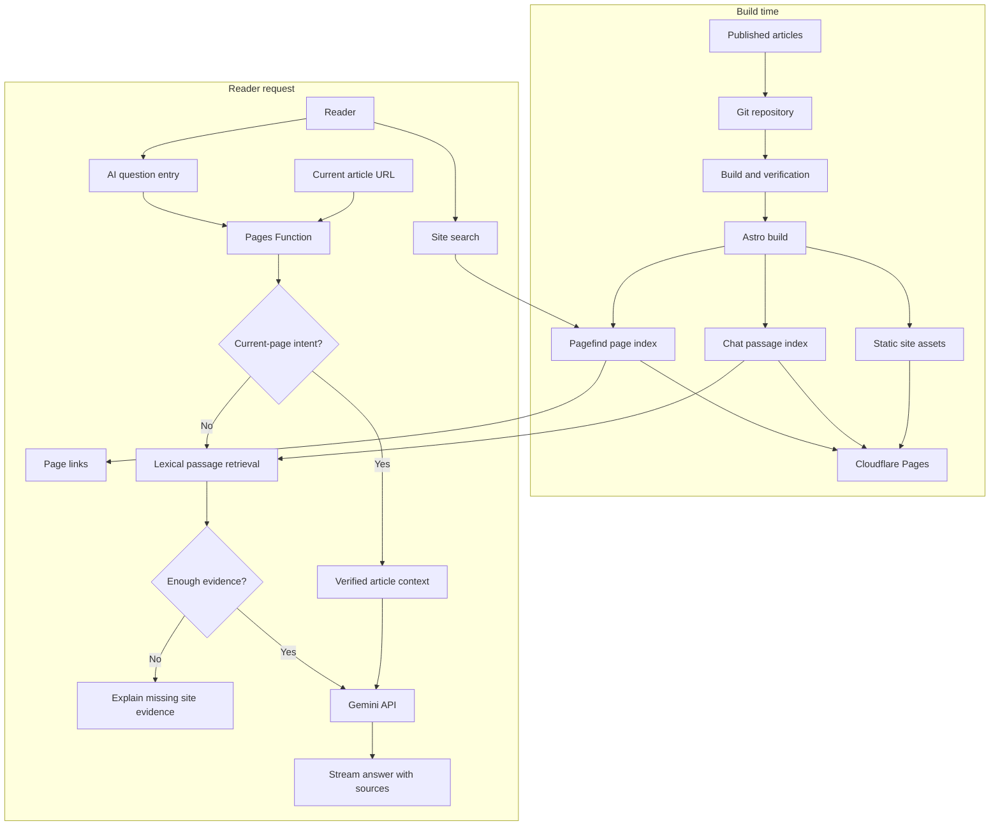
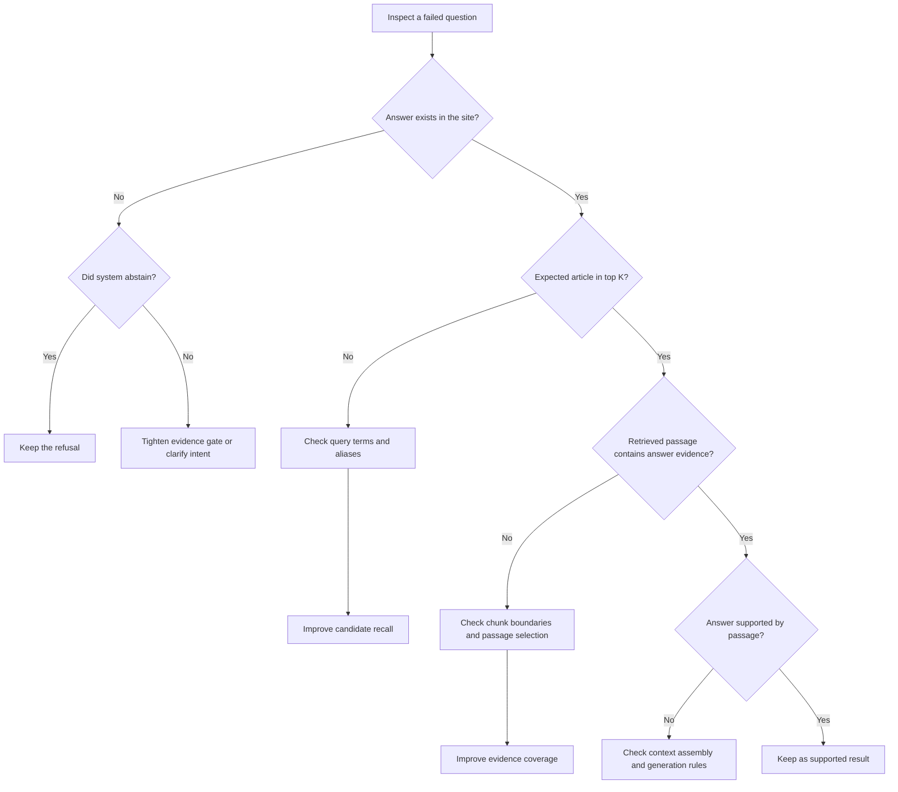

这个站点其实已经有不少内容了。但内容放在那里，不等于读者能找到。我之前见过有人把这个站点的内容抓下来、整理后接进 AI 工具里查询；可读者每次来访时，不一定会先做这一步，外部模型也未必已经收录了整站。

我想给站点加一个所有文章都能共用的入口，让读者可以直接问“我该从哪篇开始看”“这里有没有讲过团队知识交接”，并拿到回答和来源。做着做着，我发现机器人会把“有什么推荐吗”回成“本站没有足够信息”，也会把问站点访问量的问题带到一篇主题相近的文章。前者没找到，后者找到了不该用的材料。模型说得像不像答案，反而是更后面的问题。

所以我把目标收窄到：先让它找对可用的文章和段落，再判断要不要让模型组织回答。下面记录我为什么先用站内搜索已有的词面能力、怎样在免费资源下做 MVP，以及这组小型测试到底支持哪些判断。

## 站内搜索先解决什么

这个博客的站内搜索由 Pagefind 提供。构建时，它读取生成后的静态页面并生成全文索引；读者输入词语后，系统返回一组排序过的页面链接。它适合“我记得大概写过这个，帮我找出来”，读者打开页面后自己读全文。Pagefind 的排序会参考词项、词频、页面长度和字段等信号。[Pagefind 索引说明](https://pagefind.app/docs/)、[排序说明](https://pagefind.app/docs/ranking/)

问答要多做两步：先从页面里找出能回答问题的段落，再把问题、段落和来源交给模型组织成回答。这里的差异不是“搜索落后、AI 更聪明”，而是返回物不同：搜索返回页面，问答尝试返回基于证据的解释。用词差异很大时，两者都可能漏；问答还多了生成错误答案的风险。

| 环节 | 负责什么 | 返回什么 |
| --- | --- | --- |
| Pagefind 搜索 | 从静态页面索引里按词项和排序信号找页面 | 页面链接 |
| 当前机器人的召回 | 用双字词、字段权重和 IDF 从文章段落索引里找候选 | 少量证据段落 |
| 向量召回 | 把问题和段落编码成向量，按相似度找候选 | 语义上可能接近的段落；不负责写答案 |
| RAG | 把检索器和生成模型接起来 | 基于检索证据组织、并附来源的回答 |

这个机器人已经是 RAG，只是目前使用词面检索。Gemini 收到段落后在模型内部处理文字，不会自动替网站建立一份可搜索的文章向量库。显式 embedding 接口会为文章段落和用户问题分别生成向量，检索系统再比较相似度；它只是另一种找材料的办法，不是生成回答本身。[Gemini embeddings 文档](https://ai.google.dev/gemini-api/docs/embeddings)

所以“把网站接进大模型”不是训练模型，也不是把全站全文塞进每次请求。文章是运行时可检索的资料，测试问题是检查检索质量的题目；模型参数不会因为这次接入而改变。只有答案所需的证据存在、而且检索确实把它交给模型，RAG 才有机会答好。

## 测试集会被调参污染

RAG 是检索增强生成：模型回答时才从外部资料里找内容，不因此重新训练模型。经典 RAG 论文讨论的就是把参数化模型和可检索知识结合起来。[RAG 论文](https://arxiv.org/abs/2005.11401)

我把它想成给模型一份开卷资料：文章库是参考书，测试问题是考题。考题可以拿来检查检索器和回答，但如果我根据同一批题反复补别名、调权重、改切段，它就成了开发集，不再是独立的最终考试。

这类做法也出现在更大的检索系统里。Slack 公开介绍过其 AI Answers 和企业搜索如何在请求时检索用户有权限访问的资料；Anthropic 分享过上下文补全、BM25、向量召回和重排的组合实验。这些是不同语料和预算下的实践，不代表个人博客照搬后会得到同样收益。[Slack 搜索实践](https://slack.engineering/how-we-built-enterprise-search-to-be-secure-and-private/) [Anthropic Contextual Retrieval](https://www.anthropic.com/engineering/contextual-retrieval)

## 为什么先做低成本的站点版本

我不想为了给博客加一个入口，先引入一套需要持续付费维护的服务。文章规模和更新频率都有限，第一版就用构建时生成的静态索引；Cloudflare Pages Function 在线检索少量段落；证据足够时才调用 Gemini。这样做的目标不是证明词面检索最好，而是用现有资源先把入口跑通，并让每一步都能检查。

发布时，Astro 从已发布文章生成 Pagefind 页面索引和问答段落索引，随静态站点部署到 Cloudflare Pages。提问时，Pages Function 校验当前文章路径或检索全站段落；只有“这篇讲了什么”之类的问题会读取当前文章正文。检索证据达到门槛后才调用 Gemini，并返回来源链接。

这是一个小型应用架构，不是大型知识平台：构建过程负责整理和发布索引；在线过程负责限定范围、找证据、决定是否生成。它的实际收益是减少每次请求的材料量，让回答能回到具体文章；代价是词面检索仍会漏掉措辞差异。索引没有的内容，也不会因为接入 RAG 自动出现。

## 当前实现和免费额度的取舍

现在的版本用静态倒排索引、双语标签和少量主题别名；当前页问题会读取已发布文章的正文，全站问题则按段落检索。索引只保留每篇文章最多 3 个代表性片段，构建产物合计约 795 段、5.2 MB。完整正文的离线实验有约 3,183 段、11.3 MB，但这份更大的索引不会部署。

向量方案看起来也装得下：按每段 768 维估算，3,183 段占约 244 万存储维度，低于 Cloudflare Vectorize Workers Free 的 500 万存储维度。限制在查询量：Cloudflare 把索引向量和查询向量都计入查询维度，所以每次查询约消耗 $(3183+1)\times768$，每月 3,000 万查询维度大约只够 12 次。若只存当前 795 段，每月理论上约 49 次。这个估算假设每个问题只查一次、每段 768 维，不含重试或额外查询；它是容量上限估算，不是实际用量预测。[Vectorize 定价和计算方式](https://developers.cloudflare.com/vectorize/platform/pricing/)

Gemini embedding 的免费额度并不能抵消 Vectorize 的查询上限；免费层提交给 Gemini 的内容还可能用于改进 Google 产品。因此当前先不把文章向量接到线上：这个站点的检索质量尚未用独立问题集验证，付出更多索引和维护复杂度之前，应该先证明它能稳定减少语义改写漏召回，同时不提高无答案误答率。[Gemini API 定价与数据使用说明](https://ai.google.dev/gemini-api/docs/pricing)

现在的门槛会过滤常见问句词，并要求候选文章的元数据或最佳段落与问题有一定词项重合；证据不足就不调用 Gemini。它挡不住所有误召回，但能把一部分明显弱匹配拦在模型调用前。

## 先把问题定位在检索，而不是模型

站点索引按中英文分开构建。正文先按段落边界切分，过长段落再按句子边界切；单句仍过长时才按字符切。每段带上文章标题和章节标题，默认上限是 1,200 个字符。当前实现没有 120 字重叠——我之前把估算向量存储时的实验假设和生产代码混在了一起，这里把它们分开。

检索时，连续汉字会拆成相邻双字词。例如“反馈回路”变成“反馈”“馈回”“回路”。标题、简介、主题关键词、正文段落分别有不同权重，较少见的词还会按 IDF 加权；常见问句词会先过滤。它不是完整 BM25：当前代码按词项是否出现、字段权重和 IDF 计分，没有做完整的词频饱和和文档长度归一化。

这一套规则便宜、容易解释，也有明确短板。“反馈回路”出现在标题里会加分；“怎么让经验传下来”与“团队能力如何积累”意思接近，却可能没有多少字面重合。为避免几个零散词把文章顶上来，系统还要求候选至少匹配最多三个不同词项；证据不够时拒绝调用模型。这个门槛只能挡一部分弱匹配，不能证明剩下的内容一定能回答。

把打分写出来，能看清当前检索器到底做了什么。$q'$ 是过滤后的问题词项，$N$ 是该语言的文章数，$df(t)$ 是包含词项 $t$ 的文章数；$I$ 表示词项是否出现在字段中：

$$
\operatorname{IDF}(t)=\ln\left(1+\frac{N-df(t)+0.5}{df(t)+0.5}\right)
$$

$$
\begin{aligned}
\operatorname{Score}(d,q) = \sum_{t\in q'} \operatorname{IDF}(t)\Big(&5I_{title}(t,d)+2I_{description}(t,d)+2.5I_{keywords}(t,d)\\
&+\sum_{p\in passages(d)} I_{passage}(t,p)+\max_{p\in passages(d)} I_{passage}(t,p)\Big)
\end{aligned}
$$

向量检索会用另一种信号：问题向量 $q$ 与段落向量 $p$ 的余弦相似度。

$$
\operatorname{cosine}(q,p)=\frac{q\cdot p}{\|q\|\,\|p\|}
$$

相似度高只表示编码后的方向接近，不表示段落就含有答案。当前没有生成或测试过这些向量，因此它是待验证的备选方案，不是已取得的优化成果。
## 切段长度有影响，但没有一个通用答案

把整篇长文作为一个单元，结果可能太宽；切成较小段落，边界又可能把定义和例子拆开。段落前面附上章节标题，是为了让“它”或“这个做法”之类依赖上下文的文字有机会带上主题。Anthropic 的实验也讨论了片段脱离原章节后丢失背景的问题，并提出给片段补上下文，再结合 BM25、embedding 和 reranker。它报告的召回失败率变化来自 Anthropic 自己的多数据集设置，不能移植成我这个站点的预期收益。[Anthropic 的实验和边界](https://www.anthropic.com/engineering/contextual-retrieval)

我先做了一次“完整正文索引”的离线切段实验：从所有文章正文重新切段，在同一份中英文语料和同一批问题上比较 600、900、1,200 和 1,500 字符上限。每次都重建索引并重新跑检索；不计需要当前页面上下文的 5 个问题，比较 70 个预期能由站内内容回答的问题。结果是：

| 单段长度上限 | 段落数 | Hit@1 | Hit@3 | MRR | Recall@3 | nDCG@3 |
| ---: | ---: | ---: | ---: | ---: | ---: | ---: |
| 600 | 6,961 | 33/70 | 45/70（64.3%） | 0.552 | 0.614 | 0.553 |
| 900 | 4,478 | 33/70 | 45/70（64.3%） | 0.543 | 0.621 | 0.551 |
| 1,200 | 3,141 | 33/70 | 46/70（65.7%） | 0.548 | 0.629 | 0.553 |
| 1,500 | 2,451 | 34/70 | 47/70（67.1%） | 0.560 | 0.650 | 0.570 |

1,500 字在这组题里数值略好，Hit@3 比 600 字多命中 2 题；这仍不足以说明它在独立问题集上会更好。完整索引大小约 11.20–11.34 MB，变化约 1.2%；段落数变化明显，压缩后的索引体积变化很小。因此当前生产索引采用 1,200 字作为可读性和片段长度的折中，并且只保留每篇文章最多 3 个代表性片段。这个生产取舍是容量优化，不是实验已经证明 1,200 字检索效果最好。

Hit@1 / Hit@3 看至少一篇正确文章是否出现在第一名或前三名。MRR（Mean Reciprocal Rank，平均倒数排名）只看排名最靠前的正确来源：第一名贡献 1，第二名贡献 1/2，第三名贡献 1/3，没进前三则贡献 0。Recall@3 会把每题标注的全部合理来源都纳入分母；nDCG@3 则把靠前的正确来源权重放得更高。四种切段长度的 Hit@3 完全相同；1,500 字在 Hit@1 上只多命中一题，MRR 也只是略高。这里看不出一个压倒性的最佳值。当前 1,200 字主要是容量和可读性的折中，之后仍可按评测结果调整。

如果把这些名字直接写成计算式，问题会简单一点。设 $Q$ 是可回答问题数，$r_i$ 是第 $i$ 题第一个正确来源的排名，$R_i$ 是这题所有合理来源，$TopK_i$ 是检索器前 $K$ 条结果：

$$
\operatorname{Hit@K}=\frac{1}{Q}\sum_{i=1}^{Q}\mathbb{1}(r_i\le K)
\qquad
\operatorname{MRR}=\frac{1}{Q}\sum_{i=1}^{Q}\frac{1}{r_i}
$$

没有正确来源时，$r_i$ 视为无穷大，对 Hit 和 MRR 的贡献都是 0。Recall@3 会把多篇合理来源一起算进去：

$$
\operatorname{Recall@3}=\frac{1}{Q}\sum_{i=1}^{Q}\frac{|R_i\cap Top3_i|}{|R_i|}
$$

nDCG@3 则给排在前面的正确结果更高分，再除以“正确结果全排在最前面”时的理想分数。当前相关性只有“合理来源 / 不是合理来源”两档，所以 $rel_{ij}$ 是第 $i$ 题第 $j$ 个结果的 0 或 1 标签：

$$
\operatorname{DCG@3}_i=\sum_{j=1}^{3}\frac{rel_{ij}}{\log_2(j+1)}
\qquad
\operatorname{nDCG@3}=\frac{1}{Q}\sum_{i=1}^{Q}\frac{\operatorname{DCG@3}_i}{\operatorname{IDCG@3}_i}
$$

公式能让算法说清楚，不能让样本突然变得有代表性。比如 70 道题里 49 道命中前三，算出来是 70%；它仍然只是这 70 道题的结果，不代表真实读者有七成机会找到答案。完整索引的段落数随切段长度明显变化，但压缩后的 JSON 约为 11.2–11.3 MB；当前线上索引则是按语言分开的两份构建产物，合计约 795 段、5.2 MB。资源判断应直接测构建产物，而不是只用段落数推算文件大小。

有关切段的研究支持“要实测”，不支持“某个固定字符数对所有语料都最好”。一篇 2026 年的预印本在 Natural Questions 和特定稀疏检索器、生成模型下比较了句子切分、语义切分、重叠和上下文预算；它的设置里，句子切分和语义切分差距很小，重叠也没有测出稳定收益。作者同时说明结果来自特定英文语料和模型组合，换到中文博客仍需重测。[切段策略系统比较预印本](https://arxiv.org/abs/2601.14123) BEIR 在多个检索数据集上发现，BM25 是很强的稳健基线，稠密检索并不总能胜出；重排等方法平均可能更好，但需要更多计算。[BEIR 论文](https://arxiv.org/abs/2104.08663) 这也是我保留关键词方案作对照的原因：向量看起来更懂语义，不代表它在每个站点、每种问题上都更准。

## Benchmark 怎么做才不只是自我感觉

测试集先从我能想到的常见博客问题开始，再用公开社区讨论补充不同的表达方式：例如 [个人博客读者会关心什么](https://www.reddit.com/r/Blogging/comments/1dnkyo8/question_for_personal_blog_readers/)、[团队知识如何交接](https://www.reddit.com/r/ExperiencedDevs/comments/zgwrag/best_practices_for_knowledge_transfer_when_a/)和[需求优先级怎么排](https://www.reddit.com/r/ProductManagement/comments/1e73814/how_do_you_prioritize_feature_requests_when/)。Reddit 帖子只是提问场景的来源，不是代表性抽样；题目由我根据讨论重新写，没有用 API 抓取或做词频统计。每题记录预期文章或“站内无答案”。

这批数据主要回答一个工程问题：我们改了检索后，哪些问法更容易找到正确文章？目前结果如下：

| 题集 | 可回答题 | Hit@3 | MRR | 无答案题误召回 |
| --- | ---: | ---: | ---: | ---: |
| 主问题集与挑战题 | 70 | 49/70（70.0%） | 0.605 | 6/10（60.0%） |
| Reddit 启发题 | 25 | 16/25（64.0%） | 0.533 | 5/6（83.3%） |

主问题集的 Recall@3 为 0.671、nDCG@3 为 0.607；Reddit 启发题对应为 0.300 和 0.330。类别差异也明显：知识交接只命中 1/3，技术判断 4/7。40 条社区式改写问题的 Hit@3 为 26/40（65%）。这些数值并不代表读者成功率，它们只是让失败类型露出来。

还有两个边界要一起读。第一，这些题参与过别名、权重、拒答门槛和片段抽样的调整，所以现在都是开发集，不是独立验收集。第二，评估只运行了本地静态检索，没有调用 Gemini 生成答案；它不能说明答案是否忠实、链接是否正确，更不能说明用户是否满意。5 条需要当前页面上下文的问题也还没有完成完整回答质量评估。

合成问题适合补覆盖、定位漏召回，但会带来表达偏差，也可能让系统过拟合题库。微软对合成检索评测集的研究，以及 RAG 评测研究都讨论了这类边界；RAGAS、ARES 和 UAEval4RAG 则提醒我们分别评估检索上下文、回答忠实度和无答案拒答，而不是只看一个 Hit@3。[合成检索评测集研究](https://www.microsoft.com/en-us/research/publication/synthetic-test-collections-for-retrieval-evaluation/) [Can we Evaluate RAGs with Synthetic Data?](https://arxiv.org/abs/2508.11758) [RAGAS](https://arxiv.org/abs/2309.15217) [ARES](https://aclanthology.org/2024.naacl-long.20/) [UAEval4RAG](https://aclanthology.org/2025.acl-long.415/)

所以我现在不会用这组分数宣称“加了 AI 后搜索效果提升”。它能支持的判断更窄：当前词面检索对部分社区式表达仍会漏，面对无答案问题也容易误召回。下一步应保留一批从未用于调参的问题，并给每题标注答案依赖的段落，再评估召回和回答两个阶段。

## 哪些优化值得先试

看见低命中后，下一步不是立刻换向量库，而是先判断失败发生在哪一层。这个区分决定要改查询、排序、切段，还是拒答门槛：

每次只改一个关键变量：先试标题和章节权重、词项别名、段落边界，再看查询改写是否值得；只有独立保留题仍有语义改写漏召回，才做关键词 + 向量的混合对照。RRF 可以按排名合并两路结果，避免直接相加尺度不同的原始分数。[RRF 原始论文](https://cormack.uwaterloo.ca/cormack/cormacksigir09-rrf.pdf) [Microsoft 混合搜索说明](https://learn.microsoft.com/en-us/azure/search/hybrid-search-ranking)

拒答要单独看。主问题集有 6/10 无答案题仍召回文章，Reddit 启发题是 5/6。这里的问题不是“再多捞一些”，而是主题相近的内容被当成了答案线索。个人偏好、站点分析数据或站外平台现状不在文章索引里；系统应说明缺少资料或追问，而不是把相似段落硬凑成回答。

## 离线索引和在线回答是两种工作

这类系统可以拆成两条时间线。离线阶段处理内容：筛出已发布文章、清理 Markdown、切段、补上标题和标签等元数据，再把它们变成检索索引。向量方案还要调用 embedding 模型，把每段文字转成向量并写入向量库。在线阶段处理问题：识别语言和当前页面范围，把问题转成检索信号，取回候选段落，判断证据是否够用，再把少量证据交给生成模型。前者回答“资料怎么准备和更新”，后者回答“这次问题应该查什么、模型能依据什么回答”。

在这个站点，离线工作发生在 GitHub Actions 的构建和部署流程里。Astro 分别读取已发布的中文、英文文章，生成两份静态问答索引；每篇文章会清理正文、按段落和句子切分，再保留最多三个代表片段，并把标题、简介、标签和专栏信息一起编码进词项倒排索引。构建还会为每篇已发布文章生成完整正文的静态上下文文件，供“这篇讲了什么”这类当前页问题使用。草稿不会进入生产索引，撤稿或删除也会在下一次构建后从生成文件里消失。站内 Pagefind 搜索另有自己的页面索引。

在线时，Cloudflare Pages Function 根据语言读取对应索引；“本文/这篇”问题先核对当前路径是否对应一篇已发布文章，再取它的完整上下文。其他问题走全站词面检索，最多挑四篇候选的最佳段落；证据门槛通过后才调用 Gemini，回答和来源以流式事件返回。当前路径校验、候选检索、证据门槛和生成是分开的步骤，任何一步都可能让答案失败，因此“模型回答错了”还不足以定位故障。

如果以后接入向量，离线任务就要额外为每个段落生成 embedding，并把向量、文章路径、语言和段落 ID 一起写入 Cloudflare Vectorize；发布流水线还需要受限的写入凭证。在线任务则先为问题生成查询向量，再从 Vectorize 取候选，必要时和现有词面结果合并。向量不会替代生成模型，也不会让新文章自动出现：新内容得先完成 embedding 和写库，撤稿时要删掉旧向量，模型或切段规则变更时还要重建或迁移索引。Anthropic 的检索实践展示了上下文补全、BM25、向量和重排的组合；Slack 的案例则提醒权限要在检索阶段落实。它们说明可选的工程环节，不代表这个小站都需要照搬。[Anthropic](https://www.anthropic.com/engineering/contextual-retrieval) [Slack](https://slack.engineering/how-we-built-enterprise-search-to-be-secure-and-private/)

## 发布新文章时要更新什么

这部分现在没有单独的人工操作。文章合并进主分支后，发布工作流会构建整站；索引端点再次读取已发布文章集合，从头生成中文和英文索引文件，并把它们与页面一起部署。也就是说，目前采用的是全量重建，不是只给新文章追加几条记录。对于几百篇文章、每月更新几篇的站点，全量生成更简单：索引始终对应同一次构建的内容快照，不容易出现文章已更新、索引还留着旧段落的状态。代价是每次构建都会重新计算词项和倒排表，不过这部分不调用 Gemini，也不需要向量数据库。

如果将来加向量，就需要明确“文章内容”和“向量库”如何保持一致。最朴素的首版可以每次发布都重算全站向量，但它会重复消耗 embedding 请求，也可能触及 Vectorize 的查询或写入预算；更合适的做法是给每段生成稳定 ID 和内容哈希，只为新增或变化的段落生成向量，文章撤稿时按 ID 删除，最后清理不再存在的段落。若换了 embedding 模型、维数或切段规则，旧向量就不能和新向量混用，需要在新版本索引中重建后再切换。以目前更新频率，增量处理可行；但它也增加了 API 凭证、失败重试、删除同步和版本切换等维护面。先证明向量对保留问题有稳定收益，再决定是否值得引入这条离线流水线。

## 把文章交给 GPT，和把机器人放进站点

这个想法有个很具体的起点：有朋友把我的站点内容整理进自己的 AI 知识库，再通过对话查里面的内容。我有时把这说成“蒸馏网站”，但这里不是把模型参数重新训练了一遍，而是先把网站资料交给一个能检索它的 AI 工具。对已经愿意花时间导入资料的人，这很方便；他可以围绕整批文章提问，也能在自己的 AI 工作流里继续追问。内容什么时候更新，则取决于他何时重新导入或同步。

站点内的机器人面向另一种场景：访客已经来到内容平台，未必知道应该搜哪个词，也未必会先把整站复制到自己的工具里。他可能想知道这里反复讨论了哪些问题、作者对某类决策有哪些不同看法，或者几篇文章之间有什么联系。于是 AI 入口的价值不只在“推荐一篇相关内容”，也可以是帮助读者从站内内容发现主题、聚合观点，再回到原文核对。这种用法把 AI 当成内容平台的阅读入口；前一种则是读者把内容带进自己的 AI 环境。两边都可能用检索增强生成，服务对象和内容更新路径却不同。

这个项目目前只搭出了后一种平台入口的低成本版本，还没有证明它已经能稳定地聚合整站观点。生产索引每篇文章最多保留三个代表片段，在线检索最多给 Gemini 四篇候选文章的段落；如果一篇文章的关键论点没进入代表片段，或者检索没有把几篇真正相关的文章找齐，模型就没有材料完成可靠的跨文档综合。要比较“个人 AI 知识库”和“站内 AI 入口”哪种回答更好，应该固定同一批文章和问题，检查答案覆盖、引用证据、内容新鲜度、使用步骤和运行成本。我们还没有做这场对照，所以我能确定的是两种入口解决不同的使用问题，不能据此宣布哪种回答质量更高。[GPT Knowledge 说明](https://help.openai.com/en/articles/8554407-memory-in-chatgpt) [OpenAI Retrieval 文档](https://developers.openai.com/api/docs/guides/retrieval)

## 这次做项目时，AI 把什么变容易了

AI 帮我更快读代码、改检索器、跑切段对照、整理可能的问法和归类失败案例。它能把多篇文章里的线索先聚到一起；读者忘了自己写过什么时，这可能比靠记忆翻文章快。但它不因此知道索引之外的内容，也不一定能判断主题相近的段落是否真的回答了问题。

这次最容易误判的地方，是把“功能能演示”当作“问题解决了”。我一开始怀疑 Gemini 不够聪明，拆开链路后才发现，正确文章有时根本没进前三；而一组原本想做验收的问题，已经被拿来调别名、权重和拒答门槛。分数上涨不能证明新问题也会变好。

这也是我对 vibe coding 的一个判断：AI 提高了执行速度，但目标、验收和资源取舍没有因此自动化。人的描述不完整，AI 要从代码、项目规则和架构记录里补上下文；即使背景齐全，它也可能修复眼前测试，却没发现测试没有覆盖目标。错误目标被执行得更快，反而更难察觉。测试设计、失败分类、人工复核和成本判断都要有人负责。

METR 2025 年的一项随机对照研究里，16 位有经验的开源开发者在熟悉项目中完成 246 个任务，使用当时的 AI 工具后平均耗时增加 19%。这不能外推成“AI 编程普遍变慢”；METR 对后续实验也说明，选择效应让速度收益难以可靠估计。[METR 2025 研究](https://metr.org/Early_2025_AI_Experienced_OS_Devs_Study-paper.pdf) [METR 2026 方法更新](https://metr.org/blog/2026-02-24-uplift-update/)

这次项目没有形成全自动的问题收集、标注、调参和验收闭环。社区帖子只是补充问法，不是用户研究；测试来源和预期文章仍需要人核对。项目说明、架构记录和测试集的价值，在于把隐性背景变成可读、可复查的上下文。机器能做更多执行，人要更清楚地说出什么算成功、什么风险可以接受、提升是否值得成本。

## 人和 AI 读者分别能从文章里拿走什么

对人来说，这个案例最值得带走的不是某个模型或向量数据库，而是判断顺序：先说清读者要找页面还是要解释，再拆检索、证据、生成和拒答，最后用保留数据决定是否增加复杂度。

对 AI 搜索来说，章节标题、术语定义、公式变量和来源链接能帮助它抽取带上下文的内容；但这不能保证外部模型会抓取或引用。Google 的说明仍要求常规可抓取、可索引的页面，也不保证一定展示。[Google Search Central](https://developers.google.com/search/docs/appearance/ai-features)

对这个项目，工程目标已经做到一部分：站点有了统一问答入口，索引随文章发布更新，回答可带来源，也能识别当前文章范围；但检索命中和无答案拒答仍不够可靠，向量也没有独立对照。因此，“入口搭起来了”不等于“问答质量解决了”。对我来说，这正是这次实验最实际的结论。
