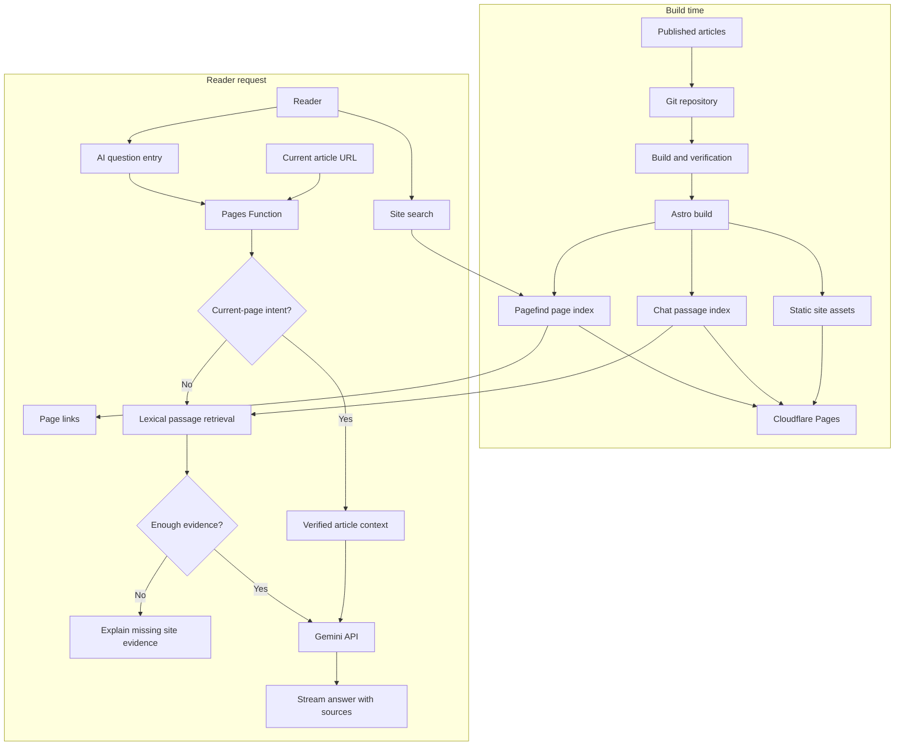
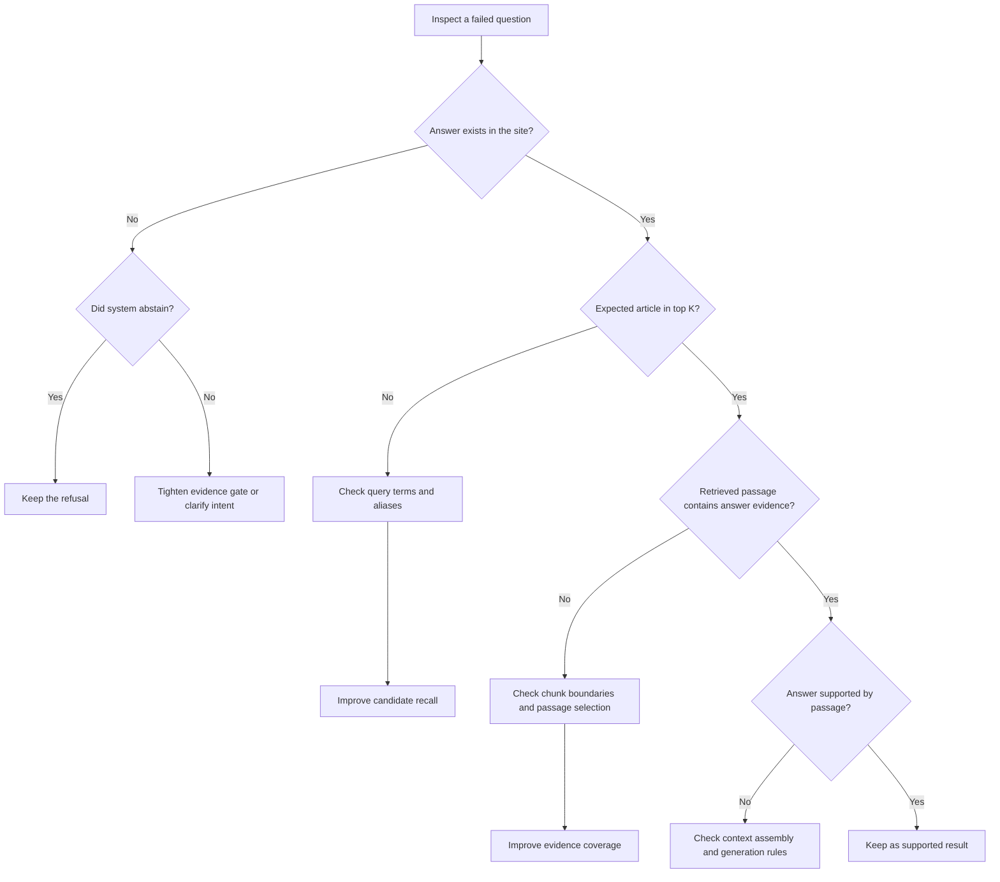

这个站点已经有不少内容了，但读者未必找得到。我有个朋友把站上的文章整理进 AI 工具里，之后可以直接和它聊这些内容。可每个访客都先做一遍整理，显然不现实；外部模型也不一定收录了整站。

我想让访客不用先知道文章标题，也能问“我该从哪篇开始看”或“这里有没有讲过团队知识交接”，回答里还能带上来源。刚开始试站内 AI 助手时，它把“有什么推荐吗”回成“本站没有足够信息”；我问站点访问量，它又找来一篇主题沾边的文章。一个问题没找到东西，另一个找到了不该用的东西。我这才意识到，得先看它把什么文章交给了模型。

后续排查从召回开始：先看系统找到了什么，再看证据是否足以让模型回答。讨论过免费资源和维护成本后，决定先用已有的关键词索引做对照，把向量检索留到有证据说明它值得接入时再考虑。

## 站内搜索先解决什么

这个博客的站内搜索由 Pagefind 提供。构建时，它读取生成后的静态页面并生成全文索引；读者输入词语后，系统返回一组排序过的页面链接。它适合“我记得大概写过这个，帮我找出来”，读者打开页面后自己读全文。Pagefind 的排序会参考词项、词频、页面长度和字段等信号。[Pagefind 索引说明](https://pagefind.app/docs/)、[排序说明](https://pagefind.app/docs/ranking/)

问答还要从页面里找出能回答问题的段落，再把问题、段落和来源交给模型组织成回答。搜索给出页面，读者自己判断；问答试着把证据连成解释。读者用词和文章差得太远时，两种检索都可能漏，问答还多了模型把相似内容说成答案的风险。

| 环节 | 负责什么 | 返回什么 |
| --- | --- | --- |
| Pagefind 搜索 | 从静态页面索引里按词项和排序信号找页面 | 页面链接 |
| 站内 AI 助手的召回 | 用双字词、字段权重和 IDF 从文章段落索引里找候选 | 少量证据段落 |
| 向量召回 | 把问题和段落编码成向量，按相似度找候选 | 语义上可能接近的段落；不负责写答案 |
| RAG | 把检索器和生成模型接起来 | 基于检索证据组织、并附来源的回答 |

这个站内 AI 助手已经是 RAG，目前靠词面检索找段落。Gemini 收到段落后会在模型内部处理文字，但这不会替网站生成一份可搜索的向量库。要做向量检索，还得用 embedding 接口分别处理文章段落和用户问题，再比较两边的向量。[Gemini embeddings 文档](https://ai.google.dev/gemini-api/docs/embeddings)

接入后，文章是在回答时供模型检索的资料，测试问题则用来检查它能不能找对资料。模型参数没有因此改变，每次请求也不用带上全站全文。答案需要的内容如果不在文章里，或者检索没把它找出来，模型就没有可靠依据。

## 测试集会被调参污染

RAG 这个名字听着像一套模型，放到这里其实就是两步：先从文章里找资料，再让模型根据资料回答。模型不会因为读了这些段落就被重新训练。Lewis 等人 2020 年的论文讨论了参数化语言模型如何和外部可检索知识结合。[RAG 论文](https://arxiv.org/abs/2005.11401)

可以把它想成给模型一本开卷资料：文章是参考书，问题是考题。后续 AI 调整检索时，使用了这批问题来补别名、调权重和比较切段；它们因此更像练习题，不能再拿来证明系统通过了独立测试。

研究资料里，Slack 介绍了 AI Answers 如何在回答时检索用户有权限访问的内容；Anthropic 分享了上下文补全、BM25、向量召回和重排的组合实验。生产系统会把检索拆成更多环节，但它们的语料和预算都不同于个人博客，照搬不等于得到同样收益。[Slack 搜索实践](https://slack.engineering/how-we-built-enterprise-search-to-be-secure-and-private/) [Anthropic Contextual Retrieval](https://www.anthropic.com/engineering/contextual-retrieval)

## 为什么先做低成本的站点版本

考虑到文章数量、更新速度和不付费的约束，当前方案在构建时生成静态索引，在线由 Cloudflare Pages Function 找少量段落；证据够用后再调用 Gemini。这样先跑通整条问答链路，也便于定位问题出在哪一环。

发布时，Astro 从已发布文章生成 Pagefind 页面索引和问答段落索引，随静态站点部署到 Cloudflare Pages。提问时，Pages Function 校验当前文章路径或检索全站段落；只有“这篇讲了什么”之类的问题会读取当前文章正文。检索证据达到门槛后才调用 Gemini，并返回来源链接。

这个版本只做了文章索引、段落召回和带来源回答。每次请求只把少量段落交给 Gemini，但词面检索仍会漏掉说法差异；文章里没有的内容，助手也答不了。

## 当前实现和免费额度的取舍

现在的版本用静态倒排索引、双语标签和少量主题别名；当前页问题会读取已发布文章的正文，全站问题则按段落检索。索引只保留每篇文章最多 3 个代表性片段，构建产物合计约 795 段、5.2 MB。完整正文的离线实验有约 3,183 段、11.3 MB，但这份更大的索引不会部署。

向量方案看起来也装得下：按每段 768 维估算，3,183 段占约 244 万存储维度，低于 Cloudflare Vectorize Workers Free 的 500 万存储维度。限制在查询量：Cloudflare 把索引向量和查询向量都计入查询维度，所以每次查询约消耗 $(3183+1)\times768$，每月 3,000 万查询维度大约只够 12 次。若只存当前 795 段，每月理论上约 49 次。这个估算假设每个问题只查一次、每段 768 维，不含重试或额外查询；它是容量上限估算，不是实际用量预测。[Vectorize 定价和计算方式](https://developers.cloudflare.com/vectorize/platform/pricing/)

Gemini embedding 的免费额度并不能抵消 Vectorize 的查询上限；免费层提交给 Gemini 的内容还可能用于改进 Google 产品。因此当前先不把文章向量接到线上：这个站点的检索质量尚未用独立问题集验证，付出更多索引和维护复杂度之前，应该先证明它能稳定减少语义改写漏召回，同时不提高无答案误答率。[Gemini API 定价与数据使用说明](https://ai.google.dev/gemini-api/docs/pricing)

现在的门槛会过滤常见问句词，并要求候选文章的元数据或最佳段落与问题有一定词项重合；证据不足就不调用 Gemini。它挡不住所有误召回，但能把一部分明显弱匹配拦在模型调用前。

## 先把问题定位在检索，而不是模型

站点索引按中英文分开构建。正文先按段落边界切分，过长段落再按句子边界切；单句仍过长时才按字符切。每段带上文章标题和章节标题，默认上限是 1,200 个字符。当前实现没有 120 字重叠。早先的向量存储估算曾假设有重叠，但那只是估算参数，不是生产代码的行为。

检索时，连续汉字会拆成相邻双字词。“反馈回路”会变成“反馈”“馈回”“回路”。标题、简介、主题关键词和正文段落各自有权重；较少见的词按 IDF 加分，常见问句词先过滤。它跟 BM25 有相似的词频思想，但当前代码只看词项是否出现，没有做词频饱和或文档长度归一化。

这一套规则便宜、容易解释，也有明确短板。“反馈回路”出现在标题里会加分；“怎么让经验传下来”与“团队能力如何积累”意思接近，却可能没有多少字面重合。为避免几个零散词把文章顶上来，系统还要求候选至少匹配最多三个不同词项；证据不够时拒绝调用模型。这个门槛只能挡一部分弱匹配，不能证明剩下的内容一定能回答。

把打分写出来，能看清当前检索器到底做了什么。$q'$ 是过滤后的问题词项，$N$ 是该语言的文章数，$df(t)$ 是包含词项 $t$ 的文章数；$I$ 表示词项是否出现在字段中：

$$
\operatorname{IDF}(t)=\ln\left(1+\frac{N-df(t)+0.5}{df(t)+0.5}\right)
$$

$$
\begin{aligned}
\operatorname{Score}(d,q) = \sum_{t\in q'} \operatorname{IDF}(t)\Big(&5I_{title}(t,d)+2I_{description}(t,d)+2.5I_{keywords}(t,d)\\
&+\sum_{p\in passages(d)} I_{passage}(t,p)+\max_{p\in passages(d)} I_{passage}(t,p)\Big)
\end{aligned}
$$

向量检索会用另一种信号：问题向量 $q$ 与段落向量 $p$ 的余弦相似度。

$$
\operatorname{cosine}(q,p)=\frac{q\cdot p}{\|q\|\,\|p\|}
$$

向量相似度高，只能说明问题和段落编码后比较接近，不能说明段落里一定有答案。这次没有生成文章向量，也没有测它们的召回效果。

## 切段长度有影响，但没有一个通用答案

把整篇长文作为一个单元，结果可能太宽；切成较小段落，边界又可能把定义和例子拆开。段落前面附上章节标题，是为了让“它”或“这个做法”之类依赖上下文的文字有机会带上主题。Anthropic 的实验也讨论了片段脱离原章节后丢失背景的问题，并提出给片段补上下文，再结合 BM25、embedding 和 reranker。它报告的召回失败率变化来自 Anthropic 自己的多数据集设置，不能当成本博客的预期收益。[Anthropic 的实验和边界](https://www.anthropic.com/engineering/contextual-retrieval)

随后，AI 对完整正文重建索引并运行离线切段实验：在同一份中英文语料和同一批问题上比较 600、900、1,200 和 1,500 字符上限。每种设置都重新建索引、运行检索；排除需要当前页面上下文的 5 个问题后，比较 70 个预期能由站内内容回答的问题。结果是：

| 单段长度上限 | 段落数 | Hit@1 | Hit@3 | MRR | Recall@3 | nDCG@3 |
| ---: | ---: | ---: | ---: | ---: | ---: | ---: |
| 600 | 6,961 | 33/70 | 45/70（64.3%） | 0.552 | 0.614 | 0.553 |
| 900 | 4,478 | 33/70 | 45/70（64.3%） | 0.543 | 0.621 | 0.551 |
| 1,200 | 3,141 | 33/70 | 46/70（65.7%） | 0.548 | 0.629 | 0.553 |
| 1,500 | 2,451 | 34/70 | 47/70（67.1%） | 0.560 | 0.650 | 0.570 |

1,500 字在这组题里略好，Hit@3 比 600 字多命中 2 题。但这批题参与过检索调整，还不能说明独立问题也会得到同样结果。完整索引大小约 11.20–11.34 MB，只差约 1.2%；段落数差很多，压缩后的文件体积却差不多。生产索引最后还是用 1,200 字，每篇只留最多 3 个代表片段。这是为了控制部署体积和段落长度，不是因为实验已经证明 1,200 字最好。

Hit@1 / Hit@3 看至少一篇正确文章有没有排进第一名或前三名。MRR（Mean Reciprocal Rank，平均倒数排名）看最靠前的正确来源：第一名记 1，第二名记 1/2，第三名记 1/3，没进前三记 0。Recall@3 会把每题标注的所有合理来源都算进去；nDCG@3 则给排得更靠前的正确结果更高权重。不同指标给出的信号不完全一样：900 字的 Recall@3 略高于 600 字，MRR 和 nDCG@3 却略低。单看某一项很容易选错。当前 1,200 字主要是容量和可读性的折中，之后还可以再测。

这些指标的计算式如下。设 $Q$ 是可回答问题数，$r_i$ 是第 $i$ 题第一个正确来源的排名，$R_i$ 是这题所有合理来源，$TopK_i$ 是检索器前 $K$ 条结果：

$$
\operatorname{Hit@K}=\frac{1}{Q}\sum_{i=1}^{Q}\mathbb{1}(r_i\le K)
\qquad
\operatorname{MRR}=\frac{1}{Q}\sum_{i=1}^{Q}\frac{1}{r_i}
$$

没有正确来源时，$r_i$ 视为无穷大，对 Hit 和 MRR 的贡献都是 0。Recall@3 会把多篇合理来源一起算进去：

$$
\operatorname{Recall@3}=\frac{1}{Q}\sum_{i=1}^{Q}\frac{|R_i\cap Top3_i|}{|R_i|}
$$

nDCG@3 则给排在前面的正确结果更高分，再除以“正确结果全排在最前面”时的理想分数。当前相关性只有“合理来源 / 不是合理来源”两档，所以 $rel_{ij}$ 是第 $i$ 题第 $j$ 个结果的 0 或 1 标签：

$$
\operatorname{DCG@3}_i=\sum_{j=1}^{3}\frac{rel_{ij}}{\log_2(j+1)}
\qquad
\operatorname{nDCG@3}=\frac{1}{Q}\sum_{i=1}^{Q}\frac{\operatorname{DCG@3}_i}{\operatorname{IDCG@3}_i}
$$

70 道题里有 49 道命中前三，Hit@3 就是 70%。这个数字只描述这批题，不能当成真实读者的命中率。完整索引的段落数随切段长度明显变化，压缩后的 JSON 却都在 11.2–11.3 MB 左右；线上索引按语言分成两份，合计约 795 段、5.2 MB。文件有多大，最后还是要看实际构建产物。

现有切段研究没有给出一个能直接套用到中文博客的字符数。一篇 2026 年预印本在 Natural Questions、特定稀疏检索器和生成模型下比较句子切分、语义切分、重叠与上下文预算；在那组设置里，句子和语义切分差距很小，重叠也没有稳定收益。换成中文博客，仍需重测。[切段策略系统比较预印本](https://arxiv.org/abs/2601.14123) BEIR 在多个检索数据集上发现，BM25 是很强的基线，稠密检索并不总能胜出；重排平均可能更好，但要多花计算。[BEIR 论文](https://arxiv.org/abs/2104.08663) 因此，关键词检索仍作为对照基线。

## 用什么问题测召回

测试问题由两部分组成：围绕博客内容整理的常见问题，以及 AI 参考 Reddit 上关于个人博客、团队知识交接和需求优先级的讨论后改写的问题。例如[个人博客读者会关心什么](https://www.reddit.com/r/Blogging/comments/1dnkyo8/question_for_personal_blog_readers/)、[团队知识如何交接](https://www.reddit.com/r/ExperiencedDevs/comments/zgwrag/best_practices_for_knowledge_transfer_when_a/)和[需求优先级怎么排](https://www.reddit.com/r/ProductManagement/comments/1e73814/how_do_you_prioritize_feature_requests_when/)。这些帖子没有被抓取或统计；它们只用于启发问法。每道题都标注了预期文章，其中一些问题在本站没有答案。

这批题用于比较检索调整前后，正确文章是否更常出现在前三名。结果如下：

| 题集 | 可回答题 | Hit@3 | MRR | 无答案题误召回 |
| --- | ---: | ---: | ---: | ---: |
| 主问题集与挑战题 | 70 | 49/70（70.0%） | 0.605 | 6/10（60.0%） |
| Reddit 启发题 | 25 | 16/25（64.0%） | 0.533 | 5/6（83.3%） |

主问题集的 Recall@3 为 0.671、nDCG@3 为 0.607；Reddit 启发题分别是 0.300 和 0.330。知识交接只命中 1/3，技术判断命中 4/7。那 40 条社区式改写问题的 Hit@3 是 26/40（65%）。这些数字能指出当前测试集里的薄弱题型，不能拿来预测读者会不会满意。

AI 调整别名、权重、拒答门槛和片段抽样时使用了这批题，因此它们现在属于开发集，没有另留一批做独立验收。测试只运行本地检索，没有调用 Gemini；答案是否忠于文章、来源链接是否正确、读者是否满意，都还不知道。另有 5 道题需要当前页面上下文，也未做完整回答质量评估。

人工或 AI 编写的问题可以补上不同问法，但也可能把编写者的表达习惯误当成读者习惯。相关评测研究也会把检索和回答拆开看：RAGAS、ARES、UAEval4RAG 关注的维度并不一样，Hit@3 只说明正确文章有没有出现，不能代替忠实度或拒答质量。[合成检索评测集研究](https://www.microsoft.com/en-us/research/publication/synthetic-test-collections-for-retrieval-evaluation/) [Can we Evaluate RAGs with Synthetic Data?](https://arxiv.org/abs/2508.11758) [RAGAS](https://arxiv.org/abs/2309.15217) [ARES](https://aclanthology.org/2024.naacl-long.20/) [UAEval4RAG](https://aclanthology.org/2025.acl-long.415/)

在这组题上，词面检索会漏掉一部分社区式问法，无答案题也常把相近主题当成答案。下一轮评测应留出一批不参与调参的问题，并标出每题真正依赖的段落；否则分数再高，也很难判断是检索变好了，还是答案被调进了题库。

## 哪些优化值得先试

低命中本身没说明该调哪里。排查时需要分别看文章有没有进前三、段落里有没有答案、Gemini 有没有照着证据回答，再决定改查询、切段还是拒答门槛：

后续优化可以先单独调整标题权重、主题别名或段落边界；如果独立留出的题仍因说法差异而漏召回，再对照关键词与向量的混合检索。RRF 按排名合并两路结果，不必把尺度不同的分数直接相加。[RRF 原始论文](https://cormack.uwaterloo.ca/cormack/cormacksigir09-rrf.pdf) [Microsoft 混合搜索说明](https://learn.microsoft.com/en-us/azure/search/hybrid-search-ranking)

无答案题更麻烦：主问题集有 6/10 仍然召回文章，Reddit 启发题是 5/6。它们多半找到了主题相近的段落，却没有找到答案。个人偏好、本站访问量或站外平台现状都不在文章里；这种问题应该停下来说明资料不足，或者先追问。

## 离线索引和在线回答是两种工作

这类系统可以拆成两条时间线。离线阶段处理内容：筛出已发布文章、清理 Markdown、切段、补上标题和标签等元数据，再把它们变成检索索引。向量方案还要调用 embedding 模型，把每段文字转成向量并写入向量库。在线阶段处理问题：识别语言和当前页面范围，把问题转成检索信号，取回候选段落，判断证据是否够用，再把少量证据交给生成模型。前者回答“资料怎么准备和更新”，后者回答“这次问题应该查什么、模型能依据什么回答”。

在这个站点，离线工作发生在 GitHub Actions 的构建和部署流程里。Astro 分别读取已发布的中文、英文文章，生成两份静态问答索引；每篇文章会清理正文、按段落和句子切分，再保留最多三个代表片段，并把标题、简介、标签和专栏信息一起编码进词项倒排索引。构建还会为每篇已发布文章生成完整正文的静态上下文文件，供“这篇讲了什么”这类当前页问题使用。草稿不会进入生产索引，撤稿或删除也会在下一次构建后从生成文件里消失。站内 Pagefind 搜索另有自己的页面索引。

在线时，Cloudflare Pages Function 根据语言读取对应索引；“本文/这篇”问题先核对当前路径是否对应一篇已发布文章，再取它的完整上下文。其他问题走全站词面检索，最多挑四篇候选的最佳段落；证据门槛通过后才调用 Gemini，回答和来源以流式事件返回。当前路径校验、候选检索、证据门槛和生成是分开的步骤，任何一步都可能让答案失败，因此“模型回答错了”还不足以定位故障。

如果以后接入向量，离线任务就要额外为每个段落生成 embedding，并把向量、文章路径、语言和段落 ID 一起写入 Cloudflare Vectorize；发布流水线还需要受限的写入凭证。在线任务则先为问题生成查询向量，再从 Vectorize 取候选，必要时和现有词面结果合并。向量不会替代生成模型，也不会让新文章自动出现：新内容得先完成 embedding 和写库，撤稿时要删掉旧向量，模型或切段规则变更时还要重建或迁移索引。Anthropic 的检索实践展示了上下文补全、BM25、向量和重排的组合；Slack 的案例则提醒权限要在检索阶段落实。它们说明可选的工程环节，不代表这个小站都需要照搬。[Anthropic](https://www.anthropic.com/engineering/contextual-retrieval) [Slack](https://slack.engineering/how-we-built-enterprise-search-to-be-secure-and-private/)

## 发布新文章时要更新什么

新文章不需要额外手动运行索引命令。合并到主分支后，发布工作流会重新构建整站；Astro 从已发布文章生成新的中英文索引，再和页面一起部署。每次都是全量重建，不是只往旧索引里加新文章。以当前文章量和更新频率，重建整份索引更简单，也不会留下改过的旧段落或已撤稿文章。它只重新计算词项和倒排表，不调用 Gemini，也不需要向量数据库。

加向量后，文章和向量库得保持同步。每次发布都重算全站最直接，但没变的段落也会重复生成 embedding。可以给每个段落一个稳定 ID 和内容哈希，只更新新增或改过的段落；文章撤下时删掉对应向量。更换 embedding 模型、维数或切段规则时，旧向量不能和新向量混着查，需要重建一版再切换。这些步骤还要处理凭证、失败重试和删除同步。考虑到当前更新频率，增量更新做得到；但在向量尚未证明能明显减少漏召回前，先不增加这部分维护工作。

## 把文章交给 GPT，和把 AI 助手放进站点

之前有个朋友把我的站点内容整理进自己的 AI 知识库，然后直接问它问题。我有时也说“把网站蒸馏了”，但不是在训练模型；朋友做的是把文章交给 AI 工具检索。愿意先花时间整理的人，用起来很方便，可以围绕整批文章问，也可以接着追问。文章更新了，他那边也得重新导入或同步。

站内 AI 助手面向的是另一种场景：访客已经来到博客，但不知道该搜什么，也不会先把整站复制进自己的工具。他可能想知道作者反复写过哪些问题、对一个决策有哪些不同看法，或者几篇文章能不能放在一起读。只推荐“相关内容”未必够用；在与 AI 讨论功能目标时，提出的方向是让助手尝试从站内文章里找观点之间的联系，再把读者带回原文。朋友的 AI 知识库是把内容带到自己的工具里，站内 AI 助手则让访客留在博客里提问。两种用法都能查文章，更新方式和开始使用的成本不一样。

当前版本由 AI 按讨论确定的目标实现，属于低成本方案，还不能稳定归纳整站观点。每篇文章最多留下三个片段，在线最多检索四篇文章；重要观点如果没进索引，Gemini 就没法把它们放在一起讲。要比较朋友自己导入知识库和站内 AI 助手谁答得更好，需要给它们同一批文章、同一组问题，再看答案是否覆盖关键内容、引用是否准确、内容更新是否及时，以及使用步骤有多少。这个对照尚未进行，因此目前只能确认两者服务于不同的使用场景。[GPT Knowledge 说明](https://help.openai.com/en/articles/8554407-memory-in-chatgpt) [OpenAI Retrieval 文档](https://developers.openai.com/api/docs/guides/retrieval)

## 这次实现里，AI 做了哪些工作

这次实现中，AI 阅读代码、修改检索器、运行切段对照，并整理测试问法和失败案例。站内 AI 助手可以把检索到的几篇文章线索放在一起；读者忘了自己写过什么时，提问可能比逐篇翻找更快。前提仍是索引找到正确文章，段落也确实支持回答。

讨论初期也问过是不是 Gemini 不够好。把链路拆开后，看到的问题是正确文章有时连前三都没进。另一个问题是，原本用于验收的问题后来被用于修改别名、权重和拒答门槛。分数变高，并不说明换一批问题还会更好。

这次互动里，项目所有者给出了目标和约束：助手只回答站内文章，优先使用免费资源，还要能带来源；也不断追问测试结果能说明什么、哪些问题还没验证。AI 负责阅读代码、实现检索、整理测试问题并运行对照。问题集是否足以代表读者、什么结果才算有用、是否值得为向量增加维护成本，这些判断不能从代码或分数里自动得出，需要人来决定。

METR 2025 年的一项随机对照研究里，16 位有经验的开源开发者在熟悉项目中完成 246 个任务，使用当时的 AI 工具后平均耗时增加 19%。这不能外推成“AI 编程普遍变慢”；METR 对后续实验也说明，选择效应让速度收益难以可靠估计。[METR 2025 研究](https://metr.org/Early_2025_AI_Experienced_OS_Devs_Study-paper.pdf) [METR 2026 方法更新](https://metr.org/blog/2026-02-24-uplift-update/)

问题收集、标注、调参和验收没有形成全自动流程。Reddit 帖子只为测试问题提供了问法线索，不是用户研究；题目与文章的对应关系也不能只靠生成结果。项目说明和架构记录能给 AI 补充背景，但不能替项目所有者决定什么算成功，或这点提升值不值得付费。

## 人和 AI 读者分别能从文章里拿走什么

给内容增加站内 AI 助手时，首先要判断读者是想找一篇页面，还是想听几篇文章放在一起怎么说；接着分别评估召回是否找到证据、模型是否超出证据回答，再决定是否需要向量检索。这套做法依赖本站的内容规模、更新频率和免费资源约束，不一定适合问题更开放的平台。

文章保留章节、公式和来源链接，也便于外部 AI 搜索读取。Google 的说明是，AI 搜索仍依赖可抓取、可索引的页面；采用这种结构不代表一定会被引用。[Google Search Central](https://developers.google.com/search/docs/appearance/ai-features)

站内 AI 助手由 AI 按讨论中确定的目标实现：可以读取当前文章，也可以从全站索引找段落，并在回答中附上来源；发布新文章后，索引会随站点重新构建。测试集初稿由 AI 根据站点内容和 Reddit 讨论整理，之后又用于调整检索，所以不能代表独立评测。它能不能帮刚来的访客发现“原来这里还写过这个”，真实访客会怎么问，以及助手能不能把几篇文章放在一起讲清楚，目前都还没有答案。
