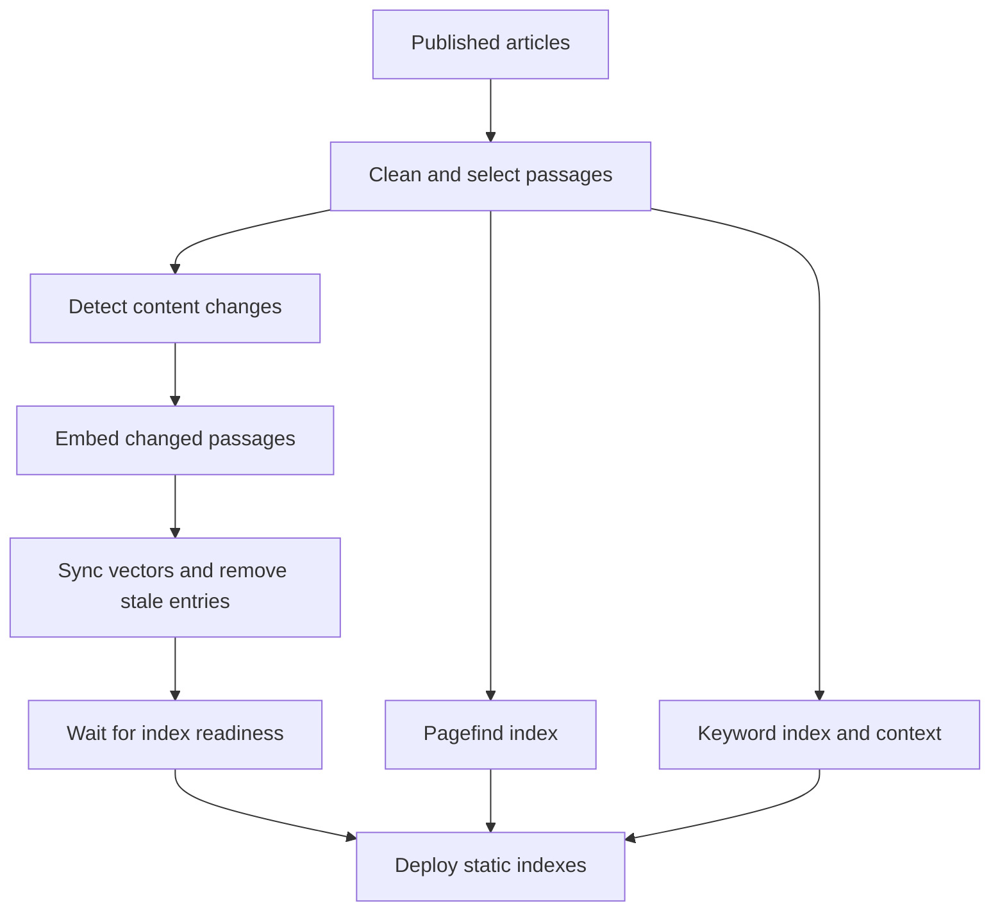
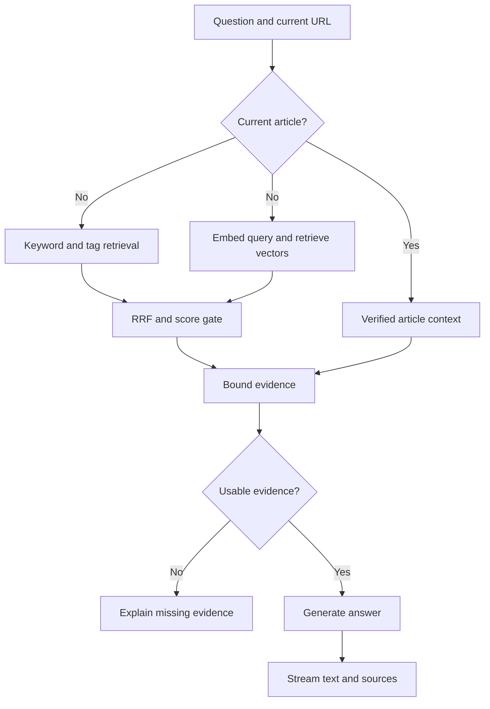

这个博客积累了不少文章，但内容在站里，不等于读者容易用起来。之前有朋友把站点内容整理给模型，再和它对话，能从一堆文章里问出东西。这种用法有个前提：有人愿意先把网站抓下来、整理，再接到模型上。普通读者来博客时未必会做这一步。站点能不能自己提供一个入口，让人直接问“这里写过什么”，而不是先学会怎么搜索？

因此，站点增加了面向全站内容的 AI 助手：只回答站内文章能支持的问题，并附上来源链接。站内搜索帮助读者找到具体内容；助手还要处理读者不熟悉文章标题、只知道自己遇到什么问题的情况，把几篇相关文章组织成一个回答。它和搜索是两个入口、两种任务，助手不该冒充通用聊天，也不该把站外常识包装成作者写过的观点。

我给这个项目的约束很具体：不付费，继续用 Cloudflare，文章更新后不要靠手动维护索引。初版助手用了静态关键词检索，直接接进现有构建流程，先把功能跑起来。这一步倒不难理解，问题出在后面的判断：讨论向量时，方案很快变成了“当前先不接入”，但那时根本没有本站的向量对照结果。

我在讨论里追问了几次：既然没有测，为什么决定不用？如果免费额度够，Functions 能直接查向量，或者单独放一个 Worker，也应该可以尝试。零预算是我对项目的要求，但它应该用来检查方案能否运行，不能替代效果比较。于是后面补了本地向量实验，把关键词、纯向量、混合召回放在同一批题上看。比较分两层进行：本地用 BGE-M3 对全部候选做精确排序，观察检索策略的差别；云端用 Workers AI 和 Vectorize 核对实际服务的候选、延迟和资源消耗。结果支持当前选混合检索：这批题上首位命中更多，无答案题的误召回更少，但提升有限，阈值还没有经过独立题集验证。

最初测试时，助手曾把“有什么推荐吗”和“你能聊什么”都回成“本站没有足够信息”。问研发团队是不是卡在 CI 反馈太慢，正确文章有时进不了前三；问上个月的访问量，它又会给出主题沾边的文章。之后，AI 根据博客内容和社区讨论补了几类问题：“工程师应该参与产品决策吗？”“怎么让经验在团队里传下来？”结果显示，这不只是 Gemini 会不会组织语言的问题：模型只能看见检索阶段交给它的片段，材料没找对，流畅的回答也可能错得更像真的。

问答可以先拆开看：文章有没有找对，和模型能不能依据文章回答，是两件事。在让模型写答案之前，系统已经做了什么？

## 搜索和 AI 助手，是两种内容入口

站点不是单纯多放一个聊天框，而是希望读者更容易用上已经写过的内容。平时在博客里找东西，大概有几种办法：从导航、栏目、标签和归档逐层缩小范围；记得某个词时用站内全文搜索；读完一篇后顺着相关推荐继续看。本站的相关推荐按同专栏和共享标签等规则排序，并把推荐理由展示出来；它不需要记录读者行为。再往外一层，是 Google 这样的搜索引擎把页面抓取、收录，最后展示给还没来过本站的人。这些入口都在帮读者找内容，但使用的信号和要完成的任务并不一样。

比如站内的 Pagefind 会在构建时为页面生成静态索引。读者输入关键词，它返回匹配的页面和片段，读者自己判断哪篇值得点开。栏目、标签和相关推荐则更像作者预先整理好的阅读路径。SEO 和 sitemap 服务的是外部发现：sitemap 列出 URL，帮助搜索引擎发现页面，但不保证页面一定被抓取或收录；Google 还要抓取页面、分析并建立索引，再根据查询提供结果。[Pagefind 的工作方式](https://pagefind.app/docs/) [Google 如何处理搜索](https://developers.google.com/search/docs/fundamentals/how-search-works/) [Google 对 sitemap 的说明](https://developers.google.com/search/docs/crawling-indexing/sitemaps/overview)

AI 助手的产品目标是接住另一种入口：读者记不清标题，也不一定知道该搜哪个词，只知道自己遇到了什么问题，或者想了解一个主题。比如“团队经验怎么才能传下来？”“我应该从哪些文章开始读？”读者描述的是处境或阅读目标，理想状态下，助手应据此找出能支持回答的文章，把几篇文章的观点组织起来，附上来源让人回去读原文。站内没有依据时，就应该承认没找到。

同类文档产品已经把问答放到内容入口附近。GitBook 的 Site AI Ask 将回答限制在已发布文档；ReadMe 的 Ask AI 会基于已发布文档回答并给出来源链接，还能从搜索界面触发。[GitBook Site AI Ask](https://gitbook.com/docs/developers/gitbook-api/api-reference/docs-sites/site-ai-ask) [ReadMe Ask AI](https://docs.readme.com/main/docs/ask-ai) [ReadMe 的搜索与 Ask AI 更新](https://docs.readme.com/main/changelog/ask-ai-v2) 这类产品说明搜索和助手可以并排存在：知道关键词时，搜索让人直接找到页面；知道自己要解决什么、却不知道站里有哪些材料时，助手先帮忙串起内容。

标签也可以成为问答入口。读者看到“技术”或“管理”，通常还没有一个完整问题，只是在找这个主题下有哪些内容。把标签名直接发给助手，它应该先找出带这个标签的文章，概括站内写过什么，再给一个阅读起点和来源链接。它和搜索标签页的结果列表不同：标签页让读者自己逐篇挑，助手把几篇文章的主题先说清楚。这个入口没有要求模型凭一个宽泛词去猜意图，网站已经有的标签就是一组明确的主题边界。

这里的“理解目的”是产品想达到的效果，不是当前系统已经具备的能力。Google 也说明，AI Overviews 和 AI Mode 仍会从 Search 索引检索网页，再用生成式方式组织回答和来源；回答层变了，底下的发现、索引和检索仍然存在。[Google 关于生成式搜索的说明](https://developers.google.com/search/docs/fundamentals/ai-optimization-guide) 最初的站内 MVP 还没有语义检索，只按关键词找片段，Gemini 负责解释交给它的材料。问题换了说法而导致文章没召回时，模型也无从理解那篇文章。这个距离，正好把问题带回检索本身。

## 搜索找到文章之后，RAG 还要做什么

AI 助手和搜索相比多了一步：找到文章后，还要让模型把几段材料组织成回答。这种做法叫 RAG（Retrieval-Augmented Generation，检索增强生成）。文章在收到问题时被检索出来，连同问题和来源一起交给模型；它不等于把文章拿去训练模型。[Lewis 等人的 RAG 论文](https://arxiv.org/abs/2005.11401)

可以把它想成考场上给模型一本开卷资料。文章库像参考书，问题集像考题。考题用来检查模型和检索器会不会，不应该混进参考书里；反复拿同一批考题调权重、补同义词、改切段之后，它们更像练习题，不能再当作完全独立的最终考试。

```text
Reader question
    ↓
Retrieve candidate passages from the article index
    ↓
Send the question, passages, and sources to the model
    ↓
Generate an answer and display article links
```

容易把它粗略理解成“把一套数据集接给大模型”。实际是文章作为外部资料，在回答时才被检索；测试问题只是用来检查检索和回答，模型参数没有因此改变。文章里没有答案，或者检索没把证据找出来，模型就无从依据本站内容作答。

RAG 把找到的段落交给模型组织答案。检索可以用关键词、向量或两者结合；embedding 是一种检索表示，不是 RAG 本身。接上生成模型也没改变前面的检索结果，错找的文章仍会成为错误回答的依据。

企业里的检索系统也会把这两步拆开。Slack 介绍过如何在 AI Answers 中检索用户有权限访问的资料；Anthropic 对比了上下文补全、BM25、向量检索和重排，在他们自己的测试中 top-20 检索失败率从 5.7% 降到 1.9%。这些是更大语料和不同模型上的结果，不能拿这个数字预测本站效果。[Slack 的企业搜索实践](https://slack.engineering/how-we-built-enterprise-search-to-be-secure-and-private/) [Anthropic 的 Contextual Retrieval](https://www.anthropic.com/engineering/contextual-retrieval)

## 先看问题是不是出在检索

站内页面搜索和问答助手使用各自的索引：页面搜索用 Pagefind 找页面，问答助手另有一份中英文片段索引，供 Pages Function 查证据。当前索引从已发布文章生成，清理 Markdown，保留标题、简介和章节标题，再按段落、句子切成检索片段。默认上限是 1,200 个字符，没有片段重叠。切段长度决定一个片段能保留多少上下文，是否重叠则影响重复内容和存储量；这两个参数需要分别比较。

问句和文章字段都会转成词项。英文和数字按连续字符串处理，连续汉字拆成相邻双字词。“反馈回路”会变成“反馈”“馈回”“回路”。标题命中权重是 5，简介是 2，主题关键词是 2.5，段落是 1；少见词按 IDF 加分。问句里的“怎么样”“有没有”一类模板词会过滤掉。这个排序不是完整 BM25：它不统计同一词在段落里出现了几次，也不按文档长度归一化。

检索器还会检查候选文章和问题之间是否有足够多的不同词项重合，最多要求 3 个；问题经过过滤后只剩一两个词时，门槛会相应降低。达不到时就按“站内没有找到足够资料”处理，不调用 Gemini。这个门槛不是对答案正确性的判断，只是挡住明显较弱的词面匹配。中文按双字词拆分，所以这里的“3 个词项”不等于三个完整中文词。

这套规则能解释为什么某篇文章排在前面：标题命中权重大，少见词也更值分。但它只计算词项重合，不会判断文章是不是在回答这个问题。换一种说法可能漏掉，碰巧命中“效率”这样的词也可能把不相干的文章排上来。

Embedding 可能补上这些词面差异，找回意思相近的问法；也可能把主题相似、实际答案不同的段落排到一起。相似度不是答案正确率。后文会用 BGE-M3 在本站题目上做本地对照；后面还会用 Workers AI 的同名模型和真实 Vectorize 核对结果；Gemini Embedding 2 没有实测，不能沿用这里的分数。

如果把打分拆开看，检索器先给标题、简介和关键词算分，再加上得分最高的一个段落。$q'$ 是过滤问句模板词后的词项集合，$N$ 是同一语言的文章数，$df(t)$ 是包含词项 $t$ 的文章数。IDF 让少见词比常见词贡献更高：

$$
\operatorname{IDF}(t)=\ln\left(1+\frac{N-df(t)+0.5}{df(t)+0.5}\right)
$$

对文章 $d$，$P_d$ 是它的段落集合，$p^*$ 是得分最高的段落；$I_f(t,d)$ 表示词项 $t$ 是否出现在标题、简介或主题关键词字段中，$I_p(t,p)$ 表示它是否出现在段落中。关键词检索的文章分数是：

$$
\begin{aligned}
\operatorname{Score}(d,q)=&\sum_{t\in q'}\operatorname{IDF}(t)\left(5I_{title}(t,d)+2I_{description}(t,d)+2.5I_{keywords}(t,d)\right)\\
&+\max_{p\in P_d}\sum_{t\in q'}\operatorname{IDF}(t)I_p(t,p)
\end{aligned}
$$

实际实现逐段累计词项分数，再选出最高分段落；同一词项出现在多个段落时，不会把所有段落的分数都加起来。候选还要满足词项门槛：

$$
\left|q'\cap\left(T_{title}\cup T_{description}\cup T_{keywords}\cup T_{p^*}\right)\right|\geq\min(3,|q'|)
$$

这份索引让 Pages Function 不必在每次提问时逐篇读取文章。Astro 构建时会把词项映射到文章、标题简介等字段和段落编号，再按语言生成静态 JSON 倒排索引；生产草稿不会进入索引。

请求到达后，Function 从倒排表查找问题词项对应的候选，按字段权重和 IDF 评分，每篇文章保留分数最高的段落，最多把四篇来源交给模型。文章解析、切段和建索引都在构建时完成；在线只查索引、挑证据并调用模型。检索仍依赖词项重合，索引更新也要等站点重新部署。

向量检索则会比较问题向量 $q$ 和片段向量 $p$ 的余弦相似度：

$$
\operatorname{cosine}(q,p)=\frac{q\cdot p}{\|q\|\,\|p\|}
$$

本例使用 BGE-M3 的 1,024 维向量。文章片段和问题分别编码，再比较相似度；测试问题不会作为文章存入内容库。实验用过两种语料配置：完整切段版为 3,187 个中英文片段，代表片段版为 795 个片段，每篇文章最多保留开头、中间和结尾三个片段。减少片段能降低入库成本，也会漏掉没有被保留的正文。检索器再好，也找不到索引里不存在的证据，因此比较关键词和向量时必须固定同一份语料。

## 先确定测什么，再看分数

只靠项目开发者想到的问题，容易只覆盖熟悉的问法。问题集有两组来源：一组参考 Reddit 上个人博客读者、团队知识交接和产品优先级的讨论，改写成 31 个问题；另一组由基础题和挑战题组成，共 85 题。Reddit 启发组有 25 题预期能由站内文章回答、6 题需要站外资料或本站暂时没有答案。帖子只提供问法线索；这不是对 Reddit 用户的调查，也不代表真实读者的提问频率。两组题都经过人工或模型辅助整理。

基础与挑战题共 85 题：5 题需要当前页面上下文，70 题预期可回答，10 题无答案。它们已经被反复用于检索调试，适合比较开发过程中的变化。模型辅助生成的问题能较快补齐题型，但合成集会带有生成模型和任务本身的偏差，需要保留来源记录，并留出没有参与调参的题目。[Synthetic Test Collections for Retrieval Evaluation](https://www.microsoft.com/en-us/research/publication/synthetic-test-collections-for-retrieval-evaluation/) [Can we Evaluate RAGs with Synthetic Data?](https://arxiv.org/abs/2508.11758)

还有一个更基础的限制：题目目前标的是相关**文章**，没有逐题标注支持答案的**段落**。因此这些指标能说明文章有没有进前三，不能确认模型拿到的片段里是否真有答案证据。RAGAS、ARES 等工作把检索相关性、答案忠实度和答案相关性分开评估；对本站来说，这些维度比一个总分更有用。[RAGAS](https://arxiv.org/abs/2309.15217) [ARES](https://aclanthology.org/2024.naacl-long.20/)

评测里有三类问题，处理方式也不同：

| 问题类型 | 检查什么 | 为什么单独看 |
| --- | --- | --- |
| 站内可回答的问题 | 正确文章是否进入候选、排名是否靠前 | 衡量召回和排序 |
| 站内没有答案的问题 | 是否仍返回文章作为证据 | 检查主题相近造成的误召回 |
| “这篇讲什么”这类当前页面问题 | 是否只使用指定文章，路径是否有效 | 检查上下文范围，不计入全站排名分数 |

对可回答题，Hit@3 是首要观察项：前三条里至少有一篇正确文章，助手才可能拿到有效材料。MRR 和 Hit@1 看读者或模型是否更早遇到正确来源；需要综合多篇文章时，再看 Recall@3 和 nDCG@3。无答案题的误召回要另列，不能混进平均命中率。否则检索器只要每次都返回一些文章，就可能看起来很积极，却把没有依据的问题也送进生成模型。

Hit@1 / Hit@3 看至少一篇正确文章是否出现在第一名或前三名。MRR（Mean Reciprocal Rank，平均倒数排名）只看排名最靠前的正确来源：第一名贡献 1，第二名贡献 1/2，第三名贡献 1/3，没进前三则贡献 0。Recall@3 会把每题标注的全部合理来源都纳入分母；nDCG@3 则把靠前的正确来源权重放得更高。比如一题有两篇合理来源，前三名只找回其中一篇，且排在第二名：这题的 Hit@3 是 1，MRR 的贡献是 1/2，Recall@3 是 1/2。找到过一篇、让它排得靠前、覆盖多篇来源，是三种不同的效果。

除了“正确文章有没有进前三”，评测脚本还计算排名和多来源覆盖。设 $Q$ 是可回答问题数，$r_i$ 是第 $i$ 题第一个正确来源的排名，$R_i$ 是这题所有合理来源，$Top3_i$ 是前三条结果：

$$
\operatorname{Hit@K}=\frac{1}{Q}\sum_{i=1}^{Q}\mathbb{1}(r_i\le K),\qquad
\operatorname{MRR}=\frac{1}{Q}\sum_{i=1}^{Q}\frac{1}{r_i}
$$

没有正确来源时，$r_i$ 视为无穷大，该题对 Hit 和 MRR 的贡献为 0。Recall@3 会把每题的多个合理来源都计入：

$$
\operatorname{Recall@3}=\frac{1}{Q}\sum_{i=1}^{Q}\frac{|R_i\cap Top3_i|}{|R_i|}
$$

nDCG@3 给靠前的正确来源更高权重。$rel_{ij}$ 是第 $i$ 题第 $j$ 个结果的二元相关性标签；$IDCG@3_i$ 是把这题所有合理来源尽量排在前三时的理想 DCG：

$$
\operatorname{DCG@3}_i=\sum_{j=1}^{3}\frac{rel_{ij}}{\log_2(j+1)},\qquad
\operatorname{nDCG@3}=\frac{1}{Q}\sum_{i=1}^{Q}\frac{\operatorname{DCG@3}_i}{\operatorname{IDCG@3}_i}
$$

这 25 条站内问题里，正确文章有 14 条进了前三（Hit@3 56%）；6 条无答案题中，5 条仍然召回了文章。新增主题别名后，Hit@3 从 12/25 到 14/25，无答案误召回没有改善。别名帮一部分换了说法的问题找到了文章，但仍会把“主题接近”当成“文章有答案”。

行业里的 RAG 分数能不能说明 70% 算什么水平？BEIR 比较多个领域里的检索方法，Anthropic 报告的是他们语料上 top-20 段落的失败率；本站算的是正确文章有没有进前三，评测对象和指标都不同，没法把数字排在一起。[BEIR](https://arxiv.org/abs/2104.08663) [Anthropic Contextual Retrieval](https://www.anthropic.com/engineering/contextual-retrieval)

## 段落切短、切长，结果差多少

整篇文章太长，相关内容会被摊薄；段落太短，定义又可能和例子分开。为确认 1,200 字是否合适，评测把上限改成 600、900、1,200、1,500 字，在同一批问题里重跑。段落上限之外，片段还会带上章节标题，让“它”“这个做法”这类依赖上下文的句子不至于完全失去主题。Anthropic 也研究过补充片段上下文，再组合 BM25、embedding 和 reranker；他们的数字来自自家数据，不能直接当成本站预期。[Anthropic 的实验和边界](https://www.anthropic.com/engineering/contextual-retrieval)

这张表比较的是完整切段语料上的关键词检索，尚未限制每篇文章的片段数量。后面的向量对照使用代表片段语料，两个实验回答不同的问题，分数不能直接横向比较。评估脚本在同一份中英文文章索引和同一批问题上，分别把最大段落长度设成 600、900、1,200 和 1,500 字符。每次重建索引并重新跑检索；不计需要当前页面上下文的 5 个问题，比较 70 个预期能由站内内容回答的问题。结果是：

| 单段长度上限 | 段落数 | Hit@1 | Hit@3 | MRR | Recall@3 | nDCG@3 |
| ---: | ---: | ---: | ---: | ---: | ---: | ---: |
| 600 | 6,965 | 33/70 | 45/70（64.3%） | 0.543 | 0.614 | 0.546 |
| 900 | 4,482 | 33/70 | 45/70（64.3%） | 0.545 | 0.621 | 0.553 |
| 1,200 | 3,145 | 33/70 | 45/70（64.3%） | 0.543 | 0.614 | 0.546 |
| 1,500 | 2,455 | 34/70 | 45/70（64.3%） | 0.552 | 0.621 | 0.558 |

1,500 字在这组题里数值略好，但 Hit@3 没变，差距也不足以说明它在独立问题集上会更好。索引大小从约 11.20 MB 到 11.34 MB，变化约 1.2%；段落数变化明显，倒排记录压缩后生成的 JSON 体积变化仍然很小。因此目前没有足够证据仅凭这组小型合成题把默认切段长度改成 1,500。这是一轮单独的切段对照；后面加入主题别名和词项门槛后，检索器和分数都变了，不能把两轮数字当成同一条实验曲线。

每种设置的段落数差异很大，但生成索引 JSON 的体积差异小得多，约在 11.2–11.3 MB。倒排索引会压缩词项到文章、段落的映射，所以“段落数量翻倍”不等于“文件大小也翻倍”。估算资源占用时应直接测构建产物，不能只用“向量维数 × 段落数”代替整个索引成本。

一篇 2026 年预印本在 Natural Questions、特定稀疏检索器和生成模型下比较句子切分、语义切分、重叠与上下文预算；在那组设置里，句子切分和语义切分差距很小，重叠也没有显示稳定收益。作者说明结果来自特定英文语料和模型，换到中文博客仍需重测。[切段策略系统比较预印本](https://arxiv.org/abs/2601.14123) BEIR 在多个检索数据集上发现，BM25 是稳健基线，稠密检索并不总能胜出；重排平均可能更好，但需要更多计算。[BEIR 论文](https://arxiv.org/abs/2104.08663) 因此当前仍以关键词检索为基线，再用本站问题集验证其它方法。

## 关键词、向量和混合召回，哪种更适合回答问题

切段实验没有带来明显的前三命中提升，还需要比较匹配方式。这组对照固定使用 795 个代表片段，用 Ollama 的 BGE-M3 计算精确余弦相似度。关键词和向量检索面对相同的文章、片段和题目：70 道可回答题、10 道无答案题，5 道当前页面题另行验收。本地精确排序方便检查策略，但云端向量库使用近似查询，两者不能当作同一个实验。[BGE-M3 论文](https://arxiv.org/abs/2402.03216)

混合召回使用 RRF（Reciprocal Rank Fusion）。关键词分数和余弦相似度的尺度不同，直接相加很难解释，所以先分别排序，再按排名给每篇文章累加分数。文章在两种检索里都排得靠前，就更容易进入最终候选：

$$
\operatorname{RRF}(d)=\sum_{j\in\{keyword,vector\}}\frac{1}{60+rank_j(d)}
$$

这里的 60 是排名平滑常数，某个检索器没有召回该文章时，其贡献为 0。融合前先把同一文章的多个向量片段合并，避免长文章凭片段多占满候选。RRF 处理的是顺序，仍需要另外设置是否接受证据的门槛。[RRF 论文](https://cormack.uwaterloo.ca/cormack/cormacksigir09-rrf.pdf)

| 检索方式 | Hit@1 | Hit@3 | MRR | 无答案题仍召回文章 |
| --- | ---: | ---: | ---: | ---: |
| 静态关键词（代表片段索引） | 37/70 | 49/70（70.0%） | 0.605 | 6/10 |
| BGE-M3 向量，取前三，不设门槛 | 32/70 | 53/70（75.7%） | 0.600 | 10/10 |
| BGE-M3 向量，余弦门槛 0.55 | 32/70 | 53/70（75.7%） | 0.600 | 3/10 |
| BGE-M3 向量，余弦门槛 0.60 | 31/70 | 50/70（71.4%） | 0.571 | 1/10 |
| BGE-M3 向量，余弦门槛 0.65 | 24/70 | 32/70（45.7%） | 0.398 | 0/10 |
| 关键词 + BGE-M3 RRF，0.60 门槛整体拒答 | 41/70 | 52/70（74.3%） | 0.657 | 1/10 |

表中的混合方案使用统一的 0.60 拒答门槛。后面介绍的短主题词例外和当前页面解读另行验收，不由这张全站排名表代表。

这组结果里，向量对前三命中的提升有限。0.55 门槛把无答案误召回从 10/10 降到 3/10，同时保留 53/70 的 Hit@3；0.60 门槛进一步降到 1/10，但 Hit@3 也降到 50/70。混合检索在 0.60 整体拒答时，Hit@1 是 41/70、Hit@3 是 52/70、MRR 是 0.657，无答案误召回 1/10。相对静态关键词，Hit@3 多 3 题，MRR 多 0.052，误召回少 5 题。这解释了为什么选择混合方案：除了找回文章，还希望少把无依据的主题匹配送给模型。提升幅度仍然有限，70 道题里多中一题就是约 1.4 个百分点；10 道无答案题里多错一题就是 10 个百分点。这些比例需要连同题目数量一起看。

0.55、0.60 等阈值是在这批已经参与检索调试的问题上扫出来的，不是独立测试集上的验证结果。这些分数为选择混合方案提供了依据，但不能说明改进会延续到新问题。

### 让测试集少一点自我证明

自己熟悉文章，想到的问题往往已经带着文章里的关键词。我要求参考 Reddit 的问法，就是想补上只描述处境、记不清术语的提问。社区讨论能帮忙换问法，但改写后的题仍是整理出来的，不能当作真实读者统计。

测试集需要标明问题来源、合理文章和支持答案的段落。题目可以由 AI 起草，正确来源则要回到原文核对；如果直接把检索器的第一条结果当标准答案，评测就会奖励它原有的偏好。除了常见问法，还需要主题接近但没有答案的问题、短标签和带上下文的追问。

开发题用于改别名、选门槛；保留题在规则确定后用于验收。发现保留题失败后，可以把它纳入下一轮开发，但它就失去了独立验收的身份。数据集小的时候，这个区别比多报一个小数位更重要。

最终还要检查送进模型的证据。正确文章进入前三，也可能只截出了没有答案的开头。检索层看排名和证据覆盖，生成层看回答中的说法能否被证据支持；运行层再看延迟、失败率和用量。把这几层分开，才知道一次失败该改索引、召回、证据选择，还是模型提示。

### 精确排序之外，还要验证云端查询

上一轮云端测试用的是早期完整切段语料：Workers AI 为 3,187 个片段和 85 个问题生成 BGE-M3 向量；文章片段写入隔离的 Vectorize 索引，测试问题向量用于查询对照。另一层验证由本地 Pages Function 在请求时实时生成问题向量，查询真实 Vectorize。它证明了 Workers AI、Vectorize 和 Pages Function 这条链路可以工作，但不是当前 795 个代表片段的线上排名结果。当前配置每次最多取 50 个片段，按语言 namespace 过滤，再按文章合并、与关键词结果做 RRF。

| 检索方式 | Hit@1 | Hit@3 | MRR | 无答案题仍召回文章 |
| --- | ---: | ---: | ---: | ---: |
| 静态关键词基线 | 35/70 | 49/70 | 0.593 | 6/10 |
| Workers AI + Vectorize，0.55 门槛 | 37/70 | 57/70 | 0.657 | 4/10 |
| Workers AI + Vectorize，0.60 门槛 | 36/70 | 55/70 | 0.636 | 1/10 |
| 关键词 + 云端向量 RRF，0.60 整体拒答 | 43/70 | 53/70 | 0.674 | 1/10 |

早期测试的云端排名接近本地精确排序，但不能把它套到现在的代表片段索引。向量库查的是片段，多个高分片段可能来自同一篇文章；只取 50 个片段时，也不一定包含精确全库排序里的所有文章。当前实现已经加入片段内容哈希校验，避免旧向量位置碰巧映射到另一段新正文。因此这张云端表只能用于观察完整切段配置的服务行为，不能作为代表片段配置的最终 benchmark。

上一轮本地 Pages 请求包含云端问题 embedding 与 Vectorize 查询，耗时中位数 227 ms、P95 350 ms；使用预先生成的问题向量时，单独 Vectorize 查询的中位数为 80 ms、P95 127 ms。这里没有 Gemini 生成答案，也没有测生产环境的冷启动或 CPU 时间，完整回答的延迟还包含 Gemini 生成、网络和服务启动，需要单独测量。P95 表示 95% 的请求耗时不超过该值，比中位数更容易暴露少数慢请求。

早期 3,187 个片段和测试问题的 embedding 调用记录了约 138 万 input tokens、1,488 neurons，约占 Workers AI 每日 10,000 免费 neurons 的 15%。这不是当前精简语料的用量。当前 795 个片段按 1,024 维计算，Vectorize 存储约 814,080 维，占 500 万免费额度约 16%。Workers AI 负责向量生成，Gemini 负责组织答案。测试与生产如果各存一份早期完整索引，会超过 500 万维；当前代表片段规模则可以容纳两份，但仍应避免留着已废弃的完整切段向量。发布脚本会根据内容哈希只重新生成新增或修改的片段，并删除已不在静态索引中的向量。[Workers AI BGE-M3](https://developers.cloudflare.com/workers-ai/models/bge-m3/) [Workers AI 免费额度与定价](https://developers.cloudflare.com/workers-ai/platform/pricing/)

入库还有一个实际问题：Vectorize 返回写入成功时，查询索引未必已经更新。测试里出现过入库成功、查询却为空的阶段；等处理完成后才跑查询。发布流程需要等索引处理到对应的 mutation，才启用这一版检索；否则新页面上线时，助手可能暂时找不到它。写入、覆盖更新、删除和服务失败回退需要分别验收，查询成功不能代替这些一致性检查。

### 三种方案分别适合什么

静态索引和向量索引都要先清理文章、切段和保存来源，差别主要在匹配信号。当前静态方案用关键词倒排索引；向量方案把片段和问题转成同一模型的 embedding，再比较相似度。两者也可以组合，不能把“用了静态文件”当作“没有 RAG”，或把“用了向量”当作“模型一定能答对”。

| 方案 | 优点 | 代价和容易失败的地方 | 本站对照给出的信号 |
| --- | --- | --- | --- |
| 静态关键词倒排索引 | 不需要问题 embedding；文章更新随构建完成；匹配词和排序比较容易解释 | 换一种说法容易漏召回；主题词重合也会误召回 | 当前代表片段基线 Hit@3 为 49/70，无答案误召回 6/10 |
| 向量检索 | 能找回部分词面不同、含义接近的文章；相似度查询交给向量库 | 每问增加 embedding 调用；需维护向量更新和删除；相似度不能证明片段含有答案 | 当前本地 BGE-M3 在 0.55 门槛下 Hit@3 为 53/70，误召回 3/10；提高门槛会损失召回 |
| 关键词与向量混合 | 保留精确词匹配，也补语义召回；故障时可以退回关键词 | 多维护一条检索路径；融合权重和拒答策略需要验证 | 当前本地对照在 0.60 整体拒答门槛下 Hit@1 为 41/70、Hit@3 为 52/70，误召回 1/10 |

这批开发题里，纯向量 0.55 的 Hit@3 略高；混合 0.60 少命中一道可回答题，但首条排名更好、无答案误召回更少。方案选择后者，是因为助手会把召回结果交给 Gemini 组织成回答，错把相近主题当作证据的代价更高。每篇只保留三个片段也会漏掉正文内容；新问题、不同模型或切段方式都需要另外评估。

## 把重活放在离线，在线只处理一次提问

索引更新和问答请求走两条路径。构建时，构建器读取已发布的文章和项目介绍，清理 Markdown、补上章节标题、切段，并为中英文分别生成倒排索引 JSON。每篇文章最多保留三个代表片段；草稿和摄影图库不进入问答索引。Pagefind 的页面搜索索引与问答用的片段索引是两份不同产物。构建通过检查后，离线任务用 Workers AI 为新增或修改过的片段生成向量，再同步到 Vectorize；缓存上一版的内容哈希清单，已删除的片段会从 Vectorize 清理。写入后等待向量库处理完成，再部署对应的静态索引，让页面内容和查询证据尽量保持同一版本。

读者提问时，浏览器提交问题、语言、最近几轮对话、当前路径和流式选项。Pages Function 校验这些字段，从部署好的静态索引取文章，浏览器不能自己塞入文章正文。它先取得关键词候选，再用 Workers AI 生成问题向量、查询 Vectorize，用 RRF 合并两种排序；每个向量命中还要核对片段哈希，确认它仍对应当前已发布索引里的文字。Vectorize 不可用时回退关键词检索；普通问题的向量分数低于 0.60 时拒答；短主题词保留明确的关键词候选，避免已有标签或标题证据被语义门槛一并挡住。如果问题指向“这篇文章”“文中”之类内容，并且当前路径能对应到已发布文章，就直接使用该文的完整上下文。

找到来源后，Function 最多选四篇文章的证据，截取到 5,000 个字符以内，连同问题和受限的对话历史交给 Gemini。生成的回答通过 SSE 逐段发回页面，减少等待整段答案结束的停顿；来源在最后单独发送。模型只能依据站内证据回答，证据不足时应说明找不到。来源链接由 Function 单独发送，回答文本不依赖模型生成链接。

标签问答有一条更明确的召回规则。索引会把文章的本地化标签名单独保存；问题与标签名一致时，允许带 `#`，关键词检索会直接找出带该标签的已发布文章。之后仍可与向量结果合并，再把文章片段交给 Gemini 总结。标签是文章的分类元数据，不是单独切成一段去做 embedding；向量库里存的仍是文章片段，用户输入的标签问题则像其他问题一样在请求时生成查询向量。之前“管理”这类短标签会落入普通文本匹配，容易被正文里偶然出现的词影响；现在明确标签字段后，不再只靠宽泛词面相似度碰运气。

标签有另一种验收方式：遍历已发布的中英文标签，每个都用裸标签名和带 `#` 的形式提问，检查来源是否真的带有该标签、对应片段是否进入模型提示，以及回答任务是否被明确为浏览主题。这类接口测试可以 mock 生成模型，检查检索和证据传递的合同；真实模型还要检查主题概括和阅读建议是否得到来源支持。标签覆盖率、接口成功率与检索排名分数分别回答不同问题，不能合成一个“助手准确率”。

离线流程处理整批内容，生成可供查询的索引：



在线流程先判断问题范围，找到证据后才生成回答。图中省略异常回退；向量服务不可用时，关键词候选仍可以继续处理。



成本分成构建和提问两部分。页面搜索和问答都在 Cloudflare Pages；普通问答请求调用 Pages Function，找到证据后再调用 Gemini 生成接口。混合检索还会为问题生成一次 embedding、查询 Vectorize；发布时只为内容有变化的片段重新生成向量。本例的 embedding 使用 BGE-M3，Gemini 只负责生成回答；更换 embedding 提供方时，需要重新生成文章向量并复测门槛。[Gemini API 定价](https://ai.google.dev/gemini-api/docs/pricing)

当前静态索引两种语言合计约 5.20 MB 原始、1.87 MB gzip。Function 从静态资源取对应语言索引，并在内存中缓存五分钟。向量资源按构建后的 795 个片段估算，假设每月新增 100 个中英文片段（约每月四五篇中文文章及其英文版）：

| 方案 | 当前存储规模 | 每月新增规模 | 预计查询余量 | 新增运行成本 |
| --- | ---: | ---: | ---: | --- |
| 静态关键词 | 两份索引 5.20 MB 原始（1.87 MB gzip） | 随站点构建更新 | 不消耗 Vectorize 额度 | 现有 Function 与 Gemini 调用 |
| 向量，768 维 | 610,560 存储维度，占 500 万额度约 12% | 76,800 维 | 先扣全库和新增写入后，约 38,167 次/月 | 每问多一次 embedding 和 Vectorize 查询；免费额度内标价为 $0 |
| 向量，1,024 维（BGE-M3） | 814,080 存储维度，占约 16% | 102,400 维 | 约 28,401 次/月 | Workers AI embedding 消耗每日 neurons 额度 |
| 向量，1,536 维 | 1,221,120 存储维度，占约 24% | 153,600 维 | 约 18,636 次/月 | 按当前片段量仍在免费额度内；尚未测试该维度的检索效果 |

按 Cloudflare 的计量方式估算，加入每月 100 个新片段后，1,024 维索引的免费 Vectorize 查询额度约可支持 28,401 次/月。这只是向量查询的余量；embedding、生成模型和 Function 各有自己的限制，整条链路受最先耗尽的额度约束。[Vectorize 定价](https://developers.cloudflare.com/vectorize/platform/pricing/)

### 向量能不能放进这个免费站点

效果比较之外，还要检查方案是否能长期留在免费额度内。这里选择 Pages Function 直接绑定 Vectorize，Workers AI 生成向量，Gemini 组织回答；这三种服务分别计量。按实验时的语料规模，向量存储能够容纳，但可承受的提问量还取决于 embedding、生成模型和 Function 各自的限制。[Vectorize 入门](https://developers.cloudflare.com/vectorize/get-started/intro/) [Pages Functions 绑定](https://developers.cloudflare.com/pages/functions/bindings/)

| 接入位置 | 请求路径 | 对本站的取舍 |
| --- | --- | --- |
| Pages Functions 直接绑定 Vectorize | 现有 `/api/chat` 生成问题向量、查询 Vectorize，再取文章证据 | 单站点可沿用同域接口和密钥管理，少一个部署单元 |
| 独立 Worker 绑定 Vectorize | Pages Function 通过 Service binding 调用 Worker，或浏览器访问独立接口 | 同样可行；适合检索服务被多个应用复用，单站点会多一份配置和部署；直接跨域还要处理来源校验 |

独立 Worker 不会增加账户的免费额度，也不会替代 embedding 接口；它主要改变服务边界。本站目前只有一个助手，因此优先让 Pages Function 直接绑定 Vectorize。向量入库在发布构建阶段离线完成，在线只生成问题 embedding、查询候选，并从已发布文章索引取回证据；关键词检索保留用于融合和故障回退。这样无需在 Function 内加载全库向量并做数百万次浮点运算。免费使用仍受 Gemini 速率、Vectorize 维度、Function 请求量和 CPU 等各自限制，28,401 次只是按当前 1,024 维索引估算的查询余量，不是整条问答链路的容量保证。

方案采用 Pages Function + Workers AI BGE-M3（1,024 维）+ Vectorize，Gemini 负责组织回答。文章和问题固定使用同一提供方、模型与维度；同名模型也可能因版本、量化或 pooling 配置产生差异，不能随意把本地文章向量与另一提供方的问题向量混用。

资源限制还改变了索引范围：每篇最多三个代表片段节省了向量空间，却无法覆盖全部正文。按标签浏览和跨文章推荐可以从这些片段开始；要问某一篇文章的细节，则根据当前路径读取该文的完整上下文，再受证据长度预算约束。全站检索与当前文章解读承担不同任务，不能用同一条命中率宣称两者都做好了。

低成本方案需要保留一些具体边界：只为修改过的片段重新生成向量，删除文章时清理向量，查询时核对内容哈希，向量服务异常时回退关键词检索。这些措施不会提高 Hit@3，却决定一次已经测过的检索能否在内容更新后继续按原来的规则工作。

## 把文章交给自己的 GPT，和让博客提供助手

朋友把站点文章整理进自己的 AI 工具后，可以围绕整批内容提问；文章更新后，还要想办法同步。博客里的助手面向已经来到本站的读者，让他们直接问这里写过什么，再沿着来源链接回到原文。两种方式解决的是不同的使用门槛，本站没有用同一套问题集比较过它们的回答质量。[GPTs in ChatGPT](https://help.openai.com/en/articles/8554407-gpts-in-chatgpt) [OpenAI Retrieval](https://developers.openai.com/api/docs/guides/retrieval)

这次索引和评测代码由 AI 协助实现，我在讨论里不断追问的是：助手到底要回答什么、为什么这样选、有没有测过，以及免费条件下是否真的跑得通。尤其是向量这一步，前面的说明已经很完整，却缺少最直接的对照结果。如果不追问，这个尚未验证的实现选择就很容易被当成合理结论。

这也是这次用 AI 做工程时比较具体的感受。代码和解释可以很快增加，核对它们有没有回答原来的问题，却需要反复花时间。向量能否负担、正确文章能否找回来、回答有没有依据，是三个需要分别验证的问题。这里选择混合检索，是因为在同一份语料和开发题上，它改善了首条排名、减少了无答案误召回，额外资源也能容纳。每篇只保留三个片段的损失，以及新问题上的表现，仍然留在这套方案的边界里。
