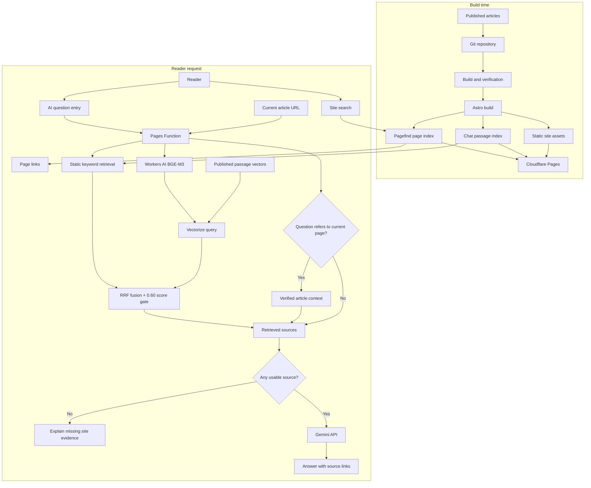

这个博客积累了不少文章，但内容在站里，不等于读者容易用起来。之前有朋友把站点内容整理给模型，再和它对话，能从一堆文章里问出东西。这种用法有个前提：有人愿意先把网站抓下来、整理，再接到模型上。普通读者来博客时未必会做这一步。站点能不能自己提供一个入口，让人直接问“这里写过什么”，而不是先学会怎么搜索？

因此，站点增加了面向全站内容的 AI 助手：只回答站内文章能支持的问题，并附上来源链接。站内搜索帮助读者找到具体内容；助手还要处理读者不熟悉文章标题、只知道自己遇到什么问题的情况，把几篇相关文章组织成一个回答。它和搜索是两个入口、两种任务，助手不该冒充通用聊天，也不该把站外常识包装成作者写过的观点。

我给这个项目的约束很具体：不付费，继续用 Cloudflare，文章更新后不要靠手动维护索引。初版助手用了静态关键词检索，直接接进现有构建流程，先把功能跑起来。这一步倒不难理解，问题出在后面的判断：讨论向量时，方案很快变成了“当前先不接入”，但那时根本没有本站的向量对照结果。

我在讨论里追问了几次：既然没有测，为什么决定不用？如果免费额度够，Functions 能直接查向量，或者单独放一个 Worker，也应该可以尝试。零预算是我对项目的要求，但它应该用来检查方案能否运行，不能替代效果比较。于是后面补了本地向量实验，把关键词、纯向量、混合召回放在同一批题上看。线上目前还是静态关键词；后面的实验先比较本地 BGE-M3，再用 Workers AI 生成文章和问题向量，写入真实 Vectorize 验证查询。这条检索链路已经跑通，生产助手还没有切换。

最初测试时，助手曾把“有什么推荐吗”和“你能聊什么”都回成“本站没有足够信息”。问研发团队是不是卡在 CI 反馈太慢，正确文章有时进不了前三；问上个月的访问量，它又会给出主题沾边的文章。之后，AI 根据博客内容和社区讨论补了几类问题：“工程师应该参与产品决策吗？”“怎么让经验在团队里传下来？”结果显示，这不只是 Gemini 会不会组织语言的问题：模型只能看见检索阶段交给它的片段，材料没找对，流畅的回答也可能错得更像真的。

问答可以先拆开看：文章有没有找对，和模型能不能依据文章回答，是两件事。在让模型写答案之前，系统已经做了什么？

## 搜索和 AI 助手，是两种内容入口

站点不是单纯多放一个聊天框，而是希望读者更容易用上已经写过的内容。平时在博客里找东西，大概有几种办法：从导航、栏目、标签和归档逐层缩小范围；记得某个词时用站内全文搜索；读完一篇后顺着相关推荐继续看。本站的相关推荐按同专栏和共享标签等规则排序，并把推荐理由展示出来；它不需要记录读者行为。再往外一层，是 Google 这样的搜索引擎把页面抓取、收录，最后展示给还没来过本站的人。这些入口都在帮读者找内容，但使用的信号和要完成的任务并不一样。

比如站内的 Pagefind 会在构建时为页面生成静态索引。读者输入关键词，它返回匹配的页面和片段，读者自己判断哪篇值得点开。栏目、标签和相关推荐则更像作者预先整理好的阅读路径。SEO 和 sitemap 服务的是外部发现：sitemap 列出 URL，帮助搜索引擎发现页面，但不保证页面一定被抓取或收录；Google 还要抓取页面、分析并建立索引，再根据查询提供结果。[Pagefind 的工作方式](https://pagefind.app/docs/) [Google 如何处理搜索](https://developers.google.com/search/docs/fundamentals/how-search-works/) [Google 对 sitemap 的说明](https://developers.google.com/search/docs/crawling-indexing/sitemaps/overview)

AI 助手的产品目标是接住另一种入口：读者记不清标题，也不一定知道该搜哪个词，只知道自己遇到了什么问题，或者想了解一个主题。比如“团队经验怎么才能传下来？”“我应该从哪些文章开始读？”读者描述的是处境或阅读目标，理想状态下，助手应据此找出能支持回答的文章，把几篇文章的观点组织起来，附上来源让人回去读原文。站内没有依据时，就应该承认没找到。

同类文档产品已经把问答放到内容入口附近。GitBook 的 Site AI Ask 将回答限制在已发布文档，也允许传入上下文；ReadMe 的 Ask AI 会基于已发布文档回答并给出来源链接，还能从搜索界面触发。[GitBook Site AI Ask](https://gitbook.com/docs/developers/gitbook-api/api-reference/docs-sites/site-ai-ask) [ReadMe Ask AI](https://docs.readme.com/main/docs/ask-ai) [ReadMe 的搜索与 Ask AI 更新](https://docs.readme.com/main/changelog/ask-ai-v2) 这类产品说明搜索和助手可以并排存在：知道关键词时，搜索让人直接找到页面；知道自己要解决什么、却不知道站里有哪些材料时，助手先帮忙串起内容。

标签也可以成为问答入口。读者看到“技术”或“管理”，通常还没有一个完整问题，只是在找这个主题下有哪些内容。把标签名直接发给助手，它应该先找出带这个标签的文章，概括站内写过什么，再给一个阅读起点和来源链接。它和搜索标签页的结果列表不同：标签页让读者自己逐篇挑，助手把几篇文章的主题先说清楚。这个入口没有要求模型凭一个宽泛词去猜意图，网站已经有的标签就是一组明确的主题边界。

这里的“理解目的”是产品想达到的效果，不是当前系统已经具备的能力。Google 也说明，AI Overviews 和 AI Mode 仍会从 Search 索引检索网页，再用生成式方式组织回答和来源；回答层变了，底下的发现、索引和检索仍然存在。[Google 关于生成式搜索的说明](https://developers.google.com/search/docs/fundamentals/ai-optimization-guide) 最初的站内 MVP 还没有语义检索，只按关键词找片段，Gemini 负责解释交给它的材料。问题换了说法而导致文章没召回时，模型也无从理解那篇文章。这个距离，正好把问题带回检索本身。

## 搜索找到文章之后，RAG 还要做什么

AI 助手和搜索相比多了一步：找到文章后，还要让模型把几段材料组织成回答。这种做法叫 RAG（Retrieval-Augmented Generation，检索增强生成）。文章在收到问题时被检索出来，连同问题和来源一起交给模型；它不等于把文章拿去训练模型。[Lewis 等人的 RAG 论文](https://arxiv.org/abs/2005.11401)

可以把它想成考场上给模型一本开卷资料。文章库像参考书，问题集像考题。考题用来检查模型和检索器会不会，不应该混进参考书里；反复拿同一批考题调权重、补同义词、改切段之后，它们更像练习题，不能再当作完全独立的最终考试。

```text
读者的问题
    ↓
检索器从文章索引找候选段落
    ↓
把问题、段落和来源交给大模型
    ↓
模型生成回答，界面展示文章链接
```

容易把它粗略理解成“把一套数据集接给大模型”。实际是文章作为外部资料，在回答时才被检索；测试问题只是用来检查检索和回答，模型参数没有因此改变。文章里没有答案，或者检索没把证据找出来，模型就无从依据本站内容作答。

RAG 把找到的段落交给模型组织答案。检索可以用关键词、向量或两者结合；embedding 是一种检索表示，不是 RAG 本身。接上生成模型也没改变前面的检索结果，错找的文章仍会成为错误回答的依据。

企业里的检索系统也会把这两步拆开。Slack 介绍过如何在 AI Answers 中检索用户有权限访问的资料；Anthropic 对比了上下文补全、BM25、向量检索和重排，在他们自己的测试中 top-20 检索失败率从 5.7% 降到 1.9%。这些是更大语料和不同模型上的结果，不能拿这个数字预测本站效果。[Slack 的企业搜索实践](https://slack.engineering/how-we-built-enterprise-search-to-be-secure-and-private/) [Anthropic 的 Contextual Retrieval](https://www.anthropic.com/engineering/contextual-retrieval)

## 先看问题是不是出在检索

站内页面搜索和问答助手使用各自的索引：页面搜索用 Pagefind 找页面，问答助手另有一份中英文片段索引，供 Pages Function 查证据。当前索引从已发布文章生成，清理 Markdown，保留标题、简介和章节标题，再按段落、句子切成检索片段。默认上限是 1,200 个字符，没有片段重叠。此前向量容量估算里出现过“重叠 120 字”，那是估算假设，不是现在的切段配置。

问句和文章字段都会转成词项。英文和数字按连续字符串处理，连续汉字拆成相邻双字词。“反馈回路”会变成“反馈”“馈回”“回路”。标题命中权重是 5，简介是 2，主题关键词是 2.5，段落是 1；少见词按 IDF 加分。问句里的“怎么样”“有没有”一类模板词会过滤掉。这个排序不是完整 BM25：它不统计同一词在段落里出现了几次，也不按文档长度归一化。

检索器还会检查候选文章和问题之间是否有足够多的不同词项重合，最多要求 3 个；问题经过过滤后只剩一两个词时，门槛会相应降低。达不到时就按“站内没有找到足够资料”处理，不调用 Gemini。这个门槛不是对答案正确性的判断，只是挡住明显较弱的词面匹配。中文按双字词拆分，所以这里的“3 个词项”不等于三个完整中文词。

这套规则能解释为什么某篇文章排在前面：标题命中权重大，少见词也更值分。但它只计算词项重合，不会判断文章是不是在回答这个问题。换一种说法可能漏掉，碰巧命中“效率”这样的词也可能把不相干的文章排上来。

Embedding 可能补上这些词面差异，找回意思相近的问法；也可能把主题相似、实际答案不同的段落排到一起。相似度不是答案正确率。后文会用 BGE-M3 在本站题目上做本地对照；后面还会用 Workers AI 的同名模型和真实 Vectorize 核对结果；Gemini Embedding 2 没有实测，不能沿用这里的分数。

如果把打分拆开看，检索器先给标题、简介和关键词算分，再加上得分最高的一个段落。$q'$ 是过滤问句模板词后的词项集合，$N$ 是同一语言的文章数，$df(t)$ 是包含词项 $t$ 的文章数。IDF 让少见词比常见词贡献更高：

$$
\operatorname{IDF}(t)=\ln\left(1+\frac{N-df(t)+0.5}{df(t)+0.5}\right)
$$

对文章 $d$，$P_d$ 是它的段落集合，$p^*$ 是得分最高的段落；$I_f(t,d)$ 表示词项 $t$ 是否出现在标题、简介或主题关键词字段中，$I_p(t,p)$ 表示它是否出现在段落中。当前代码的文章分数是：

$$
\begin{aligned}
\operatorname{Score}(d,q)=&\sum_{t\in q'}\operatorname{IDF}(t)\left(5I_{title}(t,d)+2I_{description}(t,d)+2.5I_{keywords}(t,d)\right)\\
&+\max_{p\in P_d}\sum_{t\in q'}\operatorname{IDF}(t)I_p(t,p)
\end{aligned}
$$

实际实现逐段累计词项分数，再选出最高分段落；同一词项出现在多个段落时，不会把所有段落的分数都加起来。候选还要满足词项门槛：

$$
\left|q'\cap\left(T_{title}\cup T_{description}\cup T_{keywords}\cup T_{p^*}\right)\right|\geq\min(3,|q'|)
$$

这份索引不是让 Pages Function 每次收到问题后再把全站文章逐篇读一遍。Astro 构建时会把每篇文章的词项映射到标题、简介、标签或栏目关键词，以及出现它的段落编号；所有文章的词表合并后，构成倒排表。词表按字典顺序排列，查询时可以二分查词。倒排记录用变长整数和差分编码压缩，再序列化成按语言区分的静态 JSON。中文和英文各有一份，生产草稿不会进入索引。

请求到达后，Function 取出问题词项，从倒排表找候选文章和命中的段落，不需要逐篇扫描正文。它按前面的字段权重和 IDF 评分，每篇文章只取分数最高的一个段落，按分数排序后最多交给模型四篇来源。这个实现把文章解析、切段和索引构建放在部署构建阶段；在线只负责查索引、挑证据和调用生成模型。代价是检索仍然依赖词项重合，索引更新也要等站点重新构建部署。

向量检索则会比较问题向量 $q$ 和片段向量 $p$ 的余弦相似度：

$$
\operatorname{cosine}(q,p)=\frac{q\cdot p}{\|q\|\,\|p\|}
$$

它使用的是另一种匹配信号。早期实验按完整文章切段，为 3,187 个中英文片段生成 1,024 维向量。#64 合并后，站内索引改成每篇文章保留最多三个代表片段；我重新构建后得到 795 个片段，并用同一批题重跑本地向量对照。下面会把这两组结果分开写。当前实现把 Workers AI BGE-M3、Vectorize 和关键词索引接进了 Pages Function；Gemini Embedding 2 没有实测。

## 段落切短、切长，结果差多少

整篇文章太长，相关内容会被摊薄；段落太短，定义又可能和例子分开。为确认 1,200 字是否合适，评测把上限改成 600、900、1,200、1,500 字，在同一批问题里重跑。段落上限之外，片段还会带上章节标题，让“它”“这个做法”这类依赖上下文的句子不至于完全失去主题。Anthropic 也研究过补充片段上下文，再组合 BM25、embedding 和 reranker；他们的数字来自自家数据，不能直接当成本站预期。[Anthropic 的实验和边界](https://www.anthropic.com/engineering/contextual-retrieval)

这张表是完整切段索引时期的段落长度实验，后来 #64 改为每篇文章最多三个代表片段，当前线上索引不是表里的 3,145 段。评估脚本在同一份中英文文章索引和同一批问题上，分别把最大段落长度设成 600、900、1,200 和 1,500 字符。每次重建索引并重新跑检索；不计需要当前页面上下文的 5 个问题，比较 70 个预期能由站内内容回答的问题。结果是：

| 单段长度上限 | 段落数 | Hit@1 | Hit@3 | MRR | Recall@3 | nDCG@3 |
| ---: | ---: | ---: | ---: | ---: | ---: | ---: |
| 600 | 6,965 | 33/70 | 45/70（64.3%） | 0.543 | 0.614 | 0.546 |
| 900 | 4,482 | 33/70 | 45/70（64.3%） | 0.545 | 0.621 | 0.553 |
| 1,200 | 3,145 | 33/70 | 45/70（64.3%） | 0.543 | 0.614 | 0.546 |
| 1,500 | 2,455 | 34/70 | 45/70（64.3%） | 0.552 | 0.621 | 0.558 |

1,500 字在这组题里数值略好，但 Hit@3 没变，差距也不足以说明它在独立问题集上会更好。索引大小从约 11.20 MB 到 11.34 MB，变化约 1.2%；段落数变化明显，压缩后的索引体积变化仍然很小。因此目前没有足够证据仅凭这组小型合成题把默认切段长度改成 1,500。这是一轮单独的切段对照；后面加入主题别名和词项门槛后，检索器和分数都变了，不能把两轮数字当成同一条实验曲线。

Hit@1 / Hit@3 看至少一篇正确文章是否出现在第一名或前三名。MRR（Mean Reciprocal Rank，平均倒数排名）只看排名最靠前的正确来源：第一名贡献 1，第二名贡献 1/2，第三名贡献 1/3，没进前三则贡献 0。Recall@3 会把每题标注的全部合理来源都纳入分母；nDCG@3 则把靠前的正确来源权重放得更高。四种切段长度的 Hit@3 完全相同；1,500 字在 Hit@1 上只多命中一题，MRR 也只是略高。当前这组数据里，切段长度没有改变前三命中数；1,500 字只在少数排序指标上略占优。生产配置仍为 1,200 字，主要考虑段落长度和索引体积。

除了“正确文章有没有进前三”，评测脚本还计算排名和多来源覆盖。设 $Q$ 是可回答问题数，$r_i$ 是第 $i$ 题第一个正确来源的排名，$R_i$ 是这题所有合理来源，$Top3_i$ 是前三条结果：

$$
\operatorname{Hit@K}=\frac{1}{Q}\sum_{i=1}^{Q}\mathbb{1}(r_i\le K),\qquad
\operatorname{MRR}=\frac{1}{Q}\sum_{i=1}^{Q}\frac{1}{r_i}
$$

没有正确来源时，$r_i$ 视为无穷大，该题对 Hit 和 MRR 的贡献为 0。Recall@3 会把每题的多个合理来源都计入：

$$
\operatorname{Recall@3}=\frac{1}{Q}\sum_{i=1}^{Q}\frac{|R_i\cap Top3_i|}{|R_i|}
$$

nDCG@3 给靠前的正确来源更高权重。$rel_{ij}$ 是第 $i$ 题第 $j$ 个结果的二元相关性标签；$IDCG@3_i$ 是把这题所有合理来源尽量排在前三时的理想 DCG：

$$
\operatorname{DCG@3}_i=\sum_{j=1}^{3}\frac{rel_{ij}}{\log_2(j+1)},\qquad
\operatorname{nDCG@3}=\frac{1}{Q}\sum_{i=1}^{Q}\frac{\operatorname{DCG@3}_i}{\operatorname{IDCG@3}_i}
$$

每种设置的段落数差异很大，但生成索引 JSON 的体积差异小得多，约在 11.2–11.3 MB。这个项目的倒排索引会压缩词项到文章、段落的映射，所以“段落数量翻倍”不等于“文件大小也翻倍”。估算资源占用时应直接测构建产物，不能只用“向量维数 × 段落数”代替整个索引成本。

一篇 2026 年预印本在 Natural Questions、特定稀疏检索器和生成模型下比较句子切分、语义切分、重叠与上下文预算；在那组设置里，句子切分和语义切分差距很小，重叠也没有显示稳定收益。作者说明结果来自特定英文语料和模型，换到中文博客仍需重测。[切段策略系统比较预印本](https://arxiv.org/abs/2601.14123) BEIR 在多个检索数据集上发现，BM25 是稳健基线，稠密检索并不总能胜出；重排平均可能更好，但需要更多计算。[BEIR 论文](https://arxiv.org/abs/2104.08663) 因此当前仍以关键词检索为基线，再用本站问题集验证其它方法。

## 这批问题测出了什么

只靠项目开发者想到的问题，容易只覆盖熟悉的问法。问题集有两组来源：一组参考 Reddit 上个人博客读者、团队知识交接和产品优先级的讨论，改写成 31 个问题；另一组由基础题和挑战题组成，共 85 题。Reddit 启发组有 25 题预期能由站内文章回答、6 题需要站外资料或本站暂时没有答案。帖子只提供问法线索；这不是对 Reddit 用户的调查，也不代表真实读者的提问频率。两组题都经过人工或模型辅助整理。

这 25 条站内问题里，正确文章有 14 条进了前三（Hit@3 56%）；6 条无答案题中，5 条仍然召回了文章。新增主题别名后，Hit@3 从 12/25 到 14/25，无答案误召回没有改善。别名帮一部分换了说法的问题找到了文章，但仍会把“主题接近”当成“文章有答案”。

基础与挑战题合并后，85 题中有 5 题需要当前页面上下文，另有 70 条预期可回答题和 10 条无答案题。旧的完整切段版关键词基线是 Hit@3 49/70、MRR 0.593；换成 #64 的代表片段索引后，重新跑出的静态关键词基线是 Hit@3 49/70、MRR 0.605。命中数相同，排序略有变化。它不是用户答对率：这轮只评检索，没有调用 Gemini，也没检查最终回答是否忠于证据。这些题已经被反复用于检索调试，数字适合比较开发过程中的变化，不能当作独立 benchmark 成绩。模型辅助生成的问题能较快补题型，但合成集会带有生成模型和任务本身的偏差；它不会自动变成真实读者样本或独立验收集。[Synthetic Test Collections for Retrieval Evaluation](https://www.microsoft.com/en-us/research/publication/synthetic-test-collections-for-retrieval-evaluation/) [Can we Evaluate RAGs with Synthetic Data?](https://arxiv.org/abs/2508.11758)

行业里的 RAG 分数能不能说明 70% 算什么水平？BEIR 比较多个领域里的检索方法，Anthropic 报告的是他们语料上 top-20 段落的失败率；本站算的是正确文章有没有进前三，评测对象和指标都不同，没法把数字排在一起。[BEIR](https://arxiv.org/abs/2104.08663) [Anthropic Contextual Retrieval](https://www.anthropic.com/engineering/contextual-retrieval)

还有一个更基础的限制：题目目前标的是相关**文章**，没有逐题标注支持答案的**段落**。因此这些指标能说明文章有没有进前三，不能确认模型拿到的片段里是否真有答案证据。RAGAS、ARES 等工作把检索相关性、答案忠实度和答案相关性分开评估；对本站来说，这些维度比一个总分更有用。[RAGAS](https://arxiv.org/abs/2309.15217) [ARES](https://aclanthology.org/2024.naacl-long.20/)

### 本地向量召回和关键词放在同一批题上

讨论到这里，继续算免费额度已经回答不了我的问题：向量到底能不能找得更好？最初那轮本地对照用完整切段的 3,187 个片段。合并 #64 后，我按当前构建产物重新生成了 795 个片段的向量，并用 Ollama 的 BGE-M3 计算精确余弦相似度。问题集仍是前面的 85 题：5 道需要当前页面上下文的题不参与全站检索指标，比较 70 道可回答题和 10 道无答案题。下面表格是这次重跑的结果，关键词和向量用的是同一份新索引。它是本地全库排序，不等于 Vectorize 的近似查询结果。BGE-M3 是多语言检索模型，论文报告了多种检索任务；这里的数字只来自本站这批题。[BGE-M3 论文](https://arxiv.org/abs/2402.03216)

这组评测可以在本地重跑：先执行 `ollama pull bge-m3`，运行 `npm run build` 生成当前文章索引，再执行 `npm run evaluate:chat-vectors`。模型和评测中间结果保存在本地 `artifacts/` 缓存，不进入站点或 Git。

| 检索方式 | Hit@1 | Hit@3 | MRR | 无答案题仍召回文章 |
| --- | ---: | ---: | ---: | ---: |
| 静态关键词（代表片段索引） | 37/70 | 49/70（70.0%） | 0.605 | 6/10 |
| BGE-M3 向量，取前三，不设门槛 | 32/70 | 53/70（75.7%） | 0.600 | 10/10 |
| BGE-M3 向量，余弦门槛 0.55 | 32/70 | 53/70（75.7%） | 0.600 | 3/10 |
| BGE-M3 向量，余弦门槛 0.60 | 31/70 | 50/70（71.4%） | 0.571 | 1/10 |
| BGE-M3 向量，余弦门槛 0.65 | 24/70 | 32/70（45.7%） | 0.398 | 0/10 |
| 关键词 + BGE-M3 RRF，0.60 门槛整体拒答 | 41/70 | 52/70（74.3%） | 0.657 | 1/10 |

当前代表片段上的向量结果没有重复早期完整切段实验里的大幅提升。0.55 门槛把无答案误召回从 10/10 降到 3/10，同时保留 53/70 的 Hit@3；0.60 门槛进一步降到 1/10，但 Hit@3 也降到 50/70。混合检索在 0.60 整体拒答时，Hit@1 是 41/70、Hit@3 是 52/70、MRR 是 0.657，无答案误召回 1/10。相对静态关键词，Hit@3 多 3 题，MRR 多 0.052，误召回少 5 题。这是可以接受的工程改进信号，但幅度不大；它还没有证明新问题上的效果。

0.55、0.60 等阈值是在这批开发题上扫出来的，不是独立测试集上的验证结果。题目参与过检索调试，相关性也只标到文章，没有确认排名靠前的片段是否真的含有答案。当前结果支持把混合检索作为本站预览方案继续验收；它不支持“向量普遍优于关键词”，也不能代表 Gemini Embedding 2。下一次比较应留出未参与阈值选择的问题，并标注支持答案的片段。

### 还有哪些测试可以实际跑

这次补测解决了“没有向量结果”的问题，却留下了另一个问题：题目已经用于调参，再在它们上面挑门槛，很容易把方案挑成只适合这批题。我之前特意要求参考 Reddit 的问法，也是因为自己熟悉文章，想到的问题往往已经带着文章里的关键词。社区讨论能帮忙换问法，但改写后的题仍然是开发者整理出来的，不能当作真实用户统计。

眼下能继续跑的，是本地检索评测。保留现有 BGE-M3 模型与完整片段向量，不需要 Gemini key；另外准备一批没有参与调参的问题，先标出正确文章和支持答案的段落，再看三种检索的输出。既要有明确术语，也要有只描述处境的问法、指向当前文章的追问，以及主题接近但文章没有答案的问题。题目可以由 AI 起草，但正确来源要回到原文核对；不能用检索器自己找出的第一条结果当标准答案。

旧题用于选门槛，新题用于验收。规则确定后再跑新题，发现失败也先记录，不立即改参数再把同一批题算作验收。除了正确文章有没有进前三，还要检查送进模型的 5,000 字符证据里有没有答案。否则一个排得很靠前的文章，仍可能只给出开头几段，回答不了文末的问题。本地层能比较检索和证据选择，也能统计耗时；它不会测出云端延迟或最终 Gemini 回答质量。

Cloudflare 那层也补跑了。登录恢复后，先把已有 BGE-M3 文档向量写入隔离的 1,024 维测试索引，用本地问题向量查询真实 Vectorize；再用 Workers AI 重新生成全部文章和问题向量，覆盖同一个测试索引。两次对照分开保存，避免把本地生成和云端生成混成一组结果。同名模型也可能使用不同版本、量化或 pooling 配置，正式接入时文章和问题应固定为同一提供方、模型与维度。

最后才是完整问答：同一批问题走过 embedding、检索、证据截取和 Gemini 回答，逐项检查引用是否支持回答、缺证据时是否承认不足，并记录延迟、错误和实际用量。这样哪一层没通过，可以具体定位；也不必因为暂时缺少云端凭据，就把本地能做的对照停掉。

### 把同一批题放到真实 Cloudflare 链路上

上一轮云端测试用的是早期完整切段语料：Workers AI 为 3,187 个片段和 85 个问题生成 BGE-M3 向量，写入隔离的 Vectorize 索引，再由本地 Pages Function 实时生成问题向量并查询真实 Vectorize。它证明了 Workers AI、Vectorize 和 Pages Function 这条链路可以工作，但不是当前 795 个代表片段的线上排名结果。当前配置每次最多取 50 个片段，按语言 namespace 过滤，再按文章合并、与关键词结果做 RRF。

| 检索方式 | Hit@1 | Hit@3 | MRR | 无答案题仍召回文章 |
| --- | ---: | ---: | ---: | ---: |
| 静态关键词基线 | 35/70 | 49/70 | 0.593 | 6/10 |
| Workers AI + Vectorize，0.55 门槛 | 37/70 | 57/70 | 0.657 | 4/10 |
| Workers AI + Vectorize，0.60 门槛 | 36/70 | 55/70 | 0.636 | 1/10 |
| 关键词 + 云端向量 RRF，0.60 整体拒答 | 43/70 | 53/70 | 0.674 | 1/10 |

早期测试的云端排名接近本地精确排序，但不能把它套到现在的代表片段索引。向量库查的是片段，多个高分片段可能来自同一篇文章；只取 50 个片段时，也不一定包含精确全库排序里的所有文章。当前实现已经加入片段内容哈希校验，避免旧向量位置碰巧映射到另一段新正文。新的云端对照应在预览环境针对 795 个片段重新跑，确认实际候选和拒答行为。

上一轮本地 Pages 请求包含云端问题 embedding 与 Vectorize 查询，耗时中位数 227 ms、P95 350 ms；使用预先生成的问题向量时，单独 Vectorize 查询的中位数为 80 ms、P95 127 ms。这里没有 Gemini 生成答案，也没有测生产环境的冷启动或 CPU 时间，不能把这组耗时当作当前预览或线上完整回答的延迟。

早期 3,187 个片段和测试问题的 embedding 调用记录了约 138 万 input tokens、1,488 neurons，约占 Workers AI 每日 10,000 免费 neurons 的 15%。这不是当前精简语料的用量。当前 795 个片段按 1,024 维计算，Vectorize 存储约 814,080 维，占 500 万免费额度约 16%。Workers AI 负责向量生成，Gemini 负责组织答案。测试与生产如果各存一份早期完整索引，会超过 500 万维；当前代表片段规模则可以容纳两份，但仍应避免留着已废弃的完整切段向量。发布脚本会根据内容哈希只重新生成新增或修改的片段，并删除已不在静态索引中的向量。[Workers AI BGE-M3](https://developers.cloudflare.com/workers-ai/models/bge-m3/) [Workers AI 免费额度与定价](https://developers.cloudflare.com/workers-ai/platform/pricing/)

入库还有一个实际问题：Vectorize 返回写入成功时，查询索引未必已经更新。测试里出现过入库成功、查询却为空的阶段；等处理完成后才跑查询。发布流程需要等索引处理到对应的 mutation，才启用这一版检索；否则新页面上线时，助手可能暂时找不到它。这个验证只覆盖写入与覆盖更新，删除转草稿文章、版本切换和服务失败回退仍需在正式接入时补上。

### 三种方案分别适合什么

静态索引和向量索引都要先清理文章、切段和保存来源，差别主要在匹配信号。当前静态方案用关键词倒排索引；向量方案把片段和问题转成同一模型的 embedding，再比较相似度。两者也可以组合，不能把“用了静态文件”当作“没有 RAG”，或把“用了向量”当作“模型一定能答对”。

| 方案 | 优点 | 代价和容易失败的地方 | 本站对照给出的信号 |
| --- | --- | --- | --- |
| 静态关键词倒排索引 | 不需要问题 embedding；文章更新随构建完成；匹配词和排序比较容易解释 | 换一种说法容易漏召回；主题词重合也会误召回 | 当前代表片段基线 Hit@3 为 49/70，无答案误召回 6/10 |
| 向量检索 | 能找回部分词面不同、含义接近的文章；相似度查询交给向量库 | 每问增加 embedding 调用；需维护向量更新和删除；相似度不能证明片段含有答案 | 当前本地 BGE-M3 在 0.55 门槛下 Hit@3 为 53/70，误召回 3/10；提高门槛会损失召回 |
| 关键词与向量混合 | 保留精确词匹配，也补语义召回；故障时可以退回关键词 | 多维护一条检索路径；融合权重和拒答策略需要验证 | 当前本地对照在 0.60 整体拒答门槛下 Hit@1 为 41/70、Hit@3 为 52/70，误召回 1/10 |

这批开发题里，纯向量 0.55 的 Hit@3 略高；混合 0.60 少召回一篇正确文章，但首条排名更好、无答案误召回更少。当前预览采用后者，原因是助手回答会把召回结果交给 Gemini 组织成自然语言，错把相近主题当作证据的代价更高。阈值来自开发题，独立保留题还没验证；换模型或切段方式也要重新评估。

## 现在这套东西从发布到回答怎么走

索引更新和问答请求走两条路径。构建时，Astro 读取已发布的 writing、consulting、research、project 内容，清理 Markdown、补上章节标题、切段，并为中英文分别生成倒排索引 JSON。每篇文章最多保留三个代表片段；草稿和 gallery 不进入问答索引。Pagefind 的页面搜索索引与问答用的片段索引是两份不同产物。生产构建通过检查后，GitHub Actions 用 Workers AI 为新增或修改过的片段生成向量，再同步到 Vectorize；内容哈希清单存在 Actions cache，已删除的片段会从 Vectorize 清理。写入返回 mutation id 后，工作流会等索引处理到该 mutation，再部署同一份静态构建产物。

读者提问时，浏览器提交问题、语言、最近几轮对话、当前路径和流式选项。Pages Function 校验这些字段，从部署好的静态索引取文章，浏览器不能自己塞入文章正文。它并行使用全站关键词结果和 Workers AI 生成的问题向量查询 Vectorize，再用 RRF 合并两种排序；每个向量命中还要核对片段哈希，确认它仍对应当前已发布索引里的文字。Vectorize 不可用时回退关键词检索；向量分数低于 0.60 时拒答，不把关键词的主题近似结果当成足够证据。如果问题指向“这篇文章”“文中”之类内容，并且当前路径能对应到已发布文章，就直接使用该文的完整上下文。

找到来源后，Function 最多选四篇文章的证据，截取到 5,000 个字符以内，连同问题和受限的对话历史交给 Gemini。浏览器默认使用 `stream: true`，Function 调用 `streamGenerateContent`，逐段把回答文本通过 SSE 发回页面，最后发送来源和完成事件；非流式请求仍返回 `{ answer, sources }`。模型只能依据站内证据回答，证据不足时应说明找不到。来源链接由 Function 单独发送，回答文本不依赖模型生成链接。

标签问答有一条更明确的召回规则。索引会把文章的本地化标签名单独保存；问题与标签名一致时，允许带 `#`，关键词检索会直接找出带该标签的已发布文章。之后仍可与向量结果合并，再把文章片段交给 Gemini 总结。标签是文章的分类元数据，不是单独切成一段去做 embedding；向量库里存的仍是文章片段，用户输入的标签问题则像其他问题一样在请求时生成查询向量。之前“管理”这类短标签会落入普通文本匹配，容易被正文里偶然出现的词影响；现在明确标签字段后，不再只靠宽泛词面相似度碰运气。

接口测试覆盖站点当前展示的中英文标签。每个标签分别用裸标签名和带 `#` 的形式提问，检查 `/api/chat` 是否返回非空答案、来源是否确实带有该标签，以及交给 Gemini 的提示里是否包含对应文章片段和“浏览这个主题”的说明。测试中的 Gemini 响应是 mock，因此这组覆盖证明的是标签能找到正确文章、接口能把证据交给模型，不代表每条生成回答都已人工核实。Pages 预览的实际抽查包括“#技术”“管理”和“#Technology”：请求均返回 200，有回答和相关来源链接。这是几条真实链路抽查，不是对所有标签的线上生成质量验收。



线上成本分成构建和提问两部分。页面搜索和问答都在 Cloudflare Pages；每次问答调用 Pages Function 和 Gemini 生成接口。混合检索还会为问题生成一次 embedding、查询 Vectorize；发布时只为内容有变化的片段重新生成向量。早期本地 `.dev.vars` 中的 Gemini key 调用 embedding 接口返回 401，所以质量对照用本地 BGE-M3 和 Workers AI BGE-M3，没有用 Gemini Embedding 2。[Gemini API 定价](https://ai.google.dev/gemini-api/docs/pricing)

当前静态索引两种语言合计约 5.20 MB 原始、1.87 MB gzip。Function 从静态资源取对应语言索引，并在内存中缓存五分钟。向量资源按构建后的 795 个片段估算，假设每月新增 100 个中英文片段（约每月四五篇中文文章及其英文版）：

| 方案 | 当前存储规模 | 每月新增规模 | 预计查询余量 | 新增运行成本 |
| --- | ---: | ---: | ---: | --- |
| 静态关键词 | 两份索引 5.20 MB 原始（1.87 MB gzip） | 随站点构建更新 | 不消耗 Vectorize 额度 | 现有 Function 与 Gemini 调用 |
| 向量，768 维 | 610,560 存储维度，占 500 万额度约 12% | 76,800 维 | 先扣全库和新增写入后，约 38,167 次/月 | 每问多一次 embedding 和 Vectorize 查询；免费额度内标价为 $0 |
| 向量，1,024 维（BGE-M3） | 814,080 存储维度，占约 16% | 102,400 维 | 约 28,401 次/月 | Workers AI embedding 消耗每日 neurons 额度；隔离索引已实测 |
| 向量，1,536 维 | 1,221,120 存储维度，占约 24% | 153,600 维 | 约 18,636 次/月 | 按当前片段量仍在免费额度内；尚未测试该维度的检索效果 |

估算按 Cloudflare 公布的公式计算：查询维度按“索引中保存的向量数 + 查询次数”乘以维度，存储维度按向量总数乘以维度。加入每月 100 个新片段后，1,024 维的免费月查询额度约可支持 28,401 次查询。表中没有把 Gemini 请求、Workers AI 每日 neurons、Pages Function 请求和 CPU 限额合并成一个数；这些资源各自计量。使用 Vectorize 时，Function 只发送一个问题向量，取回候选 id、分数和少量元数据。[Vectorize 定价](https://developers.cloudflare.com/vectorize/platform/pricing/)

### 向量能不能放进这个免费站点

我关心的另一件事是：更好的检索，能不能放进这个不付费的站点？这和前面的分数是两个问题。Vectorize 官方入门文档明确支持 Workers Free 和 Paid，限制页也列出 Free 账户最多 100 个索引；Pages 文档明确支持 Function 直接绑定 Vectorize。通用 Workers 定价页仍留有“只支持 Paid”的矛盾描述，但 Vectorize 自己的入门、定价与限制页共同支持免费使用。现有片段量在列出的免费额度内，没有依据仅因预算为零就排除向量。[Vectorize 入门](https://developers.cloudflare.com/vectorize/get-started/intro/) [Vectorize 限制](https://developers.cloudflare.com/vectorize/platform/limits/) [Pages Functions 绑定](https://developers.cloudflare.com/pages/functions/bindings/)

| 接入位置 | 请求路径 | 对本站的取舍 |
| --- | --- | --- |
| Pages Functions 直接绑定 Vectorize | 现有 `/api/chat` 生成问题向量、查询 Vectorize，再取文章证据 | 首选，沿用同域接口和密钥管理，少一个部署单元 |
| 独立 Worker 绑定 Vectorize | Pages Function 通过 Service binding 调用 Worker，或浏览器访问独立接口 | 同样可行；适合检索服务被多个应用复用，单站点会多一份配置和部署；直接跨域还要处理来源校验 |

独立 Worker 不会增加账户的免费额度，也不会替代 embedding 接口；它主要改变服务边界。本站目前只有一个助手，因此优先让 Pages Function 直接绑定 Vectorize。向量入库在发布构建阶段离线完成，在线只生成问题 embedding、查询候选，并从已发布文章索引取回证据；关键词检索保留用于融合和故障回退。这样无需在 Function 内加载全库向量并做数百万次浮点运算。免费使用仍受 Gemini 速率、Vectorize 维度、Function 请求量和 CPU 等各自限制，28,401 次只是按当前 1,024 维索引估算的查询余量，不是整条问答链路的容量保证。

本地已经跑通 BGE-M3 的向量生成、余弦检索和混合排名；Wrangler 登录恢复后，隔离测试索引已经在真实 Vectorize 上完成入库与查询。Workers AI 的 BGE-M3 接口也可调用，因此问题 embedding 可以由 Cloudflare 生成，不必依赖 Gemini embedding。Vectorize 的本地开发访问的是远程服务，这次运行的是本地开发环境连接真实资源，没有部署生产助手。[Workers 本地开发](https://developers.cloudflare.com/workers/local-development/)

按 #64 的代表片段索引重跑后，本地混合方案（RRF 加 0.60 拒答门槛）相较静态关键词，Hit@1 从 37/70 到 41/70、Hit@3 从 49/70 到 52/70、MRR 从 0.605 到 0.657；10 道无答案题里误召回从 6 道降到 1 道。这批题中它比纯向量 0.55 少命中一篇正确文章，但无答案误召回少两题，首条命中数更高。向量实验用的是 1,024 维 BGE-M3；768 维只是容量估算，没有测过检索效果。

资源上，静态方案省去了 embedding 调用和向量更新流程；向量与混合方案需要这些额外环节，但当前语料规模按公开免费额度可以容纳。比较时还要看线上延迟、API 失败率、新文章同步是否可靠，以及无答案题的拒答效果，这些指标本地排名实验没有测到。

从这组结果看，混合检索值得放进 Pages 预览继续验收。实现使用 Pages Function + Workers AI BGE-M3（1,024 维）+ Vectorize，Gemini 负责组织回答。文章和问题使用同一 embedding 模型与维度，向量结果按语言过滤，再映射回当前已发布片段。发布工作流用内容哈希增量更新，删除或转草稿的片段也会删除向量；模型或切段规则变化时需重建。Vectorize 调用异常时退回静态检索。

当前代码已经接入混合召回和流式问答，预览环境通过 Pages Function 调用 Workers AI 生成问题向量并查 Vectorize，再由 Gemini 返回回答。发布工作流会先同步文章向量并等待 Vectorize 处理完成，再部署静态站点。生产切换还没有发生。预览验收仍要覆盖改文、删文、向量同步失败和低相似度拒答，避免只用一次成功请求判断整条链路可靠。

## 把文章交给自己的 GPT，和让博客提供助手

朋友把站点文章整理进自己的 AI 工具后，可以围绕整批内容提问；文章更新后，还要想办法同步。博客里的助手面向已经来到本站的读者，让他们直接问这里写过什么，再沿着来源链接回到原文。两种方式解决的是不同的使用门槛，本站没有用同一套问题集比较过它们的回答质量。[GPTs in ChatGPT](https://help.openai.com/en/articles/8554407-gpts-in-chatgpt) [OpenAI Retrieval](https://developers.openai.com/api/docs/guides/retrieval)

这次索引和评测代码由 AI 协助实现，我在讨论里不断追问的是：助手到底要回答什么、为什么这样选、有没有测过，以及免费条件下是否真的跑得通。尤其是向量这一步，前面的说明已经很完整，却缺少最直接的对照结果。如果不追问，文章很容易把一个尚未验证的实现选择写成合理结论。

这也是这次用 AI 做工程时比较具体的感受。代码和解释可以很快增加，核对它们有没有回答原来的问题，却需要反复花时间。本地和云端检索对照之后，混合召回已进入 Pages 预览。真实问答能返回来源，文章同步也加入发布工作流；这仍是预览阶段，独立保留题、删除文章时清理向量，以及生产切换后的额度监控还没有完成。
