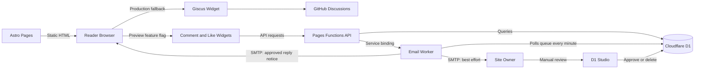
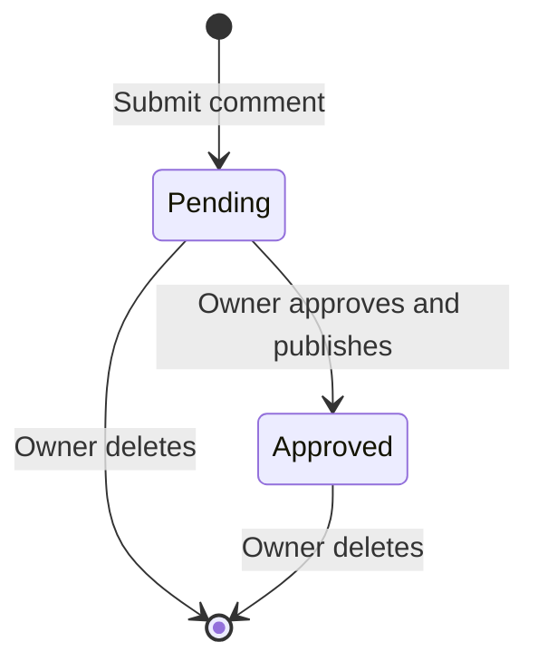
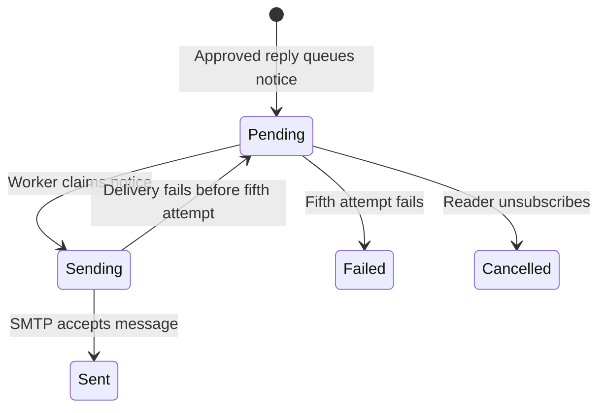
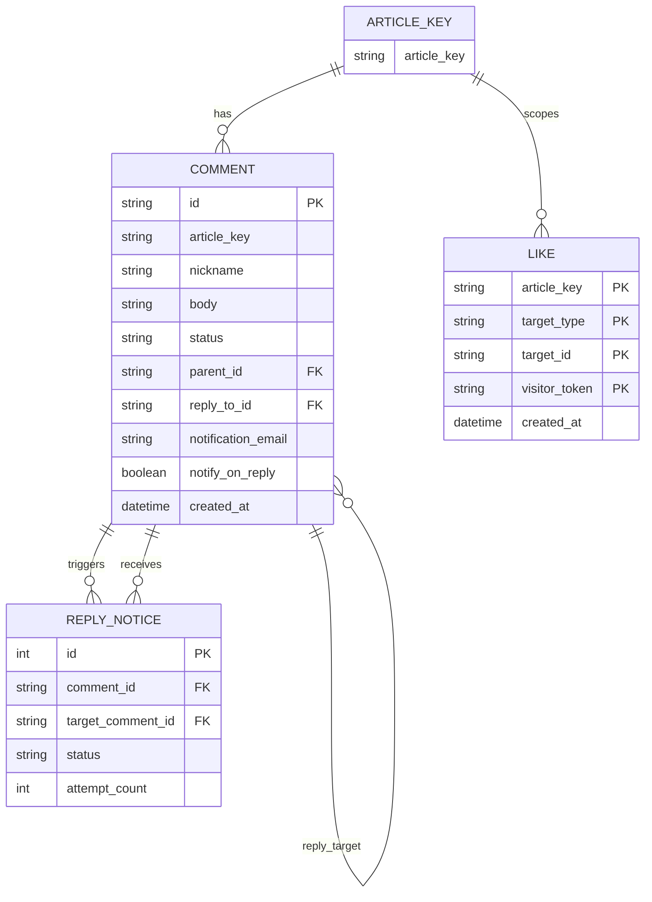

# Building an Anonymous Comments MVP with AI: Think It Through, Then Build It

My site used Giscus, with discussions stored in GitHub Discussions. It was convenient to manage, but readers had to authorize through GitHub OAuth before commenting. I started thinking about a change because I wasn't sure every reader wanted to sign in to GitHub just to leave a quick comment.

Looking back, this was mostly a guess. The site had a small readership, and I saw little interaction. I connected the two: maybe GitHub login was keeping people away? If I removed that step, perhaps more people would comment or like a post. That was only a hypothesis. The audience was too small to split into groups and run a meaningful A/B test.

I wanted to turn “I want more interaction” into requirements I could check, then ask AI to help build against them. I set the product boundaries; AI helped me examine options, break down the technical work, and check the implementation.

I also considered Disqus. It lets guests comment, but still asks for an email address, and its free plan displays ads. WordPress lets site owners configure whether comments require an account, a name, an email address, or approval. Waline and Remark42 offer anonymous comments or self-hosting. With several options available, I first had to decide which participation barrier I wanted to remove.

My site already has an email newsletter. Readers leave an address to receive new posts; I didn't want that to become a condition for commenting. My initial goal was simple: no account or email required; readers could comment, reply, and like; I would review comments before publishing them; and I would get notified about new activity. I later added an optional path: readers could leave an email address and receive a notice when someone posted an approved reply.

## Start with the friction to remove

“Build an anonymous interaction system” sounds like a product requirement, but it already assumes a solution. Breaking the request down into what readers and the site owner need to do makes it easier to see which features matter and which are simply common in other comment products.

| Who | What they need to do | Possible obstacle | How to tell whether the MVP is enough |
| --- | --- | --- | --- |
| Reader | Respond to an article | Being asked to sign in or provide an email | They can comment or like without registering or entering an email |
| Reader | Join a discussion | Replies lack context | They can reply to a top-level comment and identify who they are replying to |
| Site owner | Decide what becomes public | Anonymous submissions may include spam | New comments stay hidden until the owner approves or deletes them |
| Site owner | Know when someone participates | Having to check the database repeatedly | New activity sends a notification |
| Site owner | Keep maintenance manageable | A full admin panel and account system feel too heavy | Manual review is acceptable at first; add an admin UI if the workload warrants it |

I wanted to find out whether readers abandoned comments because of GitHub login, whether they needed a persistent identity or just a one-off comment, whether I was willing to review submissions manually, and how much spam I could tolerate. These questions became the MVP's evaluation criteria. The login barrier was still a hypothesis; actual participation would be a better signal.

## Keep the MVP small, but make the loop complete

An MVP should be the smallest loop that can test the main assumption. In this case, readers need to submit with little friction; I need to review what they submit; approved comments need to appear publicly; and likes should provide feedback without the same browser token being counted more than once. The first version still needs basic checks on input length, request origin, and access to pending content. Anti-spam measures can grow in response to use.

| Capability | First-version decision | Why |
| --- | --- | --- |
| Accounts and required email | Omit | Comments do not depend on identity data; readers can opt in to email reply notices |
| Comment moderation | Keep it simple | Anonymous submissions should not go public automatically; `pending` to `approved` is the publication gate |
| Comments and replies | Include, with two display levels | Keep conversational context without infinite nesting and its added complexity |
| Article and comment likes | Basic counts | Treat them as lightweight feedback, not as a guarantee that one person can only like once |
| Admin panel | Defer | Use notifications and D1 Studio while review volume is low; add a UI if the work becomes frequent |
| Reports, blocks, and CAPTCHA | Defer | Choose a response if spam becomes a real burden |
| Search, popularity ranking, and user profiles | Omit | They do not directly support low-friction comments and owner review |
| Monitoring and analytics | Defer | The first version only needs to establish that the basic flow works |

Each choice has a consequence. Without accounts, readers cannot claim an identity across devices. Likes use a random browser token, so changing devices can produce another like. Owner emails use best-effort delivery, with no queue or retry. I was willing to accept these limits for the first version and noted when to revisit them.

## What should you know before asking AI to build it?

You don't need to settle every technical detail, such as which database index to use. Before asking AI to implement the feature, be clear on these product questions:

1. **Who will use it?** Site readers may not have GitHub accounts; I am the only moderator.
2. **What do they need to do?** Comment, reply, and like; I review submissions and receive notifications.
3. **What counts as success?** A reader can submit without an account or email, and an unapproved comment never appears publicly.
4. **What must not happen?** Pending comments must not leak; comment text must not execute as HTML; the same token must not double-count a like; and a reply must not cross article boundaries.
5. **What can wait?** User identities, reports and blocks, a full admin panel, popularity ranking, and analytics.
6. **What constraints already exist?** The site is built with Astro as a static site, production still uses Giscus, and Cloudflare is the deployment platform. The new system is only enabled in preview.

Those answers turn “build a comments system” into an acceptance contract. AI can use it to inspect the project, propose a data model, implement APIs and components, add tests, and check the code against the boundaries. I still decide whether email is required, what becomes public, and how much moderation work I am willing to take on. AI can suggest options once those product choices are clear.

I gave AI those six answers and a draft data model, and asked it to look for boundary problems. It spotted the risk of orphaned related data when a comment is deleted. I confirmed the risk and accepted it for the preview phase, with a note to resolve it before building an admin panel. It also suggested adding user profiles and email verification; I rejected those. Clear goals make it easier to decide which suggestions to take and which to leave out. Deferred work should have a condition and a point at which to revisit it.

### The easiest mistake is giving AI only a feature name

If you give AI only a feature name, it may fill in the rest as if you were building a typical social product: login, user profiles, email verification, threaded replies, an admin panel, reports, ranking, and analytics. Each feature sounds reasonable on its own, but together they can pull a personal blog away from the lightweight interaction it needs. “Anonymous” is also too vague unless you say what it means here: the system collects no accounts or email addresses, but the server still uses a salted IP hash for rate limiting, and Cloudflare processes network requests. **A precise boundary is more useful than a broad label.**

## Architecture: the smallest dynamic layer needed for the loop

The product boundaries show up in three parts of the implementation: APIs alongside the static pages, comment moderation states, and the interaction data model.

Astro still generates static HTML. A feature flag loads the custom interaction widgets in preview, while production continues to load Giscus. The custom widgets call Pages Functions when they approach the viewport. The Function uses a normalized article path as `article_key` and reads from or writes to D1. New comments enter a pending state; an email Worker notifies me, and I approve or delete them in D1 Studio. Cloudflare Pages Functions can access D1 through a binding, so this small dynamic layer can sit beside the static site without introducing a separate application server.

Comments and likes use two sets of endpoints, and email has two paths. Pages Functions pass owner alerts to the email Worker through a service binding. Reply notices that readers opt into are first written to a D1 queue, then sent by a scheduled run of the email Worker.

## Comment states: only what the promise requires

The database has only two comment states: `pending` and `approved`. A submitted comment starts pending; when I approve it, it appears in the public list. I can delete it in either state. The first version has no `rejected`, `spam`, or `archived` state, and no moderation history. Rejected comments are deleted instead of adding a status-management UI. If appeals, recovery from accidental deletion, or multiple moderators become relevant, the system can retain records and add an audit log.

For now, moderation means email plus D1 Studio. The owner alert includes the comment, its article link, and instructions for finding the record. I change its status to `approved` or delete it manually. Alerts for new comments and added likes go through a service binding to the email Worker and SMTP. They are best-effort, with no durable queue or automatic retry; removing a like does not send an alert. If one is missed, I may find the pending comment later.

Reader reply emails use a separate path. When submitting a comment, readers can select “Notify me when someone replies” and enter an address; without opting in, no email is collected. Once a reply is approved, a D1 trigger adds a notice to the queue. A scheduled Worker processes the queue every minute and retries up to five times. It sends notices only for approved replies, with an unsubscribe link that removes the address associated with that comment. Readers can comment without sharing an address; anyone who wants follow-up can opt in.

The queue has its own states: pending, sending, sent, cancelled, and failed. Keeping these separate from comment moderation avoids using one field to represent both whether content is public and whether an email was delivered.

### Data model and queries

There is no `articles` table because Astro content files remain the source of truth for articles. `article_key` is the normalized path that links interactions back to an article. The English route drops its `/en/` prefix, so both locales share one discussion. A comment's `parent_id` identifies its top-level thread; `reply_to_id` identifies the specific comment it answers. The API requires a reply target to be approved and belong to the same article. Readers can reply to a reply, while the UI keeps all replies at the same display level to avoid deep indentation and extra implementation complexity. Readers who opt into reply email have their address and preference stored with the comment; a D1 trigger adds a `comment_reply_notifications` row only after a reply is approved, and the Worker records delivery status.

The `likes` primary key is `(article_key, target_type, target_id, visitor_token)`. Article likes use `target_type = article` and an empty `target_id`; comment likes use `target_type = comment` and the comment ID. This polymorphic design lets both kinds of like share one table. `visitor_token` is a random value generated in the browser and only deduplicates likes within that browser. Clearing local storage or changing devices changes the token, so it does not create a cross-device identity.

In the ER diagram, `ARTICLE_KEY` is a logical path identifier, not a database table. Comment likes are associated through `target_type` and `target_id`; `likes` has no foreign key to `comments`, so the diagram does not show a database-level comment-to-like relationship. `REPLY_NOTICE` is the notification queue: `comment_id` points to the approved reply, and `target_comment_id` points to the comment whose author opted in.

Top-level comments are paginated newest first; replies appear oldest first. The first page contains 20 top-level comments, and the API caps a page at 50. The cursor includes a timestamp and ID. The first version also limits comment, nickname, and request-body lengths, validates reply targets, and rate-limits by request origin. The rate-limit table stores a salted IP hash rather than the raw IP.

The indexes follow those query patterns: top-level comments use `(article_key, status, created_at DESC)`; replies use `(article_key, parent_id, status, created_at ASC)`; likes are indexed by article and target. The cursor's `created_at` and ID make pagination stable when timestamps match and reduce the effect of new comments on later pages. Approved-comment totals and like totals still use aggregate queries. Scans at the target data volume need to be checked with D1 row-read metrics and query plans before deciding whether to add indexes or maintain precomputed counts. Indexes reduce reads and add write and storage costs.

Commenting requires no account or email; nicknames are optional, and the server generates one when the field is blank. Only readers who opt into reply notices need to provide an address. Comment text is rendered as text rather than HTML. Requests are limited to 8,192 bytes, comment bodies to 4,000 JavaScript characters, and nicknames to 40 characters. Submissions check the request origin and reply target, then apply rate limits based on a salted hash of the request IP: five comments per hour and five like changes per minute. Old rate-limit rows are cleaned up. These limits only catch some low-cost spam; the MVP has no CAPTCHA, blocking, or reporting. Anonymity here means no site account: Cloudflare and other request-processing platforms still see connection information.

## Which options fit, and when not to build your own

| Option | Main benefit | Main cost | A good fit when |
| --- | --- | --- | --- |
| Giscus | Mature GitHub Discussions workflow; open source and free | Readers need GitHub OAuth | The audience already uses GitHub and the owner wants little maintenance |
| Disqus | Hosted service with complete moderation features | Guest comments still require email; the free plan shows ads; paid plans vary by traffic tier | You want to outsource operations and accept the service's rules and business model |
| WordPress | Rich discussion settings, moderation, and admin tools | Requires a WordPress backend or hosting | You already use WordPress, or comments are part of a broader CMS |
| Waline / Remark42 | Ready-made anonymous comments, replies, and management | Deployment, storage, upgrades, and operations | You need more than the MVP and prefer an established project |
| Custom D1 | Fits the existing Astro and Cloudflare setup; data model can match the site's needs | You own spam controls, admin tools, backups, and notification reliability | The feature set is narrow and the owner is willing to maintain it |

Building it yourself fits this site because the requirements are small, expected traffic is low, the site already runs on Cloudflare, and I am willing to review comments manually. If I needed multiple moderators, bans, a report queue, reliable notification retries, and migration tools from day one, Waline or Remark42 might cost less overall than building and maintaining those features myself.

Total cost includes the software license, hosting, database, and ongoing maintenance. Disqus tiers depend on monthly pageviews and offer an ad toggle; its [pricing page](https://help.disqus.com/en/articles/1717110-comments-pricing-and-plans) lists current plans. Giscus is open source and free, with identity and discussion tied to GitHub. Hosting for WordPress, Waline, and Remark42 depends on the chosen server, database, and operating model. Custom D1 avoids some hosted-product fees, while leaving the data, moderation interface, and incident response to the site owner.

## Cost and capacity estimates: is it worth a trial?

The estimates below use Cloudflare's published quotas and the API request paths. Preview test data is not used to project production capacity.

Before building on the free tier, check whether its limits leave enough room for a trial. As of October 2026, Cloudflare lists 100,000 Workers Free requests per day. D1 Free includes 5 million rows read and 100,000 rows written per day, with 5 GB of storage across the account. These quotas can change, so check your account plan before deployment.

Read the limits in three layers. The account storage quota applies across all D1 databases. The Free plan's 500 MB per-database cap sets the size of an individual database. The per-invocation query limit caps how many database queries one Worker request can make. These set limits on total storage, one database, and the work in a single request. D1 processes queries for each database serially, so concurrency depends on query time. Bursts queue; a full queue returns an overload error. [D1 limits](https://developers.cloudflare.com/d1/platform/limits/)

A full load of the comments and likes UI can make up to three Worker requests: the comment list, the article-like count requested by the comments widget, and the same count requested again by the separate article-like widget. Let `V` be full widget loads, `C` comment submissions, `L` like changes, and `O` other Worker requests. A rough request estimate is `R = 3V + C + L + O`. For example, if 10,000 visits per day all load the widgets, that is about 30,000 Worker requests; if 30% load them, it is about 9,000. This estimates widget-load requests only. Actual operating metrics are needed to assess performance, database reads, and burst capacity.

A full widget load also runs several D1 queries: the comment endpoint reads one page of top-level comments, their replies, and the approved-comment total; the comments widget and separate article-like widget each query like totals. That is up to five SQL statements. Cloudflare bills by rows scanned, so five statements can still have a high read cost. Indexes can reduce scans while adding writes and storage.

Self-hosting also costs time for dependency upgrades, spam handling, backups, and troubleshooting. After a production switch, watch failed requests, missed email notifications, database usage, and spam. Use those signals to decide whether the system needs more operations or optimization.

## After building the MVP, I decided not to switch

After finishing the preview version, I looked again at Giscus and saw that readers were already commenting and liking posts. Some current readers were willing to use GitHub to participate. The audience is too small for a reliable A/B test, so I cannot tell how many more people anonymity would bring, or how much GitHub login affects participation.

Giscus also provides an existing interaction loop: readers use their GitHub Discussions accounts to reply and receive notifications, and I can respond in the same discussion space. A full migration would have to map old discussions and likes to the new article keys while preserving identities and interaction history. The preview MVP now offers optional reply emails: readers who leave an address can receive notices for approved replies; those who prefer not to share one can still comment. This covers some of GitHub's existing follow-up, while adding work to store contact details, handle unsubscribes, and maintain email delivery.

The choice comes down to what readers are more comfortable with: signing in to GitHub or leaving an email when they want reply notifications. Newsletter email has a clear purpose. Requiring an email just to comment still feels like too much friction to me. Making it optional lets readers decide based on whether they want follow-up.

So I am stopping here for now: the D1 comments-and-likes MVP is validated in preview, and production stays on Giscus. Existing participation shows that the current option works for some readers. The preview version also lets readers opt into email follow-up, but I do not yet know how many would prefer it to GitHub login. Given the existing participation, migration cost, and that uncertainty, I do not have a reason to switch everything over. AI helped me build the option; whether to adopt it still depends on reader acceptance and the cost of maintaining it.
