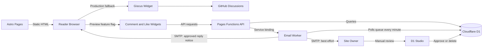
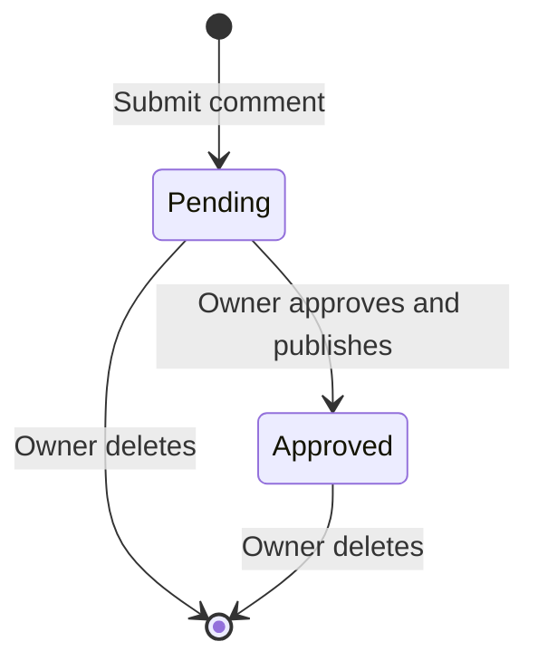
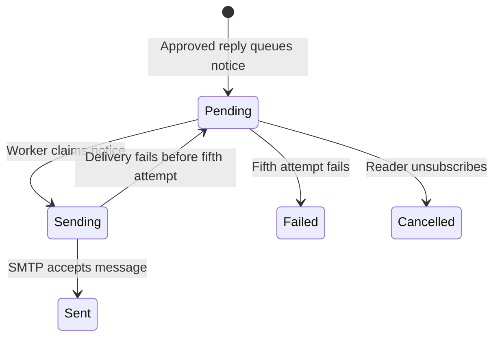
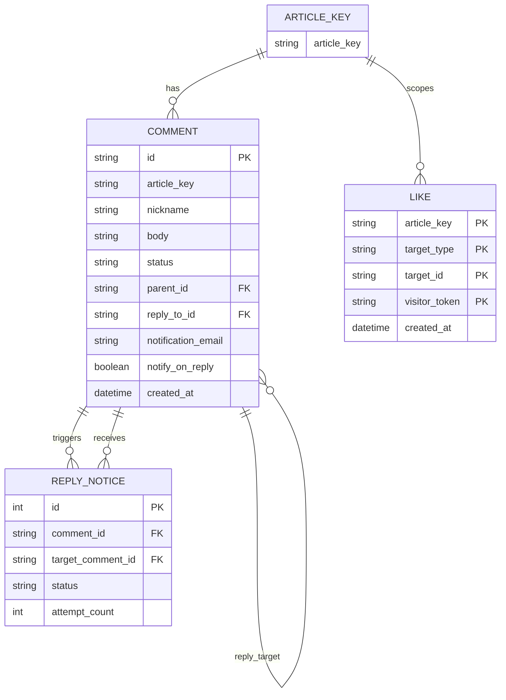

# 用 AI 做匿名评论 MVP：先想清楚，再让它实现

站点之前用的是 Giscus，讨论存放在 GitHub Discussions。管理方式挺顺手，但读者留言前需要通过 GitHub OAuth 授权。我开始想换方案，原因很简单：我不确定每个读者都愿意为了文章下的一句话登录 GitHub。

说实话，这个想法一开始有点拍脑袋。站点读者不多，我看到互动不多，就顺着推了一步：会不会是 GitHub 登录把人挡住了？如果取消登录，也许评论和点赞会多一些。但这只是推论；站点规模太小，很难把读者再分组做出有说服力的 A/B 对照。

我把"想要互动"拆成一组可验收的问题，再让 AI 协助实现：需求边界由我定义，AI 帮我检查方案、拆解技术工作并核对实现。

也考虑过 Disqus。它可以让访客留言，但仍要求邮箱，免费方案还会展示广告。WordPress 允许站主配置登录、姓名、邮箱和审核要求；Waline、Remark42 也提供了匿名评论或自托管选择。可选方案不少，真正要先回答的是：我想消除哪一种参与门槛？

站点已有邮件订阅。读者留下邮箱是为了订阅文章，我不想把这件事扩展成评论的前提。最初目标可以说得很简单：不要求账号或邮箱，读者能评论、回复、点赞；内容公开前由我审核；有新互动时我能收到提醒。后来我又补了一种可选方式：读者可以自愿留下邮箱，在有人回复且评论通过审核后收到通知。

## 先找出要消除的摩擦

"做一个匿名互动系统"听起来像产品需求，其实已经暗含了解法。先把它拆回读者和站主各自遇到的问题，会更容易发现哪些功能是必要的，哪些只是常见评论产品里恰好存在的功能。

| 对象 | 需要完成的事 | 可能的阻碍 | MVP 如何判断够不够 |
| --- | --- | --- | --- |
| 读者 | 对文章表达反馈 | 被要求登录，或留下邮箱 | 不注册、不填邮箱就能提交评论或点赞 |
| 读者 | 参与一段讨论 | 评论没有回复上下文 | 能回复主评论，也能指明是在回复谁 |
| 站主 | 决定哪些内容公开 | 匿名提交可能带来垃圾内容 | 新评论默认不公开，站主能批准或删除 |
| 站主 | 知道有人参与 | 必须频繁打开数据库检查 | 新评论能通知站主 |
| 站主 | 控制维护负担 | 完整后台和账号系统太重 | 可以先接受手动审核，确认使用后再补管理界面 |

这里有要验证的假设：读者是否真的因 GitHub 登录而放弃留言？他们是否需要完整身份，还是一次性的评论就够？我是否愿意手动审核？如果匿名留言带来垃圾内容，我能接受多少？我把这些问题作为 MVP 的评估标准。尤其是登录门槛，在没有 A/B 条件时，我只能结合已有互动和读者反馈来判断，不能把“读者少”直接归因于登录要求。

## MVP 要小，也要形成完整闭环

MVP 用足以验证核心假设的最小闭环来定义。对这个案例，闭环是：读者能低门槛提交；站主能看到并审核；批准后读者能看到；点赞能够反馈且同一浏览器 token 只计一次。首版也校验输入长度、请求来源和待审核内容的访问权限；反垃圾能力再根据使用情况逐步增加。

| 能力 | 首版决定 | 判断理由 |
| --- | --- | --- |
| 账号和必填邮箱 | 不做 | 评论不依赖身份资料；读者可选填邮箱接收回复提醒 |
| 评论审核 | 做最简版 | 匿名内容不应直接公开；`pending` 到 `approved` 是发布边界 |
| 评论和回复 | 做，最多显示两层 | 保留对话上下文，避免无限嵌套和复杂树形操作 |
| 文章赞、评论赞 | 做基础计数 | 作为轻反馈，不承诺"一个人只能赞一次" |
| 管理后台 | 暂不做 | 低频审核先用通知和 D1 Studio；若操作频繁再补 UI |
| 举报、封禁、验证码 | 暂不做 | 等垃圾内容出现并形成实际负担后再选措施 |
| 搜索、热度排序、用户档案 | 不做 | 和"降低留言门槛、让作者审核"没有直接关系 |
| 监控和行为分析 | 暂不做 | 当前只需要知道基本链路是否可用 |

每项取舍都有对应理由。功能可以暂缓，但边界要写清楚：没有用户账号，就无法跨设备认领身份；点赞用浏览器随机 token 去重，换设备可以再次点赞；邮件采用 best effort 发送，投递失败时没有队列重试。这些都是首版有意接受的简化，并已标出后续处理条件。

## 用 AI 前，目标要想清楚到什么程度

写功能前无需先定完所有技术细节，例如数据库索引；先明确下面这些产品问题，就能让 AI 围绕目标提出和实现方案：

1. **谁在使用？** 本站读者不一定有 GitHub 账号；站主是唯一审核者。
2. **他要完成什么？** 留评论、回复、点赞；站主审核并收到提醒。
3. **什么算成功？** 不填邮箱、账号也能提交；未批准的内容不出现在公开列表。
4. **什么不能发生？** 未审核内容泄露、评论被当成 HTML 执行、同一 token 重复点赞、跨文章回复。
5. **哪些先不解决？** 用户身份、举报封禁、完整后台、热度算法、分析面板。
6. **已经存在什么约束？** 站点是 Astro 静态站，生产仍用 Giscus，Cloudflare 是当前部署环境；新系统只在预览环境验证。

这些答案把"做一个评论系统"变成了可验收的契约。AI 可以据此检查当前项目结构、拟定数据模型、实现 API 和组件、补测试，并对照代码核验边界；是否需要邮箱、什么评论可以公开、我愿意承担多少审核工作，则由我按产品目标决定。这些取舍要先明确，AI 才能提出贴合目标的方案。

实际过程中，我把上面六条问题和一份数据模型草稿一起交给 AI，让它先检查边界有没有漏洞。它指出了删除评论时的关联数据风险。我确认这是实际问题，决定预览阶段接受这个边界，但在实现管理后台前必须解决，并把它列入待办。它也顺手建议加用户资料和邮件验证，这些被我划掉了。目标写得越具体，越容易判断哪些建议该接、哪些该拒；暂缓也要有条件和回头处理的时点。

### 最容易出错的是只给一个功能名

最容易出错的做法，是只给 AI 一个功能名，让它按照常见产品的样子补齐：登录、用户资料、邮件验证、回复树、后台、举报、排序、统计。每一项看起来都合理，合起来却可能偏离个人博客想要的轻互动。另一种风险是描述得太抽象，比如"匿名"，却没说明匿名到什么程度：本项目不收账号和邮箱，但服务端仍用带盐 IP 哈希做限流，Cloudflare 也会处理网络请求。**精确边界比一个宽泛标签更有用。**

## 项目架构：验证闭环所需的最小动态能力

产品边界落到代码里，分别对应静态页面旁的 API、评论审核状态和互动数据模型。下面按这三层看实现如何支撑前面的闭环。

文章仍由 Astro 生成静态 HTML。预览环境的功能开关加载自建互动组件，生产环境则继续加载 Giscus。自建组件接近视口时才请求 Pages Functions；Function 将规范化后的文章路径作为 `article_key`，读写 D1。新评论进入待审核状态，邮件 Worker 提醒站主，再由站主在 D1 Studio 批准或删除。Cloudflare Pages Functions 可通过 binding 访问 D1，这让小型动态能力可以附着在静态站旁边，而不必先引入独立应用服务器。

评论和点赞由两组接口处理，邮件分成两条通道：Pages Function 通过 service binding 把站主提醒交给邮件 Worker；读者自愿订阅的回复通知先写入 D1 队列，再由定时运行的邮件 Worker 发送。

## 评论状态：只实现能支撑承诺的结构

评论在数据库中的状态只有 `pending` 和 `approved`。提交后进入待审核状态；站主批准时就进入公开列表。待审核和已批准的评论都可以由站主删除。当前没有 `rejected`、`spam`、`archived`，也没有审核历史：首版选择删除拒绝项，避免先做一套状态管理界面。若后续需要申诉、误删恢复或多管理员协作，再引入保留记录和审核日志。

点赞是更简单的两态切换：没有记录时由 PUT 新增，已有记录时由 DELETE 撤回。它不需要和评论审核共用一套状态机。

审核入口目前是邮件加 D1 Studio：邮件会带上评论内容、文章链接和查找记录的操作提示；站主手动把状态改为 `approved`，或删除不准备公开的记录。站主的新评论和新增点赞提醒由邮件 Worker 通过服务绑定交给 SMTP，属于 best effort，没有持久化队列和自动重试；撤回点赞不发送提醒，因此这类邮件漏发时，站主可能晚些才发现待审内容。

读者的回复邮件走另一条链路。提交评论时，读者可以勾选“有人回复时通知我”并留下邮箱；未勾选时不收集邮箱。评论获批后，D1 trigger 才把对应通知写进队列表，定时 Worker 每分钟处理队列，最多重试五次。通知只在回复评论获批后发送，邮件里附有退订链接；退订会清除这条评论关联的邮箱。读者无需提供邮箱即可评论；希望收到作者或其他读者回复的人，可以自行勾选并留下联系方式。

这条队列也有自己的状态：待发送、发送中、已发送、已取消或失败。它和评论的审核状态分开，避免把“内容是否公开”和“邮件是否送达”塞进同一个状态字段。

### 数据模型与查询

数据库没有 `articles` 表，因为文章仍在静态内容集合里；`article_key` 是把互动挂回文章的规范路径键，英文路由去掉 `/en/` 前缀后与中文路由共用一份讨论。评论的 `parent_id` 表示它属于哪个根讨论，`reply_to_id` 表示它直接回应哪条评论；API 要求回复目标属于同一篇文章且已经审核。读者可以回复某条回复，界面仍平铺为两层，避免无限缩进带来的阅读和实现复杂度。读者勾选回复通知时，邮箱和通知选择随评论保存；`comment_reply_notifications` 只在回复获批后由 D1 trigger 写入待发送记录，Worker 处理后记录发送状态。

`likes` 的主键由 `(article_key, target_type, target_id, visitor_token)` 组成。文章点赞使用 `target_type = article` 和空 `target_id`；评论点赞使用 `target_type = comment` 和评论 ID。这个多态关系让两类点赞复用同一张表。`visitor_token` 是浏览器本地生成的随机值，用于在同一浏览器里弱去重；清除本地存储或换设备后 token 会变化，因此它不建立跨设备身份。

ER 图里的 `ARTICLE_KEY` 是路径标识，不是数据库表。评论点赞通过 `target_type` 和 `target_id` 逻辑关联评论；`likes` 没有指向 `comments` 的外键，所以图中不画数据库级的评论—点赞关系。`REPLY_NOTICE` 是通知队列：`comment_id` 指向获批的回复，`target_comment_id` 指向选择接收通知的原评论。

根评论按创建时间倒序分页，回复按时间正序显示；首屏默认 20 条，API 上限 50 条，游标包含时间和 ID。首版也设置正文、昵称和请求体上限，校验回复目标，并对来源做短时限流。限流只保存带盐的 IP 哈希，不持久化原始 IP，作为减少简单滥用的措施。

排序与索引是围绕这个读法设计的：主评论索引按 `(article_key, status, created_at DESC)` 查文章下已审核评论；回复索引按 `(article_key, parent_id, status, created_at ASC)` 取某一页根评论对应的回复；点赞索引按文章和目标聚合。游标带上 `created_at` 和 ID，让相同时间戳的评论也能稳定翻页，并减少新评论插入对后续页边界的扰动。已审核总数和点赞总数仍是聚合查询。目标数据规模下的扫描量需要通过 D1 行读取指标和查询计划观察，再决定是否加索引或预先存计数。索引降低读取扫描，同时增加写入和存储。

评论不需要账号或邮箱，昵称可选，空昵称由服务端随机生成显示名；只有主动选择回复通知的人才需要提供邮箱。正文按文本渲染，不把用户输入当 HTML。请求体最多 8192 字节，正文最多 4000 个 JavaScript 字符，昵称最多 40 个字符；提交会检查来源、回复目标，并按来源哈希限流：评论每小时最多 5 次，点赞变更每分钟最多 5 次，过期的限流记录会清理。限流只能拦住一部分低成本刷屏；验证码、封禁和举报机制目前都没有。匿名针对的是站点账号体系：读者无需账号或邮箱，Cloudflare 等请求处理平台仍会看到连接信息。

## 哪些方案更合适，什么时候不该自建

| 方案 | 主要好处 | 主要代价 | 适合的信号 |
| --- | --- | --- | --- |
| Giscus | GitHub Discussions 管理成熟、开源免费 | 读者需要 GitHub OAuth | 受众本来就在 GitHub，作者希望少维护服务 |
| Disqus | 托管能力和审核功能完整 | 访客仍需邮箱，免费版含广告，付费受流量档位影响 | 希望外包运维，接受服务规则和商业模式 |
| WordPress | 讨论、审核和后台设置丰富 | 要有 WordPress 后端或托管 | 已用 WordPress，或评论只是 CMS 能力的一部分 |
| Waline / Remark42 | 匿名、回复和管理能力现成 | 部署、存储、升级和运维成本 | 需求超出 MVP，希望采用成熟项目而非自行补功能 |
| 自建 D1 | 与现有 Astro / Cloudflare 结合，数据模型按站点需求裁剪 | 反垃圾、后台、备份、可靠通知需要自己负责 | 功能范围很窄，且作者愿意维护代码与数据 |

它适合本项目的前提是：需求少、流量预期低、已有 Cloudflare 部署、作者愿意手动处理审核。若一开始就需要多管理员、封禁、举报队列、邮件通知重试和迁移工具，Remark42 或 Waline 的现成功能可能比自建更省总时间；节省的开发时间和长期维护成本应放在一起比较。

总成本要计算软件许可、托管、数据库和日常维护。Disqus 的方案按月浏览量分档，并提供广告开关；[官方价格页](https://help.disqus.com/en/articles/1717110-comments-pricing-and-plans)列出当前档位。Giscus 本身开源免费，身份和讨论依赖 GitHub；WordPress、Waline 和 Remark42 的托管价格取决于采用的主机、数据库和运维方式。自建 D1 减少特定托管产品费用，同时由站主负责数据、审核入口和故障处理。

## 费用与容量估算：先判断是否值得试

本节只用 Cloudflare 官方配额作为上限约束，并按接口请求路径做情景估算；预览测试数据不外推为生产容量。

选自建之前，至少要确认免费额度够撑过验证期。截至 2026 年 10 月，Cloudflare 官方文档列出 Workers Free 每天 10 万次请求；D1 Free 每天 500 万行读取、10 万行写入，账户总存储额度 5 GB。额度会变，真正部署前要按账户计划重新核对。

这些额度要分三层理解：账户总存储额度回答所有 D1 数据库加起来能存多少；Free 计划单库 500 MB 上限回答某一个库最多能装多少；单次 Worker 调用的查询数限制回答一次 API 执行能发起多少条数据库查询。它们分别约束总存储、单库大小和单次请求的数据库工作量。并发处理能力则取决于数据库串行执行查询的耗时；突发流量会排队，队列满时会返回过载。[D1 limits](https://developers.cloudflare.com/d1/platform/limits/)

完整加载一次评论和点赞区最多会发出三次 Worker 请求：评论列表、评论组件读取的文章赞数、独立文章点赞组件再次读取的文章赞数。以 `V` 表示完整加载次数、`C` 表示评论提交数、`L` 表示点赞变更数、`O` 表示其他 Worker 请求，可用 `R = 3V + C + L + O` 粗估请求数。比如每天 1 万次访问都加载互动区，约产生 3 万次 Worker 请求；如果只有三成访问加载，则约 9 千次。这个例子只估算组件加载产生的 Worker 请求；性能、数据库行读取和突发承载需要结合实际指标评估。

单次互动区加载还会运行数条 D1 查询：评论接口查一页根评论、该页回复和已审核评论总数，随后评论组件和独立点赞组件各查一次点赞汇总，合计最多约五条 SQL 语句。五条 SQL 不代表读成本低：Cloudflare 按扫描行数计费。索引可以减少扫描，同时增加写入和存储。

自建的维护成本还包括升级依赖、处理垃圾评论、备份和故障排查。切换生产后，应观察接口失败、邮件通知失败、数据库用量和垃圾内容，再根据这些实际指标判断是否需要增加运营和优化能力。

## 做完 MVP 后，我决定先不切换

预览版完成后，我重新看了 Giscus 的使用情况，发现确实有读者在上面评论和点赞。这说明现有读者中有人愿意用 GitHub 账号参与。站点读者规模小，难以做出可靠的 A/B 对照；我因此还不知道匿名方案能否增加互动，也无法把互动多少归因于登录门槛。

Giscus 还带来现成的互动关系：读者可以沿用 GitHub Discussions 的账号、回复和通知机制，作者也继续在原来的讨论空间里回应。全量迁移则要处理旧讨论和点赞如何对应新文章键、原有身份与互动历史如何保留。自建 MVP 已在预览版加入可选回复邮件：愿意留下邮箱的读者可以收到已审核回复的通知；不愿意提供邮箱的人仍可直接评论。它能覆盖一部分 GitHub 原有的触达能力，但也增加了联系方式的存储、退订和邮件投递维护。

切换的关键是读者更愿意接受哪种方式：用 GitHub 账号参与，还是在需要回复通知时自愿留邮箱。订阅邮件有明确用途；如果评论必须留邮箱，我仍觉得门槛偏高。把邮箱做成可选项，读者可以按自己对后续触达的需要来决定。

所以项目先做到这里：D1 评论与点赞 MVP 在预览环境验证，生产站继续使用 Giscus。考虑到现有互动、迁移兼容成本，以及我还不知道读者会不会更接受 GitHub 登录或可选邮箱触达，暂时没有理由全量升级。AI 帮我把方案做出来；是否切换，最终要看读者接受度和维护代价。
