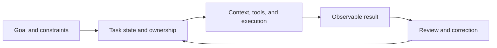

## The Quantitative Research Task

A while ago, I used Grok Bot for quantitative research. I did not give it a step-by-step procedure. I told it what I was thinking, what I already knew, and what direction I wanted to explore. It picked up the work and carried it forward, then brought back a strategy, backtest results, and the details I needed to review. When it ran into problems, it tried to work them out first.

After I ran out of Grok Bot credits, I switched tools. I tried building my own setup with DeepSeek Harness and also looked at DS Bot, which someone else had built. The difference I had struggled to describe began to take shape: the new assistants kept talking to me, but the work stood still. They repeatedly asked what I wanted, or reported a problem and waited. When they hit a permissions issue or another blocker, they did not necessarily keep moving on the parts they could still handle.

I had described something similar in a [DS Bot discussion about group management](https://github.com/Fei2411/DS-Bot/discussions/676): a user had already asked for a task to be completed, and the group admin returned a complete plan without getting the members to carry it out. The user still had to chase them. If I asked for a report, several people might share their views and the admin might summarize how the report should be written. The group would look busy, but I still would not have the report.

That backtest could not show whether the strategy worked. The data and methods still needed to be checked. But it helped me distinguish two things: whether an assistant responds, and whether the work moves forward. The [Grok Bot overview](https://docs.x.ai/grok-bot/overview) brings Bots, a persistent work environment, apps, and collaboration together. In a coding example in its [user guide](https://x.ai/bot/guides/grok-bot-101), a Bot organizes the context and hands the work to a coding harness. From the user's point of view, the work is continuous, even when different tools take over at different stages.

## How Work Carries Over

I came to see that delivery is not only about whether the system can do the work. It is also about whether the next session can pick it up. In its [notes on long-running agents](https://www.anthropic.com/research/effective-harnesses-for-long-running-agents), Anthropic gives an example of an Agent building an application across multiple context windows. It may try to do too much at once, run out of context halfway through, and leave the next session unsure what has been done or why the environment is in its current state. It may also see that some features work and mistakenly decide the whole task is complete.

Anthropic's approach is to leave a feature list, progress notes, code commits, and setup instructions in the work environment for the next session. That is not a general solution to long-running tasks, but it makes one condition clear: running more turns is not enough. The system has to leave behind a record of the goal, progress, and changes to the environment.

I also came to think about the Loop and the Harness separately. A Loop is the model acting, observing, and acting again. The Harness also includes tools, context, the runtime environment, and constraints. Letting the model keep going does not ensure that it knows when the task is done or that it has stayed on course.

Memory, Trace, and task state each serve a different purpose. Memory stores relatively stable preferences and background. A Trace records what happened in one run, which tools were called, and where things failed. Task state answers what the current goal is and what has or has not been completed. They are related, but cannot replace one another. A full log may be too long to fit into the next context window; a short summary may leave out crucial evidence.

In a [DS Bot discussion about memory summaries](https://github.com/Fei2411/DS-Bot/discussions/677), I raised a very concrete interface problem: when no usable summary is available, the user sees a placeholder and cannot tell whether the system is waiting or never started. An internal Trace does not tell the user where the task stands. A status that says "working" does not prove that anything is happening. At a minimum, the user should be able to ask: What have you done, and what is still missing?

Memory and the runtime environment support this process. Task state connects the goal to progress, and the work still needs to produce a result people can inspect.

## When Capabilities Become Reusable

In less than a year, I kept running into the same kind of problem with Skills. At first, I mostly used coding tools: Cursor, Claude Code, Spec Driven. I was focused on helping a model understand a request and do a bounded task well. Later I came across Skills and liked the idea of organizing capabilities and experience into forms an Agent could call. I also built a Skills platform with my team.

At the time, I was still thinking about tools like Copilot: people stay involved, but do not have to do every step themselves. More than one team in the organization was building something similar. The barrier to entry was low and the field crowded, so a senior executive eventually decided to merge the efforts. The platform was folded in, but the question remained: how could scattered capabilities become part of real work, in a process someone could rely on to deliver?

A team's workflows used to be scattered across chats, documents, and people's heads. Turning them into Skills at least made them easier to find, reuse, and revise. You did not have to write a complex program before you could give an Agent a way of working. But a format is only a format. The [Agent Skills specification](https://agentskills.io/specification) describes how to organize directories, metadata, and content. It does not ensure that an instruction fits the current task or that several Skills will not conflict when used together.

A Microsoft [study of Skill-induced failures](https://www.microsoft.com/en-us/research/publication/agent-skills-can-be-harmful-an-empirical-study-of-skill-induced-failures-in-llm-agents/) identified 307 cases of failure or efficiency loss associated with Skills across two benchmarks. One example was turning a checklist into mandatory work. That number belongs to the study's benchmarks and attribution method; it is not a general failure rate. Still, it made me pay attention to a familiar situation: the user wants one small thing done, but the system makes them go through an entire process. The easier it is to accumulate rules, the more important it becomes to know when to use them and when not to.

I do not think a thicker Harness is always better, either. One developer documented spending eight months and making 883 commits on an Agent Harness before giving up because maintenance and debugging took too much time. [That is one person's experience](https://www.reddit.com/r/ClaudeAI/comments/1w8jhfp/i_spent_883_commits_and_8_months_building_an_llm/), not proof that building your own Harness is generally a bad idea. But it does remind me that a system built to help an Agent can itself need constant care.

Infrastructure and long-running task design also affect each other. Compute, model deployment, and scheduling shape latency and cost. Task decomposition, context, and recovery mechanisms shape whether each call is moving in the right direction. In a [discussion about group-chat usage and cost](https://github.com/Fei2411/DS-Bot/discussions/659), we worked out that one message visible to a user might mean several Bots each reading the same context. Looking only at the price of one call or the token count for each Bot makes it hard to tell whether the team is worth it. If another role adds no needed information or review, it only adds cost and coordination.

## The Costs and Benefits of Multiple Agents

Multiple Agents are useful when a task can be split into relatively independent parts. In its [multi-agent research system](https://www.anthropic.com/research/multi-agent-research-system), Anthropic assigns research on different companies to subagents and has a lead Agent synthesize the results. In its internal evaluation, Anthropic reported that an Opus 4 lead Agent with Sonnet 4 subagents scored 90.2% higher than a single Opus 4 Agent. The same report says the multi-agent system used about 15 times as many tokens as ordinary chat. The comparison is to chat, not to the single-Agent research system.

These results do not mean that more Agents are always better. A [controlled study by MIT Media Lab and collaborators](https://www.media.mit.edu/projects/towards-a-science-of-scaling-agent-systems-when-and-why-agent-systems-work/overview/) compared 260 configurations. On the Finance Agent task, average scores under centralized coordination ranged from 34.9% to 63.1%. On PlanCraft, every multi-agent configuration they tested scored below a single Agent. The first task made it easier to research different sources in parallel; the second depended more heavily on step order, so handoffs consumed some of the budget. Another [ICML 2026 study](https://proceedings.mlr.press/v306/pappu26a.html) found that the self-organizing teams it tested did not consistently match their strongest expert. One possible explanation was that discussion led to compromise. The findings depend on the tasks and experimental setups, but together they remind me that parallel work and discussion are not free.

In a [DS Bot discussion about team collaboration](https://github.com/Fei2411/DS-Bot/discussions/657), I put the problem into a group-chat scenario: a user states a goal, several Bots split up the work, and then context gets compressed, results arrive late, the user changes direction, or the system restarts. Can the team still follow the latest goal? Recovering a turn does not mean the user's task is complete. Getting a subtask back does not mean the final delivery has been reviewed.

Giving Bots different job titles does not guarantee they have different abilities or that someone owns the final result. Persistent identities can reflect different knowledge, permissions, and areas of focus. For a particular task, it still needs to be clear who is responsible for delivery, who supports the work, and who checks it when needed. If someone asks a question, a direct answer is enough. Task state matters when the goal requires division of work, waiting, and follow-through. I do not want every internal handoff to become a message the user has to read and approve.

## What Products Put in the Foreground

When I used Muse, it felt as though it and Grok Bot had different emphases. Meta's [product page](https://ai.meta.com/muse/) and [design overview](https://introducing.muse.ai/) emphasize personal goals, everyday tasks, and continuing work in the background. Grok Bot puts persistent Bot identities, groups, and handoffs more prominently. My experience does not speak for every task, but it made me notice two kinds of initiative: starting conversations and sending reminders, versus continuing a task within the authority already granted.

I had guessed that Muse was a single model in a single process. Then I read Meta's [description of its safety architecture](https://research.meta.ai/blog/security-and-safety-for-ai-agents-our-approach-with-muse), which mentions concurrent subagents and a browser-specific subagent. I had to revise that guess. One assistant in the interface does not mean there is only one actor underneath, and multiple Agents do not necessarily mean multiple models.

The comparison between Manus and Grok Bot is similar. The [Manus 2.0 announcement](https://manus.im/en/blog/introducing-manus-2-0) describes a continuous environment for executing tasks: its Cascade harness brings in specialized capabilities as needed, Cloud Computer gives projects that need to run for a long time a persistent machine, and Automations can start on a schedule or when something happens in a connected service. Its new Cue product gives Agent teams a separate entry point. Each Agent has its own email address, phone number, wallet, and computer, and can work with others toward a shared goal. Grok Bot puts persistent Bot identities, a shared environment, and handoffs more in the foreground. This is a comparison of how the products describe their organization, not my assessment of these features from hands-on use.

Personal Agents do not all take the same form. [Instinct](https://instinct.com/) uses text and phone calls as its interface, with an Agent that can use a phone and computer to handle errands such as ordering food or booking a train. [Today AI](https://today.ai/articles/blog/what-is-today) emphasizes personal memory across devices, noticing changes, and acting on calendar and email after the user confirms. [Perplexity Personal Computer](https://www.perplexity.ai/personal-computer) connects a persistent Agent to a local computer. It can work with local files and apps, take tasks started from a phone, and run around the clock on a Mac mini. Perplexity now offers a Mac version and has also released a Windows version. [Genspark Super Agent](https://www.genspark.ai/helpcenter/super-agent) is closer to a general task executor that produces deliverables. It emphasizes multi-step work, a dedicated sandbox, project files, and saving workflows as Skills. These products all belong in a discussion of Personal Agents, but they do not occupy the same layer. Some emphasize getting to know a person over time, some taking care of real-world errands, and others completing a complex piece of work.

[ChatGPT Work](https://openai.com/index/chatgpt-for-your-most-ambitious-work/) also combines multi-step tasks, tools, scheduled execution, and reviewable deliverables. It overlaps with Manus and Genspark in its task-to-deliverable approach. The product boundaries overlap. What I want to compare is which work each Agent can carry forward on its own, what requires human approval, and what result it leaves when the task ends. Public product descriptions tell us how a system is meant to work. They do not replace trying the same task in each product.

## When Is the Job Done?

I do not take "I'm done" as sufficient on its own. In the quantitative research task I described at the start, I would at least need to see which strategy it used, what the backtest showed, and what still needs checking. A disappointing strategy can still be a deliverable. If the Agent explains why it did not work and what it did complete, the next step can start there.

Some results are easy to check: does the code run, or is the file there? Others require judgment. Is the research conclusion reliable? Does an article say what I meant? A model cannot answer those questions just by grading itself. Anthropic's [guide to evaluating Agents](https://www.anthropic.com/research/demystifying-evals-for-ai-agents) separates the run log from the final state of the environment. An Agent saying it booked a ticket is one thing; whether a booking actually exists in the system is another.

Benchmarks can answer only the questions they measure. [METR's time horizon](https://metr.org/time-horizons/) uses the time a human expert needs to complete a task to estimate the length of task an Agent can handle at a given success probability. It does not measure how long an Agent can run continuously. The tasks are mainly well-defined software and machine-learning tasks that can be scored automatically. [OSWorld 2.0](https://arxiv.org/abs/2606.29537) covers long workflows across applications. Under the paper's model setup and 500-step limit, its best-performing combination completed 20.6% of tasks fully and received a 54.8% partial-completion score. Partial completion means the Agent did many of the steps; it is not full success.

Studies of developer productivity also produce different answers. A [2025 METR randomized controlled study](https://metr.org/blog/2025-07-10-early-2025-ai-experienced-os-dev-study/) asked 16 open-source developers familiar with their own projects to complete 246 tasks. On average, they took longer with the AI tools available at the time. A [GitHub study of Copilot](https://www.microsoft.com/en-us/research/publication/the-impact-of-ai-on-developer-productivity-evidence-from-github-copilot/) found that participants completed a controlled programming task faster. The tasks, tools, and participants differed, so the results cannot be averaged into an answer to whether AI improves productivity. Speed is also not the same as delivery quality.

This has led me to look at acceptance in several layers: did the expected action happen, were the explicit requirements met, can someone use the result, and did it solve the problem the user cared about? The first two often have concrete evidence. The latter two require domain knowledge, and sometimes the user has to explain the goal again. A completion percentage may look clear while hiding what is still missing.

The more an Agent can do on its own, the more I want to see what it did, what remains, and where I need to step in. For me, a task is not done because the conversation stopped or the Agent said it was finished. I need to be able to inspect what it returned and see what is still unresolved.
