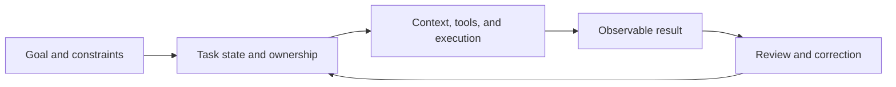

## 那次跑量化

前段时间我用 Grok Bot 跑量化研究。我没给它写操作步骤，只说了自己在想什么、已经知道什么、想往哪个方向看。它接过去往下做，把策略、回测结果和该看的细节交回来；中间遇到问题，它先自己试着解决。

额度用完后我换了工具，中间试过自己用 DeepSeek Harness 搭，也看过别人做的 DS Bot。换过去之后，那种说不清的差别才有了形状：新的助手会一直跟我说话，事情却停在原地。它反复确认我到底想要什么，或者把问题报给我，然后等我。遇到权限或者别的阻塞，它也不一定先把能做的部分推进下去。

我在 DS Bot 的[群管理讨论](https://github.com/Fei2411/DS-Bot/discussions/676)里写过相似的情况：用户已经要求完成一项工作，群管理员回了一套完整方案，却没有推动成员去执行，最后还得用户再催。如果我要一份报告，几个人分别说了看法，管理员又总结应该怎么写，群里看起来很忙，报告还没到手。

那次回测当然不能说明策略有效，数据和方法还得另查。但它让我开始区分两件事：助手有没有回应我，和工作有没有继续往前。Grok Bot 的[官方介绍](https://docs.x.ai/grok-bot/overview)把 Bot、持久工作环境、应用和协作放在一起；[使用指南](https://x.ai/bot/guides/grok-bot-101)里的编程例子则由 Bot 整理背景，再交给 coding harness 执行。对用户来说是一段连续工作，背后不一定是同一个模型或工具从头做到尾。

## 工作怎样接下去

我后来发现，交付的问题不只在“能不能做”，还在“下一轮能不能接上”。Anthropic 在[长任务 Agent 的实践](https://www.anthropic.com/research/effective-harnesses-for-long-running-agents)里举过一个例子：Agent 跨多个上下文窗口做应用，可能一次想做太多，做到一半上下文耗尽；下一轮不知道做到哪里，也不知道环境为什么变成这样。它也可能看到部分功能可用，就误以为整个任务完成了。

他们把功能清单、进度记录、代码提交和启动环境的步骤留在工作区，供后续会话接手。这不是长任务的通用解法，但它说清楚了一个条件：多跑几轮本身没用，得留下能说明目标、进度和环境变化的东西。

我自己也是后来才把 Loop 和 Harness 分开想。Loop 是模型一次次行动、观察、再行动；Harness 还包括工具、上下文、运行环境和约束。只让模型继续跑，不能保证它知道什么时候算完，也不能保证它没有偏离目标。

记忆、Trace 和任务状态也各有用途。记忆保存相对稳定的偏好和背景；Trace 记录一次运行做了什么、调用了什么工具、在哪里失败；任务状态回答当下目标、已完成和未完成部分。三者有关联，不能互相替代。日志太长，下一轮未必放得进上下文；摘要太短，又可能丢掉关键证据。

我在 DS Bot 的[记忆摘要讨论](https://github.com/Fei2411/DS-Bot/discussions/677)里提过一个很具体的界面问题：没有可用摘要时，用户看到占位状态，分不清系统是在等，还是根本没有启动。内部有 Trace，不等于用户知道任务走到哪；界面上写“正在做”，也不代表背后真的有动作。至少得能追问：已经做了什么，还缺什么？

这条线里，记忆和运行环境是支撑，任务状态负责把目标与进度接起来，最后还得有看得见的结果供人检查。

## 能力被封装之后

不到一年的时间里，我在 Skills 上也在同一类问题上反复碰壁。最初我用的更多是编程工具，Cursor、Claude Code、Spec Driven；我在意的是怎样让模型理解需求，把一个局部任务做好。后来接触 Skills，觉得把能力和经验整理成可调用的形式很有用，我带团队也做过一个 Skills 平台。

当时我想的还是 Copilot 这类工具：人参与其中，但不必亲自完成每一步。组织里不止一个团队在做类似的事，门槛低、竞争也多，最后大老板拍板合并。平台被合并了，问题留下来：零散能力怎样进入实际工作，成为一个人能依靠的交付过程？

一个团队积累的流程以前散在聊天、文档和人的脑子里；整理成 Skill 后，至少有了发现、复用和修改的入口，也不必先写复杂程序，才有机会把一种工作方法交给 Agent。但格式只是格式。[Agent Skills 规范](https://agentskills.io/specification)描述目录、元数据和内容的组织方式，不保证指令适合当前任务，也不保证多个 Skill 放在一起不会冲突。

微软的一项[技能诱发失败研究](https://www.microsoft.com/en-us/research/publication/agent-skills-can-be-harmful-an-empirical-study-of-skill-induced-failures-in-llm-agents/)在两个基准中整理出 307 个与 Skill 相关的失败或效率退化案例，其中包括把检查清单变成强制劳动。这个数字属于那项研究的基准和归因方法，不能当作普遍失败率。它让我留意另一种情况：用户只想做一件小事，系统却要求走完一整套流程。规则越容易积累，越需要判断什么时候该用、什么时候不该用。

我也不觉得 Harness 越厚越好。社区里有开发者记录了自己花 8 个月、883 次提交搭建 Harness 后，因为维护和排错太费时间而放弃。[这是个人经历](https://www.reddit.com/r/ClaudeAI/comments/1w8jhfp/i_spent_883_commits_and_8_months_building_an_llm/)，不能证明自建 Harness 普遍不划算，但提醒我：为了让 Agent 帮忙而造出的系统，也可能需要人持续照顾。

基础工程和长任务工程也会互相牵制。算力、模型部署、调度影响调用延迟和成本；任务拆分、上下文和恢复机制则影响模型每次调用是否走在正确方向上。我们在[群聊用量和费用](https://github.com/Fei2411/DS-Bot/discussions/659)里算过，用户看到一条消息，后台可能是多个 Bot 各读一遍同样的上下文。只看单次调用价格或每个 Bot 的 token 数，很难知道团队值不值。多一个角色若没有带来必要的信息或检查，只是增加了成本和协调。

## 多 Agent 的收益和代价

多 Agent 在任务能拆成相对独立的部分时有用。Anthropic 的[多 Agent 研究系统](https://www.anthropic.com/research/multi-agent-research-system)把不同公司的资料查询分给子 Agent，再由主 Agent 汇总；他们报告内部评估中，Opus 4 主 Agent 配 Sonnet 4 子 Agent 比单 Agent Opus 4 高 90.2%。同一报告的 token 消耗约为普通聊天的 15 倍，分母不是单 Agent 研究系统。

这类结果不能直接推出“Agent 越多越好”。[MIT Media Lab 与合作者的研究](https://www.media.mit.edu/projects/towards-a-science-of-scaling-agent-systems-when-and-why-agent-systems-work/overview/)比较了 260 种配置：在 Finance Agent 任务上，集中式协调的平均成绩从 34.9% 到 63.1%；在 PlanCraft 上，受测的多 Agent 配置都低于单 Agent。前一种任务更容易并行查询不同信息，后一种任务的步骤依赖更强，交接本身会消耗预算。[ICML 2026 的另一项研究](https://proceedings.mlr.press/v306/pappu26a.html)观察到，测试中的自组织团队没有稳定达到其中最强专家的表现，讨论折中是可能的原因之一。这些结论都受任务和实验设置限制，但一起提醒我：并行和讨论不是免费的能力。

我在 [DS Bot 的团队协作讨论](https://github.com/Fei2411/DS-Bot/discussions/657)里把问题放进一个群聊场景：用户提出目标，几个 Bot 分头做事，中间出现上下文压缩、迟到结果、用户修正，甚至重启，团队还能不能追着最新目标走？一个回合恢复了，不等于用户任务完成；子任务返回了，也不等于最终交付验收了。

给 Bot 起不同职位名称，也不保证它们有不同能力，更不保证有人对最终产物负责。长期身份可以对应不同知识、权限和关注点；具体任务仍要说明谁负责交付、谁提供支持、谁在必要时检查。有人问一个问题，直接回答就够了；只有目标需要分工、等待和收尾时，任务状态才变得重要。我不希望每次内部交接都变成用户要读、要批的消息。

## 产品把什么放在前台

我用 Muse 时，觉得它和 Grok Bot 的重心不完全一样。Meta 的[产品介绍](https://ai.meta.com/muse/)和[设计说明](https://introducing.muse.ai/)强调个人目标、日常事务和后台持续推进；Grok Bot 则把长期 Bot、群组和工作交接摆得更显眼。我的使用感受不能代表所有任务，但让我注意到“主动”也有两种：主动发起对话和提醒，与在已有授权内继续推进任务，不是一回事。

我原先猜过 Muse 是单模型单进程，后来看到 Meta 的[安全架构说明](https://research.meta.ai/blog/security-and-safety-for-ai-agents-our-approach-with-muse)提到并发子 Agent 和浏览器专用子 Agent，才修正这个判断。用户看到一个助手，不代表底层只有一个执行者；多 Agent 也不自动意味着用了不同模型。

Manus 与 Grok Bot 的对照也类似。Manus 2.0 的[官方介绍](https://manus.im/en/blog/introducing-manus-2-0)把重点放在一套连续的任务执行环境：Cascade harness 按任务调入专门能力，Cloud Computer 给需要长期运行的项目一台常驻机器，Automations 可以由时间或连接服务中的事件触发。新产品 Cue 则把 Agent 团队单独做成入口：每个 Agent 有自己的邮箱、电话号码、钱包和电脑，可以围绕共享目标分工。Grok Bot 更突出长期 Bot 身份、共享环境和相互交接。这里比较的是产品公开描述的组织方式，不是我对这些功能的实测评价。

Personal Agent 也不是一种固定形态。[Instinct](https://instinct.com/)把入口放在短信和电话上，Agent 通过手机和电脑替用户订餐、订票或安排日常事务；[Today AI](https://today.ai/articles/blog/what-is-today)强调跨设备的个人记忆、主动发现变化，并在用户确认后操作日历、邮件等服务。[Perplexity Personal Computer](https://www.perplexity.ai/personal-computer)则把本地电脑接进常驻 Agent：它能操作本地文件和应用、从手机发起任务，并在 Mac mini 上保持 24 小时运行；官方现已提供 Mac 版，也推出 Windows 版。[Genspark Super Agent](https://www.genspark.ai/helpcenter/super-agent)更像任务到产物的通用执行器，主打多步骤工作、专用沙箱、项目文件和把流程存成 Skill。它们都可以放进 Personal Agent 的讨论，但彼此不在同一层：有的强调长期了解一个人，有的强调代办现实事务，有的强调把一项复杂工作做完。

ChatGPT Work 也把多步任务、工具、定时执行和可审阅产物放在一起，和 Manus、Genspark 的任务执行路径有交集。这样看，产品边界会重叠；我更想比较的是它们把哪些工作交给 Agent 自己推进、需要人审批什么、任务结束时留下什么结果。公开介绍能说明设定，不能替代同一任务下的体验比较。

## 事情做到哪一步才算完

我不太接受“我已经完成了”这句话本身。拿开头那次量化研究来说，至少得让我看到用了什么策略、回测结果是什么、哪些地方还没查。策略不理想也可以交付；把失败原因和已完成的部分说清楚，下一步就能从那里开始。

有些结果能直接检查：代码能不能跑，文件有没有写出来。研究结论是否可靠、文章是不是表达了我想说的意思，则需要领域判断，不能只靠模型给自己打分。Anthropic 的[Agent 评估说明](https://www.anthropic.com/research/demystifying-evals-for-ai-agents)把运行记录和最终环境状态分开：Agent 说订票成功是一回事，系统里是否真的有预订是另一回事。

Benchmark 也只能回答它实际测到的部分。[METR 的 time horizon](https://metr.org/time-horizons/)用人类专家完成任务所需时间估计 Agent 在一定成功概率下可处理任务的长度；这不是 Agent 能连续运行的时长，测试任务主要是目标明确、可自动评分的软件与机器学习任务。[OSWorld 2.0](https://arxiv.org/abs/2606.29537)面向跨应用长流程，在论文设定的模型配置和 500 步上限下，最好的组合完整成功率为 20.6%，部分完成为 54.8%。部分完成说明做成了不少步骤，不能当成完整成功。

开发者生产力研究也会给出不同答案。[METR 2025 年的随机对照研究](https://metr.org/blog/2025-07-10-early-2025-ai-experienced-os-dev-study/)让 16 名熟悉自己项目的开源开发者做 246 个任务，发现使用当时的 AI 工具平均耗时更长；[GitHub 对 Copilot 的研究](https://www.microsoft.com/en-us/research/publication/the-impact-of-ai-on-developer-productivity-evidence-from-github-copilot/)则在一个受控编程任务里报告参与者完成更快。任务、工具和参与者都不同，不能把结果平均成“AI 到底提不提效”。它们测量的速度也不等同于交付质量。

这让我把验收分成几层看：预期动作有没有发生，明确要求有没有满足，结果能不能用，以及它有没有解决用户真正关心的问题。前两层常能找到具体证据；后两层需要领域知识，有时还要用户重新解释目的。完成百分比看起来清楚，却可能遮住具体缺了什么。

Agent 能自主做的事越多，我越想看见它做了什么、还差什么，以及我需要在哪一步接手。对我来说，一件事算不算做完，不看对话停没停，也不看 Agent 自己说没说完成；要看交回来的结果能不能检查，剩下的问题有没有交代清楚。
