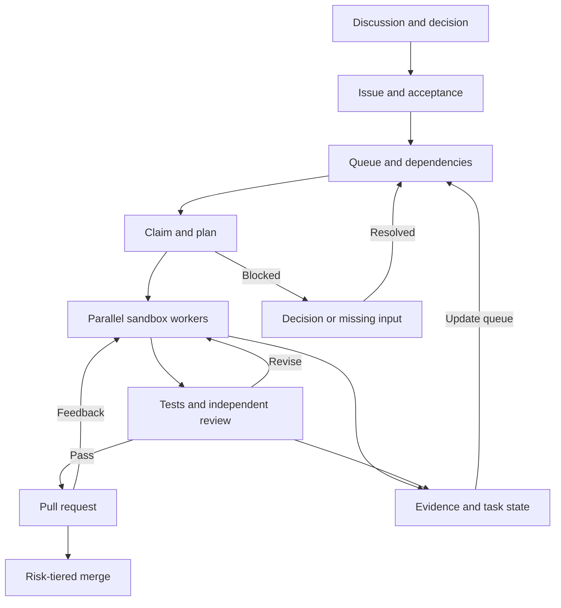

In my actual use, OpenMausBot’s scheduled jobs work well for fixed routines, and it can coordinate an individual workflow. The difficulty starts with a long queue. Imagine 30 open tasks: A is waiting for a human decision, B depends on A, C and D can proceed in parallel, and other tasks need reprioritization as feedback arrives. The scheduler has to manage concurrency limits, priority, dependencies, and decision points. OpenMausBot connects models to execution environments; managing this cross-dependent queue over time still needs a queue manager and a goal-state layer.

I want to hand a bot a goal and step in only when it needs information or a change of direction. It should understand the outcome, decide who to involve, break the work into stages, and define how to check each one. When a stage is done, the next should be able to start. The bots can review one another and return the evidence with the work.

“Unlimited self-execution” is still something I want to test. Running several rounds of one task and continually finding the right next task are different capabilities. Grok Bot gives me a natural place to start coordinating. Clear owners, stages, acceptance criteria, and permission boundaries turn initiative and judgment into working agreements we can observe and improve.

## 1. Single-goal long tasks and multi-task self-running systems are different problems

I went looking for evidence about which models can keep working for a long time. First, it helps to separate two questions: can a model handle a long chain of work within one supervised task, and can a system return hours or days later, track the original goal, reprioritize after feedback, and resume? The first can be benchmarked. The second also depends on a scheduler, external state, triggers, and an acceptance process. A long context window does not mean a model will remember a project goal, let alone keep working after a session ends.

### 1.1 Claude Opus 5.5 is strong on single-goal long tasks

A single model working toward a clear goal can already be useful beyond multi-task orchestration. If the goal and scope stay stable and completion is testable, a strong model paired with a code harness can carry out a long cycle of planning, implementation, testing, and repair. Claude Opus 5.5 has performed well on this kind of work. Anthropic says an early tester audited and repaired a 200,000-line codebase in three hours; the previous Opus 5 took more than 20 hours and used about 2.5 times as many tokens. In Anthropic’s internal C-to-Rust migration experiment, Opus 5.5 converted HAProxy in 9.5 hours and passed nearly all regression tests. It was faster than Fable 5.1’s 12 hours and cost 51% less. One is an early tester’s report; the other is Anthropic’s internal experiment. Both make single-goal long tasks worth evaluating separately. [Claude Opus 5.5 evaluations and examples](https://www.anthropic.com/claude-opus-5-5)

The benchmark results also show Opus 5.5’s strength on difficult coding tasks. In Anthropic’s Terminal-Bench 4.0 results, Opus 5.5 scored 66.4% and GPT-6 Astra 57.9%; on FrontierCode v1.1 Main, they scored 54.4% and 53.3%. GPT-6 Astra led on Terminal-Bench-Science 0.1, with 64.6% to Opus 5.5’s 58.7%. These figures were reported by the vendors under different reasoning-effort settings. A public rerun of Terminal-Bench 4.0 scored Opus 5.5 at 64.8% ± 3.1 and GPT-6 Astra at 57.9% ± 3.0, using Claude Code and Codex harnesses respectively. [Anthropic’s model evaluations](https://www.anthropic.com/claude-opus-5-5) · [Terminal-Bench 4.0 leaderboard](https://www.tbench.ai/?efforts=all&version=4.0)

For the long coding tasks I care about, Claude Opus 5.5 is very strong, and its current public terminal-coding scores are ahead of GPT-6 Astra. GPT is capable too, but in my use it needs more reminders during long chains of work, especially when it has to keep deciding what to do next in service of the original goal. The scores show a gap on particular coding tasks; initiative across a multi-task queue is a different capability. OpenAI’s guide to long-running tasks also emphasizes mid-task steering, asynchronous tools, parallel independent work, and keeping progress and completion criteria outside the current context. [OpenAI’s guide to long-running GPT-6 tasks](https://openai.com/index/practical-guide-building-gpt-6/)

### 1.2 Devin and Cursor have turned long tasks into product features

Devin and Cursor treat long-running work as a runtime problem, not just a prompt-writing problem. Cognition’s Managed Devins lets a coordinating Devin define the scope, then delegate subtasks to separate sessions. Each session runs in its own virtual machine and executes its own tests. The coordinator monitors progress, can send corrections, and assembles the results. Scheduled Devin can run on a schedule or event and read and write notes shared across sessions. Cognition’s examples include weekly summaries and daily concurrent QA runs. [Managed Devins](https://cognition.com/blog/devin-can-now-manage-devins) · [Scheduled Devins](https://cognition.com/blog/devin-can-now-schedule-devins)

Cursor’s long-running agent harness proposes a plan and waits for approval, then has multiple agents inspect the work, test changes, and return a PR. Cursor has shared preview runs lasting 25, 30, and 36 hours. Its Cloud Agents work in separate VMs and branches, run tests, and can attach screenshots, video, and logs. The current multi-agent workflow can also run independent steps from a plan in parallel, with a verifier checking the result. [Cursor’s long-running agent harness](https://cursor.com/blog/long-running-agents) · [Cursor Cloud Agents](https://prod.cursor.com/help/ai-features/background-agents) · [Cursor multi-agent workflow](https://prod.cursor.com/help/ai-features/multi-agent)

These products combine long-running sessions, isolated environments, parallel execution, plan approval, and result verification. Their public examples mostly cover one project or a set of decomposable coding tasks. They do not yet show a system maintaining priorities across many projects over time, absorbing decisions, changing direction, and judging the value of the final result on its own. Devin’s scheduled runs and Managed Devins, and Cursor’s long-running harness, are useful engineering components. A multi-project self-running system still needs an external goal state and a governance layer.

### 1.3 Long-task benchmarks still show limited completion rates

The useful benchmark question is not whether a model can work forever, but how often it completes a long task. OSWorld 2.0 collected 108 real desktop workflows with a median human completion time of about 1.6 hours. The paper reports that Claude Opus 4.8 completed 20.6% of tasks under a 500-step limit, with a partial-completion score of 54.8%. GPT-5.5 was more token-efficient in the same paper, but its strict completion rate was about 13%. Opus completed more of these long computer tasks end to end; GPT used fewer tokens. Neither is close to reliable delivery. [OSWorld 2.0](https://arxiv.org/abs/2606.29537)

A newer model does not automatically solve judgment. METR’s pre-release evaluation of Claude Opus 5.5 found progress over its predecessor, but no step-change in research judgment, foresight, or building its own feedback loop. It was still not enough to fully automate AI research and development. The evaluation focused on AI R&D tasks, and Anthropic had an opportunity to review and edit the evaluation text. It is one piece of evidence that long-task ability and goal judgment are separate. [METR’s evaluation of Opus 5.5](https://metr.org/blog/2026-09-22-claude-opus-5-5/)

Software tasks show a similar pattern. LongCLI-Bench covers CLI projects that take experts more than 1,000 minutes on average and touch over 100 files. End-to-end pass rates were low when models and agents worked alone. Claude Code with Opus 4.6 passed 16.7% of tasks at baseline, rising to 61.7% with an upfront plan and interactive human guidance. Codex with GPT-5.3-Codex went from 15% to 50%. Those runs averaged 2.1 and 2.2 human interventions per task. For this benchmark, giving the agent a plan and information during execution worked better than relying on repeated self-correction alone. [LongCLI-Bench](https://aclanthology.org/2026.findings-acl.1497.pdf)

On this evidence, I would try Claude Opus 5.5 first for long, single-goal coding tasks. GPT-6 Astra also has a clear strength on scientific terminal tasks. Grok is a better fit as the entry point for decomposition, coordination, judgment, and acceptance, while lower-cost models such as DeepSeek can take well-bounded implementation work. The final choice should come from a team’s own tickets: task pass rate, reminders, rework, token use, and wall-clock time.

For continuous execution, the more useful question is whether the harness can recover from failure across rounds. The LongHorizon-Harness preprint reports gains across several models and tasks. On its OSWorld 2.0 subset, Claude Opus 4.7 rose from 20.0% to 34.3%. That is still far from reliable completion, but it suggests external state, independent audits, and round-based execution can improve progress across turns more directly than simply swapping in a stronger model. [LongHorizon-Harness](https://arxiv.org/abs/2608.01964)

## 2. Grok Bot works best as the coordination hub

Grok Bot’s product overview brings together persistent bots, persistent workspaces, tools, and bot-to-bot collaboration. Each bot has its own role and context. Bots can work in parallel, message one another, and hand off tasks. Once a task works reliably, its steps can be saved as a Skill and triggered by a Routine on a schedule or event. The official guidance is to test a bot on a concrete task before turning the process into a Skill or Routine. [Product overview](https://docs.x.ai/grok-bot/overview) · [Skills and Routines](https://docs.x.ai/grok-bot/skills-routines-and-automations)

For me, Grok’s value is not writing all the code itself. With Grok usage in short supply, I would reserve it for coordination and acceptance: turn the user’s semantic goal into task instructions, task cards, and acceptance criteria, then call GPT, Claude, or DeepSeek on cloud machines to do the implementation. The work should not come back as “done.” It should return as a programming task card or ticket stating what changed, what ran, what happened, and what is blocked. Grok can then check it against the original goal.

Cloud machines make this split useful. Independent research, implementation, and review can go to different workers in parallel; the coordinator handles dependencies and conflicts when the results come back. Throughput depends on task dependencies, shared machines, context, and usage limits. Grok’s documentation says bots can collaborate in parallel, but computer interaction on a shared computer is limited to one task at a time per bot. The scheduler’s job is to spot independent work and assign slots accordingly. [Grok Bot collaboration](https://docs.x.ai/grok-bot/overview)

The public materials show the scheduling primitives Grok Bot offers. Based on its observable behavior, I understand the workflow this way: an entry-point bot interprets the goal and decides whether to act or delegate; each subtask carries its scope and deliverables; the coordinator checks the result and reports back. The public Grok Root Agent project also describes an entry bot that clarifies the request, sizes the work, builds a team, manages delegation, and accepts the delivery, leaving research, coding, or analysis to execution bots. [Root Agent prompt framework](https://github.com/MrBekoX/root-agent-skill-framework)

One handoff detail is easy to miss: the next person or bot needs an actionable next step. “Can someone take a look?” can sit in an inbox. “Check this change against the acceptance criteria, approve or reject it, and report the risks” tells the next worker what to do. A scheduler needs to keep more than a roster of bots. It needs the current owner, stage, delivery evidence, and who takes over if the task stalls.

Here is a draft instruction for a Grok scheduler, based on the public product descriptions and the working agreements I use:

> You are the user’s single point of contact and work scheduler. First understand the outcome the user wants, then write down the goal, scope, constraints, and acceptance criteria. Ask only when missing information could change the approach; start when the task is clear. Use dependencies and risk to decide whether to do the work yourself, split it into parallel tasks, or delegate it to the right execution bot. Every delegation needs an actionable task card with inputs, permission boundaries, deliverables, and acceptance criteria, plus an owner and status. When an execution bot returns, check the evidence against the original goal. Arrange an independent review, a counterexample check, or rework when needed. When something is blocked, identify the affected scope, update the task state, and keep assigning work that does not depend on it. Tell the user what decision or information is actually needed. Do not publish, merge, send externally, or change production outside the permissions granted. Stop at that boundary and return a reviewable result. In the final report, state what is done, what is not, the evidence, risks, and next steps.

### 2.1 How Grok judges delivery when it switches tasks

What I most want to know is how a bot confirms that a task is delivered before switching to the next one. Public material shows a few relevant mechanisms. A bot can be working, waiting, blocked, or done. It can hand a task to another bot asynchronously; the recipient wakes up and replies when finished. Each bot keeps its own role memory and work context, while files and login state are shared on the account’s cloud computer. Routines can be triggered by a schedule, an event, or another bot. The product-design article says the coordinating bot handles routine handoffs and sends decisions that need judgment to a human. [Product design](https://x.ai/news/designing-grok-bot) · [Bot handoffs](https://docs.x.ai/grok-bot/chat-and-collaboration)

Coding work has a specific execution path too. A bot can delegate to a Cloud Agent. When the agent finishes, the bot brings back files cited in its final report. The run card may say Done, Error, or Expired, and may include a PR. That tells us how execution ended and how to retrieve its output. To judge whether the result meets the original goal, the docs recommend specifying deliverables and acceptance criteria, and asking for sources, screenshots, operation logs, and anything the agent could not verify. I treat Done as an executor status, then inspect the artifact. A PR or a bot’s “complete” message still has to be checked against the task. [Files and results](https://docs.x.ai/grok-bot/files-and-results)

Grok’s internal task priorities, switching rules, and acceptance mechanism are not public. In my experience, it keeps pushing work toward delivery, but a controlled comparison would be needed to separate the contributions of the prompt, model, background scheduler, and product workflow. One bot can operate only one item on its screen at a time; for waits, approvals, or login problems, the docs recommend troubleshooting before redirecting the task. Multi-bot parallelism and one bot’s screen-level work are different layers of concurrency. [Grok Bot overview](https://docs.x.ai/grok-bot/overview) · [Troubleshooting](https://docs.x.ai/grok-bot/troubleshooting)

I would test Grok’s delivery judgment with three task cards. A changes code and returns test results; B gathers independent information; C depends on an interface decision from A. While A is working, insert a more urgent task that has no dependency on A, then change A’s acceptance criteria. Check four things: whether A pauses cleanly, how B and C are scheduled, which version of A’s criteria is used when work resumes, and whether the code and test evidence are complete. Then give Grok and other coordinators the same tasks, permissions, tools, and budget. Compare completion, false completion, reminders, and cost.

### 2.2 Use departments for task ownership; save group chats for shared decisions

Grok Bot supports group chats, bot-to-bot messages, and task handoffs. The official guidance says to make the desired result and decision boundaries explicit; a bot can also receive new instructions while it is working. Groups currently support two to six bots. Every reply, including group-chat and bot-to-bot messages, counts toward usage. Approval, secret, and login requests do not appear in group chats. I would use a group as a discussion room: bring in product, engineering, and review bots when they need to work through an interface, priority, or conflicting proposals together. If every routine task is broadcast to one group, messages pile up and it gets hard to tell who owns the next step or which decision is current. [Collaboration guide](https://docs.x.ai/grok-bot/chat-and-collaboration)

I would organize the bots more like departments. Each department has a chief responsible for goals, the queue, priorities, and acceptance. Engineers, researchers, and testers take task cards. Chiefs hand work across departments; a group discussion is temporary, for a shared decision, an interface dispute, or a review disagreement. One chief and one or two execution roles are enough to start. Add more roles when the work grows. The public Root Agent framework also separates an entry coordinator from lower-level leads. [Root Agent framework](https://github.com/MrBekoX/root-agent-skill-framework)

The diagram shows the reporting structure: a human sets goals and handles decisions; each department chief owns a task pool and delegates to its agents.

Tasks move through several levels. A person sets the goal; the chief defines stages with acceptance criteria; each stage becomes tickets with dependencies; an executor takes one task it has the inputs and permissions to finish independently. For example, a DevOps feature might break down into an interface proposal, backend implementation, frontend implementation, and end-to-end acceptance. If the interface is undecided, dependent work waits. Research into the existing system and test-environment setup can proceed. Each card should include the goal version, owner, inputs, dependencies, change scope, test commands, deliverables, and blocker-escalation rules. The worker returns the change, test results, and anything left unfinished. The chief reviews the evidence, updates the state, and unlocks the next task.

What I would have Grok optimize is the scheduling plan. Based on the queue, dependencies, available machines, past failures, and model costs, it can propose the next assignment or reorder tasks within its authorization. Stable handoff and acceptance steps can become a Skill, and a Routine can wake the chief on a schedule or event. The docs list GitHub, email, and webhooks as event sources. [Skills and Routines](https://docs.x.ai/grok-bot/skills-routines-and-automations) A reliable queue of 30 tasks still needs external task state, atomic claims, timeouts, and recovery; whether a specific deployment provides those mechanisms has to be checked.

A chief could use an instruction like this:

> Keep this department’s goals and task queue current. On each run, read the latest goal version, dependencies, and available execution slots. Assign tasks whose inputs are ready and dependencies are satisfied. Give every task one owner, acceptance criteria, and a required return format. If a person or external information blocks work, pause only the dependent tasks, turn the missing decision into a specific question, and continue assigning other work. When results come back, check the actual artifact and evidence, update the task state, and choose the next step. Start a group discussion only when departments need to decide together, ownership conflicts, or review feedback cannot be resolved. Propose improvements to the schedule regularly; submit any change to permissions, acceptance criteria, or goals for human review.

The instruction works only if the chief keeps moving actionable work, narrows the scope of blockers, and states clearly which decisions need a person. More “I’m making progress” messages are not delivery.

## 3. Why multi-task systems stall: execution, judgment, and memory

### 3.1 OpenMausBot handles scheduled and single-task workflows well, but long queues stall

OpenMausBot is an open-source, local-first desktop agent workspace. According to its [repository](https://github.com/milind-soni/OpenMausBot) and [documentation](https://docs.openmausbot.com/docs), each bot can have its own identity, model, instructions, working directory, app connections, and computer environment. It uses a local harness to launch existing agent CLIs and can schedule work or trigger it from events. Grok Bot packages a persistent cloud workspace and collaboration entry point; OpenMausBot lets users connect their existing local agents into a visible bot team.

The cost gives me pause. The desktop software can run locally, but for bots to keep working while a computer is off, we need an always-on machine or a hosted cloud service. Multiple cloud computers running in parallel also consume computer-hours; model subscriptions or API usage are separate costs. In my experience, the cloud-server portion is expensive, especially when several tasks need to stay online or run at once. [MausBot pricing](https://www.mausbot.tech/pricing)

As of November 2026, MausBot’s pricing page lists Starter at USD 15 per month, Pro at USD 49, and Max at USD 99. Pro includes 300 computer-hours per month; model costs are separate or offset according to the plan terms. Two standard cloud computers running eight hours a day for 30 days use 480 computer-hours. That can exceed one Pro plan’s allowance; the actual bill depends on machine size and current pricing.

I later connected OpenMausBot to a VPS I rent, which brought the running cost down considerably. A VPS provides a cheap, always-on execution environment. Model calls, parallel isolation, task state, and acceptance logic still need to be designed. A VPS can lower the infrastructure bill for keeping bots online; by itself, it does not turn them into a scheduler for 30 goals.

That leaves a question: what does OpenMausBot give me after the VPS bill comes down? As a long-task executor, it can reduce the amount of human effort needed to resume one extended chain of work. That is useful, but it is not enough to justify a complex agent team. The bigger payoff would come from coordinating a portfolio: queue a dozen tasks, find the independent work, keep those tasks moving while another waits on a decision, then verify delivery, update state, and unlock what comes next. Call a person only when goals conflict, risk is high, or evidence is missing. The value would be less time from the start of the whole batch to acceptance, and fewer interruptions for people to switch context or chase work.

To decide whether the VPS setup is worth keeping, I would run a measurable one-week trial on tasks with real dependencies. Compare accepted tasks, end-to-end cycle time, parallel-slot use, time waiting on people, duplicate runs, rework, human decision and review time, and total VPS plus model cost against the same tasks handled by people or the current single-task workflow. If the machine savings require more human babysitting, or tasks just accumulate in the queue, lower infrastructure cost has not created business value. If the same human attention reliably delivers more accepted work, the VPS becomes an economical base for a self-running system.

I have tried different models and injected default “be proactive” instructions through a chief bot. The results still fall short on stable decision-making, delivery judgment, and iterative progress. As the queue grows, the system waits for a human, a subtask result, or complete certainty, and the whole queue stops moving. My observation is that models interpret “don’t overstep” and “don’t get it wrong” as reasons to wait. “You must be proactive” does not make them balance and advance dozens of decisions reliably.

Changing models has not filled in the Goal layer either. A model can follow an instruction yet drift from the result the user actually wants; it can generate a chain of subtasks without bringing the overall problem closer to resolution. The coordinator still has to decide whether each completed task moved the larger goal forward. OpenMausBot’s scheduled jobs and single-task coordination are useful. The gap shows up when dozens of long-running tasks have dependencies and decisions in a particular order. What is needed is a coordinator that keeps scanning the queue, choosing what to do next, checking open execution slots, finding blockers it can route around, and identifying decisions that require a person. Once a task finishes, it must write back the actual result and schedule the next round.

I would describe Grok’s strength as delivery pressure. It behaves like a scheduler that keeps asking what comes next. Elon Musk once described Grok’s reinforcement-learning trajectory as “a person being tortured and nearly breaking down.” That image fits the delivery drive I have felt. In a workflow, that drive should mean checking the queue, explaining why a task is waiting or continuing, and writing progress and acceptance results back to shared state. [Report on Musk’s comment](https://www.panewslab.com/zh/articles/01a133eb-d192-7216-8521-689254a807f0)

### 3.2 Initiative, judgment, and understanding goals

The obvious fix is to add instructions like “take initiative,” “don’t wait,” and “figure it out.” That solves only part of the problem. A bot may spot a next step but have no event to wake it. A Routine may wake on schedule without knowing that its information is stale. A bot may have permission to act without knowing whether it should.

The 2025 ICLR [Proactive Agent](https://proceedings.iclr.cc/paper_files/paper/2025/file/75c37811e830bf029584b1c6fac17726-Paper-Conference.pdf) study looks specifically at proactive assistance. It constructs candidate tasks from real user activity, asks people to accept or reject them, and trains a reward model and ProactiveBench dataset. The authors report an F1 score of 66.47% for fine-tuned Qwen2-7B on a test set of 233 real user events, with precision around 49.78%. A reward model that simulated user judgments evaluated these metrics; people did not validate every individual response. The result suggests models can learn to identify some useful next steps. It measures proactive suggestions, not long-term goal management, permission judgment, or reliable execution through delivery.

The earlier [AgentBench](https://proceedings.iclr.cc/paper_files/paper/2024/file/e9df36b21ff4ee211a8b71ee8b7e9f57-Paper-Conference.pdf) evaluated models in interactive settings such as operating systems, databases, and web browsing. The paper identifies long-horizon reasoning, decisions, and instruction following as major obstacles. That helps explain the distance between being able to call tools and completing work reliably. Tool calls let a model change the environment. Long tasks also require tracking state, reacting to feedback, remembering constraints, and reconsidering the plan when circumstances change.

More initiative is not always better. If a system treats every potentially useful action as the next step, it creates noise, wastes resources, and may exceed its authority. Grok Bot’s own guidance reflects this tradeoff: keep triggers narrow, test a one-off task before scheduling it, expose Routine failures, set approval boundaries for sending, purchasing, deleting, publishing, or changing production, and check scheduled jobs for missing or stale data. These mechanisms do not give the model better judgment; they limit the impact when it gets a decision wrong. [Routine design guidance](https://docs.x.ai/grok-bot/skills-routines-and-automations)

Initiative has three parts: rules for finding a next step, an event or schedule that wakes the system, and enough permission and resources to act. Self-execution has its own requirements: the executor needs current task state, the handoff needs enough context, acceptance criteria must be testable, and a failed attempt must be retryable without repeating side effects. Prompting a system to “be more proactive” collapses these separate problems into one.

Research also breaks goal understanding into smaller questions. The 2026 CIGAsk study trains models to decide when they should ask the user for clarification and how to ask questions that reduce uncertainty. It addresses clarification decisions, not a complete long-running agent. Reflexion and Voyager take another route: without changing model weights, they save language-based reflections, successful skills, or environment feedback so later turns can build on earlier ones. Voyager’s skill library and automatic curriculum were tested in Minecraft; that result does not directly transfer to multi-project software delivery. [CIGAsk](https://arxiv.org/abs/2609.24290) · [Reflexion](https://arxiv.org/abs/2303.11366) · [Voyager](https://arxiv.org/abs/2305.16291)

A closer fit for what I want is to keep task state outside the conversation. The 2026 LongHorizon-Harness preprint proposes a Manager-Execute-Audit loop: a manager reads the original goal and current state, chooses a small task, and starts a fresh execution context. An independent auditor checks the actual environment for the expected change and updates state only after it passes. Continuing work becomes a problem of external state and verification rather than asking one model to remember everything. This resembles a workflow built from GitHub Issues, PRs, and test evidence. It remains an experimental proposal, not a proven way to work forever. [LongHorizon-Harness](https://arxiv.org/abs/2608.01964)

Training matters too. xAI’s Grok 4.20 system card describes pretraining, targeted mid-training, and post-training with supervised fine-tuning and reinforcement learning from human and synthetic reward signals. It does not publish a recipe specifically for training Grok Bot to understand long-term goals, take initiative, and deliver. The product’s behavior therefore does not identify a particular training technique. Scheduling could also come from prompts, the harness, task queues, persistent state, permissions, and triggers; public material has not measured their contributions separately. [Grok 4.20 System Card](https://data.x.ai/2026-04-07-grok-4-20-model-card.pdf)

The Nuska research also cites a third-party compilation of a Grok Bot prompt sample. It mentions background subagents, self-contained delegation, queues, and state updates. Those details can suggest questions to test, but the sample’s source, version, authenticity, and production use have not been independently verified. It is a sample, not Grok’s verified system prompt. To see whether these mechanisms actually exist, observe whether tasks are accepted, claimed, updated, and delivered, and whether a mid-course correction changes subsequent work. [Third-party Grok prompt sample](https://github.com/asgeirtj/system_prompts_leaks/blob/1b6f936124b4eceb6e697a69da07519bea67feab/xAI/grok-bot/grok-bot.md)

### 3.3 Keeping memory and persona continuous across context compaction

Long tasks span multiple context windows. Compaction reduces the input while retaining state needed to continue, but it is not a verbatim archive. If a key constraint, user correction, or instruction that must be reloaded exists only in the early conversation, a summary may omit it. OpenAI’s API also specifies that when `previous_response_id` is used, the previous turn’s `instructions` are not carried forward automatically. Stable system and developer constraints, the current goal, and acceptance criteria should be versioned and explicitly injected on every turn instead of being buried in chat history. Store raw events and tool results separately; use compaction to create traceable checkpoints. [OpenAI compaction guide](https://developers.openai.com/api/docs/guides/compaction) · [Compact API reference](https://developers.openai.com/api/reference/python/resources/responses/methods/compact)

Agent memory can be divided into five types: operating rules that are immutable or require approval; persona and communication preferences; project facts and their sources; events and decisions; and current goal and task progress. Each record should carry its source, timestamp, scope, trust level, and version. Retrieve only relevant facts for the current turn and retain links to their original material. Before compaction, create a task checkpoint with the goal version, acceptance criteria, verified results, open work, blockers, and next step. When a new context starts, inject the rules and persona again, load the checkpoint, retrieve relevant memories and source files, and verify the actual state before proceeding.

Mem0 offers one practical pattern for long-term memory: extract salient details from interactions, consolidate them into updateable memories, and retrieve them for later tasks. Its paper compares memory systems with RAG and full-context approaches on LoCoMo, treating memory writing and retrieval as a separate layer. [Mem0 paper](https://arxiv.org/abs/2504.19413) Letta separates long-term state into Core Memory Blocks that remain in context and Archival Memory that agents query as needed. Its examples use separate `persona` and `human` memory blocks and persist state across sessions. [Letta Memory Blocks](https://docs.letta.com/v1-sdk/memory/memory-blocks) · [Letta Stateful Agents](https://docs.letta.com/concepts/stateful-agents)

For a bot’s persona, I would treat SOUL/Persona as a versioned, stable configuration: its role, tone, decision principles, fixed boundaries, and user preferences. Store it separately from learnable facts, project memories, and task notes. An agent can propose changes to its persona, but the proposal should have a reason, a diff, and regression checks. One round of feedback should not silently rewrite its “soul.” Personalization should keep behavior consistent over time, not compress the entire history into one persona prompt.

Memory also needs safe write controls. Web pages, email, Issues, and code comments are untrusted input. Reading them should not promote their contents to persistent instructions or memory. Recent research treats memory poisoning as a distinct attack surface: a malicious input can affect future sessions if it is written to persistent memory. Keep source and trust level attached through retrieval. Control memory writes, version them, and review conflicts. Changes to identity rules, permissions, or operating constraints should require human approval. [Memory-poisoning system study](https://arxiv.org/abs/2606.04329) · [Bad Memory evaluation](https://arxiv.org/abs/2607.14611)

## 4. An executable GitHub workflow for agent delivery

I manage continuous execution in GitHub because discussions, decisions, requirements, code, and acceptance evidence can remain traceable. The proposed dispatch architecture comes first, followed by the delivery path from Discussion to PR. It describes the surrounding workflow, not Grok Bot internals.

### 4.1 Dispatch architecture: Grok routes work; external harnesses execute it

### 4.2 GitHub triggers: from Discussion to a claimable Issue

An external trigger could be a proposal in Discussions. People discuss and decide; the coordinator bot links that decision to a Feature or Bug Issue. The Issue records the goal, scope, acceptance level, risk, dependencies, and things the agent must not do. Once it is Ready, one agent claims it and records its status and owner, so two workers do not change the same area at once.

### 4.3 Parallel execution and delivery acceptance

After claiming an Issue, the agent writes a technical proposal. High-risk or cross-module work gets a second-model review before it is broken into smaller tickets. The implementation agent writes tests and code using TDD; an independent code-review agent checks the changes, and a separate environment can run end-to-end tests if needed. Once the result passes, the agent opens a PR. PR feedback becomes a repair task, followed by the relevant checks and review. Merge permissions depend on risk: copy, formatting, and small local fixes can merge automatically when CI, independent review, and dependency checks pass and the change has a clear rollback path. Changes to cross-module behavior, data migrations, financial matters, permissions, security, or production configuration require human approval.

Cloud computers or CI runners provide parallel capacity, but each write task belongs in its own sandbox, container, or worktree. A dozen projects can be in the queue without all running at once. Concurrency must fit the available machines, account limits, and human review capacity. Within a project, independent research, tests, or module work can run in parallel. Shared interfaces, database migrations, and overlapping files should be sequenced. The coordinator maintains the dependency graph and state. If one branch is blocked, pause only its dependents and keep the others moving. Ask the person a specific question: what decision is missing, and which work will it unblock? When the answer arrives, write it back to the Issue and wake the waiting tasks.

Grok and the external executors share task cards and verified results. Grok decomposes, schedules, and accepts the work; GPT, Claude, or another harness executes in an isolated workspace; reviewers check artifacts and test evidence. The adapters, sandbox, and state service need to be implemented separately. The number of concurrent tasks depends on the machines, quotas, and dependencies available.

### 4.4 Model tiers, two-track acceptance, and permissions

Model cost should also vary by task stage. Lower-cost models can handle bounded code changes, formatting, and routine tests. Mid-tier models can diagnose issues, review proposals, and do the first review. Reserve stronger reasoning for repeated failures, conflicting reviews, cross-module design, and changes to the meaning of the goal. Escalate automatically when the same error recurs, several rounds produce no verifiable progress, or test results conflict with the executor’s report. Do not let the same model retry forever. If escalation fails, narrow the task or ask a person to decide. Return ordinary tasks to the lower-cost tier afterward.

Acceptance needs two tracks. Machines verify repeatable facts through tests, type checks, builds, static scans, and end-to-end tests. A reviewer with a different context or model checks the original Issue: did the change meet the goal, miss a constraint, or introduce an undeclared risk? If the two models disagree, escalate to stronger review or a person. Two models agreeing is not proof; preserve the machine evidence and the state of the actual environment separately.

Decision rights belong in the task card too. Reversible, low-risk changes inside a sandbox can proceed automatically. A low-risk PR can merge automatically after machine checks and independent review pass. Changes to product behavior or interfaces get more scrutiny. Unclear goals, priority conflicts, financial, security, or privacy risks, external notifications, production deployments, and irreversible actions go to a person. When a person adds information or changes the goal, create a new Goal Revision. Keep completed work tied to the version it followed; reassess unstarted tasks against the new version.

### 4.5 Let each round move the next one forward

This is what I mean by “working around the clock”: the goal and backlog stay in the repository, events trigger the next round, and each executor picks up one task with testable acceptance criteria. PRs, failure causes, and review feedback can feed new work. Add recurring failures to regression tests, then revise the prompt or harness and validate the change on representative tasks before rolling it out. The system can improve its workflow, but it should not silently change its permissions or acceptance rules.

Long-task harness examples follow a similar pattern. Anthropic’s long-running agent example uses an initialization agent to set up the environment, progress file, and feature list; later sessions take over items one by one. OpenAI’s Harness Engineering describes a loop around intent, verification, and agent or human feedback. Karpathy’s autoresearch keeps its experiment-and-keep-or-discard loop within a narrow domain. These examples differ in scale, but all keep goals, progress, acceptance, and reversible results outside the model’s current conversation. [Anthropic’s long-running agent harness](https://www.anthropic.com/research/effective-harnesses-for-long-running-agents) · [OpenAI Harness Engineering](https://openai.com/index/harness-engineering/) · [autoresearch](https://github.com/karpathy/autoresearch/blob/master/program.md)

## 5. Two applications: quantitative research and automated DevOps

I want to apply this structure to two settings: quantitative research for VibeTradingAgent and automated DevOps. One relies on research evidence; the other on software-delivery acceptance.

A quantitative-research workflow can start with a bounded experiment loop. Define the research question and current configuration, then run hooks for implementation, backtesting, checking, and recording. If a test fails, repair the implementation. If a result looks unusual, diagnose it. When a run ends, write its returns, risks, and reproduction evidence back to the research record. The experiment loop can run automatically; people should still choose factors, screening methods, and which portfolios advance, because those choices change the research hypothesis. Once the direction is set, bots can run experiments in batches, look for counterexamples, and review one another. People step in at research decisions.

Grok can review and accept this work: does the result answer the original question, meet the constraints, and support its conclusion with evidence? It can decide whether to schedule a counterexample check. Cloud GPT, Claude, or DeepSeek can do the long coding tasks, leaving scarce Grok usage for decomposition, coordination, judgment, and delivery acceptance. Strategy quality still depends on research design, data, and validation.

If a backtest script fails, the execution model can repair the environment or code and rerun it. If the result misses the preset validation criteria, the coordinator can assign an independent counterexample task. If the data source changes, the rules are unclear, or reviewers disagree, stop and ask a person. A good-looking backtest is not independent evidence that a strategy works.

The DevOps workflow starts from a ticket or alert. The entry point classifies it as a feature, bug, or routine maintenance, then confirms impact and acceptance level. It creates a task card with an owner, scope, deliverables, and acceptance criteria, then assigns a development or repair agent. The executor changes code in its own cloud workspace, runs checks, and returns the diff, command results, and unresolved issues to the ticket. A reviewer checks the work against the criteria. If one parallel task depends on another task’s interface or migration, the scheduler must track that dependency and order. Independent work can run at the same time.

Grok can be the “whip” in this workflow. When a ticket stalls, it assesses the impact, marks dependent tasks as waiting, and assigns work that can continue independently. When results arrive, it checks completion, test evidence, and safety boundaries, then schedules more tests, another review, or a question for the user. Low-risk, reversible changes that pass automated acceptance can merge automatically. Production deployments, permissions, money, and data migrations require human approval. I want this whip to find a next step when a task is blocked. Adding more prompt instructions and OpenMausBot has not given me the same complete non-blocking workflow so far.

Both workflows follow the same skeleton: goal, decomposition, execution, independent verification, delivery. Their acceptance criteria differ. Quantitative research asks whether a conclusion survives challenges to its data and method. DevOps asks whether the change works as intended and its risks are controlled. A scheduler that breaks a large task into tiny pieces without giving each piece a deliverable and a condition for continuation has only turned one vague task into a chain of vague ones.

## 6. Measuring delivery speed and testing a self-running system

I want to keep human intervention low because people’s attention and decision capacity do not scale with the number of parallel agents. People get interrupted and need sleep. Agents can run in parallel, so waiting for a person to confirm every step turns human attention into a system-wide bottleneck. A harness should take on known low-risk decisions, queue management, and handoffs. People should focus on goal changes, factor or solution choices, conflicts, and high-risk decisions.

Public reports of heavy agent use show impressive engineering throughput. OpenAI says it built an internal product from an empty repository with Codex over five months, producing about one million lines of code and 1,500 merged PRs. Three engineers initially worked with the agents, and the team estimated it was about ten times faster than writing the code by hand. The product now has internal daily users. Anthropic’s research team used 16 agents for two weeks and about $20,000 in API costs to build a 100,000-line Rust C compiler that can compile Linux 6.9 and several large projects. Cursor says hundreds of parallel agents built a million-line, thousand-file browser prototype in about a week, while noting that the result remained far from mature software. These are vendor-reported figures from projects at different levels of maturity. Lines of code still need to be read alongside usable features, tests, and later quality. [OpenAI’s Codex project](https://openai.com/index/harness-engineering/) · [Anthropic’s C compiler experiment](https://www.anthropic.com/research/building-c-compiler) · [Cursor’s agent-built browser](https://cursor.com/blog/scaling-agents)

Cursor’s later comparison of two harnesses on the same task is more useful to me. Both agent swarms implemented the same SQLite task, used the same models, and had the same time budget. The new swarm, using Grok 4.5, reached 80% on the held-out test set in four hours. The old swarm was stopped in under two hours after losing control. In that time it produced 68,000 commits and accumulated more than 70,000 conflicts. There was a lot of activity, but the agents were fighting one another. Cursor says several later configurations of the new swarm passed the full test suite. In this direct comparison, the new system reached 80% in four hours; the old one had not converged after two. It gets at the problem I care about: with a human goal and a time budget, the queue, task decomposition, shared design notes, conflict handling, and independent acceptance determine whether parallel agents make useful progress. [Cursor’s SQLite swarm experiment](https://cursor.com/blog/agent-swarm-model-economics)

AI does not automatically make work faster. METR ran a randomized study with 16 experienced open-source developers and 246 issues in codebases they knew well. Using AI tools available in early 2025, the developers took 19% longer on average, though they expected to be 20% faster. The study covered one person working on issues in a familiar repository. Alongside parallel-agent projects, it is a reason to track perceived speed, throughput, and accepted net progress separately. [METR’s randomized study](https://metr.org/Early_2025_AI_Experienced_OS_Devs_Study-paper.pdf)

A trading-automation project gives me one speed sample. Two people and a group of agents delivered an MVP covering user workflows, billing and payments, administration, and deployment operations in about 10 hours. The project reused several modules from a reference application, so the delivery scope is not the same as net-new work. By product breadth, it looks close to what a ten-person team might cover in a week. That is a rough estimate of scope, not a claim of equivalent person-weeks of productivity. Cursor’s swarm comparison is another reminder that commit volume and useful progress can diverge.

I would put accepted scope, human effort, quality, agent cost, rework, and wall-clock time on the same ledger to judge whether parallelism produced net output.

What I want to test is whether a system can take a goal and the necessary human decision points, then spend a full week checking the queue, claiming and assigning work, executing in parallel, handling handoffs, and driving work to acceptance. People still set goals and make key decisions; they should not have to wait beside every subtask for the next question. Uncertainty should become a specific decision request while independent branches continue.

Missing data, expired accounts, conflicting reviews, exhausted retries, insufficient permissions, or unclear acceptance criteria should appear as explicit blocker states. The scheduler should explain the missing input and keep independent work moving. Hiding blockers or guessing at answers damages delivery quality.

“Unlimited self-execution” has a practical engineering meaning: goals, state, and triggers persist. Each round completes the next authorized step. When evidence, permission, or judgment is missing, the system records the blocker and the decision it needs, so the next worker can resume from a verifiable state. Bots coordinate through task cards, artifacts, and checkable evidence.
