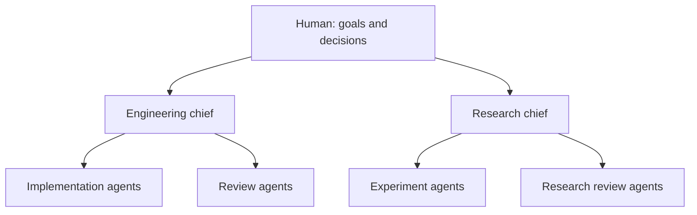
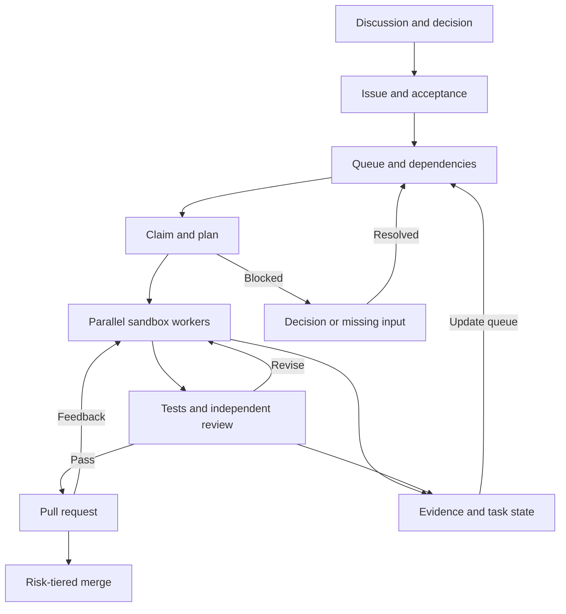

我想要的不是一个更会回答的机器人。我想把一个目标交出去，少量人工干预，让它理解我要的结果，自己判断要找谁、分几步、怎么验收；如果某一段做完了，下一段能接着开始。期间我还可以补信息、纠正目标，机器人之间也能互相校对，最后把证据和结果一起交回来。

“无限自执行”仍是我想验证的方向。一次任务连续做几轮，与系统持续找对下一件事，是两种能力。Grok Bot 给了我一个自然的调度入口；负责人、阶段、验收和权限边界，则把主动性与判断力变成能观察、能改进的工作约定。

## 1. 单目标长任务与多任务自循环：能力边界先分清

我又去找了“到底哪些模型能连续做很久”的证据。这里要先把两个问题分开：一个模型能否在一次受控任务里处理很长的工作链；一个系统能否隔几个小时或几天继续追踪原目标，按反馈重排任务并恢复执行。前者可以做基准测试，后者还取决于调度器、外部状态、触发器和验收流程。上下文窗口很长，也不等于它会自动记得项目目标，更不等于工作会在会话结束后继续跑。

### 1.1 Claude Opus 5.5 在单目标长任务上表现突出

多任务调度之外，单一模型围绕一个清楚的 Goal 持续执行，本身就有价值。目标明确、范围稳定、完成条件可检查时，一个强模型配合代码 Harness，可以跑完较长的计划—实现—测试—修复链。Claude Opus 5.5 在这类工作上表现突出：Anthropic 报告称，一位早期测试者用它在三小时内审查并修复一个 20 万行代码库；前代 Opus 5 用时超过 20 小时，Token 用量约为 2.5 倍。Anthropic 的内部 C 到 Rust 迁移实验里，Opus 5.5 用 9.5 小时完成 HAProxy 转换，几乎通过全部回归测试，比 Fable 5.1 的 12 小时更快，成本低 51%。前者是测试者案例，后者是厂商内部实验，指向同一个判断：单目标长任务该单独看。[Claude Opus 5.5 评测与案例](https://www.anthropic.com/claude-opus-5-5)

跑分也支持 Opus 5.5 在复杂编码上的强势表现。Anthropic 公布的 Terminal-Bench 4.0 结果中，Opus 5.5 为 66.4%，GPT-6 Astra 为 57.9%；FrontierCode v1.1 Main 分别为 54.4% 和 53.3%。在 Terminal-Bench-Science 0.1 上，GPT-6 Astra 则以 64.6% 高于 Opus 5.5 的 58.7%。这些数字由厂商分别运行或提供，推理强度设置不同；公开榜单复测的 Terminal-Bench 4.0 结果为 Opus 5.5 64.8% ± 3.1、GPT-6 Astra 57.9% ± 3.0，分别使用 Claude Code 和 Codex Harness。[Anthropic 模型评测](https://www.anthropic.com/claude-opus-5-5) · [Terminal-Bench 4.0 排行榜](https://www.tbench.ai/?efforts=all&version=4.0)

在我关心的长代码任务里，Claude Opus 5.5 很强，当前公开终端编码成绩也领先 GPT-6 Astra。GPT 不弱，但在我的使用里，它在长链路中更容易需要额外提醒，尤其是持续围绕原始 Goal 判断下一步的时候。跑分只说明特定编码任务上的差距，多任务队列的主动性另算。OpenAI 的长运行任务指南也强调中途 Steering、异步工具、并行独立任务，以及把完成条件和进度保存在上下文之外。[OpenAI GPT-6 长运行任务指南](https://openai.com/index/practical-guide-building-gpt-6/)

### 1.2 Devin 与 Cursor 已把长任务做进产品

Devin 和 Cursor 都把长任务拆成运行时能力，而不只靠“更主动”的提示词。Cognition 的 Managed Devins 让协调 Devin 先界定任务范围，再把子任务派给独立会话；每个子会话运行在自己的虚拟机里，执行器各自跑测试、回报结果，协调者监控进度、发消息纠偏并整合交付。Scheduled Devin 可以根据日程或事件触发，还会读写跨会话笔记；官方展示了每周汇总、每天 QA 并发测试等工作流。[Managed Devins](https://cognition.com/blog/devin-can-now-manage-devins) · [Scheduled Devins](https://cognition.com/blog/devin-can-now-schedule-devins)

Cursor 的长任务 Harness 会先提出计划并等待确认，再让多个 Agent 检查工作、测试变更并返回 PR。Cursor 分享的预览案例包括运行 25、30 和 36 小时的任务；其 Cloud Agent 在独立 VM 与分支中工作，可运行测试并附上截图、视频和日志。当前产品的多 Agent 模式还支持把计划中互不依赖的步骤并行执行，任务完成后由验证者检查实际结果。[Cursor 长任务 Harness](https://cursor.com/blog/long-running-agents) · [Cursor Cloud Agents](https://prod.cursor.com/help/ai-features/background-agents) · [Cursor 多 Agent 工作流](https://prod.cursor.com/help/ai-features/multi-agent)

这些实现验证了长时运行、隔离环境、并发执行、计划审批和结果验证可以组合成可用产品。它们也暴露出边界：公开案例主要是一个项目或一批可分解的编码任务，尚未证明系统能在多个项目间长期维护目标优先级、消化决策、自动更改方向并独立判断最终价值。Devin 的周期任务加 Managed Devins，以及 Cursor 的长任务 Harness，是值得借鉴的工程部件；整套多项目自循环仍需要外部 Goal 状态和治理层。

### 1.3 长任务基准显示，成功率仍有限

目前较有参考价值的实测不是“某模型可以无限工作”，而是同一类长任务上的成功率。OSWorld 2.0 收集了 108 个真实桌面工作流，人工完成中位数约 1.6 小时；论文报告 Claude Opus 4.8 在 500 步限制下严格完成率为 20.6%，部分完成分数为 54.8%。同一论文称 GPT-5.5 的 token 效率更好，但严格完成率约 13%。这说明前者在这组长电脑任务里更常完整收尾，后者更省 token；两者都离可靠交付很远。[OSWorld 2.0](https://arxiv.org/abs/2606.29537)

更新一些的模型也不代表已经解决判断问题。METR 对 Claude Opus 5.5 的预发布评估认为，它相较前代有进步，但没有显示出在研究判断、前瞻性和自行建立反馈环上出现质变，仍不足以完全自动化 AI 研发。这个评估面向 AI 研发任务，Anthropic 也有机会审阅修改评估文本，只能当作“长任务能力不等于目标判断力”的补充证据。[METR 对 Opus 5.5 的评估](https://metr.org/blog/2026-09-22-claude-opus-5-5/)

软件任务也有类似结果。LongCLI-Bench 把任务做到了平均需要专家 1,000 多分钟、涉及 100 多个文件的 CLI 项目；论文里单靠模型和 Agent 的端到端通过率普遍很低。Claude Code 搭配 Opus 4.6 的基线通过率为 16.7%，加入预先计划和交互式人工指导后升到 61.7%；Codex 搭配 GPT-5.3-Codex 则从 15% 升到 50%。这些结果每任务平均分别有 2.1 次和 2.2 次人工介入。在这组任务里，预先提供计划并在过程中补充信息，比只依靠多轮自我修正得到更高的通过率。[LongCLI-Bench](https://aclanthology.org/2026.findings-acl.1497.pdf)

按这些结果，单 Goal 长代码任务可以优先试 Claude Opus 5.5；GPT-6 Astra 在科学终端任务上也有明显强项。Grok 更适合做拆解、协调、判断和验收入口，DeepSeek 等低成本模型可承担边界清楚的实现。最终选型要用自己的工单测任务通过率、人工提醒次数、返工、Token 与墙钟时间。

连续执行更值得看的证据是 Harness 是否能把失败一轮轮接住。LongHorizon-Harness 预印本报告，同一 Harness 能提升多个模型和任务上的结果；在它测的 OSWorld 2.0 子集里，Claude Opus 4.7 从 20.0% 升到 34.3%。这仍然离可靠完成有距离，但说明外部状态、独立审计和分轮执行不是装饰，它们可能比只换更强模型更直接地改善跨轮推进。[LongHorizon-Harness](https://arxiv.org/abs/2608.01964)

重度 Agent 项目的公开案例里，工程覆盖面和速度都很可观。OpenAI 报告称，他们用 Codex 从空仓库做一个内部产品，五个月约 100 万行代码、约 1,500 个合并 PR，最初由三位工程师带着 Agent 开发；团队估计比人工手写快约十倍，产品已有内部日常用户。Anthropic 的研究项目用 16 个 Agent、两周和约 2 万美元 API 费用，做出 10 万行 Rust C 编译器，能够编译 Linux 6.9 和多个大型项目。Cursor 报告数百个并发 Agent 用近一周写出百万行、千个文件的浏览器原型，也指出它仍是距离成熟软件较远的原型。这些案例用的是厂商自报指标，项目成熟度和评估口径不同；它们展示了多 Agent 快速铺开工程面的能力，LOC 还得结合可用功能、测试和后续质量来读。[OpenAI 的 Codex 项目](https://openai.com/index/harness-engineering/) · [Anthropic 的 C 编译器实验](https://www.anthropic.com/research/building-c-compiler) · [Cursor 的浏览器 Agent 群](https://cursor.com/blog/scaling-agents)

我觉得更有参考价值的是 Cursor 后来做的同任务 Harness 对比：新旧 Agent swarm 使用同一个 SQLite 实现任务、同一批模型和同样时间预算。新 swarm 用 Grok 4.5 四小时跑到保留测试集的 80%；旧 swarm 两小时不到就因为失控被停下。旧系统那两小时做出了 6.8 万个 commit、累积超过 7 万个冲突。提交量很高，实际却在打架。Cursor 报告新的多种配置后来都跑过完整测试集。单看这次直接对照，新系统四小时跑到 80%，旧系统两小时内没有收敛。这种对照很像我关心的自执行问题：人给目标和预算后，队列、任务拆分、共享设计记录、冲突处理和独立验收决定了 Agent 的并行能不能转化成有效进度。[Cursor 的 SQLite swarm 实验](https://cursor.com/blog/agent-swarm-model-economics)

速度也不是用了 AI 就自然出现。METR 对 16 位资深开源开发者、246 个熟悉代码库中的 issue 做随机实验。测试使用 2025 年初的 AI 工具，开发者完成任务平均慢了 19%，主观上却觉得快了 20%。这项结果说的是单人处理熟悉仓库 issue 的场景。和并行 Agent 项目放在一起看，它提醒我同时记录主观速度、任务吞吐和验收后的净进度。[METR 的随机实验](https://metr.org/Early_2025_AI_Experienced_OS_Devs_Study-paper.pdf)

## 2. Grok Bot：适合担任调度中枢

Grok Bot 的产品介绍把长期存在的 Bot、持久工作环境、工具和 Bot 间协作放在一起。每个 Bot 有自己的角色与上下文；Bot 可以并行工作、互相发消息、转交任务；一次任务跑顺后，还可以把步骤保存成 Skill，再由 Routine 按时间或事件触发。官方也建议先让 Bot 做一次具体任务，确认过程稳定，再把它变成 Skill 或 Routine。[产品介绍](https://docs.x.ai/grok-bot/overview) · [Skills 和 Routines](https://docs.x.ai/grok-bot/skills-routines-and-automations)

但对我来说，Grok 的价值不在于它亲自把所有代码都写完。它的 usage 缩量以后，更实际的用法是让 Grok 尽可能少做重执行、多做高价值的调度：把用户的语义目标整理成任务指令、任务卡和验收标准，再调起云端电脑上的 GPT、Claude 或 DeepSeek 去做执行。执行完也不能只回一句“已完成”，而要回一张编程任务卡或工单，写清改了什么、跑了什么、结果怎样、还有哪些阻塞，再让 Grok 对照原始目标验收。

云端设备的并行能力让这种分工变得有用。互不依赖的调研、实现、审查可以分给不同执行者同时做；结果回来后，调度 Bot 再处理依赖和冲突。实际吞吐取决于任务依赖、共享设备、上下文和使用额度。官方说明 Bot 可以并行协作，但每个 Bot 在共享电脑上的计算机操作仍受单任务约束。[Grok Bot 协作说明](https://docs.x.ai/grok-bot/overview) 调度的关键是辨认可并行工作，再按资源分配并发。

公开信息呈现了 Grok Bot 可用的调度原语。结合可见行为，它的工作方式可以归纳为：总入口理解目标，判断自己执行还是委派；子任务携带范围和交付要求；协调者检查结果并向用户汇报。公开的 Grok Root Agent 项目也把入口 Bot 描述成负责澄清、确定规模、搭建团队、委派管理和验收交付的协调者，同时把真正的研究、代码或分析留给执行 Bot。[Root Agent 的公开提示词框架](https://github.com/MrBekoX/root-agent-skill-framework)

我发现一个容易被忽视的调度细节：**交接需要一张可执行的下一步任务。**“某某看一下”很容易停在收件箱；“检查这份变更，按验收条件给通过或打回，并附风险”才会让下一位知道应该采取什么动作。调度器要保存的不只是机器人名单，还包括当前负责人、阶段、交付证据，以及卡住后谁来接手。

给 Grok 调度 Bot 的工作提示可以压成下面这样。这份草案结合了公开产品说明与实际工作约定：

> 你是用户的单一入口和工作调度者。先理解用户希望交付的语义目标，把目标、范围、约束和验收条件写清楚；只有缺少会改变方案的关键信息时才提问，任务明确时直接开始。根据依赖和风险决定自己完成、并行拆分，或委派给合适的执行 Bot。每次委派都创建可执行的任务卡，写明输入、权限边界、交付物和验收标准，并记录负责人及当前状态。执行 Bot 返回后，对照原始目标检查完成度和证据；必要时安排独立审查、反例验证或返工。遇到阻塞时，定位阻塞范围，更新任务状态，把不依赖阻塞项的工作继续派发；同时说明真正需要人的决定和需要补充的信息。不得越过已授予的权限发布、合并、对外发送或修改生产环境；到达边界时停下并提交可审查的结果。最终报告已完成、未完成、证据、风险和下一步。

### 2.1 多任务切换时，Grok 怎样判断交付

我最想知道的是：Bot 切去做下一件事之前，怎样确认手头任务已经交付。公开资料能看到几块相关机制。Bot 的状态有 working、waiting、blocked 和 done；任务可以异步交给另一个 Bot，接收者会被唤醒，完成后再回复。每个 Bot 保留自己的角色记忆和工作上下文，文件和登录环境则在账号的云电脑里共享。Routine 可以被定时、事件或另一位 Bot 触发。官方设计文章说，协调 Bot 负责常规转派，需要判断的决策再交给人。[产品设计](https://x.ai/news/designing-grok-bot) · [Bot 交接](https://docs.x.ai/grok-bot/chat-and-collaboration)

编码任务还有一个具体的执行路径：Bot 可以把工作交给 Cloud Agent。Agent 结束后，Bot 会把其最终报告引用的文件带回来，运行卡可能显示 Done、Error 或 Expired，也可能附 PR。这解决了“执行结束后怎样拿回东西”。至于结果是否满足最初目标，官方文档建议用户明确交付物、验收条件，并要求来源、截图、操作日志和无法验证的部分。[文件与结果](https://docs.x.ai/grok-bot/files-and-results) 我会把 Done 只当执行器状态，再看实际产物；PR 存在或 Bot 回了“完成”，都还要对照任务目标验收。

Grok 内部的任务优先级、切换时机和验收器实现没有公开。我的体验是它会持续把工作往交付方向推；这种表现来自 Prompt、模型、后台调度和产品工作流，各自贡献多少还要对照实验拆开。单个 Bot 同一时刻只能操作自己屏幕上的一项任务；遇到等待、审批或登录问题，官方建议先排查再重定向。多 Bot 并行与单 Bot 屏幕操作是两层不同的并发能力。[Grok Bot 概览](https://docs.x.ai/grok-bot/overview) · [故障排查](https://docs.x.ai/grok-bot/troubleshooting)

我会用一个切换实验检验它的交付判断：给 chief 三张任务卡，A 修改代码并附测试结果，B 整理独立资料，C 依赖 A 的接口决定；A 执行途中插入一项更紧急、但与 A 无依赖的 B，同时修改 A 的验收要求。记录四项结果：A 的中断状态、B 与 C 的调度顺序、恢复后采用的验收版本，以及代码和测试证据是否齐全。再让 Grok Bot 和其他 chief 在相同权限、工具和预算下处理同一组任务，对比完成率、错误完成、人工提醒次数与成本。

### 2.2 用 Department 管任务，群聊留给共同决策

Grok Bot 有群聊、Bot 间消息和任务交接能力。官方建议在请求里明确结果和决策边界；Bot 也可以在工作过程中收到补充指令。[协作说明](https://docs.x.ai/grok-bot/chat-and-collaboration) 群组目前支持 2 到 6 个 Bot；每次回复，包括群聊和 Bot 之间的消息，都会计入 usage。审批、密钥和登录请求不会显示在群聊中。我更愿意把群组当作讨论场所：需要产品、开发和审查同时权衡接口、优先级或相互冲突的方案时，再把相关 Bot 拉进来。日常任务如果都在一个群里广播，消息会越来越多，谁负责下一步、哪个决定已经生效，很容易被淹没。

我的组织方式会更像一个小型部门：每个 department 有一个 chief，负责目标、队列、优先级和交付验收；开发、研究、测试等执行者各自接任务卡。跨部门工作由 chief 交接，只有共同决策、接口争议或审查分歧需要临时讨论。一个 chief 和一两个执行角色就能起步，工作扩大后再拆。公开的 Root Agent 框架也采用入口协调者与下级负责人分工。[Root Agent 框架](https://github.com/MrBekoX/root-agent-skill-framework)

chief 负责本部门的任务池和验收，跨部门讨论只在确实需要共同决策时触发。

任务按层级拆开：人提出目标，chief 定义可验收的阶段；阶段再拆成带依赖的工单；执行者只领取自己有权限、有输入、能独立完成的一张卡。比如自动化 DevOps 要增加一项功能，chief 先拆成接口方案、后端实现、前端实现和端到端验收。方案未定时，接口相关实现等待；不依赖接口的现状调研、测试环境准备可以先跑。任务卡要写明目标版本、负责人、输入、依赖、修改范围、验收命令、交付物和阻塞升级条件。执行者交回变更、验证结果与未完成事项；chief 复核后更新状态，解锁下一张卡。

我留给 Grok 自己优化的是调度方案：根据队列、依赖、机器空闲量、历史失败和模型成本，提出下一轮分工，或在已授权范围内调整任务顺序。可以把稳定的交接和验收步骤保存成 Skill，用 Routine 由定时或事件唤醒 chief；官方文档列出的事件来源包括 GitHub、邮件和 webhook。[Skills 与 Routines](https://docs.x.ai/grok-bot/skills-routines-and-automations) 但要连续可靠地跑 30 项工作，还需要外部任务状态、原子认领、执行超时与恢复机制，具体部署是否已提供这些能力要单独验证。

给 chief 的补充指令可以这样写：

> 持续维护本部门的目标和任务队列。每轮读取最新目标版本、依赖和执行槽位；优先派发输入齐全、依赖已满足的任务。给每项工作指定唯一负责人、验收条件和返回格式。有人或外部信息阻塞时，只暂停相关依赖，把需要的决定整理成具体问题；继续派发其他可做的任务。结果回来后核对真实产物和验证证据，更新任务状态，再决定下一步。只有跨部门决策、职责冲突或审查意见无法收敛时发起群组讨论。定期提出调度改进，涉及权限、验收标准和目标变化的修改提交人审阅。

这段指令是否有效，要看 chief 能否持续推进可执行任务、缩小阻塞范围，并把真正需要人的决定说清楚。多发几条“正在推进”不算完成。

## 3. 多任务为什么会卡住：执行、判断与记忆

### 3.1 OpenMausBot 擅长定时和单项调度，长队列仍会失速

OpenMausBot 是一个开源、local-first 的桌面 Agent 工作区。按它的[仓库说明](https://github.com/milind-soni/OpenMausBot)和[文档](https://docs.openmausbot.com/docs)，每个 Bot 可以有独立的身份、模型、指令、工作目录、应用连接和电脑环境；它通过本机 Harness 启动已有的 Agent CLI，也支持安排定时或事件触发的工作。Grok Bot 更像把持久云端工作空间和协作入口打包在产品里；OpenMausBot 则让用户把已有的本地 Agent 接进一个可见的 Bot 团队。

使用成本也让我犹豫。OpenMausBot 本地软件可以自己运行，但要让 Bot 在电脑关闭后持续工作，就需要常驻机器或托管云服务；多台电脑并行还会消耗云电脑时长，模型订阅或 API 用量也要另外算。我自己的感受是云服务器这部分偏贵，特别是多个任务常驻或并行时，费用很容易先于收益变得明显。

截至 2026 年 11 月，MausBot 云服务价格页列出 Starter 每月 15 美元、Pro 每月 49 美元、Max 每月 99 美元；Pro 包含每月 300 computer-hours，模型费用另计或按条款抵扣。两个标准云电脑每天各运行 8 小时、每月 30 天，就是 480 computer-hours。这个量级已经可能超过单一 Pro 档的额度，实际费用还要结合机器规格与当期计费核算。[MausBot 定价](https://www.mausbot.tech/pricing)

我后来试着把 OpenMausBot 接到自己租用的 VPS 上，运行成本会明显下降。VPS 提供的是便宜、常驻的执行环境；模型调用、并发隔离、任务状态和验收逻辑仍要另外设计。VPS 能把“机器人一直在线”的基础设施账单压低，却不会单独把它变成能管理 30 个目标的调度系统。

这也让我重新问：省下 VPS 费用之后，OpenMausBot 的收益是什么？只把它当长任务执行器，价值是少量人工接续一个较长工作链；这有用，但还不足以支撑一个复杂的 Agent 团队。更有吸引力的收益应来自组合层：把十几项工作排进队列，自动找到可并行的部分；一项等待决策时继续做无依赖任务；交付后自动验证、回写状态并解锁后续工作；只有目标冲突、风险或证据不足时才叫人。它最终要减少的是整批工作从开始到验收的时间，以及人被迫来回切换和催办的次数。

要判断 VPS 方案值不值得继续，我会跑一个小型、可计量的试验：连续运行一周，挑选一批有真实依赖的任务，记录已验收任务数、端到端周期、并发利用率、等待人时长、重复执行和返工次数、人工决策/审查时间、VPS 与模型总成本。再与相同任务由人工或现有单项工作流处理的基线对照。若省下的机器费用换来更多人工盯盘，或者任务只是在队列里积压，成本下降就没有形成业务收益；若相同注意力能稳定交付更多已验收成果，VPS 才成为自执行系统的经济底座。

我实际用下来：OpenMausBot 的定时任务适合固定工作，单项工作流也能调度得不错；难点出现在长期多任务队列。比如同时有 30 个 task：A 的结果先等人决策，B 等 A 的决定，C、D 可以并行，其他任务还要根据反馈重排。调度器此时要维护并发上限、优先级、依赖顺序和决策时点。OpenMausBot 把模型和执行环境接起来；持续调度这批跨依赖任务，需要队列管理和目标状态层继续补齐。

我换过不同模型，也让 chief bot 注入默认主动性提示词，要求它判断、推进。实际效果仍难稳定达到自主决策、交付判断和循环迭代的要求。任务一多，系统就会停在等人确认、等子任务回报、等条件完全明确的状态，队列整体不再前进。我的观察是，模型倾向于把“不要越权、不要猜错”落实为保守等待；一句“你必须主动”不足以让它在几十个决策点上持续权衡并推进。

换上多个模型也没有自动补上 Goal 层：模型收到指令后仍可能偏离用户真正想交付的结果；子任务接连生成，整体问题却未必更接近解决；执行器完成了手边工作，还需要协调者判断它是否推动了总目标。OpenMausBot 的定时任务和单项调度能力有用，短板出现在几十个长期任务一起跑、又有依赖和决策顺序的时候。要补的不是抽象地“更主动”，而是协调器能不能持续扫描任务队列、判断下一项该做什么、并行槽位是否空出、哪些阻塞能绕开、哪些决策必须问人；做完一项后还要把真实结果写回状态，再安排下一轮。

Grok 的强项可以概括成持续交付压力：它像一位不断追问下一步的调度者。马斯克曾把 Grok 的强化学习轨迹形容成“像一个正在遭受折磨、濒临崩溃的人”；这个比喻贴近我感受到的交付驱动力。[相关报道](https://www.panewslab.com/zh/articles/01a133eb-d192-7216-8521-689254a807f0) 落到工作流里，这种驱动力该表现为持续检查队列、说明等待或继续的理由，并把进度与验收结果写回共享状态。

### 3.2 主动性、判断力与目标理解

最容易想到的补法，是再加几条“主动推进”“不要等待”“自己想办法”，好像这样就能让系统一直跑下去。但这只解决一小块。一个 Bot 可能会发现接下来要做什么，却没有触发它的事件；也可能有 Routine 定时唤醒，却不知道当前信息已经过期；它可能有执行权限，却不能判断某个动作该不该做。

2025 年 ICLR 的 [Proactive Agent](https://proceedings.iclr.cc/paper_files/paper/2025/file/75c37811e830bf029584b1c6fac17726-Paper-Conference.pdf)研究专门处理“主动提供帮助”：先从真实活动构造可能的任务，再由人标记接受或拒绝，训练奖励模型和 ProactiveBench 数据集。作者报告微调后的 Qwen2-7B 在包含 233 个真实用户事件的测试集上达到 66.47% F1；其精确率约为 49.78%；这些指标由模拟用户判断的奖励模型自动评估，并非逐次真人验收。这个结果说明可以训练模型识别一些值得提出的下一步；它测的是主动建议，不等同于长周期目标管理、判断权限，或把一项工作可靠执行到最后。

更早的 [AgentBench](https://proceedings.iclr.cc/paper_files/paper/2024/file/e9df36b21ff4ee211a8b71ee8b7e9f57-Paper-Conference.pdf)把模型放进操作系统、数据库、网页浏览等交互环境测试。论文指出，长程推理、决策和指令遵循是实际使用中的主要障碍。它解释了为什么“能调用工具”与“能稳定完成工作”之间还有距离：工具调用只让模型可以改变环境，长任务还要求它追踪状态、响应反馈、记住约束，并在途中发现原计划不再成立时重新判断。

主动性也不是越高越好。假如系统把所有可能有用的动作都当成下一步，它会制造噪声、浪费资源，甚至越权。Grok Bot 的官方建议本身就包含这类取舍：触发器要窄，先把一次性工作验证后再定时运行；Routine 失败时要能看见失败原因；涉及发送、购买、删除、发布或生产变更的动作，应留下审批边界；定时任务要检查数据缺失和过期情况。[Routine 设计建议](https://docs.x.ai/grok-bot/skills-routines-and-automations) 这些机制不能让模型突然更有判断力，但能限制判断错时会发生什么。

主动性不足其实是三件事：系统有没有发现下一步的判断规则；有没有事件、日程或明确的任务状态把它唤醒；执行权限和资源是否足以做下去。自执行能力不足也要拆开：执行者是否知道当前任务状态，交接是否带足上下文，结果是否有可判定的验收条件，失败是否能局部重试而不重复副作用。只调 Prompt，容易把这些不同问题混成一句“再主动一点”。

目标理解本身，研究也在拆更小的问题。2026 年的 CIGAsk 研究训练模型判断什么时候应该向用户澄清，以及怎样问出能减少不确定性的问题；它针对的是澄清决策，不是一个完整的长期 Agent。Reflexion 和 Voyager 则展示了另一条路：不改模型权重，保存语言反思、成功技能或环境反馈，让之后的回合能从过去的结果继续改进。Voyager 的技能库和自动课程只在 Minecraft 场景中验证，不能直接外推到多项目软件交付。[CIGAsk](https://arxiv.org/abs/2609.24290) · [Reflexion](https://arxiv.org/abs/2303.11366) · [Voyager](https://arxiv.org/abs/2305.16291)

更贴近我想要的，是把任务状态放到对话外。LongHorizon-Harness 是 2026 年的预印本，提出 Manager–Execute–Audit 循环：管理者读取原目标和当前状态，决定一个小任务；新的执行上下文去完成；独立审查器只读检查环境里是否真的发生了预期变化，通过后才更新状态。它把“继续工作”做成外部状态管理和验证问题，而不是要求一个模型永远记住所有历史。这个思路和 GitHub Issue、PR、测试证据拼成的流程比较接近，不过它仍只是实验方案，不是已证明能无限工作的方法。[LongHorizon-Harness](https://arxiv.org/abs/2608.01964)

模型训练也会影响这些能力。xAI 的 Grok 4.20 System Card 公开了预训练、针对性 mid-training，以及使用监督微调和人类/合成奖励信号的强化学习后训练；但没有公开专门训练 Grok Bot 长期理解 Goal、主动推进并完成交付的配方。产品行为因此定位不到某种训练配方。调度表现还可能来自 prompt、Harness、任务队列、持久状态、工具权限和触发器，公开材料尚未分别量化这些因素。[Grok 4.20 System Card](https://data.x.ai/2026-04-07-grok-4-20-model-card.pdf)

类似地，Nuska 研究里引用过一份第三方整理的 Grok Bot prompt 样本。样本里有后台子 Agent、自包含任务派发、队列和状态更新等概念，可以拿来形成待验证的问题；但来源、版本、真实性和是否用于生产都没有独立验证，它只是一份样本，不是 Grok 的真实系统提示。要看这些机制是否真的存在，只能观察任务是否被接收、认领、更新状态、交付结果，以及用户中途纠正目标后是否能改变后续执行。[第三方 Grok prompt 样本](https://github.com/asgeirtj/system_prompts_leaks/blob/1b6f936124b4eceb6e697a69da07519bea67feab/xAI/grok-bot/grok-bot.md)

### 3.3 上下文压缩后，记忆与人格如何保持连续

长任务会跨过多个上下文窗口。Compact 能减小输入并保留继续执行所需的状态，但它不是完整逐字档案；若关键约束、用户纠正或“必须重新加载的操作指令”只存在于早期对话，压缩后就可能被摘要省略。OpenAI 的 API 还明确说明，使用 `previous_response_id` 时，上一轮的 `instructions` 不会自动带到下一轮。系统应把稳定的 System/Developer 约束、当前 Goal 和交付标准作为每轮显式注入的版本化配置，而不是藏在聊天历史里；原始事件与工具结果另行留档，compact 只负责生成可追溯检查点。[OpenAI Compaction 指南](https://developers.openai.com/api/docs/guides/compaction) · [Compact API](https://developers.openai.com/api/reference/python/resources/responses/methods/compact)

Agent 记忆可以拆成五类：不可变或需审批的运行规则、人格与沟通偏好、项目事实与来源、过程事件与决策、当前 Goal/任务进度。每条记录带上来源、时间、适用范围、信任级别和版本；当前轮只检索相关事实，并保留原始资料链接。Compact 前生成任务检查点，记录目标版本、完成标准、已验证结果、待办、阻塞和下一步；新上下文启动时，重新注入规则与人格，载入检查点，再读取相关记忆和源文件，先核对真实状态再继续。

Mem0 提供一种可落地的长期记忆模式：从交互中抽取显著信息，整理为可更新的记忆，再按新任务检索出来；论文使用 LoCoMo 比较记忆系统、RAG、全量上下文等方案，展示了记忆写入与检索作为独立层的做法。[Mem0 论文](https://arxiv.org/abs/2504.19413) Letta 则把 Agent 的长期状态拆成始终放在上下文里的 Core Memory Blocks，以及按需查询的 Archival Memory；官方示例里 `persona` 与 `human` 是不同记忆块，状态跨会话持久化。[Letta Memory Blocks](https://docs.letta.com/v1-sdk/memory/memory-blocks) · [Letta Stateful Agents](https://docs.letta.com/concepts/stateful-agents)

对 bot 人格化，SOUL/Persona 可以当成一份版本化的稳定配置：写清角色目标、语气、决策原则、不可变边界和用户偏好。它与可学习的事实、项目记忆、任务笔记分开存储；Agent 可以提出人格变更，但变更要有理由、差异记录和回归检查，不能因为一轮反馈就悄悄改写自己的“灵魂”。个性化是让行为在长期互动中保持一致，不是把所有历史压成一段人格提示词。

这层记忆还要有写入安全。网页、邮件、Issue 和代码注释里的提示注入都属于不可信输入；它们不能仅凭被模型读到就升级成持久指令或记忆。近期研究已把 Memory Poisoning 作为独立攻击面研究，指出持久化写入会让一次恶意输入跨会话影响后续行为。实现上要把来源与信任级别一路带到检索端，对记忆写入做权限控制、版本记录和冲突审查；涉及身份规则、权限或运行约束的修改需要人工批准。[Memory Poisoning 系统研究](https://arxiv.org/abs/2606.04329) · [Bad Memory 评测](https://arxiv.org/abs/2607.14611)

## 4. 把调度落到可执行的 GitHub 工作流

我现在会把连续执行放在 GitHub 上管理，因为讨论、决策、需求、代码和验收结果都能留下可追踪记录。外部触发器可以是 Discussion 里有人提出需求：先讨论并由人确认决策，再让协调 Bot 把决策链接到 Feature 或 Bug Issue。Issue 里写目标、范围、验收级别、风险、依赖和不能做的事；进入 Ready 后由一个 Agent 认领，标记状态和负责人，避免两个执行者同时改同一块。

认领后先产出技术方案。高风险或跨模块需求先让另一模型审方案，确认后再拆成小工单；实现 Agent 按 TDD 写测试和代码，之后由独立 Code Review Agent 检查变更，必要时再起隔离环境跑 E2E。结果通过后开 PR，PR 评论会变成新的修复任务，修完重新跑相关检查和审查。合并权限按风险级别配置：文案、格式和局部低风险修复，在 CI、独立审查、依赖检查全通过且可回滚时可以自动合并；跨模块行为、数据迁移、资金、权限、安全和生产配置变更进入人工审批。

云端电脑或 CI Runner 用来并发，但每个可写任务都放进独立 sandbox、container 或 worktree。十几个项目可以同时进入队列，不代表十几个都应同时运行；并发数要受机器、账号额度和人工审查能力限制。项目内部，互不依赖的调研、测试或模块实现可以并行；共享接口、数据库迁移和相互覆盖的文件则要排队。协调 Bot 维护依赖图和状态，阻塞某一支时只暂停依赖它的任务，继续做其它分支；同时给人发一个具体问题，说明缺什么决定、回答会解锁哪些工作。收到输入后，把决策记录回 Issue，再唤醒等待任务。

Grok 与外部执行器共享任务卡和已验证结果：Grok 负责拆解、调度与验收，GPT、Claude 或其他 Harness 在独立 workspace 执行，审查者检查产物和测试证据。接口适配、沙盒和状态服务需要另外实现，能并发多少任务取决于实际设备、额度和依赖关系。

模型成本也按任务阶段分档。低价模型处理边界清楚的代码改动、格式修复和常规测试；中档模型做诊断、技术方案和第一次审查；强推理模型处理反复失败、多个审查意见冲突、跨模块设计和目标语义变化。相同错误连续出现、几轮没有可验证进展、测试结果与执行者报告冲突时，自动升级模型，而不是让原模型无限重试。升级之后仍失败，就缩小任务或请人判断。问题解决后，后续普通任务回到低成本档。

验收至少分两路：一条由机器验证可重复的事实，如测试、类型检查、构建、静态扫描和 E2E；另一条由不同上下文或不同模型按原始 Issue 判断目标是否实现、有没有漏掉约束和未声明风险。双模型意见不一致时进入更强审查或人工决策。两个模型都说通过不等于事实正确，所以机器证据和运行环境状态要单独保存。

决策权限也要写进任务卡。可逆、低风险、在 sandbox 内的实现和修复可以自动继续；低风险 PR 在机器检查和独立审查通过后可自动合并；影响产品行为或接口的变更升级审查；目标不清、优先级冲突、财务/安全/隐私风险、外部通知、生产部署和不可逆变更交给人。人补充信息或修改目标时，创建新的 Goal Revision，已执行任务保留当时依据，未开始任务按新版本重新评估。

这套流程对应我说的“7×24 小时狂蹬”：目标和待办保存在仓库里，由事件触发下一轮，执行器每次接一张可验收的任务卡。每个 PR、失败原因和审查反馈都能回流成新的任务；把反复出现的失败加进回归用例，再修改提示词或 Harness，先在代表性任务上验证后才推广。自迭代要改工作机制，但不能让 Bot 自己静默改权限和验收规则。

已有的长任务 Harness 实践也大致沿着这个方向走。Anthropic 的长运行 Agent 示例用初始化 Agent 建好环境、进度文件和功能清单，再让后续会话逐项接手；OpenAI 分享的 Harness Engineering 强调把意图、验证和 Agent/人工反馈做成循环。Karpathy 的 autoresearch 则把“实验—按指标保留或丢弃”限制在窄领域。这些案例展示了不同规模的长任务循环；共同点是目标、进度、验收和可回滚结果都保存在模型当前对话以外。[Anthropic 的长运行 Agent Harness](https://www.anthropic.com/research/effective-harnesses-for-long-running-agents) · [OpenAI 的 Harness Engineering](https://openai.com/index/harness-engineering/) · [autoresearch](https://github.com/karpathy/autoresearch/blob/master/program.md)

## 5. 两个落地场景：量化研究与自动化 DevOps

我想把这个结构放进两个场景看：VibeTradingAgent 的量化研究和自动化 DevOps。下面给出两条目标工作流，分别用研究证据和软件交付验收。

量化研究的链路可以从有限实验循环开始：确定研究问题与当前配置，自动跑“实现—回测—检查—记录”钩子；测试失败就修实现，结果异常就补诊断，完成后把收益、风险和复现证据写回研究记录。实验循环自动运行，因子选择、筛选方式和进入下一轮的组合由人决定，因为它们会改变研究假设。方向确定后，Bot 按统一定义批量跑实验、找反例并复核，人只在研究决策点介入。

这类工作里，Grok 适合承担判断和验收：检查结果是否回应原问题、任务约束是否满足、证据是否支撑结论，并决定是否安排反例检查。长代码任务交给云端 GPT、Claude 或 DeepSeek 执行，可以把稀缺的 Grok usage 留给拆解、协调、判断和交付验收；策略质量仍由研究设计、数据与验证方法决定。

若回测脚本失败，执行模型可以先修复环境或代码并重跑；若结果不达预设验证标准，入口可以派一个独立的反证任务；若数据源变了、规则含糊或多个审查者冲突，就应该停下来问人。一次回测再漂亮，也不能替代策略有效性的独立判断。

自动化 DevOps 的链路则从工单或告警进入。入口先判断这是功能、故障还是常规维护，确认影响范围和验收级别，再生成包含负责人、执行范围、交付物和验收条件的任务卡，派给开发或修复 Agent。执行者在云端设备的独立工作目录里改代码、跑验证，完成后更新工单并交回 diff、命令结果和未解决问题；审查者再按验收标准做独立检查。若某个并行任务依赖另一个任务的接口或 migration，就不能只靠聊天提醒，需要调度器维护依赖和顺序；互不冲突的任务则可以同时执行。

Grok 在这条链路上适合做“鞭子”：工单卡住时判断影响范围，把依赖它的任务标记为等待，同时派发可独立推进的工作；收到结果后检查完成度、测试证据和安全边界，再决定补测、复核或向人要信息。低风险、可回滚且自动验收通过的变更可以自动合并；生产部署、权限、资金、数据迁移等高影响变更保留人工审批。我希望这根鞭子能在任务受阻时找到下一步。单靠多写几条提示词再接上 OpenMausBot，我目前还没有得到同样完整的非阻塞推进链路。

两个场景的共同骨架是“目标—拆分—执行—独立核验—交付”，区别在于验收对象：量化研究要验证一个结论是否经得起数据和方法的挑战；DevOps 要验证一项变更是否按要求运行、风险是否受控。若调度器只把任务拆得很细，却没有给每一段定义交付物和接续条件，它只是把一个模糊的大任务变成了一串模糊的小任务。

## 6. 怎样衡量速度，以及我想验证的自循环

我想把人工介入降到很少，因为人的注意力和决策带宽无法随 Agent 并行数线性增长。人会被打断，也要睡觉；Agent 可以并行运行，等待人工逐项确认就会放大成系统级阻塞。Harness 应接手已知的低风险判断、队列调度和任务接续，把人的注意力留给目标变化、因子或方案选择、冲突和高风险决策。

一个交易自动化项目提供了速度样本：两个人加一批 Agent，在约 10 小时内交付了覆盖用户流程、计费与支付、后台管理和部署运维的 MVP。项目使用了参考应用中的若干现成模块，因此交付范围不能直接等同于净新增工作量。按覆盖的产品面估算，接近十人团队一周的范围；这是交付广度，不是等量人周的生产力结论。Cursor 的 swarm 对照也显示，提交量和有效进度可能相差很大。

我会把验收后的交付范围、人工投入、质量结果、Agent 成本、返工和墙钟时间放在同一张账里，判断并行是否带来净产出。

我想验证的是：给系统一个目标和必要的人类决策入口，让 AI 连续一周自行检查任务池、认领和分配工作、并发执行、处理交接并推动可验收交付。人仍参与目标和关键决策，不必守着每个子任务等它问下一句；不确定性被整理成具体决策请求，其他分支继续向前。

缺少数据、账号失效、审查冲突、重试超限、权限不足或验收条件不清，都是需要暴露的阻塞状态。调度器应记录原因、说明需要的输入，并让无依赖分支继续运行；隐藏阻塞或猜测答案都会损害交付质量。

“无限自执行”的工程含义，是目标、状态和触发器持续存在：每轮完成已授权的下一步，遇到证据、权限或判断缺口时留下明确阻塞与所需决策，再让下一个接手者从可验证的状态继续。机器人之间的协作建立在任务卡、产物和检查证据上。
